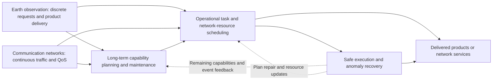

# 2 Constellation Service Requirements, Management Architectures, and Problem Formulation

## 2.1 Cross-classification of service scenarios and management problems

Constellation management can be understood in terms of application-specific services and the management functions that support them. Earth observation delivers target-related information products; a communication network provides user access and sustained traffic transport. Capability planning, scheduling, safe execution, and recovery apply across applications. Long-term maintenance and risk-response actions affect spacecraft states and therefore observation opportunities, product delivery, capacity, and continuity. Table 2 crosses the application and functional dimensions.

**Table 2. Service scenarios and management functions**

| Management problem | Earth-observation service | Communication service | Main section |
| --- | --- | --- | --- |
| Long-term capability configuration and maintenance | Coverage, constellation geometry, spares, replenishment, service facilities | Constellation and payload capacity, beams, gateways, asset redundancy | 3.1 |
| Service resource scheduling | Request selection, imaging, processing, transmission and delivery | User access, beams, spectrum/power, handovers, routing, congestion | 3.2, 3.3 |
| Safety execution and anomaly recovery | Safe maneuver, payload failure, plan repair and reacquisition | Safe maneuver, node/link derating, capacity and connection restoration | 3.4 and application subsections |
| Integration across management problems | Acquisition allocation affected by delivery paths and feedback | Interactions among access, routes, resource allocation and spacecraft states | 3.5 |

Solution architecture does not change a study's service object: distributed observation allocation remains a request-assignment problem, and hierarchical beam management remains a network-resource problem. Their difference primarily lies in information access and organization. Integrated management studies examine how delivery routes influence acquisition choice, how spacecraft availability limits service capacity, and how execution outcomes trigger revisions. An output resource, capability, or state of one decision thus becomes an input or constraint to another.

## 2.2 Management decision levels and time scales

Operations can be divided, by the type of decision, into capacity configuration, service scheduling, and execution/recovery. Configuration determines the future number, location, and capabilities of assets. Scheduling allocates tasks and network resources under current or predicted capacities. Execution and recovery implement physical and software actions and update availability following disturbances. Decision level and time scale are related but not equivalent: orbit maintenance can affect future coverage yet be triggered immediately by risk, and beam scheduling and observation planning can both use rolling horizons despite their different rates and commitment semantics.

Dependence between levels is conveyed through capability and occupancy states. A deployment plan specifies future availability; service plans specify activities and required resources; execution feedback provides actual completions, consumption, and faults. Joint optimization models multiple levels within one formulation, while hierarchical methods pass decisions or constraints between subproblems and local control revises actions in response to states. How strongly coupling affects service outcomes, together with joint computation overhead and information deadlines, determines whether these organizational choices are useful.

## 2.3 Centralized, hierarchical, and distributed information structures

Centralized architectures assemble missions and resources at a single coordinating decision maker, hierarchical architectures allocate responsibility by domain or function, and distributed architectures rely on local data and exchanges between members. The organization of information is independent of solution technique: mathematically decomposed problems may be solved centrally, while centrally trained policies may be executed in distributed fashion. Master and subproblem responsibilities, training-time access to shared states, and decision authority during execution must therefore be distinguished.

Physical connectivity, management topology, and task/network conflicts affect information exchange in different ways. Physical topology restricts where and when a message can travel. Management topology determines who is responsible for coordinating a decision. Conflict structure identifies decisions that constrain one another. Dynamic management-topology research [10](https://doi.org/10.34133/space.0248) updates management domains and members in response to orbital motion. Observation requests and satisfaction records can help avoid duplicate assignments, whereas resource occupancy and demand information support coordination of network interference and link competition. Consequently, the relevant information-sharing scope depends on the particular decisions being coupled.

## 2.4 State variables, resource constraints, and objectives

Earth-observation and communication constellations share orbit, energy, computing, and communication infrastructures, but their workloads and resources are expressed differently. Observation models accept target requests and candidate viewing windows; network models accept traffic demand and quality-of-service conditions. Attitude, storage, and downlink windows play prominent roles in observation, while interference, queue evolution, and link capacity constrain communication. Table 3 summarizes the principal modeling elements.

**Table 3. Modeling characteristics of the two principal constellation services**

| Dimension | Earth-observation scheduling | Communication network-resource management |
| --- | --- | --- |
| Workload | Targets, viewing windows, priority, quality, request validity | User/cell traffic, arrival rates, forecast demand, QoS |
| Decisions | Request acceptance, assigned satellite, acquisition time, processing and delivery | Access/handover, beams, spectrum/power, gateways, network path |
| Shared constraints | Attitude, energy, storage, compute, downlink contacts, ground facilities | Interference, beam/link capacity, power, queues, topology |
| Performance measures | Valid requests, value, revisit, timely delivery, computing time | Throughput, latency, interruptions, packet loss, fairness, energy efficiency, signaling cost |
| Uncertainty | New requests, cloud/quality, equipment faults | Demand forecast, link conditions, handover, congestion, faults |

A constraint establishes what activities are feasible; the objective specifies which outcomes are rewarded. Energy, interference, and orbit restrictions change feasibility. Changing the reward from an imaging action to a delivered and accepted product, or from assigned capacity to traffic satisfying quality constraints, changes the service-completion criterion. Thus the same label—“profit”, “reward”, or “task completion”—may indicate different outcomes. Inventory availability, safe execution, and sustained connectivity describe different operational states.

**Figure 1. Application–decision cross-classification of constellation management (review-author synthesis)**

*Caption: Both application scenarios require capability planning, scheduling, and recovery, but have distinct service objectives. Solid arrows represent classified decision dependencies; dashed arrows are feedback requiring verification in each application. The diagram does not describe an implemented commercial internal system.*

## 2.5 Problem size, method cost, and validation object

Scale is characterized jointly by spacecraft, tasks, access windows, links, and coupling. Even with the same number of satellites, window density, precedence, and cross-domain interference may lead to different search burdens. Computational and operational costs include state preparation, preprocessing, optimization, coordination messages, policy training, and the work necessary to activate revised plans. Inference time is only part of this total; decomposition, distribution, and learning alter different cost components.

Outputs also define what must be validated. A predictor provides an estimate whose service benefit depends on subsequent decisions. An optimizer delivers schedules feasible within its model. Coordination produces a mutually accepted allocation based on available messages; execution methods generate control trajectories or commands. Service APIs define commitment and completion states, whereas flight reports provide evidence of actions in specific events and platforms. Prediction accuracy, scheduling objective, message agreement, and physical safety address different stages, linked in a real operational process by resource updates and feedback.
