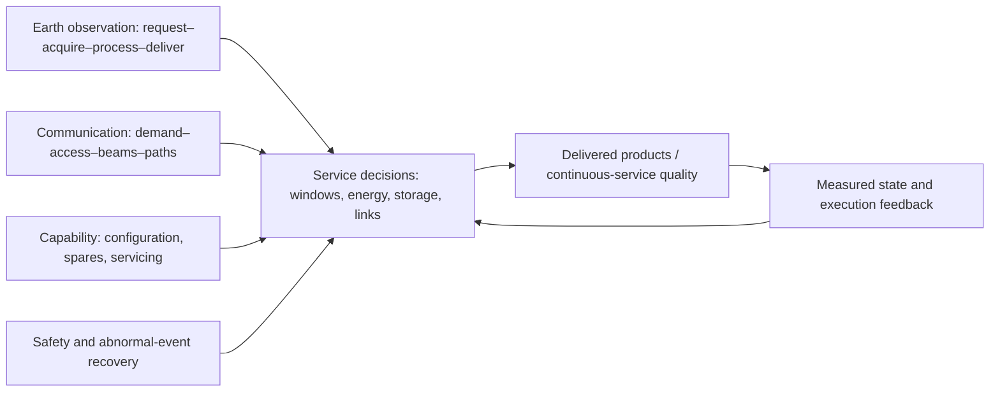
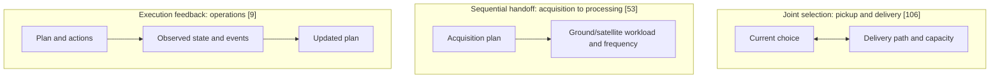

# Intelligent Management and Scheduling of Large Satellite Constellations: Application Scenarios, Technical Approaches, and Operational Practice

## Abstract

Sustained operation of large satellite constellations requires decisions under changing service demand, limited resources, and evolving spacecraft availability. This problem-driven narrative review cross-classifies application scenarios and management functions, examining the acquisition–processing–delivery chain of Earth observation and the forecasting–access–forwarding chain of communication networks together with capability planning, safety, recovery, and integrated operations. Representative studies are compared in terms of decision variables, resource and information assumptions, coordination mechanisms, and validation targets. Incremental replanning and neighborhood decomposition can reduce computational or communication costs under tested conditions without necessarily eliminating redundant observations or gaps in task satisfaction. Joint selection, sequential handoff, and execution-triggered feedback connect stages of an observation service in different ways. In communication networks, allocation benefits depend on traffic load and binding capacity constraints, whereas route persistence must be evaluated against link establishment costs. Measurements show service fluctuations even within connection windows with a single candidate serving satellite. Simulations, prototypes, operational interfaces, independent measurements, and flight demonstrations substantiate different claims. The review identifies shared mission-event scenarios, service-level results, and the cost and timeliness of coordination as essential elements for evaluating integrated constellation management.

**Keywords:** large satellite constellations; intelligent management; mission scheduling; satellite communication networks; resource allocation; autonomous operations

# 1 Introduction

## 1.1 Expanding services and persistent operational demand

Large constellations combine satellites distributed over multiple orbital planes with ground assets to provide observation and communication services. Scale increases the number of candidate assignments, time-window conflicts, changing resource states, and recovery decisions. Ben-Larbi and colleagues [1] describe how large distributed satellite systems affect operational organization, human intervention, and automation. The resulting management problem is not exhausted by producing one schedule: configuration, allocation, execution, and revision must be sustained over time.

Earth-observation and communication constellations differ in their service objectives. Observation requests specify targets, deadlines, priority, and quality; the useful output is often a processed product delivered by an agreed deadline rather than an image captured at any time. Communication networks carry traffic continuously, while orbital motion changes access candidates, link availability, gateway choices, and network paths. Throughput, latency, loss, interruptions, and fairness describe service quality. Some resource-allocation and coordination techniques transfer between the domains, but request satisfaction and continuous traffic delivery cannot be evaluated as interchangeable quantities.

Asset availability limits both services. Redundancy, deployment and constellation configuration determine future capabilities; failures, collision-avoidance maneuvers, and repairs change usable windows in the current plan. Space-logistics research [2] extends the set of possible recovery actions to servicing and replenishment. Operationally meaningful recovery requires following an asset from availability to the resumption of its intended service.

## 1.2 Existing reviews and the comparative contribution

Existing reviews organize particular domains in depth. Wang and colleagues [3] analyze agile Earth-observation scheduling formulations, constraints, and algorithms; Ferrari and colleagues [4] discuss observation, communication, and integrated activity scheduling in observation-oriented systems. Such downlink communication is not equivalent to a broadband constellation's continuous user traffic. Agent-based management [5], automation paradigms and tools [1,6], intelligent networking [7], and satellite-network resource control [8] address complementary perspectives. The coverage attributed to [7] and [8] is limited to their publicly accessible abstracts. The SatOps–NetOps review [9] specifically considers the coupling of spacecraft operations and network management.

**Table 1. Representative reviews and the additional comparative questions examined here**

| Representative review | Documented scope and organization | Comparative question pursued here |
| --- | --- | --- |
| Wang et al. [3] | Agile observation tasks, constraints, variants and scheduling methods | Which activity and delivery conditions define request completion? |
| Ferrari et al. [4] | Observation, communication windows and integrated imaging schedules | When is communication a downlink dependency, rather than an ongoing user service? |
| Agent-based management [5] | Agent organizations, coordination and mission management | What information and decision rights are actually distributed? |
| Automation reviews [1,6] | Operational paradigms, roles and software tools | How do plans connect to executable actions and monitored states? |
| Networking and resource reviews [7,8] | Traffic, topology, access, routing and network resource control, as far as accessible abstracts establish | How do load, link states and operational changes affect continuous service? |
| SatOps–NetOps review [9] | Organizational interaction and integrated management | Which variables are coordinated, and what did the tested prototype validate? |

The contribution of this review is a comparative analysis, not the assertion of a universal optimizer or the absence of related work in other surveys. First, the cross-classification of application scenario and management function preserves the different meanings of service completion in Earth observation and communication networks. Second, the literature is compared according to which downstream constraints enter a current joint decision, which outputs are handed forward sequentially, and which execution states trigger subsequent replanning. Third, computational and information costs are assessed alongside the actual verification target. This distinction prevents an improvement in a synthetic predictor or solver objective from being presented as verified flight performance.

## 1.3 Scope and method

This is a problem-driven narrative technical review rather than a systematic review. It combines earlier topical literature collection and citation tracing with representative recent studies and public engineering documentation. It does not claim an exhaustive reproducible database protocol, PRISMA screening, or pooled effect estimation. Earth observation and communication are the primary service contexts. Long-term configuration, maintenance, on-orbit servicing, safety, and recovery are included according to their management functions. Single-satellite, GEO, deep-space and general multiagent results provide technical examples only where their original task domains and assumptions remain explicit.

Here, 'large' refers to the operational burdens produced by many satellites, tasks, candidate windows, network links, and conflicting decisions rather than to a single numerical threshold. Intelligent management includes optimization, rules, prediction, learning and distributed decision methods, while autonomy depends on actual execution authority. Each study is read for objectives, resources, information, solution structure, metrics, and experimental setting. Cross-paper classifications and proposed directions are syntheses by the present review, not experimental results attributed to the cited authors.

# 2 Service requirements, management architecture, and modeling

## 2.1 Cross-classification of services and management functions

Management functions recur across services, even though the activities governed by those functions differ. Figure 1 illustrates this separation. Asset configuration changes feasible opportunities; business scheduling allocates them; safety and recovery alter what can be executed and when. Communication control and Earth-observation planning therefore occupy corresponding management layers without sharing identical completion criteria.

**Table 2. Cross-classification of service contexts and management functions**

| Management function | Earth-observation manifestation | Communication-network manifestation | Review section |
| --- | --- | --- | --- |
| Capability planning and maintenance | Coverage, orbital configuration, spares, replenishment and service facilities | Constellation and payload capacity, gateways and redundancy | 3.1 |
| Service-resource scheduling | Request selection, imaging sequence, onboard processing, downlink and delivery | Access, handover, beams, spectrum/power, routing and congestion | 3.2–3.3 |
| Safety and abnormal-event recovery | Maneuver constraints, task rescheduling and re-acquisition | Node or link degradation, avoidance actions and service restoration | 3.4 |
| Coupling across functions | Allocation depends on delivery paths and execution feedback | Capacity, control responsibilities and network states interact | 3.5 |

**Figure 1. Cross-classification of service scenarios and management functions (review synthesis).**

The arrows are conceptual decision inputs and feedback links. They do not imply that the cited studies have implemented one comprehensive joint optimizer.

## 2.2 Decision layers and timescales

Capability planning determines future assets and availability; service scheduling assigns observation or network resources under these conditions; execution and recovery carry out activities and update feasibility after disturbances. These levels need not correspond to rigid timescales. Orbit maintenance can change long-term coverage or respond to immediate risk, and both beam scheduling and observation plans can be receding-horizon decisions with very different resource commitments.

The output of one layer is often an input constraint for another. Deployment determines availability dates; schedules create resource commitments; telemetry and failures update resource states. Whether to couple layers jointly, pass outputs sequentially, or replan after feedback is a modeling and engineering decision involving additional computational and communication cost.

## 2.3 Centralized, hierarchical, and distributed information

Centralized managers aggregate states and requests; hierarchical arrangements divide responsibility among domains; distributed agents make local decisions based on their observations and exchanged messages. These are information and authority structures, not labels for solution methods. A mathematically decomposed optimization problem can still be solved centrally, and a jointly trained learning policy may be executed locally.

Physical communication topology, management responsibility, and conflicts among tasks are distinct structures. Reconfigurable management topologies [10] address changing control responsibilities as spacecraft move. Sharing completed requests can avoid repeated assignment; sharing future intended tasks can resolve simultaneous competition. Network load and spectral coordination require different state variables and message schedules.

## 2.4 Decision variables, resources, and objectives

**Table 3. Principal modeling differences between Earth observation and communication services**

| Dimension | Earth-observation task scheduling | Communication-resource management |
| --- | --- | --- |
| Workload | Target requests, visible windows, priority, quality and expiry | User/cell traffic, arrivals, predicted demand and QoS |
| Decisions | Task selection, executing satellite, pointing sequence, processing and delivery | Access, handover, beam illumination, power, spectrum, gateways and paths |
| Constraints | Attitude, energy, storage, computing, downlink windows and stations | Interference, beam/link capacity, power, queues and moving topology |
| Outputs | Valid requests, reward, revisit, delivery timeliness and solution time | Throughput, latency, interruptions, loss, fairness, energy and control overhead |
| Uncertainty | New requests, quality or cloud conditions, equipment failures | Demand forecasts, link changes, congestion, handover and failures |

Resources determine feasibility, while objectives determine the event counted as success. Counting a valid delivered product rather than an image taken changes the optimization objective; so does assessing traffic within service-quality limits rather than assigned nominal capacity. The same expression 'resource utilization' may therefore refer to unlike operational effects.

## 2.5 Scale, computational cost, and verification objects

Problem size is governed by candidate windows, tasks, links, resource conflicts, coupling density and update frequency as well as satellite count. Relevant costs include propagation and preprocessing, optimization, coordination messages, offline training, online inference, and the delay between producing and applying a new plan. A low inference time does not establish low total operating cost.

Predictors are validated against future states or demand; optimizers against model feasibility and objectives; distributed coordination against conflicts and message costs; controllers against safety and action conditions. Software prototypes, service interfaces, observations and flight events contribute further evidence. Results should be connected to the decision stage they actually measure before any service-level conclusion is made.

# 3 Principal technical approaches to constellation management and scheduling

## 3.1 Long-term capability planning and sustained operations

### Orbital configuration, deployment and reconfiguration

Selecting and rearranging constellation geometry trades coverage performance against maneuver and transition cost. Appel et al. [11] optimize transfer maneuvers for prescribed terminal configurations, Lee and Ho [12] allow target configuration and assignments to be chosen, and a multistage model [13] explicitly represents successive configurations and transitions. These approaches differ in whether demand and terminal states are fixed or decision-dependent; the multistage case uses stage requirements known in advance.

Deployment studies add accessibility and uncertainty. Repeating access patterns [14] support integer formulations; deployment under uncertain areas [15] uses demand scenarios. Gwon and Ahn [16] include parking time, J2-driven nodal drift, launch capacity and a deployment deadline in two-stage design. Their nodal accessibility is a design-level criterion, not a simulation of every launch trajectory and on-orbit insertion event. Coverage optimality and realizable deployment are thus separate evaluation dimensions.

### Spacecraft configuration, capacity, and gateways

For broadband constellations, geometric coverage does not guarantee sufficient service capacity in overloaded regions. Platform and constellation co-design [17] combines beam hopping, payload/antenna capabilities, orbital options and satellite count under specific demand and cost conditions. Its LEO/VLEO comparison should not be generalized beyond those design scenarios. Short-term beam, gateway and routing decisions interact with the capacity made available by long-term configuration.

### Spares, replenishment, and loss of capability

Random failures require decisions about where spares should be stored and when replenishment should occur. Multiechelon inventory work [18] combines terrestrial, parking-orbit and in-plane spares, including drift-induced replenishment delay. Its analytical inventory service level is evaluated through repeated stochastic simulations, but an assumed immediate in-plane replacement need not represent the physical time required to restore an actual service. Two-channel supply systems [19], Markov models of inventory states [20], and direct/indirect replenishment extensions [21] refine transport and inventory behavior. Steady-state availability and recovery after one specific failure are distinct quantities.

Iridium's deployment of spare spacecraft [22] confirms that redundancy is a real operational practice; it does not by itself establish a quantified post-failure restoration time. Models incorporating on-orbit servicing [23] permit repair as an alternative to replacement, with outcomes dependent on repairable failures, service pricing and access. The reported maintenance savings are conditional on the study's scenarios, not a universal annual reduction.

### Servicing facilities and uncertain requirements

Servicing capacity is also shaped by where depots and service vehicles are located. Discrete depot location and client allocation [24] and continuous-orbit depot optimization [25] involve different design spaces and transfer-cost models. Vehicle predeployment [26] is evaluated by client accessibility; rolling-horizon service/logistics coordination [27] responds to uncertain demand; high/low-thrust planning [28] and lifecycle uncertainty analysis [29] further distinguish transfer modeling and uncertainty classes. These works represent different segments between invested resources and the time at which service capability can actually be used.

## 3.2 Earth-observation and on-orbit servicing mission scheduling

Observation and servicing both select and order activities, but observation opportunities arise from visibility, pointing and data resources, whereas servicing opportunities are conditioned by transfers, propellant, mass and replenishment. Their shared combinatorial structure should not conceal their different physical feasibility models.

### Task selection, allocation and activity sequence

Agile-imaging scheduling combines time windows with retargeting and attitude maneuvers. Earlier algorithm comparisons [30] examine greedy, dynamic and constraint programming, and local search. Learning-based sequencing and constructive timing [31] and decomposition-assisted multiobjective methods [32] distribute work across different search stages. Branch-and-price scheduling [33] models shared and dedicated observation requests with battery constraints, uses structured decomposition and pricing, and retains a mathematical bound within the formulated model.

Distributed task allocation raises the issue of which task states are shared. In the study by Parjan and Chien [34], 100 satellite agents and 634 targets support comparisons of centralized, broadcast and highly decentralized strategies; incremental updates save processing time but can increase duplicate imaging under the tested conflict and capacity assumptions. Geometric neighborhood decomposition [35] uses task conflict structure to restrict local coordination, and its 200- and 108-satellite, 24-hour simulations consider storage, downlink, computation and messaging. These studies identify different tradeoffs rather than establishing that one distributed architecture is always faster.

When requests belong to different actors, preserving local task information can be important. Distributed constraint optimization with separate request owners [36] and consensus-based bundle auctions [37] offer different bidding and conflict-resolution mechanisms. Predicted communication opportunities [38], delayed communication planning [39], contract-net and blackboard scheduling [40], and generic asynchronous assignment under delayed or lost messages [41] show why information content and arrival time should be evaluated separately from link connectivity alone.

### Coordinating acquisition, processing, downlink and delivery

An acquired image is not necessarily a completed service. Integrated imaging and downlink optimization [42,44] introduces subsequent transmission opportunities into observation choices, while energy-aware joint observation, transmission and charging [43] further constrains feasible sequences. Heterogeneous cueing and fine observation [45] incorporate precedence between observation stages. These studies jointly select different activity combinations, so their reported outcomes refer to different completion points.

Shared ground resources add another scheduling layer. Single-satellite multistation scheduling [46], Air Force network allocation [47], downlink case studies [48], deep-space antenna scheduling [49], and tracking-pass generation and repair [50] address contact windows and station conflicts under different mission domains. Public commercial interfaces illustrate operational semantics: Planet Tasking [51] distinguishes acquisition, quality assessment and delivery, while AWS Ground Station [52] records configuration snapshots for committed contacts and may require cancellation and rebooking for changes.

Satellite edge intelligence adds compute placement, processing frequency and energy consumption. The available author version of [53] first selects acquisitions using time, attitude, quality and energy constraints; it then passes the resulting load and downlink timing to a downstream optimization of processing allocation between edge satellites and ground stations and of processing frequencies. Its fixed distribution–processing–collection pipeline and stable intersatellite-link assumption do not establish a freely reoptimized network route or downstream feedback into the acquisition decision. Offloading and inference allocation [54–56], orbital-aware processing [57], and the Kodan runtime selection approach [58] represent different compute-versus-communication tradeoffs.

### Dynamic requests and uncertainty

New requests and failures change task feasibility while a constellation is operating. Hierarchical mixed-integer scheduling [59] combines allocation and sequence repair; complementary rolling and dynamic planning [60–62] address online information and resource modifications in their own task settings. Learning-guided large-neighborhood search [63] generates an initial solution and subsequently improves it with destroy-and-repair steps, whereas rolling-horizon multiagent learning [64] changes how policies are trained and executed. Communication-aware contract-net and bundle methods [38,40] instead focus on the messages needed for coordination.

Single-satellite policy reuse [65] simplifies training by applying a common policy across a constellation, but sharing only the status of already imaged or downlinked targets leaves the possibility of simultaneous duplicate selection. Comparisons of PPO, A2C, DQN, tree-search training and genetic algorithms [66] reveal different training and search costs under the original Basilisk-based single-satellite tasks. An improvement in policy training does not automatically establish effective cross-satellite conflict handling.

### Servicing visits, orbital transfers and replenishment

Visits to multiple moving clients change propulsion demand with order and departure time. Time-dependent refuelable servicing models [67], robust GEO refueling [68], multiservicer assignments [69], and joint refueling and debris-removal planning [70] address resource replenishment, sequence, and uncertainty in different formulations. Low-thrust multiclient studies [71,72] use precomputed transfer cost grids and interpolation to support combinatorial route selection. Their modeled perturbations, mass histories and phase treatment define the limits of applying those costs to actual rendezvous operations.

**Table 4. Representative observation and servicing studies: decision scope and comparison conditions**

| Study | Decisions/resources | Information | Method and update | Validation | Main boundary |
| --- | --- | --- | --- | --- | --- |
| Branch-and-price [33] | Shared/dedicated tasks, battery | Unified task model | Decomposition and pricing | Nanosatellite simulation | Bound within its discrete model |
| Hierarchical MILP [59] | Assignment, order, dynamic tasks | Shared conflicts | Lagrangian assignment and sequence repair | Up to 1,000 satellites; 50–6,000 tasks | Depends on task structure |
| Decentralized allocation [34] | Requests, simplified capacity | Broadcast/local completion or competition states | Shared rules, incremental revision | 100 agents, 634 targets | Reduced computation versus duplicate selection |
| Geometric neighborhoods [35] | Imaging, storage, downlink | Common tasks, local capacity, neighbors | GND/NSS | 200/108 satellites; 24 hours | Fewer messages with satisfaction tradeoff |
| Joint imaging/transmission [42] | Acquisition and downlink windows | Global windows | Integer formulation and heuristics | Agile-constellation simulation | Delivery opportunities change selection |
| Energy-aware coordination [43] | Imaging, downlink, charging | Shared resources | Multi-knapsack and search | Multisatellite simulation | Charging changes feasibility |
| Sequential processing [53] | Acquisitions, satellite/ground workload and frequencies | Upstream plan to downstream stages | Acquisition selection, then processing optimization | Vessel detection/compute tests in author version | Sequential input, not full upstream–downstream feedback |
| Communication-aware bundles [38] | Emergency tasks and messages | Predicted contacts | Synchronous/asynchronous auctions | Distributed simulation | Rewards versus message overhead |
| Learning-guided LNS [63] | Dynamic emergency tasks | Subproblem state | Initial policy plus rolling repair | Large-scale dynamic simulation | Search produces final plan |
| Reused single-satellite policy [65] | Observation and downlink | Completed task states only | Train once, distribute policy | Walker-constellation simulation | Simultaneous duplication possible |
| Learning algorithm comparison [66] | Single-satellite actions | Local state and masks | PPO/A2C/DQN/MCTS variants | Basilisk task simulations | Quality versus training time |
| Multiorbit servicing [67] | Visits, fuel, replenishment | Time-dependent client network | MILP | Multiorbit examples | Transfer model dependent |
| Robust refueling [68] | Visits, service duration | Bounded uncertainty | Robust planning and search | GEO refueling | Conservatism depends on uncertainty budget |
| Low-thrust servicing [71] | Route, mass, transfers | Time- and mass-indexed costs | Precompute/interpolate then search | LEO multiclient simulation | Phase effects evaluated separately |

The table distinguishes available resource information from the physical location of a solver. Reported scales and performance belong to each study's own task and simulation conditions.

## 3.3 Communication constellation network and resource management

Unlike intermittent observation requests, communication traffic continuously competes for coverage, spectrum, power, links and queue capacity. Satellite motion changes who can provide service and which paths are viable. Forecasting demand, illuminating cells, selecting access points, and routing packets thus refer to different decision stages.

### Traffic forecasting, beam hopping, power and spectrum

Traffic nonuniformity motivates beam hopping and load-dependent power allocation. Han and colleagues [73] predict synthetic self-similar traffic generated from ON/OFF processes using EMD, ARIMA and an optimized neural network. Their validation concerns forecast error and runtime; improved throughput or operational routing was not tested as an achieved downstream outcome.

A single-satellite beam-hopping author version [74] uses a potential game to select beams under an average-power condition and subsequently optimizes continuous power while current illumination choices are fixed. Its scenario has eight beams and 61 candidate positions; G-BH and G-BHPO employ the same greedy beam-selection rule but differ in power assignment. Queue evolution may nevertheless generate different later beam sequences, so the comparison is neither a guaranteed fixed full-horizon beam-sequence ablation nor proof of global joint optimality.

Multisatellite illumination introduces cell association, load differences and interference. The public abstract of [75] describes sequential association and illumination decisions, load balancing across satellites, and coexistence constraints with GSO systems. The precise intra-constellation interference formulation has not been checked against the full text. In contrast, the author manuscript of [76] specifies 12 satellites, four beams each and 168 cells, using demand/queue information and digital-twin-assisted multiagent control. In the illustrated load range of 8–20 Gbit/s, the FPA and DPA approaches have similar throughput; above 20 Gbit/s, DPA performs better in that scenario. The schemes also differ in decision organization, so the comparison cannot isolate one power component causally.

### Access, handover and continuity

Instantaneous signal strength and elevation need not yield the best end-to-end service when network paths, congestion and handover overhead matter. The publicly readable abstract of [77] combines end-to-end propagation delay estimates, Dueling Double DQN for single-layer decisions, and delay-jitter prediction and switching overhead for cross-layer handovers. It supports the description of an integrated approach, not an independently validated contribution from each submodule.

Independent Starlink measurements [78] show performance changes near 15-second reconfiguration boundaries. Restricted-view experiments also observe fluctuations during windows with only one candidate serving satellite. Therefore satellite handover is not a necessary cause of every observed fluctuation; a specific internal periodic scheduler remains an interpretation offered by the original authors rather than a directly observed proprietary rule.

### Dynamic topology, intersatellite paths and recovery

Ground-assisted LEO networks without direct intersatellite forwarding differ from laser-ISL networks. Hierarchical routing [79] is designed to trade path delay against update stability in a ground-assisted setting. Segmented routing [80] addresses traffic engineering and failure recovery under ground-relay assumptions. Without verified model text, traffic engineering must not be relabeled optimization of physical link capacity, and intended reductions in update burden must not be reported as independently confirmed results.

For dynamic laser ISLs, the accessible author manuscript of [121] evaluates routing with the time needed to establish new links. It uses 1,584 satellites and 600 one-second snapshots, with paths precomputed and distributed by a controller, uniform establishment delays, and queueing and initial configuration times omitted. Route persistence or awareness of active links can help when establishment costs are significant; at very low costs, some persistence policies slightly increase average delay compared with instantaneous shortest paths. The conclusion does not apply to all activity-aware variants, and offline computation is not proof of onboard deadline compliance.

### Hierarchical control and resource responsibility

Centralized coordination can share global frequency and service-region information while local stations assign beams and user resources. The formal archived version of [81] defines network control, regional control, station and terminal roles with demand/price information exchange. Its tests evaluate particular spectrum, user scheduling and beam components under different loads. Those component-level results should not be added together as one full-system gain. Similarly, controller-precomputed paths in [121] presuppose that globally determined route information becomes available before data-plane decisions.

**Table 5. Communication studies: coordinated objects and critical conditions**

| Study | Coordinated/estimated object | Conditions actually available for review | Interpretable contribution or tradeoff |
| --- | --- | --- | --- |
| Traffic prediction [73] | Future demand | ON/OFF synthetic self-similar traffic | Forecast output; routing/service gains untested |
| Beam and power [74] | Illumination and continuous power | Author version, 1 satellite, 8 beams, 61 positions | Same greedy rule; power changes supply–demand matching |
| NGSO–GSO coexistence [75] | Association and illumination pattern | Load balancing and GSO interference in abstract | No verified intra-constellation interference equation |
| Demand-aware allocation [76] | Multisatellite beams, power and queues | Author version, 12 satellites and 168 cells | Load-dependent whole-strategy comparison |
| Routing-aware handover [77] | Access and cross-layer switching | Delay prediction, learning and jitter from abstract | Module-specific causal benefits not established |
| Independent measurement [78] | User latency and throughput | Multiple countries and controlled terminals | Fluctuations even with one candidate serving satellite |
| Hierarchical routing [79] | Path stability and updates | Ground-assisted, no direct ISL | Design tradeoff; full cost/results not rechecked |
| Segment routing [80] | Traffic engineering and failure rerouting | Ground relay; abstract-level mechanism | Not verified as physical capacity optimization |
| Dynamic laser routing [121] | Path and laser-link activity | Author version; 1,584 satellites; uniform establishment delay | Update/persistence benefit conditional on link cost |
| Hierarchical resources [81] | Global spectrum and local scheduling | Formal archived paper; configuration and price exchange | Management responsibilities and information scope |

## 3.4 Safe execution, anomalous conditions and service resilience

A feasible discrete schedule does not guarantee safe motion or successful execution. Collision-risk screening, constrained trajectory planning, anomaly response and schedule repair solve different tasks and produce different outputs.

### Conjunction screening and risk information

Approximation-based closest-approach computation [82] reduces the cost of evaluating candidate events under selected polynomial and error-control conditions. Risk-aware sensor scheduling [83] uses information value and collision risk to allocate tracking resources. Pair screening and CUDA-supported conjunction methods [84] reduce potential evaluations but must be assessed jointly for time and missed events; one sieve variant in the tested setting omitted some events. These methods change different components of the overall cost.

Collision-avoidance operations studies [85], maneuver-design reviews [86], and risk-prediction experiments [87] address operational responsibility, trajectory decisions and forecast information respectively. The CCSDS Conjunction Data Message standard [88] defines an information interface, while Starlink's public avoidance concept [89] describes repeated screening, onboard reassessment, and amendment or cancellation of maneuvers. A change in risk state can therefore change an already planned action.

### Safety-constrained motion and control

Passive safety [90], convex trajectory design [91] and distributed model-predictive control [92] incorporate different geometrical and dynamical requirements into motion planning. Chance-constrained rendezvous with Gaussian disturbances [93] and vision-aided noncooperative rendezvous [94] extend nominal constraints to model uncertainty; their guarantees depend on their particular relative-motion, sensing and disturbance assumptions. Continuous-time sequential convexification [95] examines passive safety in a different orbital setting and is not immediately equivalent to a LEO constellation control model.

Inspection-route comparisons [96] contrast safety-shielded closed-loop learning with sampling-based roadmaps and mixed-integer planning. The roadmap can offer favorable fuel/time outcomes at a higher offline computation cost in the reported simulation, whereas a learned policy can generate actions with less online processing. The distinction is between computational timing, feasibility and task quality rather than a universal algorithm ranking. The ADRAS-J event [97], in which an unexpected relative-state condition triggered an abort and retreat during a close approach, shows that safe termination and nominal mission completion are different operational outcomes.

### Detection, diagnosis and schedule repair

Telemetry anomaly detection using predictive networks [98], uncertainty-aware Bayesian variants [99], and verified continual-learning methods [100] yields signals about possible abnormal behavior; evaluation methodology [101] shows that metric and preprocessing choices affect reported detection quality. Rule-based fault diagnosis and recovery [102] maps identified conditions to actions but remains bounded by the rules and hardware actually tested. Schedule Manager [103] applies activity admission and predefined contingency plans in software tests, whereas resource-aware plan repair [104] changes subsequent activities after mission disturbances. A detector's accuracy, recovery response, and restoration of delivered service are separate claims.

**Table 6. Safety and abnormal-event studies: direct output and validation object**

| Study | Direct output | Connection to management | Validation boundary |
| --- | --- | --- | --- |
| Conjunction screening/CUDA [84] | Candidate events | Screening to precise assessment | Tested catalogs, computation and missed events |
| Chance-constrained control [93] | Control and predicted trajectory | Uncertain state to trajectory constraint | Relative dynamics and disturbance distribution |
| Shielded RL versus roadmap [96] | Inspection actions/routes | Safety and execution | Common simulated task; online/offline cost distinction |
| Rule-based FDIR [102] | Diagnosed fault and response | State facts to operations | Ground prototype, rule coverage and representative hardware |
| Schedule Manager [103] | Accepted activities and contingencies | Failure to plan switching | Software and development-board tests |
| Resource-aware repair [104] | Updated/repaired plan | Diagnosis to future schedule | Original deep-space task context |

## 3.5 Coupled functions and integrated operations

Operations combine task dependencies, resource availability, and changing execution states. Automation and trusted-autonomy reviews [6,105] address how management functions are organized; specific scheduling models reveal whether these functions actually share decision variables, exchange solutions sequentially, or revise plans in response to events.

### Allocation and delivery paths

The contact-graph pickup-and-delivery approach [106] searches for a spacecraft, pickup opportunity and delivery path when a request arrives. It accounts for reserved contact capacities, but assumes unlimited storage and energy and chooses requests sequentially rather than globally optimizing all requests at once. In its 16-spacecraft simulation, some routing versions deliver more nominal requests while increasing mean delay among successfully delivered requests; the population contributing to that mean also changes. Contact failures can favor different routing methods. These are model-specific, linked delivery and reliability outcomes.

The acquisition/processing author version [53] represents a different form of coupling: the acquisition plan is handed to downstream satellite/ground computing and frequency allocation. Computing offload and distributed inference studies [54–56] extend related resource choices without proving that the acquisition plan is jointly reoptimized in all cases.

### Asset state and network reconfiguration

Inventory, servicing and propulsion decisions [23,27,28] and network capacity design [17] determine different kinds of future availability. Their common interface can be expressed as where, when and how much service capability exists, but these studies do not themselves constitute one integrated multistage model.

The SatOps–NetOps framework [9] distinguishes three interaction modes—integrated, coordinated and adaptive—and describes four scenario architectures. Its tested integrated prototype uses 16 simulated spacecraft and a semi-manual best-effort reference. The experiments cannot rank all three interaction modes against one another in the same scenario. Hierarchical network resources [81] and operational avoidance feedback [89] further illustrate different management responsibilities and state updates.

### State-driven choices and executable feedback

Rule-based observation scheduling [107] studies one agile satellite. It predicts constraint-related observation, storage and energy states from a scheduling model, chooses an observation-, transmission- or energy-priority strategy with reasoning rules, and compares heuristic and metaheuristic approaches in single-satellite simulation cases. This is neither a demonstrated neural-network state predictor nor an operational multisatellite autonomy system.

A reference architecture [112] describes monitoring, analysis, planning, execution and shared knowledge (MAPE-K); the publicly accessible abstract also references expert evaluation and NIMBUS instantiation. The architecture is not evidence of demonstrated large-constellation routing performance or deployed autonomous decision deadlines. Flight and implementation sources have different coverage: Remote Agent [108], EO-1 [109], IPEX [110,111], Schedule Manager [103], cFS [113], NASA Starling [114] and Starling 1.5 [115] represent different single-spacecraft functions, four-satellite observation coordination and bounded interoperator maneuver events. Basilisk [116] and formal-methods work [117] provide supporting simulation and specification tools; generic asynchronous coordination [118], supervised reconfiguration [119] and model checking [120] test still other properties.

**Table 7. Mechanisms connecting different operational decisions**

| Mechanism | Representative evidence | Shared states or variables | What is actually established |
| --- | --- | --- | --- |
| Joint selection | Contact-graph pickup and delivery [106] | Executing spacecraft, pickup/delivery paths and contact capacity | Per-request search and discrete-event simulation |
| Sequential handoff | Observation–processing [53] | Acquired workload, downlink timing, computing power | Upstream plan passed to downstream satellite/ground optimization in author manuscript |
| Integrated planning/interaction | SatOps–NetOps [9] | Tasks, assets, network needs and actions | One integrated prototype tested, not a comparison of all interaction modes |
| State-driven strategy | Reasoning-based AEOS scheduling [107] | Model-predicted observation, storage and power states | Rules select strategy in single-satellite simulation |
| Operational feedback | IPEX/Starling/Starling 1.5 [111,114,115] | Resource, measurement and risk/authority states | Different bounded flight tasks and events |
| Architecture | Reference autonomy design and cFS [112,113] | MAPE-K responsibilities and software interface concepts | Abstract-supported architecture categorization; no asserted constellation-scale validation |

**Figure 2. Joint selection, sequential handoff and feedback-driven replanning (review synthesis).**

Joint selection allows a downstream constraint to change the present choice; sequential handoff fixes an upstream result before downstream optimization; feedback revises subsequent actions after observing execution. The examples and their evidence levels are not interchangeable.

# 4 Comparative assessment and research directions

## 4.1 Solvers, coordination and scalability

The expense of a large constellation problem arises from assignment candidates, resource conflicts, information exchange and plan revision. Structured mathematical decomposition can exploit mixed-integer model structure and sometimes preserve bounds, as in branch-and-price [33] or discrete beam/continuous-power stages [74]. It also introduces subproblem solving and coordination work that depend on the chosen model.

Receding-horizon repair and neighborhood decomposition can save computation, but the corresponding reported tests retain duplicates or task-satisfaction gaps [34,35]. Ground-assisted stable routing [79] seeks to avoid unnecessary updates without a fully rechecked quantified advantage; laser-route persistence [121] can reduce or increase delay depending on establishment costs. Direct comparison of solution times across different satellites, mission windows and task loads would therefore be misleading.

**Table 8. Main technical mechanisms and their relevant costs**

| Mechanism | Decision stage changed | Direct benefit sought | Cost or applicability boundary |
| --- | --- | --- | --- |
| Mathematical programming and decomposition | Variable representation and pricing/subproblems | Exploit structure, sometimes maintain bounds | Discrete model, pricing cost and constraints |
| Hierarchical planning and local repair | Global assignment and local sequences | Smaller updates, preserved commitments | Layer consistency, remaining duplicates or omissions |
| Distributed coordination | Information and conflict resolution | Local response, reduced central aggregation | Message access, stale states and conflict density |
| Forecasting and learning-aided search | Demand estimates, initial solutions | Better estimates or search guidance | Forecast/training cost and later repair |
| Learned policy with safety checks | Online actions and constraints | Fast conditional response | Training domain, masks, fallback and safety model |
| Joint multiresource decisions | Tasks, links, energy, paths and actions | Include downstream bottlenecks in current choice | Larger model and information/compute burden |

## 4.2 From local decisions to delivered service

Different studies couple activities at different points in the service chain. Joint imaging/downlink [42] and energy-aware planning [43] bring later feasibility into acquisition selection, while [53] passes a completed acquisition plan to downstream computing and [106] selects pickup and delivery paths per request. Calling all four 'joint scheduling' without identifying the common decision variables would conceal their distinctions.

In communication networks, power follows beam choice in [74]; association and GSO coexistence constrain [75]; demand and queue states influence [76]; estimated network delay enters handover [77]; ground-relay segment routing [80] concerns traffic engineering and recovery; link activity makes route changes costly in [121]. The precise intra-constellation interference formulation in [75] and whether capacity is a physical decision variable in [80] remain unverified. These limitations prevent stronger claims about a unified interference/capacity optimization across those studies.

The ultimate operational output is also different. Earth observation involves acquisition, usable products and delivery before deadlines; communication has continuous traffic with latency, interruptions and fairness. A higher number of successfully delivered requests can alter the composition of mean-delay samples [106]. Reviewing the count, the sample condition, and additional coordination cost is necessary to interpret claimed service improvement.

Asset restoration changes feasible service windows, not automatically completed requests. Inventory [18] and on-orbit service [23] must be linked to failure times, transition delays and workload to explain how maintenance investment becomes reduced service loss.

## 4.3 Information constraints on distributed and learned decisions

What agents exchange matters as much as the fact that communication exists. Request competition and status information [34] and locally estimated geometric neighborhoods [35] address different information requirements; a reused single-satellite policy [65] exchanging only completed-target status may still duplicate choices within one interval. Contact-aware auctions [38] and asynchronous coordination [118] illustrate how arrival times affect consistency.

Hierarchical resource allocation [81] uses configuration and demand exchanges before local resource choices; precomputed paths [121] similarly presuppose timely distribution. In learning-assisted systems, forecasting [73], initialization for neighborhood search [63], locally executed policies [65], and safety-shielded control [96] occupy different decision stages. A forecast-error reduction is not direct evidence of routing gain; faster inference does not by itself prove feasible execution under delayed state and communication.

## 4.4 Evidence from commercial operation and flight

Public operating interfaces and flight cases reveal the states and actions that abstract models must eventually represent. Planet Tasking [51] distinguishes acquisition, quality and product delivery. AWS Ground Station [52] sets explicit snapshot and rebooking rules for committed contacts. Operational reports [22,89] and demonstration events [97,111,114,115] substantiate actions only in their disclosed conditions.

**Table 9. Operational materials and the management stages they document**

| Material or case | Publicly documented state/action | Interpretive boundary |
| --- | --- | --- |
| Iridium spares [22] | Deployment of redundant spacecraft | Configuration action, not exact restoration time |
| Planet Tasking [51] | Acquisition, quality and delivery events | Interface semantics, not disclosed scheduling algorithm |
| AWS Ground Station [52] | Contact commitment and configuration snapshot | New configuration may require cancel-and-rebook |
| Starlink collision avoidance [89] | Screening, reassessment and maneuver change | Workflow and responsibilities, not complete service outcome |
| ADRAS-J [97] | Autonomous abort and safe retreat | Safety exit differs from planned mission completion |
| IPEX [111] | Onboard processing, resource feedback and replanning | Single spacecraft; no cross-satellite allocation claim |
| Starling/Starling 1.5 [114,115] | Four-satellite observation coordination and constrained interoperator maneuver tests | Bounded mission and event settings |
| CCSDS CDM/cFS [88,113] | Common messages and software component interfaces | Standards and tools, not a particular optimizer's benefits |
| Independent Starlink measurement [78] | Latency/throughput near reconfiguration and one-candidate windows | Service observation, not access to proprietary control code |

Telemetry and software verification provide other kinds of evidence. Supervised configuration updates [119] and model checking [120] assess software/process properties, not customer service quality. Comparison across models, prototypes, public documentation, measurements and flight demonstrations should identify which proposition each layer can sustain.

## 4.5 Open research problems

**Connecting recovery investment to business loss.** Inventory, dual-channel replenishment and integrated servicing [18,19,23] describe how assets may be restored, but stock availability, replacement arrival and the return of services occur at different times. Shared failure and demand sequences are needed to quantify the associated missed requests or service interruption.

**Choosing the required extent of joint decisions.** Contact-graph pickup/delivery [106] couples service execution and paths, whereas observation processing [53] uses sequential input. Communication studies [76,77,121] add demand, end-to-end delay or link activation costs at different decision stages. Comparing joint, sequential and feedback implementations on a common task and disturbance set could measure when extra coupling changes service results enough to justify its cost.

**Updates with delayed information and committed resources.** Incremental scheduling [34], contact prediction [38], hierarchical resources [81], committed contact rebooking [52] and laser-link setup [121] reveal distinct sources of update latency. Communication, reoptimization, configuration activation and disruption of accepted activities should be represented on a common timeline.

**Measuring the service contribution of learning components.** Demand forecasting [73], learned initial solutions [63] and safety-filtered policies [96] each improve a different intermediate output. Only evaluation through subsequent resource competition, repair or execution can establish changes in delivery or sustained communications, while training and fallback costs remain visible.

**Integrated verification under common events.** IPEX [111], Starling [114] and Starling 1.5 [115] demonstrate different capabilities, scales and authorities. Shared, reproducible request, link, resource and risk scenarios would permit consistent comparisons between simulation, software/hardware experiments and appropriately limited flight demonstrations without inventing a fully deployed autonomous constellation system.

# 5 Conclusions

Management and scheduling of large satellite constellations extends beyond a single assignment problem. Earth-observation systems form discrete request-to-delivery chains; communication networks deliver continuing traffic through changing access and forwarding resources. Long-term configuration, on-orbit service, safety and anomaly recovery modify the capabilities available to both domains but do not share one service-completion metric.

The literature shows that solver decomposition, plan reuse and distributed coordination can reduce selected costs while retaining model-specific limits on task satisfaction, duplicate assignments and timely control information. Joint selection, sequential handoff and feedback-based replanning are distinguishable by what they are allowed to change. In communication networks, load, capacity bottlenecks and physical link-establishment overhead determine whether an allocation or routing strategy helps under the tested conditions. Independent measurements also demonstrate that apparent service continuity is not identical to unchanged network performance.

The most useful future comparisons will state the relevant variables, information assumptions and action deadlines, assess computational and coordination costs, and use the service-completion event appropriate to the application. Modeling, simulation, operational interfaces, software tests, independent measurements and flight demonstrations contribute complementary evidence, not equivalent proofs of a fully integrated system.

# References

1. Mohamed Khalil Ben-Larbi; Kattia Flores Pozo; Tom Haylok, et al. Towards the automated operations of large distributed satellite systems. Part 1: Review and paradigm shifts. *Advances in Space Research, 2021, 67(11): 3598-3619*. DOI: [10.1016/j.asr.2020.08.009](https://doi.org/10.1016/j.asr.2020.08.009).

2. Koki Ho. Space Logistics Modeling and Optimization: Review of the State of the Art. *Journal of Spacecraft and Rockets, 2024, 61(5): 1417-1427*. DOI: [10.2514/1.A35982](https://doi.org/10.2514/1.A35982).

3. Xinwei Wang; Guohua Wu; Lining Xing, et al. Agile Earth Observation Satellite Scheduling Over 20 Years: Formulations, Methods, and Future Directions. *IEEE Systems Journal, 2021, 15(3): 3881-3892*. DOI: [10.1109/JSYST.2020.2997050](https://doi.org/10.1109/JSYST.2020.2997050).

4. Benedetta Ferrari; Jean-François Cordeau; Maxence Delorme, et al. Satellite Scheduling Problems: A survey of applications in Earth and outer space observation. *Computers & Operations Research, 2025, 173: 106875*. DOI: [10.1016/j.cor.2024.106875](https://doi.org/10.1016/j.cor.2024.106875).

5. Mohammad Reza Jabbarpour; Bao Quoc Vo; Ghaith El-Dalahmeh, et al. Agent-based approaches for distributed space systems and mission management: Methodologies, current practices and challenges. *Acta Astronautica, 2026, 238: 237-257*. DOI: [10.1016/j.actaastro.2025.10.018](https://doi.org/10.1016/j.actaastro.2025.10.018).

6. Mohamed Khalil Ben-Larbi; Kattia Flores Pozo; Mirue Choi, et al. Towards the automated operations of large distributed satellite systems. Part 2: Classifications and tools. *Advances in Space Research, 2021, 67(11): 3620-3637*. DOI: [10.1016/j.asr.2020.08.018](https://doi.org/10.1016/j.asr.2020.08.018).

7. 龚李赠; 张文龙; 陈全, 等. 低轨巨型星座智能组网技术综述. *航空学报, 2026*（2026年3月23日在线发表）. DOI: [10.7527/S1000-6893.2026.32935](https://doi.org/10.7527/S1000-6893.2026.32935).

8. 邸航; 董涛; 刘志慧, 等. 低轨通信卫星星座网络资源管控与优化技术综述. *宇航学报, 2026, 47(2): 270-283*. DOI: [10.3873/j.issn.1000-1328.2026.02.002](https://doi.org/10.3873/j.issn.1000-1328.2026.02.002).

9. Arnau Singla; Franco Criscola; David Canales, et al. Toward Integrated Satellite Operations and Network Management: A Review and Novel Framework. *Technologies, 2025, 13(8): 312*. DOI: [10.3390/technologies13080312](https://doi.org/10.3390/technologies13080312).

10. Yuhe Mao; Yunhua Wu; Xiaozhe Ju, et al. Dynamic Management Topology Construction, Evolution, and Maintenance of Low Earth Orbit Mega-Constellation. *Space: Science & Technology, 2025, 5: 0248*. DOI: [10.34133/space.0248](https://doi.org/10.34133/space.0248).

11. Leonid Appel; Moshe Guelman; David Mishne. Optimization of satellite constellation reconfiguration maneuvers. *Acta Astronautica, 2014, 99: 166-174*. DOI: [10.1016/j.actaastro.2014.02.016](https://doi.org/10.1016/j.actaastro.2014.02.016).

12. Hang Woon Lee; Koki Ho. Regional Constellation Reconfiguration Problem: Integer Linear Programming Formulation and Lagrangian Heuristic Method. *Journal of Spacecraft and Rockets, 2023, 60(6): 1828-1845*. DOI: [10.2514/1.A35685](https://doi.org/10.2514/1.A35685).

13. Hang Woon Lee; David O. Williams Rogers; Brycen D. Pearl, et al. Deterministic Multistage Constellation Reconfiguration Using Integer Programming and Sequential Decision-Making Methods. *Journal of Spacecraft and Rockets, 2025, 62(1): 206-222*. DOI: [10.2514/1.A35990](https://doi.org/10.2514/1.A35990).

14. Hang Woon Lee; Seiichi Shimizu; Shoji Yoshikawa, et al. Satellite Constellation Pattern Optimization for Complex Regional Coverage. *Journal of Spacecraft and Rockets, 2020, 57(6): 1309-1327*. DOI: [10.2514/1.A34657](https://doi.org/10.2514/1.A34657).

15. Hang Woon Lee; Pauline C. Jakob; Koki Ho, et al. Optimization of satellite constellation deployment strategy considering uncertain areas of interest. *Acta Astronautica, 2018, 153: 213-228*. DOI: [10.1016/j.actaastro.2018.03.054](https://doi.org/10.1016/j.actaastro.2018.03.054).

16. Beomjin Gwon; Jaemyung Ahn. Two-Stage Framework for Deployment-Aware Optimization of Satellite Constellation Pattern Design. *International Journal of Aeronautical and Space Sciences, 2026*. DOI: [10.1007/s42405-026-01298-1](https://doi.org/10.1007/s42405-026-01298-1).

17. Samuel Martínez Zamacola; Ramón Martínez Rodríguez-Osorio; Miguel A. Salas-Natera. Joint satellite platform and constellation sizing for instantaneous beam-hopping in 5G/6G Non-Terrestrial Networks. *Computer Networks, 2025, 257: 110942*. DOI: [10.1016/j.comnet.2024.110942](https://doi.org/10.1016/j.comnet.2024.110942).

18. Pauline Jakob; Seiichi Shimizu; Shoji Yoshikawa, et al. Optimal Satellite Constellation Spare Strategy Using Multi-Echelon Inventory Control. *Journal of Spacecraft and Rockets, 2019, 56(5): 1449-1461*. DOI: [10.2514/1.A34387](https://doi.org/10.2514/1.A34387).

19. Jaewoo Kim; Jaemyung Ahn; Taehyun Sung. Replenishment Strategy for Satellite Constellation with Dual Supply Modes. *Journal of Spacecraft and Rockets, 2025, 62(5): 1567-1583*. DOI: [10.2514/1.A36281](https://doi.org/10.2514/1.A36281).

20. Seungyeop Han; Zachary Grieser; Shoji Yoshikawa, et al. Spare Strategy Analysis and Design for Mega Satellite Constellations Using Markov Chain. *Journal of Spacecraft and Rockets, 2026: 1-12*. DOI: [10.2514/1.A36599](https://doi.org/10.2514/1.A36599).

21. Seungyeop Han; Shoji Yoshikawa; Takumi Noro, et al. Spare strategy for large-scale satellite constellations under dual resupply channels using Markov chain. *Acta Astronautica, 2026, 248: 614-629*（登记编排期为2026年11月）. DOI: [10.1016/j.actaastro.2026.06.020](https://doi.org/10.1016/j.actaastro.2026.06.020).

22. Iridium. Iridium Adds to Constellation Resilience with Launch of Spare Satellites. [官方资料](https://investor.iridium.com/2023-05-20-Iridium-Adds-to-Constellation-Resilience-with-Launch-of-Spare-Satellites). 访问日期：2026-10-10。

23. Jaewoo Kim; Taehyun Sung; Woonam Hwang, et al. On-Orbit Servicing-Integrated Maintenance Strategy for a Satellite Constellation. *Journal of Spacecraft and Rockets, 2026: 1-18*. DOI: [10.2514/1.A36684](https://doi.org/10.2514/1.A36684).

24. Yuri Shimane; Nicholas Gollins; Koki Ho. Orbital Facility Location Problem for Satellite Constellation Servicing Depots. *Journal of Spacecraft and Rockets, 2024, 61(3): 808-825*. DOI: [10.2514/1.A35691](https://doi.org/10.2514/1.A35691).

25. Euihyeon Choi; Koki Ho. Orbital Depot Location Optimization for Satellite Constellation Servicing with Low-Thrust Transfers. *Journal of Spacecraft and Rockets, 2026, 63(1): 4-13*. DOI: [10.2514/1.A36386](https://doi.org/10.2514/1.A36386).

26. Yaxiong Li; Xinglong Sun; Xinxue Liu, et al. Deployment of On-Orbit Service Vehicles Using a Fuzzy Adaptive Particle Swarm Optimization Algorithm. *Modelling and Simulation in Engineering, 2021, 2021: 1-15*. DOI: [10.1155/2021/6644339](https://doi.org/10.1155/2021/6644339).

27. Tristan Sarton du Jonchay; Hao Chen; Onalli Gunasekara, et al. Framework for Modeling and Optimization of On-Orbit Servicing Operations Under Demand Uncertainties. *Journal of Spacecraft and Rockets, 2021, 58(4): 1157-1173*. DOI: [10.2514/1.A34978](https://doi.org/10.2514/1.A34978).

28. Tristan Sarton du Jonchay; Hao Chen; Masafumi Isaji, et al. On-Orbit Servicing Optimization Framework with High- and Low-Thrust Propulsion Tradeoff. *Journal of Spacecraft and Rockets, 2022, 59(1): 33-48*. DOI: [10.2514/1.A35094](https://doi.org/10.2514/1.A35094).

29. Wen Yao; Xiaoqian Chen; Yiyong Huang, et al. On-orbit servicing system assessment and optimization methods based on lifecycle simulation under mixed aleatory and epistemic uncertainties. *Acta Astronautica, 2013, 87: 107-126*. DOI: [10.1016/j.actaastro.2013.02.005](https://doi.org/10.1016/j.actaastro.2013.02.005).

30. Michel Lemaı̂tre; Gérard Verfaillie; Frank Jouhaud, et al. Selecting and scheduling observations of agile satellites. *Aerospace Science and Technology, 2002, 6(5): 367-381*. DOI: [10.1016/S1270-9638(02)01173-2](https://doi.org/10.1016/S1270-9638%2802%2901173-2).

31. Yongming He; Lining Xing; Yingwu Chen, et al. A Generic Markov Decision Process Model and Reinforcement Learning Method for Scheduling Agile Earth Observation Satellites. *IEEE Transactions on Systems, Man, and Cybernetics: Systems, 2022, 52(3): 1463-1474*. DOI: [10.1109/TSMC.2020.3020732](https://doi.org/10.1109/TSMC.2020.3020732).

32. Jing Qi; Min Hu; Lining Xing. A decompose-and-learn multi-objective algorithm for scheduling large-scale earth observation satellites. *Swarm and Evolutionary Computation, 2025, 92: 101792*. DOI: [10.1016/j.swevo.2024.101792](https://doi.org/10.1016/j.swevo.2024.101792).

33. Pedro Marcolin Antunes; Laio Oriel Seman; Eduardo Camponogara. A branch-and-price algorithm for energy aware task scheduling of constellations of nanosatellites. *Computers & Operations Research, 2026, 185: 107259*. DOI: [10.1016/j.cor.2025.107259](https://doi.org/10.1016/j.cor.2025.107259).

34. Shreya Parjan; Steve A. Chien. Decentralized Observation Allocation for a Large-Scale Constellation. *Journal of Aerospace Information Systems, 2023, 20(8): 447-461*. DOI: [10.2514/1.I011215](https://doi.org/10.2514/1.I011215).

35. Itai Zilberstein; Ananya Rao; Matthew Salis, et al. Decentralized, Decomposition-Based Observation Scheduling for a Large-Scale Satellite Constellation. *Journal of Artificial Intelligence Research, 2025, 82: 169-208*. DOI: [10.1613/jair.1.16997](https://doi.org/10.1613/jair.1.16997).

36. Shai Krigman; Tal Grinshpoun; Lihi Dery. Scheduling of Earth observing satellites using distributed constraint optimization. *Journal of Scheduling, 2024, 27(5): 507-524*. DOI: [10.1007/s10951-024-00816-x](https://doi.org/10.1007/s10951-024-00816-x).

37. Han-Lim Choi; L. Brunet; J.P. How. Consensus-Based Decentralized Auctions for Robust Task Allocation. *IEEE Transactions on Robotics, 2009, 25(4): 912-926*. DOI: [10.1109/TRO.2009.2022423](https://doi.org/10.1109/TRO.2009.2022423).

38. Guoliang Li. Online scheduling of distributed Earth observation satellite system under rigid communication constraints. *Advances in Space Research, 2020, 65(11): 2475-2496*. DOI: [10.1016/j.asr.2020.02.018](https://doi.org/10.1016/j.asr.2020.02.018).

39. Chong Wang; Jinhui Tang; Xiaohang Cheng, et al. Distributed cooperative task planning algorithm for multiple satellites in delayed communication environment. *Journal of Systems Engineering and Electronics, 2016, 27(3): 619-633*. DOI: [10.1109/JSEE.2016.00066](https://doi.org/10.1109/JSEE.2016.00066).

40. Weiyi Yang; Lei He; Xiaolu Liu, et al. Onboard coordination and scheduling of multiple autonomous satellites in an uncertain environment. *Advances in Space Research, 2021, 68(11): 4505-4524*. DOI: [10.1016/j.asr.2021.09.003](https://doi.org/10.1016/j.asr.2021.09.003).

41. Ben Rachmut; Sofia Amador Nelke; Roie Zivan. Asynchronous Communication Aware Multi-Agent Task Allocation. *Proceedings of the Thirty-Second International Joint Conference on Artificial Intelligence, 2023: 262-270*. DOI: [10.24963/ijcai.2023/30](https://doi.org/10.24963/ijcai.2023/30).

42. Lijun He; Ben Liang; Jiandong Li, et al. Joint Observation and Transmission Scheduling in Agile Satellite Networks. *IEEE Transactions on Mobile Computing, 2022, 21(12): 4381-4396*. DOI: [10.1109/TMC.2021.3076088](https://doi.org/10.1109/TMC.2021.3076088).

43. Minghao Shang; Ronggang Yuan; Bin Song, et al. Joint observation and transmission scheduling of multiple agile satellites with energy constraint using improved ACO algorithm. *Acta Astronautica, 2025, 230: 92-103*. DOI: [10.1016/j.actaastro.2025.02.008](https://doi.org/10.1016/j.actaastro.2025.02.008).

44. Yure Rocha; Guilherme O. Chagas; Leandro C. Coelho, et al. The integrated agile Earth observation satellite scheduling problem. *Computers & Operations Research, 2025, 184: 107212*. DOI: [10.1016/j.cor.2025.107212](https://doi.org/10.1016/j.cor.2025.107212).

45. Sung Jun Kim; Minchae Kim; Han-Lim Choi. Tip-and-cue mission scheduling in heterogeneous satellite constellations using mixed-integer linear programming. *Acta Astronautica, 2026, 246: 921-940*. DOI: [10.1016/j.actaastro.2026.04.059](https://doi.org/10.1016/j.actaastro.2026.04.059).

46. Sara Spangelo; James Cutler; Kyle Gilson, et al. Optimization-based scheduling for the single-satellite, multi-ground station communication problem. *Computers & Operations Research, 2015, 57: 1-16*. DOI: [10.1016/j.cor.2014.11.004](https://doi.org/10.1016/j.cor.2014.11.004).

47. Laura Barbulescu; Jean-Paul Watson; L. Darrell Whitley, et al. Scheduling Space–Ground Communications for the Air Force Satellite Control Network. *Journal of Scheduling, 2004, 7(1): 7-34*. DOI: [10.1023/B:JOSH.0000013053.32600.3c](https://doi.org/10.1023/B:JOSH.0000013053.32600.3c).

48. Daniel Karapetyan; Snezana Mitrovic Minic; Krishna T. Malladi, et al. Satellite downlink scheduling problem: A case study. *Omega, 2015, 53: 115-123*. DOI: [10.1016/j.omega.2015.01.001](https://doi.org/10.1016/j.omega.2015.01.001).

49. Alex Sabol; Ryan Alimo; Farhad Kamangar, et al. Deep Space Network Scheduling via Mixed-Integer Linear Programming. *IEEE Access, 2021, 9: 39985-39994*. DOI: [10.1109/ACCESS.2021.3064928](https://doi.org/10.1109/ACCESS.2021.3064928).

50. Mark D. Johnston; Daniel Tran; Belinda Arroyo, et al. Automated Scheduling for NASA's Deep Space Network. *AI Magazine, 2014, 35(4): 7-25*. DOI: [10.1609/aimag.v35i4.2552](https://doi.org/10.1609/aimag.v35i4.2552).

51. Planet. Tasking API. [官方资料](https://docs.planet.com/develop/apis/tasking/). 访问日期：2026-10-10。

52. Amazon Web Services. Work with contacts. [官方资料](https://docs.aws.amazon.com/ground-station/latest/ug/contacts.html). 访问日期：2026-10-10。

53. Beatriz Soret; Antonio M. Mercado‐Martínez; Antonio Jurado‐Navas, et al. Edge Intelligence for Satellite‐Based Earth Observation: Scheduling Image Acquisition and Processing. *International Journal of Satellite Communications and Networking, 2026: sat.70082*. DOI: [10.1002/sat.70082](https://doi.org/10.1002/sat.70082).

54. Min Jia; Liang Zhang; Jian Wu, et al. Deep Multiagent Reinforcement Learning for Task Offloading and Resource Allocation in Satellite Edge Computing. *IEEE Internet of Things Journal, 2025, 12(4): 3832-3845*. DOI: [10.1109/JIOT.2024.3482290](https://doi.org/10.1109/JIOT.2024.3482290).

55. Hai Li; Jinyang Yu; Lili Cao, et al. Multi-agent reinforcement learning based computation offloading and resource allocation for LEO Satellite edge computing networks. *Computer Communications, 2024, 222: 268-276*. DOI: [10.1016/j.comcom.2024.05.008](https://doi.org/10.1016/j.comcom.2024.05.008).

56. Wenhao Fan; Qingcheng Meng; Guan Wang, et al. Satellite Edge Intelligence: DRL-Based Resource Management for Task Inference in LEO-Based Satellite-Ground Collaborative Networks. *IEEE Transactions on Mobile Computing, 2025, 24(10): 10710-10728*. DOI: [10.1109/TMC.2025.3570799](https://doi.org/10.1109/TMC.2025.3570799).

57. Danilo Magliarisi; Emiliano Casalicchio; Vincenzo Salvatore. Orbit-aware task scheduling in satellite edge computing. *Cluster Computing, 2025, 28(16): 1013*. DOI: [10.1007/s10586-025-05663-9](https://doi.org/10.1007/s10586-025-05663-9).

58. Bradley Denby; Krishna Chintalapudi; Ranveer Chandra, et al. Kodan: Addressing the Computational Bottleneck in Space. *Proceedings of the 28th ACM International Conference on Architectural Support for Programming Languages and Operating Systems, Volume 3, 2023: 392-403*. DOI: [10.1145/3582016.3582043](https://doi.org/10.1145/3582016.3582043).

59. Jiahao Qin; Hongxia Wang; Xudong Gao, et al. Lagrangian hierarchical mixed-integer programming for ultra-large-scale satellite scheduling under dynamic task delivery. *Advances in Space Research, 2026, 77(11): 11252-11270*. DOI: [10.1016/j.asr.2025.12.008](https://doi.org/10.1016/j.asr.2025.12.008).

60. Jianjiang Wang; Erik Demeulemeester; Dishan Qiu. A pure proactive scheduling algorithm for multiple earth observation satellites under uncertainties of clouds. *Computers & Operations Research, 2016, 74: 1-13*. DOI: [10.1016/j.cor.2016.04.014](https://doi.org/10.1016/j.cor.2016.04.014).

61. Xinwei Wang; Guopeng Song; Roel Leus, et al. Robust Earth Observation Satellite Scheduling With Uncertainty of Cloud Coverage. *IEEE Transactions on Aerospace and Electronic Systems, 2020, 56(3): 2450-2461*. DOI: [10.1109/TAES.2019.2947978](https://doi.org/10.1109/TAES.2019.2947978).

62. Christopher G. Valicka; Deanna Garcia; Andrea Staid, et al. Mixed-integer programming models for optimal constellation scheduling given cloud cover uncertainty. *European Journal of Operational Research, 2019, 275(2): 431-445*. DOI: [10.1016/j.ejor.2018.11.043](https://doi.org/10.1016/j.ejor.2018.11.043).

63. Jing Qi; Min Hu; Lining Xing, et al. Deep reinforcement learning-assisted large neighborhood search for online scheduling large-scale emergency tasks to Earth-observing satellites. *Expert Systems with Applications, 2025, 291: 128502*. DOI: [10.1016/j.eswa.2025.128502](https://doi.org/10.1016/j.eswa.2025.128502).

64. Zhe Li; Xin Zhu; Changdi Liu, et al. Dynamic task scheduling optimization by rolling horizon deep reinforcement learning for distributed satellite system. *Expert Systems with Applications, 2025, 289: 128350*. DOI: [10.1016/j.eswa.2025.128350](https://doi.org/10.1016/j.eswa.2025.128350).

65. Adam Herrmann; Mark A. Stephenson; Hanspeter Schaub. Single-Agent Reinforcement Learning for Scalable Earth-Observing Satellite Constellation Operations. *Journal of Spacecraft and Rockets, 2024, 61(1): 114-132*. DOI: [10.2514/1.A35736](https://doi.org/10.2514/1.A35736).

66. Adam Herrmann; Hanspeter Schaub. A comparative analysis of reinforcement learning algorithms for earth-observing satellite scheduling. *Frontiers in Space Technologies, 2023, 4: 1263489*. DOI: [10.3389/frspt.2023.1263489](https://doi.org/10.3389/frspt.2023.1263489).

67. Susan E. Sorenson; Sarah G. Nurre Pinkley. Multi-orbit routing and scheduling of refuellable on-orbit servicing space robots. *Computers & Industrial Engineering, 2023, 176: 108852*. DOI: [10.1016/j.cie.2022.108852](https://doi.org/10.1016/j.cie.2022.108852).

68. Shuai YIN; Chuanjiang LI; Edoardo FADDA, et al. On-orbit refueling robust mission scheduling with uncertain duration for geosynchronous orbit spacecraft. *Chinese Journal of Aeronautics, 2026, 39(1): 103774*. DOI: [10.1016/j.cja.2025.103774](https://doi.org/10.1016/j.cja.2025.103774).

69. K. Daneshjou; A.A. Mohammadi-Dehabadi; M. Bakhtiari. Mission planning for on-orbit servicing through multiple servicing satellites: A new approach. *Advances in Space Research, 2017, 60(6): 1148-1162*. DOI: [10.1016/j.asr.2017.05.037](https://doi.org/10.1016/j.asr.2017.05.037).

70. Weikui Liang; Hui Zhi; Peng Han, et al. GEO satellite on-orbit refueling and debris removal hybrid mission planning under uncertainty. *Advances in Space Research, 2024, 74(5): 2376-2387*. DOI: [10.1016/j.asr.2024.05.059](https://doi.org/10.1016/j.asr.2024.05.059).

71. Riccardo Apa; Jennifer Hudson; Marcello Romano. Low-Thrust Propulsion and Drift Orbit Optimization for Multi-Client Servicing Missions in Low Earth Orbit. *The Journal of the Astronautical Sciences, 2026, 73(2): 36*. DOI: [10.1007/s40295-026-00580-4](https://doi.org/10.1007/s40295-026-00580-4).

72. Riccardo Apa; Shambo Bhattacharjee; Jennifer Hudson, et al. Optimal Multi-Client Trajectory Planning for A Low-Thrust Servicing Satellite in the Presence of Perturbations. *The Journal of the Astronautical Sciences, 2025, 72(2): 7*. DOI: [10.1007/s40295-025-00487-6](https://doi.org/10.1007/s40295-025-00487-6).

73. Chi Han; Wei Xiong; Ronghuan Yu. A Hybrid Forecasting Model for Self-Similar Traffic in LEO Mega-Constellation Networks. *Aerospace, 2024, 11(3): 191*. DOI: [10.3390/aerospace11030191](https://doi.org/10.3390/aerospace11030191).

74. Zheng Shuang; Zhang Xing; Wang Peng, et al. Joint Beam Scheduling and Power Optimization for Beam Hopping LEO Satellite Systems. *China Communications, 2024, 21(10): 1-14*. DOI: [10.23919/JCC.ja.2022-0864](https://doi.org/10.23919/JCC.ja.2022-0864).

75. Zhiyuan Lin; Zuyao Ni; Linling Kuang, et al. NGSO Satellites Beam Hopping Strategy Based on Load Balancing and Interference Avoidance for Coexistence With GSO Systems. *IEEE Communications Letters, 2023, 27(1): 278-282*. DOI: [10.1109/LCOMM.2022.3213912](https://doi.org/10.1109/LCOMM.2022.3213912).

76. Ruili Zhao; Jun Cai; Jiangtao Luo, et al. Demand-Aware Beam Hopping and Power Allocation for Load Balancing in Digital Twin Empowered LEO Satellite Networks. *IEEE Transactions on Wireless Communications, 2025, 24(6): 5084-5098*. DOI: [10.1109/TWC.2025.3545745](https://doi.org/10.1109/TWC.2025.3545745).

77. Zhenglong YIN; Quan CHEN; Lei YANG, et al. Routing cost-integrated intelligent handover strategy for multi-layer LEO mega-constellation networks. *Chinese Journal of Aeronautics, 2025, 38(6): 103263*. DOI: [10.1016/j.cja.2024.09.039](https://doi.org/10.1016/j.cja.2024.09.039).

78. Nitinder Mohan; Andrew E. Ferguson; Hendrik Cech, et al. A Multifaceted Look at Starlink Performance. *Proceedings of the ACM Web Conference 2024, 2024: 2723-2734*. DOI: [10.1145/3589334.3645328](https://doi.org/10.1145/3589334.3645328).

79. Shengyu Zhang; Kwan L. Yeung. Scalable routing in low-Earth orbit satellite constellations: Architecture and algorithms. *Computer Communications, 2022, 188: 26-38*. DOI: [10.1016/j.comcom.2022.02.015](https://doi.org/10.1016/j.comcom.2022.02.015).

80. Shengyu Zhang; Xiaoqian Li; Kwan Lawrence Yeung. Segment routing for traffic engineering and effective recovery in low-earth orbit satellite constellations. *Digital Communications and Networks, 2024, 10(3): 706-715*. DOI: [10.1016/j.dcan.2022.09.022](https://doi.org/10.1016/j.dcan.2022.09.022).

81. Liang Gou; Dongming Bian; Yulei Nie, et al. Hierarchical Resource Management for Mega-LEO Satellite Constellation. *Sensors, 2025, 25(3): 902*. DOI: [10.3390/s25030902](https://doi.org/10.3390/s25030902).

82. Elad Denenberg. Satellite closest approach calculation through Chebyshev Proxy Polynomials. *Acta Astronautica, 2020, 170: 55-65*. DOI: [10.1016/j.actaastro.2020.01.020](https://doi.org/10.1016/j.actaastro.2020.01.020).

83. Nicholas Ravago; Brandon A. Jones. Risk-aware sensor scheduling and tracking of large constellations. *Advances in Space Research, 2021, 68(6): 2530-2550*. DOI: [10.1016/j.asr.2021.04.042](https://doi.org/10.1016/j.asr.2021.04.042).

84. Phasawee Saingyen; Sittiporn Channumsin; Suwat Sreesawet, et al. Performance Investigation of the Conjunction Filter Methods and Enhancement of Computation Speed on Conjunction Assessment Analysis with CUDA Techniques. *Aerospace, 2023, 10(6): 543*. DOI: [10.3390/aerospace10060543](https://doi.org/10.3390/aerospace10060543).

85. Simon Burgis; Lukas Rohrmüller; Martin Michel, et al. Simulation of satellites and constellations for the assessment of collision avoidance operations. *CEAS Space Journal, 2023, 15(5): 655-670*. DOI: [10.1007/s12567-022-00471-y](https://doi.org/10.1007/s12567-022-00471-y).

86. Zeno Pavanello; Luigi De Maria; Andrea De Vittori, et al. CAMmary: A review of spacecraft collision avoidance manoeuvre design methods. *Acta Astronautica, 2025, 236: 770-789*. DOI: [10.1016/j.actaastro.2025.07.027](https://doi.org/10.1016/j.actaastro.2025.07.027).

87. Thomas Uriot; Dario Izzo; Luís F. Simões, et al. Spacecraft collision avoidance challenge: Design and results of a machine learning competition. *Astrodynamics, 2021, 6(2): 121-140*. DOI: [10.1007/s42064-021-0101-5](https://doi.org/10.1007/s42064-021-0101-5).

88. Consultative Committee for Space Data Systems (CCSDS). Conjunction Data Message. CCSDS 508.0-B-1，2013年6月，含2021年10月技术勘误2。[官方资料](https://ccsds.org/publications/bluebooks/entry/3064/). 访问日期：2026-10-10。

89. SpaceX. Starlink Collision Avoidance CONOPS. [官方资料](https://space-safety.starlink.com/docs/space-safety-articles/starlink_cola_conops/). 访问日期：2026-10-10。

90. Louis Breger; Jonathan P. How. Safe Trajectories for Autonomous Rendezvous of Spacecraft. *Journal of Guidance, Control, and Dynamics, 2008, 31(5): 1478-1489*. DOI: [10.2514/1.29590](https://doi.org/10.2514/1.29590).

91. Ping Lu; Xinfu Liu. Autonomous Trajectory Planning for Rendezvous and Proximity Operations by Conic Optimization. *Journal of Guidance, Control, and Dynamics, 2013, 36(2): 375-389*. DOI: [10.2514/1.58436](https://doi.org/10.2514/1.58436).

92. Daniel Morgan; Soon-Jo Chung; Fred Y. Hadaegh. Model Predictive Control of Swarms of Spacecraft Using Sequential Convex Programming. *Journal of Guidance, Control, and Dynamics, 2014, 37(6): 1725-1740*. DOI: [10.2514/1.G000218](https://doi.org/10.2514/1.G000218).

93. Francisco Gavilan; Rafael Vazquez; Eduardo F. Camacho. Chance-constrained model predictive control for spacecraft rendezvous with disturbance estimation. *Control Engineering Practice, 2012, 20(2): 111-122*. DOI: [10.1016/j.conengprac.2011.09.006](https://doi.org/10.1016/j.conengprac.2011.09.006).

94. Zhenbo Zhao; Fan Wu; Jian Chen. Chance-constrained visual servoing MPC for non-cooperative spacecraft rendezvous. *Aerospace Science and Technology, 2026, 169: 111237*. DOI: [10.1016/j.ast.2025.111237](https://doi.org/10.1016/j.ast.2025.111237).

95. Purnanand Elango; Abraham P. Vinod; Kenji Kitamura, et al. Continuous-Time Successive Convexification for Passively-Safe Spacecraft Rendezvous on a Near Rectilinear Halo Orbit. *AIAA SCITECH 2026 Forum, 2026*. DOI: [10.2514/6.2026-2446](https://doi.org/10.2514/6.2026-2446).

96. Mark Stephenson; Hanspeter Schaub. Two Approaches to Autonomous Spacecraft Inspection: Shielded Reinforcement Learning versus Probabilistic Roadmaps. *The Journal of the Astronautical Sciences, 2026, 73(5): 89*. DOI: [10.1007/s40295-026-00631-w](https://doi.org/10.1007/s40295-026-00631-w).

97. Astroscale. Astroscale’s ADRAS-J Achieves Historic 15-Meter Approach to Space Debris. [官方资料](https://www.astroscale.com/en/news/astroscales-adras-j-achieves-historic-15-meter-approach-to-space-debris). 访问日期：2026-10-10。

98. Kyle Hundman; Valentino Constantinou; Christopher Laporte, et al. Detecting Spacecraft Anomalies Using LSTMs and Nonparametric Dynamic Thresholding. *Proceedings of the 24th ACM SIGKDD International Conference on Knowledge Discovery & Data Mining, 2018: 387-395*. DOI: [10.1145/3219819.3219845](https://doi.org/10.1145/3219819.3219845).

99. Junfu Chen; Dechang Pi; Zhiyuan Wu, et al. Imbalanced satellite telemetry data anomaly detection model based on Bayesian LSTM. *Acta Astronautica, 2021, 180: 232-242*. DOI: [10.1016/j.actaastro.2020.12.012](https://doi.org/10.1016/j.actaastro.2020.12.012).

100. Nils Kuhn; Bruno Sánchez Gómez; Natalia Moreno Blasco, et al. Validation-gated continual learning for anomaly detection in satellite telemetry. *Acta Astronautica, 2026, 249: 971-985*（登记编排期为2026年12月）. DOI: [10.1016/j.actaastro.2026.07.065](https://doi.org/10.1016/j.actaastro.2026.07.065).

101. Lars Herrmann; Marie Bieber; Wim J. C. Verhagen, et al. Unmasking overestimation: a re-evaluation of deep anomaly detection in spacecraft telemetry. *CEAS Space Journal, 2024, 16(2): 225-237*. DOI: [10.1007/s12567-023-00529-5](https://doi.org/10.1007/s12567-023-00529-5).

102. Sascha Wanninger. Knowledge-based satellite failure detection, isolation and recovery (FDIR). *CEAS Space Journal, 2026, 18(5): 991-1004*. DOI: [10.1007/s12567-025-00651-6](https://doi.org/10.1007/s12567-025-00651-6).

103. Antony Gillette; Alan George. Resilient Autonomous Mission Management for Decentralized Multispacecraft Missions. *Journal of Aerospace Information Systems, 2023, 20(7): 387-397*. DOI: [10.2514/1.I011208](https://doi.org/10.2514/1.I011208).

104. Chao Chen; Rui Xu; Shengying Zhu, et al. RPRS: a reactive plan repair strategy for rapid response to plan failures of deep space missions. *Acta Astronautica, 2020, 175: 155-162*. DOI: [10.1016/j.actaastro.2020.05.011](https://doi.org/10.1016/j.actaastro.2020.05.011).

105. Kathiravan Thangavel; Roberto Sabatini; Alessandro Gardi, et al. Artificial Intelligence for Trusted Autonomous Satellite Operations. *Progress in Aerospace Sciences, 2024, 144: 100960*. DOI: [10.1016/j.paerosci.2023.100960](https://doi.org/10.1016/j.paerosci.2023.100960).

106. Christopher John Lowe; Ruaridh Alexander Clark; Ciara Norah McGrath, et al. A delay-tolerant network approach to satellite pickup and delivery scheduling. *Ad Hoc Networks, 2023, 151: 103289*. DOI: [10.1016/j.adhoc.2023.103289](https://doi.org/10.1016/j.adhoc.2023.103289).

107. Changyuan He; Yunfeng Dong; Hongjue Li, et al. Reasoning-Based Scheduling Method for Agile Earth Observation Satellite with Multi-Subsystem Coupling. *Remote Sensing, 2023, 15(6): 1577*. DOI: [10.3390/rs15061577](https://doi.org/10.3390/rs15061577).

108. Nicola Muscettola; P.Pandurang Nayak; Barney Pell, et al. Remote Agent: to boldly go where no AI system has gone before. *Artificial Intelligence, 1998, 103(1-2): 5-47*. DOI: [10.1016/S0004-3702(98)00068-X](https://doi.org/10.1016/S0004-3702%2898%2900068-X).

109. Gregg Rabideau; Daniel Tran; Steve Chien, et al. Mission Operations of Earth Observing-1 with Onboard Autonomy. *2nd IEEE International Conference on Space Mission Challenges for Information Technology (SMC-IT'06), 2006: 367-373*. DOI: [10.1109/SMC-IT.2006.48](https://doi.org/10.1109/SMC-IT.2006.48).

110. Steve Chien; Joshua Doubleday; David R. Thompson, et al. Onboard Autonomy on the Intelligent Payload Experiment CubeSat Mission. *Journal of Aerospace Information Systems, 2017, 14(6): 307-315*. DOI: [10.2514/1.I010386](https://doi.org/10.2514/1.I010386).

111. NASA Jet Propulsion Laboratory. IPEX. [官方资料](https://ai.jpl.nasa.gov/public/projects/ipex/). 访问日期：2026-10-10。

112. Francesco Basciani; Luciana Rebelo; Patrizio Pelliccione. Reference architecture for autonomy and adaptivity in satellites. *Journal of Systems and Software, 2026, 236: 112802*. DOI: [10.1016/j.jss.2026.112802](https://doi.org/10.1016/j.jss.2026.112802).

113. NASA Goddard Space Flight Center. Core Flight System - Demo Bundle. [官方资料](https://github.com/nasa/cFS). 访问日期：2026-10-10。

114. NASA. What is Starling?. [官方资料](https://www.nasa.gov/smallspacecraft/what-is-starling/). 访问日期：2026-10-10。

115. NASA. NASA Starling and SpaceX Starlink Improve Space Traffic Coordination. [官方资料](https://www.nasa.gov/centers-and-facilities/ames/nasa-starling-and-spacex-starlink-improve-space-traffic-coordination/). 访问日期：2026-10-10。

116. Patrick W. Kenneally; Scott Piggott; Hanspeter Schaub. Basilisk: A Flexible, Scalable and Modular Astrodynamics Simulation Framework. *Journal of Aerospace Information Systems, 2020, 17(9): 496-507*. DOI: [10.2514/1.I010762](https://doi.org/10.2514/1.I010762).

117. Steve A. Chien. Formal Methods for Trusted Space Autonomy: Boon or Bane?. *NASA Formal Methods (Lecture Notes in Computer Science), 2022: 3-13*. DOI: [10.1007/978-3-031-06773-0_1](https://doi.org/10.1007/978-3-031-06773-0_1).

118. Matthew Rantanen; Jalil Modares; Nicholas Mastronarde, et al. Performance of the Asynchronous Consensus Based Bundle Algorithm in Lossy Network Environments. *2018 IEEE 10th Sensor Array and Multichannel Signal Processing Workshop (SAM), 2018: 311-315*. DOI: [10.1109/SAM.2018.8448984](https://doi.org/10.1109/SAM.2018.8448984).

119. Francesco Basciani; Arianna Fedeli; Daniele Masti, et al. A model-driven framework for supervised reconfiguration of satellite schedulers. *Software and Systems Modeling, 2026*. DOI: [10.1007/s10270-026-01426-1](https://doi.org/10.1007/s10270-026-01426-1).

120. Philipp Chrszon; Paulina Maurer; George Saleip, et al. Model checking of spacecraft operational designs: a scalability analysis. *Software and Systems Modeling, 2025, 24(6): 1825-1846*. DOI: [10.1007/s10270-025-01281-6](https://doi.org/10.1007/s10270-025-01281-6).

121. Dhiraj Bhattacharjee; Pablo G. Madoery; Aizaz U. Chaudhry, et al. On-Demand Routing in LEO Mega-Constellations With Dynamic Laser Inter-Satellite Links. *IEEE Transactions on Aerospace and Electronic Systems, 2024, 60(5): 7089-7105*. DOI: [10.1109/TAES.2024.3415571](https://doi.org/10.1109/TAES.2024.3415571).
