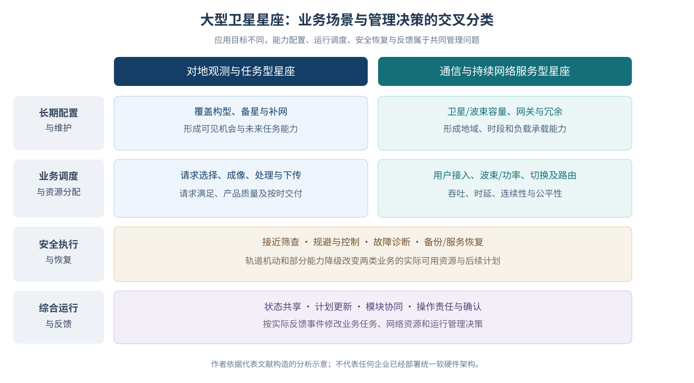

# 大型卫星星座智能管理与调度研究综述：典型业务、技术路线与运行实践

Intelligent Management and Scheduling of Large Satellite Constellations: Application Scenarios, Technical Approaches, and Operational Practice

## 摘要

大型卫星星座的持续运行涉及时变业务需求、有限资源与资产状态的持续协调。本文采用问题驱动的叙述性技术综述，以对地观测和通信作为两类核心业务，系统梳理长期能力配置、任务与网络资源调度、安全执行、异常恢复及综合运行研究。通过比较模型变量、信息假设、求解和更新机制、评价指标及验证范围，分析典型方法在不同任务条件下的适用性。代表研究表明，增量规划与几何邻域分解通过不同机制减少重复计算和消息负担，其任务满足、资源冗余及质量—成本权衡取决于负载与比较基线；观测、处理及交付可由共同选择、分阶段安排和运行反馈连接，并非同一种统一优化。通信星座的波束与功率、用户关联、切换和路径更新面对不同的干扰与时变网络约束。结合商业运营接口、独立测量及限定飞行资料，本文归纳业务能力恢复、动态资源协同、计划修改和跨模块验证的研究问题，旨在提供跨业务、跨管理功能的技术谱系和有条件的评价依据。

**关键词：** 大型卫星星座；智能管理；任务调度；卫星通信网络；资源分配；自主运行

## Abstract

Large satellite constellations must coordinate time-varying service demand, limited resources, and changing spacecraft availability. This problem-driven narrative review treats Earth observation and communication networks as two principal service domains and examines capability planning, mission and network-resource scheduling, safe execution, recovery, and integrated operations. Representative models are compared by decision variables, information assumptions, solution and update mechanisms, evaluation metrics, and validation conditions. Incremental planning and geometric neighborhood decomposition reduce different computing and coordination burdens; their effects on task satisfaction, redundancy, and solution quality depend on workloads and baselines. Acquisition, processing, and delivery can be linked through joint selection, staged optimization, or operational feedback rather than a universal end-to-end solver. Communication management faces distinct interference, access, handover, and topology-update constraints. Public operational interfaces, independent measurement studies, and bounded flight demonstrations complement algorithmic evidence. The review synthesizes technical developments across businesses and management functions and identifies conditional questions about service restoration, dynamic resource coordination, plan revisions, and cross-module validation.

**Keywords:** large satellite constellations; intelligent management; mission scheduling; satellite communication networks; resource allocation; autonomous operations

# 1 引言

## 1.1 大型星座的业务扩展与持续运行需求

大型卫星星座通过多轨道面、多节点及地面设施的协同运行提供观测与通信服务。卫星和任务规模的增长增加了候选活动数量，资源竞争、状态更新及失效恢复之间的耦合也构成重要的管理问题。大型分布式卫星系统自动化运行综述[1](https://doi.org/10.1016/j.asr.2020.08.009)从运行方式、人员与工具配置及规模适应等方面分析了这一转变。星座管理的研究对象由单次活动安排扩展至持续服务过程中的能力配置、任务调度和执行状态更新。

对地观测与通信具有不同的服务过程及调度需求。观测请求通常包含目标、时间窗口、优先级和质量要求，调度决策涉及成像、处理及交付活动。通信业务持续到达，卫星运动与流量变化共同影响接入关系、链路可用性和网络负载，因而需要连续配置波束、频谱、功率、用户关联和路由。观测任务主要以成像数量、有效产品和按时交付衡量完成情况，通信业务则通过吞吐、时延、中断和公平性反映服务质量。两类系统可采用部分共用的资源分配机制，但其任务完成条件、竞争关系及结果指标具有不同的业务含义。

资产与执行状态进一步约束业务调度。构型部署、备份和补网影响未来可用能力，安全机动、设备故障及降额运行改变当前活动机会与服务容量。在轨服务与空间物流扩展了星座维护和能力恢复的行动集合[2](https://doi.org/10.2514/1.A35982)。资源数量与位置、恢复时间及维护代价由此成为持续运行的重要条件，日常任务可行性与星座能力的形成、维持和恢复相互关联。

## 1.2 已有综述与本文的分析重点

已有综述分别围绕业务调度、分布式协同和自动化运行形成了较为明确的研究方向。Wang等[3](https://doi.org/10.1109/JSYST.2020.2997050)系统梳理敏捷对地观测调度的模型、约束、问题变体和求解方法；Ferrari等[4](https://doi.org/10.1016/j.cor.2024.106875)比较对地与外层空间观测中的成像、通信及集成调度。此类观测系统中的通信活动主要涉及数据传输和地面设施安排，其业务对象不同于面向持续用户流量的宽带通信星座。智能体方法综述[5](https://doi.org/10.1016/j.actaastro.2025.10.018)从类型、架构、协调机制及任务管理等方面讨论分布式航天系统；自动化运行综述[1](https://doi.org/10.1016/j.asr.2020.08.009)及其工具分类续篇[6](https://doi.org/10.1016/j.asr.2020.08.018)则分析运行模式、自动化职责与实现工具之间的关系。

通信方向的综述以持续网络服务及其资源管理为主要对象。《低轨巨型星座智能组网技术综述》[7](https://doi.org/10.7527/S1000-6893.2026.32935)的公开摘要列出业务感知与预测、拓扑和移动性管理、接入、路由及多维资源分配等方向；《低轨通信卫星星座网络资源管控与优化技术综述》[8](https://doi.org/10.3873/j.issn.1000-1328.2026.02.002)的公开摘要围绕资源表征、控制架构和动态优化讨论网络资源管理。卫星运行与网络管理联合综述[9](https://doi.org/10.3390/technologies13080312)进一步将SatOps与NetOps的耦合作为专门研究对象。表1归纳这些综述的研究对象及组织方式，其中两篇中文通信综述的分析限于已核读公开摘要所列方向。

**表1 代表性综述的研究对象、组织方式与本文分析维度**

| 代表综述 | 主要研究对象与分类 | 本文的分析维度 |
| --- | --- | --- |
| Wang等[3](https://doi.org/10.1109/JSYST.2020.2997050) | 敏捷观测调度；模型、约束、问题变体和方法 | 任务选择、活动时序、信息交付及不确定性的建模差异 |
| Ferrari等[4](https://doi.org/10.1016/j.cor.2024.106875) | 对地与空间观测；成像、通信和集成调度 | 获取与交付的任务依赖，以及观测下传与用户通信业务的差异 |
| Jabbarpour等[5](https://doi.org/10.1016/j.actaastro.2025.10.018) | 分布式航天系统；智能体、架构、协调与任务管理 | 信息结构、资源冲突与分布式协调适用条件之间的关系 |
| Ben-Larbi等[1](https://doi.org/10.1016/j.asr.2020.08.009)、[6](https://doi.org/10.1016/j.asr.2020.08.018) | 大型分布式系统自动化运行；模式、案例与工具分类 | 算法模型、运行职责、实现工具及服务过程之间的关系 |
| 智能组网与资源管控综述[7](https://doi.org/10.7527/S1000-6893.2026.32935)、[8](https://doi.org/10.3873/j.issn.1000-1328.2026.02.002) | 公开摘要列出的业务预测、拓扑、接入、路由及资源控制 | 通信业务资源管理的分类及其与跨业务运维的联系 |
| SatOps—NetOps联合综述[9](https://doi.org/10.3390/technologies13080312) | 卫星运行与网络管理的组织联系和联合框架 | 综合管理中的耦合变量、状态更新事件及验证范围 |

已有研究已对观测调度、空间物流、通信资源管理及SatOps—NetOps协同建立重要分类与方法体系，因而本文不以首次发现跨层联系为研究贡献。本文的补充工作是从**业务场景与管理决策交叉维度**归纳已有技术：分别比较观测任务、持续通信服务和运维恢复的任务完成标准，再按配置、调度、执行与反馈环节考察变量、资源、信息更新和验证范围。这样的对应能够说明某种算法究竟减少了搜索、协调还是运行更新成本，并揭示不同任务场景下结论为何不能直接互换。

本文采用“业务场景—管理问题”的交叉分类组织文献，形成三项相互衔接的综合分析：（1）对比两类核心业务中的模型对象、状态和完成指标；（2）根据求解机制、任务负载、可用信息与成本解释代表方法的效果及适用条件；（3）将模型输出与商业运营及飞行记录中实际执行的活动相对照，讨论进一步需要核验的接口与共同事件场景。分类是本综述用于整理和解释研究结果的工具，并非断言现有大型星座已经采用统一的软件架构。

## 1.3 研究范围与综述方法

本文采用问题驱动的叙述性技术综述方法。文献整理以已有主题检索及代表论文追溯为基础，参考相邻综述识别主要研究路线，并针对通信网络资源管理补充专题资料。分析侧重代表研究的技术脉络、模型差异及适用条件，未采用可复现的穷尽性数据库检索协议，因此不估计各类方法在全部文献中的频率或总体效应。

文献范围涵盖能力形成、业务任务与网络资源安排、安全执行、异常恢复，以及上述问题之间的运行联系。对地观测与通信为主要业务，在轨服务、物流和风险处置按其支持的管理功能纳入讨论。调制编码、器件及一般信号处理仅在相关约束直接影响星座级资源决策时作为背景。单星、地球同步轨道、深空及通用多智能体研究作为方法基础，其原任务域和资源、信息条件构成分析向大型低轨星座迁移的前提。

本文依据规模效应界定“大型”的分析含义，关注卫星与任务数量、候选活动、资源冲突、管理消息及时间跨度引起的决策负担，不采用统一的卫星数量阈值。“智能管理”包括基于状态和目标形成或更新决策的规划优化、知识推理、分布式协调及学习方法。学习方法分别承担预测、搜索辅助或策略生成职责，自主程度由实际决策和执行权限确定。“运行实践”包括公开运营流程、业务接口、软件实现和飞行试验所覆盖的具体环节。

文献信息提取包括任务对象、变量与约束、信息可得性、求解与更新机制、结果指标及验证环境。技术比较结合原研究的任务、负载和资源条件，跨模型综合分析围绕结构、机制与代价展开。学术模型、数值仿真、软件或硬件测试、飞行试验及运营资料分别提供相应分析依据。分类及跨论文归纳属于本文的综合分析，原研究实验结果的解释仍限定于其模型和验证范围。

第2节介绍业务分类、决策层级及模型特征；第3节综述各类管理问题的代表研究；第4节分析共同机制、资源耦合及运行证据，并讨论现有进展所反映的研究问题；第5节总结主要认识。

# 2 星座运行需求、管理架构与问题建模

## 2.1 业务场景与管理问题的交叉分类

星座管理问题同时具有业务属性和功能属性。对地观测以目标请求及信息产品为服务对象，通信业务以用户接入和持续传输为服务对象；能力配置、资源安排、执行及恢复则构成不同业务共有的管理功能。长期运维和安全恢复通过改变资产或执行状态，影响观测机会、产品交付、网络容量和业务连续性。表2给出业务场景与管理问题的交叉关系。

**表2 业务场景与管理问题的交叉关系及章节归属**

| 管理问题 | 对地观测业务中的表现 | 通信业务中的表现 | 主要章节 |
| --- | --- | --- | --- |
| 长期能力配置与维护 | 覆盖、构型、备份、补网及服务设施 | 星座与载荷容量、波束能力、网关及资产冗余 | 3.1 |
| 业务资源调度 | 请求选择、成像时序、处理、下传与交付 | 接入、波束、功率频谱、切换、路由与拥塞 | 3.2、3.3 |
| 安全执行与异常恢复 | 安全机动、载荷故障、任务修复与复采 | 安全机动、节点或链路降级、容量与连接恢复 | 3.4及各业务节 |
| 多问题之间的耦合 | 观测分配受交付路径与执行反馈影响 | 接入、路由、网络资源与卫星运行状态联动 | 3.5 |

**图1 大型星座核心业务与管理功能的交叉分类（本文综合示意）。** 图中箭头表示论文归纳的状态与决策依赖，不表示所有在轨系统已经部署同一软硬件架构。

算法与架构属性并不改变相应研究的业务对象。分布式观测分配仍以观测请求为决策对象，分层波束管理仍以通信资源为决策对象，其区别主要体现为信息获取和决策组织方式。综合运行管理涉及不同功能之间的依赖，包括交付路径对观测分配的影响、资产状态对可用容量的影响，以及执行结果对计划更新的触发。此类耦合表现为一个环节的能力、资源或状态构成另一环节的决策条件。

## 2.2 决策层级与时间尺度

根据决策对象，星座运行可分为能力配置、业务调度和执行恢复三个层级。长期能力配置确定未来资产的数量、位置及可用能力；业务调度在给定或滚动更新的能力条件下安排任务和网络资源；执行恢复控制物理及软件动作，并在异常后更新可用状态。决策层级与时间尺度相关，但二者并非一一对应。轨道维护既可能调整中长期覆盖，也可能由即时风险触发；波束调度与观测安排均可采用滚动时域，但其更新频率和资源承诺不同。

各层级通过能力状态和资源占用形成依赖。部署方案确定未来可用时刻，业务计划规定活动及资源需求，执行反馈反映实际完成情况、资源消耗和故障状态。联合优化在同一模型中描述相关变量，分层求解通过层间输入输出协调决策，局部控制依据执行状态更新动作。耦合对业务结果的影响、联合计算代价及状态交换时限，共同约束层间关系的建模与求解方式。

## 2.3 集中、分层与分布式的信息结构

集中式架构由统一主体汇集任务和资源状态，分层式架构按照管理域、业务区域或功能配置决策职责，分布式架构由成员依据局部信息和消息交换共同生成方案。信息汇集方式与求解机制属于不同维度。数学分解既可由地面集中求解，也可由多个成员分别计算；集中训练的学习策略亦可分散执行。主问题与子问题的划分、训练阶段联合状态的获取，以及运行阶段成员的决策权限，因而对应不同的组织关系。

物理通信拓扑、管理拓扑和任务或网络冲突关系共同影响信息组织。物理通信拓扑约束消息传递机会，管理拓扑规定协调责任，冲突关系描述决策间的相互影响。动态管理拓扑研究[10](https://doi.org/10.34133/space.0248)通过管理域调整和成员重组处理随轨道运动变化的责任关系。观测请求及其完成状态用于协调重复分配，资源占用和负载信息用于协调通信网络的跨域干扰与链路竞争。不同耦合关系由此对应不同的信息共享范围及协调需求。

## 2.4 状态变量、资源约束与目标函数

对地观测与通信共享轨道、能源、计算和通信基础设施，但其负载形式及资源决策不同。观测任务以请求和候选窗口为输入，通信业务以流量和服务质量需求为输入；前者的约束主要涉及姿态、存储及下传机会，后者则涉及干扰、队列和链路容量。表3归纳两类业务的主要建模要素。

**表3 两类核心业务星座的建模特征**

| 比较维度 | 对地观测任务调度 | 通信网络资源管理 |
| --- | --- | --- |
| 负载输入 | 目标请求、可见窗口、优先级、质量及有效期 | 用户或小区流量、到达率、需求预测及服务质量要求 |
| 主要决策 | 任务选择、执行卫星、成像时序、处理和交付 | 接入与切换、波束照射、功率频谱、网关及路径 |
| 共享约束 | 姿态、能源、存储、计算、下传时段和地面站 | 干扰、波束与链路容量、功率、队列及动态拓扑 |
| 结果指标 | 有效请求满足、收益、重访、交付时效及计算时间 | 吞吐、时延、中断、丢包、公平性、能效及控制开销 |
| 典型不确定性 | 新任务、云量或产品质量、设备故障 | 流量预测、链路状态、切换、拥塞及设备故障 |

约束决定活动的可行范围，目标函数规定可计入收益的结果。能源、干扰及轨道约束改变可行域；以合格产品交付替代成像完成，或以满足服务质量的业务替代容量分配作为奖励依据，则改变目标函数对应的服务阶段。因此，同名的“收益”或“任务完成”指标可能描述不同结果。库存可用性、风险约束满足和通信服务连续性也分别反映资产、执行及业务状态，具有不同的评价含义。

## 2.5 规模、方法代价与验证对象

模型规模由卫星、任务、窗口、链路及耦合关系共同构成。在卫星数量相同的条件下，窗口密度、任务先后关系和跨域干扰仍可能形成不同求解负担。计算与运行代价包括状态生成及预处理、集中或局部求解、协调消息、策略训练，以及修改计划的重新生效过程。在线推理时间仅对应其中一个环节，分解、分布式协调和学习方法分别影响不同的代价来源。

方法输出的差异决定了验证对象的差异。预测器生成状态或需求估计，其效果通过后续决策体现；优化器生成模型内的可行安排及目标值；协调方法通过消息交换形成任务分配；执行方法生成动作和轨迹。服务接口规定任务完成及资源承诺状态，飞行试验展示特定节点和事件中的实际运行。预测误差、模型内目标、协调冲突及动作约束分别对应运行过程的不同环节，其关联通过任务状态更新和资源反馈体现。

# 3 大型星座管理与调度的主要技术路线

大型星座管理与调度研究涵盖能力形成、业务资源配置和执行恢复。各方向通过资源可用性、任务依赖及状态反馈形成耦合。本节按照管理功能与业务场景组织代表性研究，比较其决策对象、求解机制及适用条件。

## 3.1 长期能力配置与持续运维

长期配置通过资产轨道位置、到位时间及失效恢复方式影响日常调度的可用能力。覆盖设计确定能力的空间布局，备份与补网规划失效后的能力补充，服务设施配置约束维护行动的客户可达范围。空间物流综述[2](https://doi.org/10.2514/1.A35982)将网络流、库存及任务运行纳入共同分析，揭示了这些决策在时间和资源上的依赖。

### 构型选择、部署与重构

覆盖收益与轨道转移代价之间的权衡是构型选择与重构的主要问题之一。Appel等[11](https://doi.org/10.1016/j.actaastro.2014.02.016)针对给定终端构型优化多星重构机动；Lee和Ho[12](https://doi.org/10.2514/1.A35685)联合选择区域覆盖构型与卫星分配，将目标构型作为成本权衡中的决策变量。多阶段重构研究[13](https://doi.org/10.2514/1.A35990)进一步联合描述各阶段构型及阶段间转移。上述模型分别采用固定终端构型、可优化目标构型和随阶段变化的构型需求，区别主要在于需求与终端状态参与决策的方式；其中多阶段模型以预先已知的阶段需求为输入。

部署条件进一步约束可选构型。复杂区域模式设计[14](https://doi.org/10.2514/1.A34657)利用访问模式与星座模式的循环卷积关系建立二元整数规划，不确定关注区域下的部署优化[15](https://doi.org/10.1016/j.actaastro.2018.03.054)通过需求情景评价部署方案。Gwon和Ahn[16](https://doi.org/10.1007/s42405-026-01298-1)将有限停泊时间、J₂引起的升交点赤经（RAAN）漂移、发射容量及完成窗口纳入两阶段设计，分析成本与完成时间的权衡。其RAAN可达性属于设计层面的筛选条件，完整发射轨迹及卫星实际到位过程未纳入该模型。构型的覆盖性能与部署可行性因而对应不同条件，转移和部署时序同时影响能力形成的时间。

### 通信星座的平台、容量与网关配置

几何覆盖与业务容量是通信星座设计的不同维度。在相同覆盖条件下，卫星功率、天线与波束能力、用户流量分布及传输路径仍可能形成不同容量瓶颈。平台与星座联合设计研究[17](https://doi.org/10.1016/j.comnet.2024.110942)综合分析波束跳变、天线及平台参数、轨道与星座规模，使短期资源配置影响长期架构选择。其低地球轨道（LEO）和甚低地球轨道（VLEO）方案的比较限定于给定流量、覆盖、平台及成本条件，反映相应设计要求下的取舍。

长期设计规定覆盖与容量条件，波束和路由调度决定不同地域及时段的资源使用方式。需求分布不均时，几何覆盖的增加未必缓解热点负载，平台配置、网关和潜在路径共同制约可交付容量。长期能力配置与短期资源分配由此构成相互关联的通信管理问题。

### 备份、补网与失效能力恢复

随机失效使长期能力维护同时涉及库存保障与持续补给。Jakob等[18](https://doi.org/10.2514/1.A34387)将地面库存、停泊轨道库存及轨道面内备份表示为多级库存网络，联合确定备份数量与补货触发条件，并计入轨道面间相对漂移产生的补给等待。作者通过25组参数案例及重复的多年随机仿真评价解析模型。该模型近似认为轨道面内备份能够立即接替失效卫星，供应满足率主要反映库存保障；实际业务恢复仍受到补位机动及到位时间的影响。

后续模型分别细化补给选择和库存状态演化。双供应通道模型[19](https://doi.org/10.2514/1.A36281)同时考虑经停泊轨道转移与直接注入目标轨道面的补给过程；Han等[20](https://doi.org/10.2514/1.A36599)以马尔可夫链描述轨道面及停泊库存，并通过不动点迭代求取相互一致的稳态，其双通道扩展[21](https://doi.org/10.1016/j.actaastro.2026.06.020)进一步描述直接与间接补给。两类研究从补给途径和随机状态出发，细化长期成本与补给等待之间的关系。相应稳态指标反映长期平均供应表现，单次失效后的能力恢复则具有不同的时间演化过程。

Iridium新增5颗备星的公开部署[22](https://investor.iridium.com/2023-05-20-Iridium-Adds-to-Constellation-Resilience-with-Launch-of-Spare-Satellites)表明备用资产已应用于实际星座配置。备份数量反映冗余水平，轨道位置和转移条件决定冗余能力的可用时刻。因此，即使备份投入相同，能力到位时间的差异仍可能形成不同的业务损失，这也是库存保障与运行调度之间的重要联系。

在轨服务进一步扩展了失效资产的恢复方式。Kim等[23](https://doi.org/10.2514/1.A36684)同时考虑部署新星和服务恢复，将运营方的服务水平与维护成本、服务方的价格与能力纳入双目标优化。在所设失效、价格及服务条件下，部分方案相对于不采用在轨服务的基准策略，年度维护成本最高降低约14.5%。方案选择随可恢复故障比例及服务定价变化，说明恢复策略同时受到资产可修复性、经济协调及轨道可达性影响。

### 服务设施配置与需求不确定性

服务设施的轨道位置及客户分配共同约束维护能力。Shimane等[24](https://doi.org/10.2514/1.A35691)联合选择轨道仓库、客户分配及推进需求；Choi和Ho[25](https://doi.org/10.2514/1.A36386)允许仓库位置在连续轨道空间内调整，将设施配置和服务顺序表示为混合整数非线性问题，并交替求解整数与连续子问题。后者采用GPS星座服务案例分析方法。固定候选位置保留了离散选址结构，连续位置设计则增加布局自由度，同时增强位置与转移代价之间的耦合。

需求不确定性和推进方式进一步影响服务能力配置。服务船部署研究[26](https://doi.org/10.1155/2021/6644339)以潜在客户可达性评价预部署位置，需求不确定性框架[27](https://doi.org/10.2514/1.A34978)通过滚动时域更新服务及物流活动。高、低推力权衡框架[28](https://doi.org/10.2514/1.A35094)将用户定义的轨迹模型与混合整数线性规划结合，分析推进方式对短期排程及长期设施选择的影响；生命周期评估[29](https://doi.org/10.1016/j.actaastro.2013.02.005)进一步区分随机与认知不确定性。上述模型分别细化能力位置、更新时机、转移时间和需求认知，表明星座维护能力的描述依赖资源状态及规划时域。

长期能力配置研究共同关注资产投入向业务可用能力的转化过程。部署、补给等待和服务恢复决定未来可执行活动的条件，构型、库存及设施模型则从不同方面描述能力形成及维持。各类模型的主要差异在于对这一过程的表示范围与细化程度。

## 3.2 对地观测与在轨服务任务规划调度

对地观测与在轨服务调度均涉及任务选择、分配和排序，其差异主要体现于候选活动的形成机制。观测机会受目标可见性、姿态及载荷条件约束，服务访问则进一步依赖轨道转移、推进剂和补给状态。随着多资源约束及动态任务的引入，两类问题均由给定活动集合的排程扩展至候选活动与资源状态持续更新的规划。

### 观测任务选择、分配与活动时序

敏捷观测中，任务选择和执行时刻受姿态机动与可见窗口共同约束。Lemaître等[30](https://doi.org/10.1016/S1270-9638%2802%2901173-2)比较贪心、动态规划、约束规划和局部搜索，为任务选择与执行定时提供早期研究基础。马尔可夫决策过程模型[31](https://doi.org/10.1109/TSMC.2020.3020732)以学习生成排序，再由构造式启发式确定时刻；分解学习多目标方法[32](https://doi.org/10.1016/j.swevo.2024.101792)结合任务分配、排序与全局修补。这些研究采用不同的搜索组织方式，其共同要求是将任务选择与满足姿态、窗口约束的活动时序相结合。

当资源冲突同时涉及多颗卫星时，统一混合整数模型可以表达任务选择、卫星分配和时间冲突，求解规模随候选分配和活动数量增长。Antunes等[33](https://doi.org/10.1016/j.cor.2025.107259)针对公共任务与专属任务建立电池充放电约束下的模型，比较两种Dantzig–Wolfe分解，并以动态规划求解定价子问题。该方法进一步结合对偶稳定化、强分支及整数规划启发式改进列生成过程。该研究利用任务与资源结构缩小直接搜索范围，同时保留所建离散模型的优化界，为大规模任务调度提供了结构化精确求解路线。

跨星任务竞争的协调效果还取决于成员可获得的信息范围。Parjan和Chien[34](https://doi.org/10.2514/1.I011215)在100个卫星代理、634个地面目标的一周算例中，比较集中式、广播式和高度去中心化的请求分配。广播策略根据共享冲突信息或请求满足状态的差别协调选择。其固定冲突间隔及简化容量模型下，增量更新减少运行时间，同时增加重复观测。这一结果反映了所述模型中计划复用的计算节省与重复任务之间的权衡。

Zilberstein等[35](https://doi.org/10.1613/jair.1.16997)利用观测机会和冲突关系的几何结构，将调度建模为分布式约束优化问题（DCOP），通过几何邻域分解（GND）和邻域随机搜索（NSS）组织局部求解。成员共享公共请求和星座构型，但不掌握其他成员完整的执行能力。作者在200颗与108颗模拟卫星的24 h算例中，结合存储和下传约束比较满足率、计算时间及消息开销。Parjan和Chien侧重比较信息共享规则，几何邻域方法则依据任务和成员之间的相互影响划分局部问题。两类研究表明，协调负担受任务竞争结构及能力信息的共同影响，卫星数量相同的模型仍可能具有不同的协调范围。

多主体请求的权限边界与竞价机制进一步影响任务分配的组织方式。Krigman等[36](https://doi.org/10.1007/s10951-024-00816-x)以分布式约束优化表示多主体观测请求，通过分布式随机算法及最大增益消息算法生成时刻表，降低对私有请求预先集中汇集的依赖。一致性任务包拍卖[37](https://doi.org/10.1109/TRO.2009.2022423)则将局部竞价与一致性消冲突组合，为任务分配提供通用方法基础。前者以请求所属主体及其约束信息组织决策，后者通过任务包和竞价共识处理分配冲突，二者具有不同的协调机制与请求权限条件。

通信机会受限时，竞争信息的到达时机进一步影响任务分配。Li等[38](https://doi.org/10.1016/j.asr.2020.02.018)在同步和异步任务包方法中加入通信机会预测，形成随通信成本变化的收益与交互次数取舍。延迟通信规划[39](https://doi.org/10.1109/JSEE.2016.00066)使用时延处理和协同决策模型，不确定环境下的星上调度[40](https://doi.org/10.1016/j.asr.2021.09.003)结合合同网、黑板与滚动规划。通用异步市场分配研究[41](https://doi.org/10.24963/ijcai.2023/30)进一步分析消息延迟、丢失和动态事件。上述研究分别基于卫星网络或通用多智能体环境分析通信约束，表明局部方案的协调同时受到共享内容和消息到达时机的限制。

### 观测、处理、下传与交付的联合安排

观测数据的交付依赖后续下传机会，成像选择与传输安排因而具有资源依赖。He等[42](https://doi.org/10.1109/TMC.2021.3076088)将成像和传输窗口统一为整数线性规划，并结合半正定松弛与遗传算法求解；Shang等[43](https://doi.org/10.1016/j.actaastro.2025.02.008)在联合安排中纳入充电活动，利用多背包分配及改进蚁群搜索处理多星任务。集成敏捷观测模型[44](https://doi.org/10.1016/j.cor.2025.107212)进一步讨论成像与下传共同安排；异构星座的提示—精细观测模型[45](https://doi.org/10.1016/j.actaastro.2026.04.059)以混合整数线性规划表示观测间的先后依赖。这些模型分别将后续资源和任务依赖纳入当前决策，其收益对应成像、数据交付或后续观测完成等不同阶段。

数据交付还受到共享地面设施的制约。单星—多站模型[46](https://doi.org/10.1016/j.cor.2014.11.004)将通信机会转化为可行排程，空军卫星控制网络研究[47](https://doi.org/10.1023/B:JOSH.0000013053.32600.3c)突出多请求对共享资源的竞争，下传案例研究[48](https://doi.org/10.1016/j.omega.2015.01.001)则将业务约束接入排程生成。深空网络混合整数规划[49](https://doi.org/10.1109/ACCESS.2021.3064928)提供天线资源的优化表达；Johnston等[50](https://doi.org/10.1609/aimag.v35i4.2552)将需求展开为跟踪时段，结合搜索、修复和运营协商。尽管任务域不同，这些研究均将通信可见性与共享设施的排程约束相结合。可见窗口构成传输机会，无冲突的设施安排则决定其实际可用性，并限制可交付数据。

业务接口进一步规定任务完成和资源承诺的状态条件。Planet Tasking API[51](https://docs.planet.com/develop/apis/tasking/)区分采集、质量验收和交付，部分产品允许按条件继续采集。AWS Ground Station[52](https://docs.aws.amazon.com/ground-station/latest/ug/contacts.html)对已有预约的时间或任务配置文件（mission profile）变化通常要求取消后重约；[联系版本更新](https://docs.aws.amazon.com/ground-station/latest/ug/contacts.versioning.html)则允许满足约束时保留原窗口、更新轨道星历或目标，并通过异步版本状态确认是否生效。保留资源条件的参数变更和取消后重新申请资源属于不同计划更新过程，不能将所有配置修改概括为取消重约。

星上处理将信息生成所需的计算与传输资源纳入任务链。Soret等[53](https://doi.org/10.1002/sat.70082)的[公开作者稿](https://arxiv.org/abs/2604.05937v1)先在时间、姿态与能源约束下形成采集计划，再以既有采集负载及可用下传时刻为输入，安排星上/地面处理器的计算任务与频率，并计入通信能耗和容量。Wiley正式摘要将观测与处理表述为两个相互耦合的优化问题；本文具体的顺序依赖仍以已读作者稿为依据，不以“耦合”直接推断作者完成了所有变量可互相反馈的统一全局优化。模型中的固定流水线与稳定星间链路假设也限定其向实时商业运行的推广范围。

处理位置的选择体现了计算任务与通信资源之间的耦合。多智能体卸载模型[54](https://doi.org/10.1109/JIOT.2024.3482290)、集中训练与分散执行的LEO边缘计算模型[55](https://doi.org/10.1016/j.comcom.2024.05.008)及星地协同推理资源管理[56](https://doi.org/10.1109/TMC.2025.3570799)，分别结合卸载决策、学习方法和资源优化。轨道感知调度[57](https://doi.org/10.1007/s10586-025-05663-9)通过轨道运动及通信可见性组织分布式计算，并以离散事件仿真评价响应；Kodan[58](https://doi.org/10.1145/3582016.3582043)利用离线专用模型与运行时选择处理计算、下传之间的瓶颈。卸载与协同推理研究主要确定计算位置，轨道感知调度和Kodan分别细化执行机会及模型选择。这些研究以计算任务或数据价值为主要结果，其与观测业务的联系体现于处理完成后的产品状态及后续活动变化。

### 动态请求与不确定性下的重规划

动态任务到达可能同时改变既有分配与活动序列的可行性。Qin等[59](https://doi.org/10.1016/j.asr.2025.12.008)采用任务分配与排序的分层求解：动态多背包及拉格朗日松弛处理任务冲突，回溯和递归策略在新任务到达后修复已有序列。最多1000颗卫星、50—6000项任务的实验围绕收益和收敛时间分析该分层方法。相较给定时域的列生成研究[33](https://doi.org/10.1016/j.cor.2025.107259)，该方法将分配与动态序列修复分别处理，其求解过程随任务到达事件更新。

云量等质量不确定性则在计划生成时改变预期收益。主动调度[60](https://doi.org/10.1016/j.cor.2016.04.014)采用机会约束与样本近似，鲁棒调度[61](https://doi.org/10.1109/TAES.2019.2947978)通过预算不确定集和列生成控制扰动集合内的表现，随机规划[62](https://doi.org/10.1016/j.ejor.2018.11.043)以多阶段混合整数模型组织情景决策。概率条件、扰动集合和情景更新代表不同风险表达，产生不同保守性及信息需求。这些计划生成方法在结果未知时安排任务，与根据实际质量结果进行复采的运行机制具有不同的信息条件，二者可形成互补。

在线重规划中的学习方法分别作用于初解生成、策略执行和成员协调。Qi等[63](https://doi.org/10.1016/j.eswa.2025.128502)以滚动时域形成连续静态子问题，由深度强化学习产生初解，再用大邻域破坏—修复改善计划；滚动时域多智能体学习[64](https://doi.org/10.1016/j.eswa.2025.128350)采用集中训练、分散执行。通信机会预测[38](https://doi.org/10.1016/j.asr.2020.02.018)和合同网协调[40](https://doi.org/10.1016/j.asr.2021.09.003)则将更新与成员之间的信息交换直接结合。这些研究对在线更新的处理环节不同，最终计划分别由初解生成与搜索修复、策略执行或通信协调共同形成。

单星策略复用通过调整训练组织降低联合策略训练的复杂度。Herrmann等[65](https://doi.org/10.2514/1.A35736)先在单星环境训练，再将同一策略部署于Walker星座成员，比较自由通信、单跳视线、多跳视线和无通信四种设置。成员共享已成像或下传的目标状态，通信效果随构型连通性变化；由于共享内容不包含未来计划意图，自由通信条件下仍可能出现同时段重复选择。策略复用简化了训练组织，跨星任务竞争的协调能力则受共享信息限制。

单星算法的比较研究[66](https://doi.org/10.3389/frspt.2023.1263489)进一步揭示了策略生成的计算代价。Herrmann和Schaub在Basilisk环境中比较近端策略优化（PPO）、带资源屏蔽的PPO、优势Actor–Critic（A2C）、深度Q网络（DQN）、蒙特卡洛树搜索训练及遗传算法。收益、稳定性和训练时间随任务复杂度变化，搜索式训练在较复杂的敏捷任务中获得较好的解，同时具有较高计算开销。结合策略复用研究，学习调度的收益与代价分别体现于训练、在线动作生成和跨星任务协调。

### 在轨服务的访问、转移与补给安排

在轨服务中的客户持续运动，访问顺序会改变转移时间、推进剂消耗和补给需求。多轨可加注服务模型[67](https://doi.org/10.1016/j.cie.2022.108852)用时变网络统一访问和补给，GEO加注鲁棒调度[68](https://doi.org/10.1016/j.cja.2025.103774)以预算不确定集描述服务时长，并搜索服务分配与顺序。多服务星规划[69](https://doi.org/10.1016/j.asr.2017.05.037)联合选择任务和轨道转移，GEO加注与碎片移除混合规划[70](https://doi.org/10.1016/j.asr.2024.05.059)则比较随机期望和鲁棒不确定性表达。顺序决策因而同时受动力学、资源补充及服务持续时间影响。

低推力服务任务的路径代价进一步依赖出发轨道、质量及时间状态。Apa等[72](https://doi.org/10.1007/s40295-025-00487-6)在出发与到达轨道、质量和时刻上预计算转移网格，再以插值支持组合路径搜索，模型考虑摄动、地影和质量变化，但忽略相位机动代价。其低轨漂移服务研究[71](https://doi.org/10.1007/s40295-026-00580-4)将推力—漂移—推力转移与访问及加注结合，在出发时刻和质量网格上计算代价，以遗传算法优化路径；J₂、阻力、地影及质量变化均进入相应转移模型，相位影响在主优化后单独估计。两项研究均通过预计算转移轨迹，为组合路径搜索提供状态相关代价。代价网格所涵盖的动力学及终端条件限定了其对实际交会过程的描述范围。

观测与服务调度共享任务选择和排序机制，但其候选活动分别由可见窗口、姿态及后续资源，或轨道转移、质量及补给状态生成。表4汇总代表模型的资源约束、信息条件与求解机制。

**表4 观测与服务任务代表研究的比较条件**

| 代表研究 | 优化对象与资源 | 信息范围与共享内容 | 求解与计划更新 | 验证场景 | 主要贡献与适用条件 |
| --- | --- | --- | --- | --- | --- |
| 分支定价[33](https://doi.org/10.1016/j.cor.2025.107259) | 公共/专属任务、电池 | 统一任务与资源模型 | 分解、列生成；给定时域 | 纳卫星星座仿真 | 模型内优化界；取决于定价结构 |
| 分层混合整数规划[59](https://doi.org/10.1016/j.asr.2025.12.008) | 分配、排序、动态任务 | 统一请求与冲突信息 | 拉格朗日分配、序列修复 | 最多1000星，50—6000任务 | 分层降低计算时间；依赖任务结构 |
| 去中心化观测分配[34](https://doi.org/10.2514/1.I011215) | 观测请求、简化容量 | 集中/广播/高度去中心化；完成或竞争状态 | 共享规则；重新规划/增量规划 | 100代理、634目标；单线程模拟 | 信息与更新规则影响冗余 |
| 几何邻域分解[35](https://doi.org/10.1613/jair.1.16997) | 观测、存储、下传 | 公共请求/构型；局部能力与邻域消息 | GND分解、NSS协调 | 200/108星、24 h模拟 | 降低计算时间和消息；保留满足率差距 |
| 观测—传输联合[42](https://doi.org/10.1109/TMC.2021.3076088) | 成像与传输窗口 | 统一窗口和任务信息 | 整数规划、松弛/遗传搜索 | 敏捷卫星网络仿真 | 下传机会参与成像选择 |
| 能源约束联合调度[43](https://doi.org/10.1016/j.actaastro.2025.02.008) | 观测、传输、充电 | 统一多星资源模型 | 多背包分配、蚁群/局部搜索 | 多敏捷卫星仿真 | 能源补充改变可行集合 |
| 观测—处理分阶段安排[53](https://doi.org/10.1002/sat.70082) | 质量、计算、能量 | 星上/地面处理资源 | 采集选择；星地处理负载与频率优化 | 船舶检测与计算平台测试 | 完成事件延伸到信息生成 |
| 通信预测任务包[38](https://doi.org/10.1016/j.asr.2020.02.018) | 应急观测、通信 | 同步/异步；预测通信机会 | m-CBBA/m-ACBBA更新 | 分布式观测仿真 | 收益/交互权衡随通信成本变化 |
| 学习辅助大邻域搜索[63](https://doi.org/10.1016/j.eswa.2025.128502) | 在线应急任务 | 子问题的任务与资源状态 | 学习初解、滚动破坏—修复 | 大规模动态任务仿真 | 学习与搜索共同形成最终计划 |
| 单星策略复用[65](https://doi.org/10.2514/1.A35736) | 观测与下传 | 四种通信；仅共享已完成状态 | 单星训练、多星复用 | Walker星座仿真 | 简化训练；同时段重复仍可能发生 |
| 学习算法比较[66](https://doi.org/10.3389/frspt.2023.1263489) | 单星任务、资源屏蔽 | 单星状态；无跨星协调 | PPO/A2C/DQN/MCTS-Train等 | Basilisk单星仿真 | 收益、训练和模拟成本随任务变化 |
| 可补给多轨服务[67](https://doi.org/10.1016/j.cie.2022.108852) | 访问、推进剂、补给 | 服务星/客户/设施的时变网络 | 混合整数线性规划 | 多轨服务算例 | 路径和补给统一；依赖转移表达 |
| 加注鲁棒调度[68](https://doi.org/10.1016/j.cja.2025.103774) | 访问、服务时长 | 预算不确定集 | 鲁棒模型、混合搜索 | GEO加注仿真 | 保守性与时间不确定性共同评价 |
| 低推力漂移服务[71](https://doi.org/10.1007/s40295-026-00580-4) | 路径、质量、加注 | 出发时刻/质量相关代价 | 转移预计算、插值/遗传搜索 | LEO多客户模拟 | 相位成本在主优化之外估计 |

蒙特卡洛树搜索训练方法记为MCTS-Train。表中LEO与GEO分别指低地球轨道与地球同步轨道。统一模型描述信息可用范围，不直接指明求解器物理部署在地面或星上。通信和学习算法的具体定义见本节相应研究。

## 3.3 通信星座网络管理与资源调度

低轨通信星座的资源调度具有需求时变性与拓扑动态性双重特征。用户需求随地域、时间和业务类型变化，卫星运动则持续改变覆盖范围、接入关系及端到端路径。在波束、频谱、功率、网关和星间链路容量约束下，资源管理的主要目标是协调业务负载与可用服务能力。相关研究涵盖流量预测、容量配置、接入切换、路径选择及跨域控制，各方向分别处理需求估计、局部资源竞争、业务承载和全局协调问题。

### 业务需求预测与波束、功率及频谱分配

非均匀需求使固定照射与平均资源分配难以同时兼顾资源利用和业务满足。波束跳变通过时分照射覆盖多个区域，其资源配置涉及离散照射选择与连续功率分配。Han等[73](https://doi.org/10.3390/aerospace11030191)结合经验模态分解、ARIMA与优化神经网络，在ON/OFF合成流量条件下预测具有自相似特征的业务流量，生成可供后续资源配置使用的负载估计。波束与功率优化进一步确定有限容量的分配，其评价指标包括供需差距、吞吐和时延，与流量预测误差具有不同的业务含义。

波束—功率联合分配研究[74](https://doi.org/10.23919/JCC.ja.2022-0864)采用分解求解策略：首先在平均功率条件下利用潜在博弈确定照射区域，再固定照射选择，通过罚函数内点法优化功率。其[公开预印本](https://arxiv.org/abs/2312.01292v1)采用单星、8波束和61个波束位置的算例，以供给与需求的平方差评价匹配程度。G-BH与G-BHPO基线采用相同的贪心选束规则，分别配置平均功率和优化功率；G-BHPO的供需差距较低，表明在选束规则相同的条件下，功率配置仍影响服务能力分布。该对照反映了功率优化对单星覆盖内供需匹配的作用。

多星重叠覆盖引入卫星—小区服务关联及干扰协调问题。Lin等[75](https://doi.org/10.1109/LCOMM.2022.3213912)的正式摘要将研究划分为关联选择和多星照射模式优化，涉及负载平衡、与GSO地面站共存的同频干扰及共信道条件下的波束照射设计。由于尚未取得该文可逐式核验的全文，本文不指定其成员间干扰的全部约束形式，也不声称已验证各模块的独立贡献。Zhao等[76](https://doi.org/10.1109/TWC.2025.3545745)的[公开作者稿](https://arxiv.org/abs/2411.08896v1)构造12星、每星4波束、168小区的模型，在数字孪生全局信息和星上局部观测下协调照射与功率。两者对应不同共存与协作情景，相关性能结论以各自模型和出版版本证据为边界。

联合资源配置的性能与负载水平密切相关。在Zhao等的上述算例中，采用需求驱动选束与均分功率的FPA方案，与在数字孪生中联合确定离散功率的DPA方案，在总需求8—20 Gbit/s时吞吐接近；总需求超过20 Gbit/s后，DPA的吞吐较高。原作者将这一差异解释为高负载下灵活分配有限功率的作用增强。由于两种方案的决策组织也存在差异，该结果反映特定负载条件下的整体策略性能。结合单星功率对照可见，当功率配置或服务关联构成容量瓶颈时，调整相关变量可改变模型内的需求满足程度，其收益受到瓶颈位置和模型条件的制约。

上述模型的分解方式与协调对象存在差异。波束—功率配置[74](https://doi.org/10.23919/JCC.ja.2022-0864)和需求感知配置[76](https://doi.org/10.1109/TWC.2025.3545745)分别处理离散选束与连续功率，多星共存模型[75](https://doi.org/10.1109/LCOMM.2022.3213912)则分阶段确定服务关联与照射模式。三类方法对应单星供需匹配、多星资源协调和共存干扰等不同约束。学习方法将部分计算转移至训练阶段，并依赖全局状态或局部观测。因此，联合配置方法的适用范围与其协调尺度、信息条件和计算成本密切相关。

### 星地接入、卫星切换与业务连续性

低轨卫星运动导致终端在业务传输期间改变服务卫星、波束或网关。基于最大仰角或最强信号的接入方式主要评价即时链路质量，而持续服务还受到端到端时延、网络负载和连接保持时间的影响。延长连接保持时间有助于降低切换频率，但可能牺牲短期链路性能。因此，接入与切换调度同时涉及服务对象选择和连接持续时间配置。

Yin等[77](https://doi.org/10.1016/j.cja.2024.09.039)在正式开放摘要中将端到端传播时延估计引入单层切换目标，采用Dueling Double DQN形成候选切换策略，并在跨层决策中结合时延抖动预测与切换开销。现有公开结果属于给定网络和基线下的整体策略比较；由于状态、动作、奖励及独立模块消融仍缺少正式正文核查，不能将组合方案改进全部归因于某个学习或预测模块。

Mohan等[78](https://doi.org/10.1145/3589334.3645328)通过多国测量和英德受控终端实验，观察到15秒重配置边界附近的时延及吞吐波动。在限制英国终端视场的实验中，仅有一颗候选卫星的连接窗口内仍出现上述波动，表明服务卫星切换并非这些变化的必要条件。原作者据此推测存在周期性网络调度，但实验未直接观测内部资源分配规则。该观察揭示了接入关系与服务质量变化之间的区别：业务连续性除受到切换过程影响外，还涉及连接保持期间的网络重配置状态。

### 动态拓扑、星间路由与拥塞恢复

网络结构与链路建立机制共同决定路由更新成本。无直接星间链路的网络依赖地面中继连接卫星，而采用激光星间链路的网络还受到终端指向及建链过程的约束。两类网络均具有时变路径，其可用链路、控制职责和更新开销存在差异。

Zhang和Yeung[79](https://doi.org/10.1016/j.comcom.2022.02.015)针对缺少直接星间链路的地面站辅助低轨网络提出两层路由结构，机构与出版方摘要区分按流路由的时延有界DBR（较多表项）和按目的地的DAR（减少路径变化但不具备同样的时延界）。Zhang等[80](https://doi.org/10.1016/j.dcan.2022.09.022)研究相似的时变地面辅助拓扑：DBTS/DBTS+用于流量分流和流量工程，LFA/LFA+用于预备路径快速故障重路由，不属于直接优化星载物理链路容量。两篇未取得可逐式核对的正式全文，因此具体控制成本及数字性能不作超出摘要与机构公开记录的归纳。

Bhattacharjee等[121](https://doi.org/10.1109/TAES.2024.3415571)将激光链路建立时延纳入路径代价，比较瞬时最短路、既有路径保持及考虑稳定性和链路活动状态的路由策略。其[公开预印本](https://arxiv.org/abs/2406.01953v1)在1584星、600个1秒快照的模型中设置新链路建立的时延惩罚。建链代价较高时，路径保持或链路活动状态感知能够减少部分更新损失；建链代价很低时，路径保持策略在部分算例中的平均端到端时延略高于瞬时最短路。更充分的时域评估同时增加计算成本，表明路径寿命、建立时延与更新频率之间存在相互制约。

该研究将路由评价由瞬时路径长度扩展至包含更新代价的时延。模型假定控制器提前完成路径计算与分发，新链路的建立时间一致，并忽略排队和初始配置时延，因此结果主要刻画路径稳定性与建链开销之间的关系。地面中继模型中的流量工程和恢复研究采用不同的容量及失效条件。综合评价稳定性、拥塞和故障恢复时，链路形成、容量竞争与控制信息生效分别构成影响业务传输的因素。

### 跨域资源分配与控制职责

集中更新全局资源状态受到计算与信息传输成本的限制，局部调度则面临跨域频谱和干扰协调问题。Gou等[81](https://doi.org/10.3390/s25030902)将网络控制中心、空间基站及用户终端划分为不同管理层级。该研究通过全局服务区域与频谱配置约束局部波束、时隙和信道调度，并利用需求与价格交换协调资源。该架构以层间配置和信息交互实现广域资源管理与局部需求响应的衔接。

该研究分别比较频谱管理、用户调度和波束调度，各项结果对应不同模块及负载条件。组件性能反映相应层级的资源管理作用，完整架构的运行效果还受到层间交换及配置生效条件的影响。集中式路由具有类似的信息前提：动态激光链路模型[121](https://doi.org/10.1109/TAES.2024.3415571)假设路径预先计算并分发，使部分协调过程先于路由动作完成。因此，管理层级不仅分配决策职责，也限定局部算法的信息可得范围和资源配置权限。

通信星座管理研究主要呈现资源耦合、服务连续性与路径更新三个方面的技术联系。联合资源配置的作用受到容量瓶颈和协调尺度的制约；接入切换与连接保持期间的重配置分别对应不同服务变化；路径更新则受到新链路建立成本和既有路径寿命的共同影响。这些联系构成波束、接入、路由和控制职责之间的协调基础。表5汇总代表研究的模型条件与技术取舍，第3.5节进一步讨论通信资源决策与任务及执行管理的耦合。

**表5 通信资源管理的协调对象、模型条件与方法取舍**

| 代表研究 | 协调或估计对象 | 模型与信息条件 | 主要联系或取舍 |
| --- | --- | --- | --- |
| 流量预测[73](https://doi.org/10.3390/aerospace11030191) | 未来业务量 | ON/OFF合成自相似负载；预测模型 | 输出负载估计；路由应用及服务收益尚待后续验证 |
| 波束—功率分配[74](https://doi.org/10.23919/JCC.ja.2022-0864) | 离散照射与连续功率 | 预印本采用单星、8波束、61位置 | 在相同贪心选束规则下，功率配置影响供需匹配 |
| 多星服务关联与GSO共存[75](https://doi.org/10.1109/LCOMM.2022.3213912) | 卫星—小区关联及照射模式 | 多星覆盖及GSO共信道干扰信息 | 分阶段设计；正式摘要支持，实验参数与完整约束仍待核 |
| 需求感知配置[76](https://doi.org/10.1109/TWC.2025.3545745) | 多星选束、星内功率及队列 | 预印本采用12星、168小区；集中训练 | 策略性能随负载变化，联合收益受到容量瓶颈制约 |
| 路由代价感知切换[77](https://doi.org/10.1016/j.cja.2024.09.039) | 接入对象与连接保持 | 路径时延、抖动及切换开销 | 接入选择同时考虑端到端路径质量 |
| 独立网络测量[78](https://doi.org/10.1145/3589334.3645328) | 用户侧时延及吞吐变化 | 多国测量与受控终端 | 单候选卫星窗口内仍观察到重配置边界附近的波动 |
| 分层及分段路由[79](https://doi.org/10.1016/j.comcom.2022.02.015)、[80](https://doi.org/10.1016/j.dcan.2022.09.022) | 路径稳定、流量与恢复 | 无直接星间链路的地面辅助网络 | 更新组织、流量工程和失效恢复具有不同职责 |
| 动态激光链路路由[121](https://doi.org/10.1109/TAES.2024.3415571) | 路径与链路活动状态 | 预印本采用1584星；统一建链代价；不含队列 | 路径保持与更新的取舍受到建链成本制约 |
| 分层资源管理[81](https://doi.org/10.3390/s25030902) | 全局频谱与局部资源 | 配置约束、需求和价格交换 | 分层组织连接资源权限、信息范围及局部响应 |

表中算例和结果对应正文注明的公开版本。卫星规模、流量、信道和控制假设的差异构成跨模型比较的边界，本文主要从协调对象与决策机制归纳其技术联系。

## 3.4 安全执行、异常恢复与服务韧性

任务计划的执行受到连续动力学、设备状态及外部风险约束。接近筛查识别候选风险事件，轨迹规划与控制生成满足安全条件的动作，异常处置和计划修复更新后续可用资源。这些环节共同构成扰动条件下维持服务的管理基础。

### 接近事件检测与风险信息

大规模接近评估的计算负担主要分布于目标配对与最近接近的精确搜索。Chebyshev代理多项式方法[82](https://doi.org/10.1016/j.actaastro.2020.01.020)通过分段近似和距离极值求解计算最近接近事件，其精度受多项式阶数、区间及误差控制影响。Saingyen等[84](https://doi.org/10.3390/aerospace10060543)采用Smart Sieve、CSieve及组合式CAOS-D减少候选配对，并结合CUDA分别测试单星对目录与全目录两两配对。所测数据中，GPU减少了计算时间，而Smart Sieve遗漏部分事件，另外两类方法保持了对应筛查结果。两类方法分别作用于单个候选的精算成本和进入精算的配对数量，筛查方法的加速效果同时受到漏检表现的限制。

跟踪资源的分配进一步影响风险信息的质量。风险感知传感器调度[83](https://doi.org/10.1016/j.asr.2021.04.042)将信息增益与碰撞风险用于观测选择，使目标跟踪和风险评估相互关联。风险预测和规避设计分别承担后续不同职责：ESA机器学习竞赛[87](https://doi.org/10.1007/s42064-021-0101-5)根据接近数据报文预测最终风险，CAMmary综述[86](https://doi.org/10.1016/j.actaastro.2025.07.027)比较机动设计，碰撞规避运行仿真[85](https://doi.org/10.1007/s12567-022-00471-y)分析行动主体与时机。上述研究分别形成风险估计、机动方案及运行责任分析，对应安全决策的信息输入、动作选择与组织条件。

空间数据系统咨询委员会（CCSDS）的接近事件数据报文（CDM）标准[88](https://ccsds.org/publications/bluebooks/entry/3064/)规定跨组织的信息格式，Starlink公开流程[89](https://space-safety.starlink.com/docs/space-safety-articles/starlink_cola_conops/)则将星历生成、持续筛查、星上风险重估与机动更新组织为循环，并按机动能力设置响应。风险变化在该流程中可以触发机动新增、修改或取消，机动状态随风险信息持续更新，并影响既有业务计划。

### 轨迹与控制约束下的安全执行

安全轨迹规划将避碰距离、视线及终端条件表示为动力学约束。被动安全轨迹[90](https://doi.org/10.2514/1.29590)研究轨迹本身的安全条件，锥优化交会规划[91](https://doi.org/10.2514/1.58436)实现自主轨迹求解，序贯凸规划的模型预测控制（MPC）[92](https://doi.org/10.2514/1.G000218)通过邻居通信形成分散计算并在执行中更新轨迹。这些方法分别利用安全几何、优化结构和反馈更新，处理离散任务安排所对应的连续运动过程。

概率约束控制通过允许风险水平描述扰动条件下的安全要求。Gavilan等[93](https://doi.org/10.1016/j.conengprac.2011.09.006)采用Hill–Clohessy–Wiltshire相对动力学，在MPC中加入视线约束和加性扰动，将高斯扰动下的机会约束转化为代数条件，并通过蒙特卡洛仿真比较标称与机会约束控制。非合作视觉交会研究[94](https://doi.org/10.1016/j.ast.2025.111237)进一步将姿轨耦合和图像反馈纳入控制，利用递推扰动估计及概率约束收紧处理翻滚、模型误差和测量噪声。两者均显式表达不确定性，前者围绕相对运动及视线，后者加入视觉观测与姿轨耦合；其安全性质分别以相应的动力学模型和扰动假设为条件。

安全约束的时间有效性进一步影响轨迹模型的可行性描述。连续时间逐次凸化研究[95](https://doi.org/10.2514/6.2026-2446)在近直线晕轨道交会中处理被动安全，描述连续时间安全约束，其动力学场景与低轨任务存在差异。

相同任务条件下的比较进一步揭示学习与优化方法的收益及代价。Stephenson和Schaub[96](https://doi.org/10.1007/s40295-026-00631-w)比较低轨巡检中的安全屏蔽闭环强化学习，与概率路线图及混合整数二次约束规划生成的开环轨迹。屏蔽根据相对运动限制碰撞动作，路线图搜索满足巡检几何的航迹。在高保真模拟中，路线图方法获得较好的燃料—时间权衡，同时具有较高离线求解开销；学习策略则以较低在线开销生成闭环动作。两类方法分别将计算安排于离线规划和在线状态响应，执行表现受安全约束及开闭环条件共同影响。

ADRAS-J的飞行事件体现了名义接近与异常退出之间的联系[97](https://www.astroscale.com/en/news/astroscales-adras-j-achieves-historic-15-meter-approach-to-space-debris)。2024年11月30日，航天器接近失效火箭级至约15 m后，相对姿态异常触发自主中止与安全后撤。该事件覆盖接近观测、自主中止及安全后撤，表明异常执行状态能够改变活动进程；安全退出与原定任务完成对应不同的运行结果。

### 异常识别、故障隔离与计划修复

遥测异常检测依据观测状态与预期状态的偏差识别异常。Hundman等[98](https://doi.org/10.1145/3219819.3219845)以长短期记忆网络（LSTM）预测误差和动态阈值识别SMAP/MSL异常；贝叶斯LSTM[99](https://doi.org/10.1016/j.actaastro.2020.12.012)处理不平衡数据与预测不确定性，验证门控持续学习[100](https://doi.org/10.1016/j.actaastro.2026.07.065)研究运行中的模型更新。评价复核[101](https://doi.org/10.1007/s12567-023-00529-5)显示，指标、后处理及简单基线可以影响方法比较。检测结果提供异常线索，故障定位和恢复动作仍依赖后续诊断及执行机制。

知识规则方法通过状态条件与操作规则将异常线索关联至特定响应。Wanninger[102](https://doi.org/10.1007/s12567-025-00651-6)利用CLIPS组织状态事实、故障判别和恢复动作，并在地面RaspTank rover障碍场景中演示检测到恢复的流程。Raspberry Pi原型中约30个状态参数的事实生成及规则处理达到毫秒级，代表性飞行硬件上的完整FDIR性能仍未测定。相较基于预测误差的检测，规则方法显式建立故障条件与操作序列之间的关系，其恢复能力受规则覆盖、状态准确性及执行平台限制。

故障引起的资源变化还可能破坏既有活动时序与资源分配。Gillette和George[103](https://doi.org/10.2514/1.I011208)的Schedule Manager根据时间窗、优先级、冲突类型及资源需求管理活动，在任务失败时加载预定义应急计划，并支持与core Flight System集成。该方法的单元测试、功能测试、代码分析及开发板测试覆盖软件与模块行为。RPRS[104](https://doi.org/10.1016/j.actaastro.2020.05.011)则在深空任务失败后结合资源诊断、局部修复和重排程，依据剩余状态修改已有计划。前者通过预定义响应切换计划，后者根据剩余资源状态修复既有安排，分别形成故障后的任务更新机制。其验证结论限定于相应任务域与执行平台。

异常检测、规则响应与计划修复分别将状态偏差转化为异常线索、恢复动作和活动调整。设备恢复通过释放或占用资源影响后续任务，业务恢复则体现为更新计划下任务执行的恢复。表6比较各方法的直接输出及验证环境。

**表6 安全执行与异常恢复研究的输出和验证对象**

| 代表研究 | 直接输出 | 所连接的管理环节 | 验证对象与主要条件 |
| --- | --- | --- | --- |
| 接近筛查与CUDA计算[84](https://doi.org/10.3390/aerospace10060543) | 需要进一步评估的候选事件 | 目录筛查至精算 | 所测试目录中的时间和漏检表现；筛查与精算分别评价 |
| 机会约束交会控制[93](https://doi.org/10.1016/j.conengprac.2011.09.006) | 控制动作和预测轨迹 | 不确定相对状态至约束处理 | 线性相对动力学、扰动分布及蒙特卡洛场景 |
| 屏蔽学习与路线图比较[96](https://doi.org/10.1007/s40295-026-00631-w) | 巡检动作或轨迹 | 任务几何、安全条件与执行 | 相同巡检任务的模拟；燃料、时间、计算时间和开闭环条件 |
| 知识规则FDIR[102](https://doi.org/10.1007/s12567-025-00651-6) | 故障判别及恢复动作 | 状态事实至规则响应 | 地面原型演示；受规则覆盖及硬件代表性限制 |
| Schedule Manager[103](https://doi.org/10.2514/1.I011208) | 活动管理及应急计划 | 失败事件至计划切换 | 软件及开发板测试；预定义应急计划的适用范围 |
| RPRS计划修复[104](https://doi.org/10.1016/j.actaastro.2020.05.011) | 修复或重排后的活动 | 资源诊断至计划更新 | 原深空任务域；星座应用涉及成员间资源和任务关联 |

## 3.5 多问题耦合与综合运行管理

业务调度、资产配置与执行管理之间的耦合体现于任务依赖、资源可用性及运行状态更新。自动化工具分类[6](https://doi.org/10.1016/j.asr.2020.08.018)与可信自主运行综述[105](https://doi.org/10.1016/j.paerosci.2023.100960)从管理职责与实现条件讨论这些联系。相关研究通过同一模型中的联合决策、模型之间的顺序输入，以及执行状态驱动的计划更新实现不同程度的耦合；软件架构则规定状态和计划的处理职责。其差异主要体现于共享变量、决策顺序及反馈机制。

### 任务分配与数据交付路径

Lowe等[106](https://doi.org/10.1016/j.adhoc.2023.103289)的接触图调度在请求到达后搜索任务传递、采集及数据交付路径，以最早交付时刻确定采集卫星。资源感知版本根据已分配任务扣减接触容量，使采集选择同时受到后续路径可用性的约束。该方法逐请求求解，不以全任务集的全局最优为目标，其实现假设存储与能源无限。在所设16星仿真中，资源感知与源路由增加名义条件下的交付量，同时可能提高成功样本的平均时延；接触失效条件下，局部路由具有相对优势。预定路径能够避开拥塞，但接触失败后数据更可能在交付前过期。交付数量的变化还会改变成功样本构成，因此交付量与成功样本平均时延共同反映负载及接触可靠性对方法效果的影响。

观测—处理研究[53](https://doi.org/10.1002/sat.70082)先形成采集安排，再以已采集负载和可用下传时刻为输入，优化星地处理负载分配与频率，并计入通信能耗和容量约束，形成上游计划向下游资源决策的顺序输入。卸载与协同推理模型[54](https://doi.org/10.1109/JIOT.2024.3482290)、[55](https://doi.org/10.1016/j.comcom.2024.05.008)、[56](https://doi.org/10.1109/TMC.2025.3570799)进一步处理计算位置和推理资源。相较逐请求的采集—交付路径选择，这些模型耦合的变量及决策范围不同。上游计划的顺序输入与下游资源的联合优化可以共存，其耦合范围取决于具体求解过程。

### 资产状态与业务资源重配置

维护、物流与推进模型[27](https://doi.org/10.2514/1.A34978)、[28](https://doi.org/10.2514/1.A35094)、[23](https://doi.org/10.2514/1.A36684)通过位置、可用时刻和剩余资源形成服务能力，通信平台与星座设计[17](https://doi.org/10.1016/j.comnet.2024.110942)则根据预期需求确定容量。能力恢复与容量配置均可为业务调度提供资源输入，其共同接口为特定时段和地域内的可用能力。这些模型分别处理能力形成的不同环节，输出之间的关联尚不等同于跨环节联合优化。

Singla等[9](https://doi.org/10.3390/technologies13080312)将卫星资源与网络业务要求纳入统一任务模型，通过构造启发式和局部搜索形成计划，并根据遥测及任务失败触发重排。依据SatOps与NetOps的交互关系，该框架区分集成、协调和自适应三类模式：集成模式统一生成计划，协调模式统一安排后分渠道执行，自适应模式交换需求与运行计划后分别形成动作。其集成原型的核心性能比较采用16星仿真，以未优化业务准则的半人工尽力而为（best-effort）调度为对照。所得结果支持所测集成实现的业务效果，尚未建立三类交互模式在共同场景下的相对性能结论。

分层资源管理[81](https://doi.org/10.3390/s25030902)划分区域、频谱与局部波束职责，Starlink避碰流程[89](https://space-safety.starlink.com/docs/space-safety-articles/starlink_cola_conops/)则连接风险状态与机动更新。上述研究及流程分别涉及资源职责划分和执行动作反馈。本文将覆盖、容量及可用时段归纳为运行状态与网络重配置之间的潜在接口；机动、节点退出及降额对这些变量的影响，属于共同业务模型中的进一步耦合问题。

### 状态反馈、计划修改与协同执行

状态反馈通过改变任务条件和可用策略影响后续决策。推理式敏捷观测调度[107](https://doi.org/10.3390/rs15061577)针对**单颗**敏捷对地观测卫星，通过观测、传输和能源子系统状态预测及规则推理选择任务规划策略，并在数值仿真中与启发式及元启发式方法比较。可读正式摘要和局部公开正文仅支持这一单星状态—规则—规划机制，不能据此宣称已采用神经预测或完成真实遥测驱动的多星飞行闭环。Remote Agent[108](https://doi.org/10.1016/S0004-3702%2898%2900068-X)、EO-1[109](https://doi.org/10.1109/SMC-IT.2006.48)和IPEX[110](https://doi.org/10.2514/1.I010386)分别展示其他任务中的自主运行能力，论断须保留各自的工程环境。

软件架构通过功能职责和模块接口组织状态反馈。自主与自适应参考架构[112](https://doi.org/10.1016/j.jss.2026.112802)从MAPE-K的监测、分析、规划、执行及共享知识组织功能，并通过工业专家评议和NIMBUS实例化讨论架构可用性。现有正式摘要可支持参考架构及实例化，尚不足以证明已经得到星座级调度性能增益或在轨部署验证。Schedule Manager[103](https://doi.org/10.2514/1.I011208)涉及特定软件任务准入与预设应急安排，NASA cFS[113](https://github.com/nasa/cFS)提供飞行软件组件的集成入口，各有不同的实现与验证对象。

飞行案例进一步展示星座内部协同与跨运营方协调的不同反馈机制。NASA Starling[114](https://www.nasa.gov/smallspacecraft/what-is-starling/)以四颗CubeSat共享观测状态并协调后续GPS观测；Starling 1.5[115](https://www.nasa.gov/centers-and-facilities/ames/nasa-starling-and-spacex-starlink-improve-space-traffic-coordination/)、[114](https://www.nasa.gov/smallspacecraft/what-is-starling/)在模拟接近测试中交换轨迹、返回风险信息、确认责任并实际执行机动。前者通过测量状态更新群体观测选择，后者将风险信息与动作权限纳入跨运营方流程。两项试验所展示的运行联系限定于各自任务规模、事件及管理主体。

表7依据共享变量和决策过程比较不同衔接机制。单项研究可以同时包含多种衔接机制，架构、算法与飞行流程对应不同的实现及验证范围。

**表7 综合运行管理的决策衔接机制及实现范围**

| 衔接机制 | 具体研究或资料 | 相关变量或状态 | 实现及证据范围 |
| --- | --- | --- | --- |
| 联合选择 | 接触图调度[106](https://doi.org/10.1016/j.adhoc.2023.103289) | 执行节点、采集与交付路径、接触容量 | 逐请求联合搜索；模型及离散事件仿真 |
| 顺序传递与下游联合 | 观测—处理安排[53](https://doi.org/10.1002/sat.70082) | 已采集负载、处理资源及下传时刻 | 公开作者稿由采集计划提供下游输入，再优化星地处理负载与频率 |
| 统一调度与架构间传递 | SatOps—NetOps框架[9](https://doi.org/10.3390/technologies13080312) | 任务、卫星资源和业务要求；计划与控制输入 | 统一任务调度或架构间顺序形成动作；集成原型的仿真支持所测实现 |
| 状态驱动策略 | 推理式观测调度[107](https://doi.org/10.3390/rs15061577) | 单星观测、传输与能源状态预测 | 单星规则式策略选择的模型与模拟；未核实际多星在轨执行 |
| 运行反馈 | IPEX、Starling、Starling 1.5[111](https://ai.jpl.nasa.gov/public/projects/ipex/)、[114](https://www.nasa.gov/smallspacecraft/what-is-starling/)、[115](https://www.nasa.gov/centers-and-facilities/ames/nasa-starling-and-spacex-starlink-improve-space-traffic-coordination/) | 资源、测量或风险与责任状态 | 单星重规划、四星选择及限定事件中的机动协调 |
| 架构组织 | 自主与自适应参考架构[112](https://doi.org/10.1016/j.jss.2026.112802)、cFS[113](https://github.com/nasa/cFS) | MAPE-K功能与组件之间的接口 | 工业专家评价及NIMBUS实例化；未核在轨自主或星座调度性能 |

现有综合运行研究分别实现了任务与路径的联合选择、上游计划向下游模型的顺序输入，以及状态更新驱动的后续安排调整。联合选择将后续容量纳入当前决策约束，顺序安排以上游计划确定下游输入，运行反馈则根据更新状态修正后续安排。三类机制具有互补性，其计算、信息及可修改范围各不相同。Basilisk[116](https://doi.org/10.2514/1.I010762)及形式化方法[117](https://doi.org/10.1007/978-3-031-06773-0_1)为动力学、软件和规格检查提供基础。上述机制及其差异构成在共同任务、负载和扰动序列中分析新增耦合收益与组合后决策一致性的基础。

# 4 技术进展的综合评价与研究展望

## 4.1 求解机制与可扩展性

大型星座调度的计算负担主要涉及任务与卫星的候选分配、活动之间的资源冲突，以及成员之间的状态共享和计划协调。第3节所述方法针对不同耦合关系组织决策，其扩展性因而具有不同来源。分支定价[33](https://doi.org/10.1016/j.cor.2025.107259)通过主问题与定价子问题处理公共任务、专属任务及电池约束，并保留离散模型内的优化界；波束—功率分解[74](https://doi.org/10.23919/JCC.ja.2022-0864)分别处理照射安排与连续功率配置。两类方法均利用问题结构组织求解，但子问题的变量、求解成本和协调条件取决于具体业务。其跨业务应用价值主要体现在分解机制，而非具体模型或性能结果的直接迁移。

局部协调与已有计划复用改变了不同环节的搜索负担。Parjan和Chien[34](https://doi.org/10.2514/1.I011215)的增量持续规划在指定试验中减少计算，同时请求满足表现可改善而重复观测增加；Zilberstein等[35](https://doi.org/10.1613/jair.1.16997)的几何邻域方法在较小请求集上相对广播基线可同时改善满足质量和计算消息成本，较大请求集才呈现不同质量—开销折中。因此不能一概概括为“以质量换取速度”。地面辅助稳定路由[79](https://doi.org/10.1016/j.comcom.2022.02.015)从摘要层面支持减少路由更新的设计目标，但控制开销的量化收益仍需核查；动态激光链路路由[121](https://doi.org/10.1109/TAES.2024.3415571)的作者稿显示路径保持的收益依赖建链成本和策略。表8从问题机制而非跨模型速度排名总结相应取舍。

**表8 主要技术机制、直接收益与相应代价**

| 技术机制 | 主要改变的环节 | 直接作用 | 相应取舍与适用条件 |
| --- | --- | --- | --- |
| 数学规划与结构化分解 | 变量表示、主问题与子问题 | 利用问题结构；部分模型保留优化界 | 计算分布到定价或子问题；效果受离散化与原模型约束影响 |
| 分层安排与局部修复 | 全局分配、局部排序及计划修改 | 缩小单次求解范围，保留可用安排 | 层间一致性与已确认的资源承诺限制修改范围，重复或遗漏任务可能保留 |
| 分布式协调 | 信息汇集、冲突消解与决策权限 | 减少部分集中处理，支持成员局部响应 | 消息可达性、状态陈旧和冲突密度影响协调时间及结果 |
| 预测与学习辅助搜索 | 需求估计、初解或邻域选择 | 提前识别负载或辅助搜索 | 预测误差、训练与预处理，以及后续修复共同影响最终收益 |
| 学习策略与安全约束 | 在线动作生成与约束处理 | 将部分计算前移，形成快速状态响应 | 训练域、资源屏蔽、通信状态及回退机制限定策略作用 |
| 多资源或跨环节联合决策 | 任务、路径、容量及执行状态 | 使后续瓶颈参与当前选择，改变服务结果 | 新增耦合增加模型、计算和信息成本 |

扩展性反映了计算主体、计算时机与决策质量之间的关系。即使卫星数量相同，候选窗口、任务冲突及网络链路的差异仍会改变求解负担。因此，分解、邻域和增量更新的评价以具体模型中的计算成本与任务收益为基础，不同业务和问题规模下的结果具有各自的适用范围。

## 4.2 从局部活动到最终服务的资源耦合

后续资源的建模方式决定其对任务选择和执行安排的作用。观测—传输模型[42](https://doi.org/10.1109/TMC.2021.3076088)使下传窗口参与成像决策，能源约束调度[43](https://doi.org/10.1016/j.actaastro.2025.02.008)使充电时序影响观测及传输的可行性。观测—处理安排[53](https://doi.org/10.1002/sat.70082)将采集负载传递给下游资源配置，接触图调度[106](https://doi.org/10.1016/j.adhoc.2023.103289)则逐请求共同选择采集与交付路径。前两类模型将后续条件直接纳入任务选择，顺序模型以既有采集计划形成处理输入，路径搜索则使交付可用性参与执行节点选择。这些研究连接任务链中的不同环节，联合调度的变量范围和完成条件也随之不同。

通信资源耦合作用于持续业务流。单星波束—功率研究[74](https://doi.org/10.23919/JCC.ja.2022-0864)调整照射选择后的连续功率，多星关联及GSO共存模型[75](https://doi.org/10.1109/LCOMM.2022.3213912)以摘要支持服务关联与共信道照射安排，成员间干扰的精确约束仍待核。需求感知配置[76](https://doi.org/10.1109/TWC.2025.3545745)的作者稿显示策略差异随负载改变，但FPA与DPA不是仅改变功率模块的严格对照。路由代价感知切换[77](https://doi.org/10.1016/j.cja.2024.09.039)将后续传播路径纳入切换目标，地面辅助分段路由[80](https://doi.org/10.1016/j.dcan.2022.09.022)考虑给定链路上的流量工程及故障恢复，并未确认可决策的物理容量变量。动态激光星间链路[121](https://doi.org/10.1109/TAES.2024.3415571)还具有路径建立和更新的时间代价。总体上，这些方法将不同后续瓶颈纳入当前选择，但其联合优化范围、性能指标及结论条件并不相同。

本文以最终服务结果比较两类业务中资源连接的范围。观测请求具有采集、推理或交付等完成事件，通信业务则通过持续传输中的时延、中断或公平性描述服务。联合选择将后续可行性纳入当前决策，顺序安排将上游计划传递给下游，运行反馈通过状态更新触发下一轮决策。在接触图研究中，交付量增加使较长时延请求进入成功样本，成功样本的构成因而影响平均时延的含义；通信配置中的吞吐差异则随负载改变。业务完成程度、统计样本条件及求解成本共同构成综合调度的评价基础，并限定新增资源耦合所对应的收益。

维护与安全通过改变资源可用时段进一步影响业务安排。库存模型[18](https://doi.org/10.2514/1.A34387)描述备用资源对能力维持的作用，服务集成维护[23](https://doi.org/10.2514/1.A36684)扩大能力恢复的行动集合；安全机动、故障及恢复过程还会暂时改变业务机会。这些研究与日常调度的共同联系体现为随时间和事件变化的可用能力。备用资产存在、服务设施响应和业务恢复分别属于不同阶段，在具体业务安排中连接这些阶段，有助于分析维护投入与服务损失之间的关系。

## 4.3 分布式与学习方法的信息条件

分布式观测研究表明，共享信息的内容影响成员对任务竞争的识别。Parjan和Chien[34](https://doi.org/10.2514/1.I011215)比较请求满足状态与竞争信息等共享规则，使成员以不同方式判断其他卫星承担的任务。几何邻域研究[35](https://doi.org/10.1613/jair.1.16997)在公共请求和构型已知、其他成员完整能力未知的条件下，估计邻域内的任务供给并协调局部决策。共享范围既影响消息负担，也限定成员对竞争关系的认知。

已完成状态与未来计划意图在冲突消解中具有不同作用。Herrmann等[65](https://doi.org/10.2514/1.A35736)将单星训练策略复用于星座成员，并共享已成像或已下传的目标状态。即使采用自由通信，该模型在同一决策间隔内仍可能产生重复选择，因为成员未交换未来计划意图。通信连通性提供潜在消息传递路径，共享内容影响成员对同时段任务竞争的提前识别。局部策略复用简化训练组织，而跨星协调仍受所提供状态的限制。

消息到达时机进一步影响共享信息的效用。通信受限观测调度[38](https://doi.org/10.1016/j.asr.2020.02.018)将机会预测纳入任务包方法，其任务收益和交互次数随通信成本改变；异步任务包研究[118](https://doi.org/10.1109/SAM.2018.8448984)从通用环境补充消息丢失条件。分层资源管理[81](https://doi.org/10.3390/s25030902)通过全局配置与局部需求交换协调资源，激光链路路由[121](https://doi.org/10.1109/TAES.2024.3415571)假定控制器提前计算并分发路径。二者分别配置资源权限和路径状态，局部动作因而依赖先行信息。任务竞争、任务包共识、资源需求和链路活动具有不同的状态更新条件，共享范围与消息时机共同限定协调动作的一致性。

学习方法在上述信息条件下承担不同决策职责。流量预测[73](https://doi.org/10.3390/aerospace11030191)生成未来负载估计；学习辅助大邻域搜索[63](https://doi.org/10.1016/j.eswa.2025.128502)提供初解，再由破坏—修复搜索形成计划；单星策略复用[65](https://doi.org/10.2514/1.A35736)直接影响成员的在线选择；带安全屏蔽的策略[96](https://doi.org/10.1007/s40295-026-00631-w)在巡检任务中结合动作生成与安全约束。预测、搜索初解和策略动作的改进分别通过后续优化、协调或约束处理影响运行结果。训练阶段的联合信息与执行阶段的成员状态也属于不同信息集合，学习与分布式方法的结合效果取决于局部可得状态对任务安排和冲突消解的支持程度。

## 4.4 公开运营与飞行试验提供的运行证据

公开运行资料为任务完成、资源承诺和恢复状态提供了具体定义。Planet Tasking API[51](https://docs.planet.com/develop/apis/tasking/)分别表示采集、质量满足和交付，部分产品的继续采集条件说明单次成像不必然结束请求。AWS Ground Station[52](https://docs.aws.amazon.com/ground-station/latest/ug/contacts.html)在预约时保存任务配置快照，已有预约的配置变更通过取消和重新预约生效。两项业务接口分别明确任务完成和资源承诺后的变更条件，为联合调度与动态修复提供实际状态参照。其他运行资料与试验所覆盖的管理环节见表9。

**表9 代表运行资料与试验所覆盖的管理环节**

| 资料或案例 | 已公开的状态或动作 | 对研究模型的启示与范围 |
| --- | --- | --- |
| Iridium备星部署[22](https://investor.iridium.com/2023-05-20-Iridium-Adds-to-Constellation-Resilience-with-Launch-of-Spare-Satellites) | 运营方报告备用资产部署 | 备份属于实际能力配置；业务恢复时间仍取决于后续运行过程 |
| Planet Tasking API[51](https://docs.planet.com/develop/apis/tasking/) | 采集、质量确认和交付状态，部分产品的继续采集条件 | 有效请求满足与复采具有具体事件定义；接口未公开内部调度性能 |
| AWS Ground Station[52](https://docs.aws.amazon.com/ground-station/latest/ug/contacts.html) | 通信预约及任务配置快照规则 | 已确认资源与配置更新之间存在生效条件 |
| Starlink避碰流程[89](https://space-safety.starlink.com/docs/space-safety-articles/starlink_cola_conops/) | 持续筛查、星上重估及机动新增、修改或取消 | 风险状态更新能够改变动作；公开流程体现职责和数据流 |
| ADRAS-J[97](https://www.astroscale.com/en/news/astroscales-adras-j-achieves-historic-15-meter-approach-to-space-debris) | 特定近距离接近中的自主中止和安全后撤 | 安全退出属于已实施动作，与原计划活动完成具有不同含义 |
| IPEX[111](https://ai.jpl.nasa.gov/public/projects/ipex/) | 单星数据处理、资源反馈及持续规划 | 展示单星功能联系，其试验未覆盖跨星任务协调 |
| Starling及Starling 1.5[114](https://www.nasa.gov/smallspacecraft/what-is-starling/)、[115](https://www.nasa.gov/centers-and-facilities/ames/nasa-starling-and-spacex-starlink-improve-space-traffic-coordination/) | 四星观测协同；另有模拟接近中的实际机动协调 | 分别展示内部选择和跨运营方责任联系，试验事件与规模均有限定 |
| CCSDS CDM与NASA cFS[88](https://ccsds.org/publications/bluebooks/entry/3064/)、[113](https://github.com/nasa/cFS) | 数据报文规范与软件组件连接入口 | 提供互操作和实现基础；具体决策及系统性质取决于任务实现 |
| Starlink独立测量[78](https://doi.org/10.1145/3589334.3645328) | 重配置边界附近的时延与吞吐波动，单候选卫星窗口仍有波动 | 接入保持与服务状态具有区别；测量未直接观测内部控制算法 |

飞行试验展示了状态反馈与后续选择或动作的联系。IPEX[111](https://ai.jpl.nasa.gov/public/projects/ipex/)连接单星处理、资源状态和持续规划；Starling[114](https://www.nasa.gov/smallspacecraft/what-is-starling/)在四星任务中展示观测协同；Starling 1.5[115](https://www.nasa.gov/centers-and-facilities/ames/nasa-starling-and-spacex-starlink-improve-space-traffic-coordination/)以模拟接近事件开展实际机动协调。Starlink避碰流程[89](https://space-safety.starlink.com/docs/space-safety-articles/starlink_cola_conops/)和ADRAS-J接近案例[97](https://www.astroscale.com/en/news/astroscales-adras-j-achieves-historic-15-meter-approach-to-space-debris)分别展示风险更新和安全退出。这些资料与试验涉及不同节点、管理职责及事件，其证据支持相应任务条件下的运行实施。

软件研究关注配置和状态性质的维持。受监督重配置[119](https://doi.org/10.1007/s10270-026-01426-1)处理机载实时进程调度的配置变化，状态模型检查[120](https://doi.org/10.1007/s10270-025-01281-6)分析给定规格下的性质与规模成本。其验证对象属于运行软件，与观测或通信业务收益具有不同含义。综合上述证据，运行实践对管理与调度研究的贡献体现为三点：业务完成和资源承诺的状态定义、状态反馈触发的动作，以及管理主体之间的责任联系。这些运行条件为算法模型提供实际依据，服务收益则由具体任务与事件场景确定。

## 4.5 研究挑战与发展方向

**能力恢复与业务损失的联系。** 库存、补给通道和服务集成维护扩大了能力恢复的行动集合[18](https://doi.org/10.2514/1.A34387)、[19](https://doi.org/10.2514/1.A36281)、[23](https://doi.org/10.2514/1.A36684)，但库存满足、备用资产到位和载荷重新提供业务分别属于不同阶段。备份位置、转移等待与业务重新分配对恢复时间的共同作用，是连接维护决策和服务损失的关键问题。恢复行动与需求序列的联合表示，有助于解释相同维护投入在不同故障和负载条件下产生的业务损失差异。

**端到端服务目标下的适度联合。** 接触图调度[106](https://doi.org/10.1016/j.adhoc.2023.103289)共同选择采集与交付路径，观测—处理安排[53](https://doi.org/10.1002/sat.70082)利用既有采集计划配置下游资源；需求感知波束[76](https://doi.org/10.1109/TWC.2025.3545745)、路由代价感知切换[77](https://doi.org/10.1016/j.cja.2024.09.039)和动态激光链路路由[121](https://doi.org/10.1109/TAES.2024.3415571)分别引入负载、端到端路径和建链代价。上述差异表明，联合范围取决于后续条件对当前任务或路径选择的影响，以及顺序输入和运行反馈保留这些作用的程度。相同请求、负载与扰动条件下的联合、顺序和反馈模型比较，可通过交付量、时延、计算及协调开销揭示联合范围扩大的收益和代价。

**信息延迟与计划承诺条件下的在线更新。** 增量规划[34](https://doi.org/10.2514/1.I011215)中的计算时间与观测冗余取舍、通信机会预测[38](https://doi.org/10.1016/j.asr.2020.02.018)中的收益与交互取舍，以及分层资源管理[81](https://doi.org/10.3390/s25030902)中的配置和局部职责，反映了既有安排与消息时机对更新的共同约束。AWS预约[52](https://docs.aws.amazon.com/ground-station/latest/ug/contacts.html)明确资源承诺后的变更条件，激光链路路由[121](https://doi.org/10.1109/TAES.2024.3415571)进一步描述更新动作的建链成本。局部安排的保留范围、全局重算的触发条件和新计划的执行时机，构成资源承诺与动作生效约束下的在线更新问题。状态传递、重算、配置和执行所产生的服务损失在同一时间轴上的表示，有助于比较不同更新策略。

**学习模块对最终运行结果的贡献。** 预测[73](https://doi.org/10.3390/aerospace11030191)、学习初解与搜索修复[63](https://doi.org/10.1016/j.eswa.2025.128502)、受安全屏蔽的动作生成[96](https://doi.org/10.1007/s40295-026-00631-w)分别作用于不同决策环节。局部误差或动作质量的改善经资源竞争、协调和约束处理后，可能产生不同的最终收益。其向任务交付或持续服务传递的条件，以及需求变化、通信受限和能力降级对这一过程的影响，构成学习方法的系统评价问题。结合模块职责分析训练投入、后续修复与回退结果，有助于识别学习方法对整体方案的实际贡献。

**共同任务和事件场景中的综合验证。** 单星持续规划[111](https://ai.jpl.nasa.gov/public/projects/ipex/)、四星观测协同[114](https://www.nasa.gov/smallspacecraft/what-is-starling/)及跨运营方机动协调[115](https://www.nasa.gov/centers-and-facilities/ames/nasa-starling-and-spacex-starlink-improve-space-traffic-coordination/)分别展示功能、成员和管理主体之间的运行联系。任务竞争、网络变化与安全动作同时发生时，上述联系对资源安排和最终服务的共同影响仍有待研究。可复核的共同序列能够统一描述能力状态、业务负载与扰动，并为仿真、软件或硬件测试及限定飞行试验提供相互衔接的验证条件，逐步界定局部方法形成及时、一致且可追踪运行结果的适用范围。

# 5 结论

大型卫星星座的管理与调度涵盖能力形成、业务安排和执行恢复。本文以业务场景与管理问题交叉组织文献，梳理对地观测和通信资源调度，并将备份维护、在轨服务及安全恢复纳入支撑两类业务的管理问题。对地观测通过采集、处理和交付形成任务链，通信管理通过流量、接入、照射和路径安排维持持续服务。两类业务共享时变资源竞争与协调机制，但完成条件和状态表达具有各自的业务含义。

现有研究针对决策范围及其计算、信息成本形成了不同的处理机制。增量规划和邻域分解减少计算或消息负担，同时在相应算例中保留重复观测和任务满足率差距；仅共享已完成状态也可能遗漏同时段竞争。观测任务中的资源连接包括逐请求共同选择采集与交付路径、将既有采集计划顺序传递给处理模型，以及通过执行状态触发后续重排。联合选择、顺序安排和运行反馈涵盖不同变量，其作用取决于后续条件对任务可行性和最终结果的影响。

通信研究揭示持续服务中的资源配置与路径更新取舍。波束和功率配置的策略差异随负载及容量瓶颈改变，单星配置、多星服务关联和全局频谱管理分别处理不同范围的资源竞争。路径保持与频繁更新受到建链时间和路径寿命的共同影响，瞬时最短路未必具有计入更新代价后的较低平均时延。独立测量还在仅有一颗候选服务卫星的窗口内观察到重配置边界附近的波动，表明业务连续性的描述还包括保持接入对象时的服务状态变化。

算法仿真、软件原型、公开业务接口、独立测量和飞行试验提供不同层次的研究依据。模型用于分析决策机制，原型检验相应实现，接口明确任务完成和资源承诺状态，测量与飞行事件反映特定条件下的实际运行表现。能力恢复与业务损失的联系、端到端联合的必要范围，以及延迟信息和资源承诺条件下的更新，构成进一步研究的重要方向。围绕共同任务与事件条件分析这些问题，有助于明确局部方法对持续服务的作用及其适用范围。

# 参考文献

1. Mohamed Khalil Ben-Larbi; Kattia Flores Pozo; Tom Haylok, et al. Towards the automated operations of large distributed satellite systems. Part 1: Review and paradigm shifts〔迈向大型分布式卫星系统自动化运行，第一部分：综述与范式转变〕. *Advances in Space Research, 2021, 67(11): 3598-3619*. DOI: [10.1016/j.asr.2020.08.009](https://doi.org/10.1016/j.asr.2020.08.009).

2. Koki Ho. Space Logistics Modeling and Optimization: Review of the State of the Art〔空间物流建模与优化：研究现状综述〕. *Journal of Spacecraft and Rockets, 2024, 61(5): 1417-1427*. DOI: [10.2514/1.A35982](https://doi.org/10.2514/1.A35982).

3. Xinwei Wang; Guohua Wu; Lining Xing, et al. Agile Earth Observation Satellite Scheduling Over 20 Years: Formulations, Methods, and Future Directions〔敏捷对地观测卫星调度二十年：建模、方法与未来方向〕. *IEEE Systems Journal, 2021, 15(3): 3881-3892*. DOI: [10.1109/JSYST.2020.2997050](https://doi.org/10.1109/JSYST.2020.2997050).

4. Benedetta Ferrari; Jean-François Cordeau; Maxence Delorme, et al. Satellite Scheduling Problems: A survey of applications in Earth and outer space observation〔卫星调度问题：对地与外层空间观测应用综述〕. *Computers & Operations Research, 2025, 173: 106875*. DOI: [10.1016/j.cor.2024.106875](https://doi.org/10.1016/j.cor.2024.106875).

5. Mohammad Reza Jabbarpour; Bao Quoc Vo; Ghaith El-Dalahmeh, et al. Agent-based approaches for distributed space systems and mission management: Methodologies, current practices and challenges〔分布式航天系统与任务管理的智能体方法：方法体系、实践现状与挑战〕. *Acta Astronautica, 2026, 238: 237-257*. DOI: [10.1016/j.actaastro.2025.10.018](https://doi.org/10.1016/j.actaastro.2025.10.018).

6. Mohamed Khalil Ben-Larbi; Kattia Flores Pozo; Mirue Choi, et al. Towards the automated operations of large distributed satellite systems. Part 2: Classifications and tools〔迈向大型分布式卫星系统自动化运行，第二部分：分类与工具〕. *Advances in Space Research, 2021, 67(11): 3620-3637*. DOI: [10.1016/j.asr.2020.08.018](https://doi.org/10.1016/j.asr.2020.08.018).

7. 龚李赠; 张文龙; 陈全, 等. 低轨巨型星座智能组网技术综述. *航空学报, 2026*（2026年3月23日在线发表）. DOI: [10.7527/S1000-6893.2026.32935](https://doi.org/10.7527/S1000-6893.2026.32935).

8. 邸航; 董涛; 刘志慧, 等. 低轨通信卫星星座网络资源管控与优化技术综述. *宇航学报, 2026, 47(2): 270-283*. DOI: [10.3873/j.issn.1000-1328.2026.02.002](https://doi.org/10.3873/j.issn.1000-1328.2026.02.002).

9. Arnau Singla; Franco Criscola; David Canales, et al. Toward Integrated Satellite Operations and Network Management: A Review and Novel Framework. *Technologies, 2025, 13(8): 312*. DOI: [10.3390/technologies13080312](https://doi.org/10.3390/technologies13080312).

10. Yuhe Mao; Yunhua Wu; Xiaozhe Ju, et al. Dynamic Management Topology Construction, Evolution, and Maintenance of Low Earth Orbit Mega-Constellation〔低轨巨型星座动态管理拓扑的构建、演化与维护〕. *Space: Science & Technology, 2025, 5: 0248*. DOI: [10.34133/space.0248](https://doi.org/10.34133/space.0248).

11. Leonid Appel; Moshe Guelman; David Mishne. Optimization of satellite constellation reconfiguration maneuvers〔卫星星座重构机动优化〕. *Acta Astronautica, 2014, 99: 166-174*. DOI: [10.1016/j.actaastro.2014.02.016](https://doi.org/10.1016/j.actaastro.2014.02.016).

12. Hang Woon Lee; Koki Ho. Regional Constellation Reconfiguration Problem: Integer Linear Programming Formulation and Lagrangian Heuristic Method〔区域星座重构问题：整数线性规划模型与拉格朗日启发式方法〕. *Journal of Spacecraft and Rockets, 2023, 60(6): 1828-1845*. DOI: [10.2514/1.A35685](https://doi.org/10.2514/1.A35685).

13. Hang Woon Lee; David O. Williams Rogers; Brycen D. Pearl, et al. Deterministic Multistage Constellation Reconfiguration Using Integer Programming and Sequential Decision-Making Methods〔采用整数规划与序贯决策方法的确定性多阶段星座重构〕. *Journal of Spacecraft and Rockets, 2025, 62(1): 206-222*. DOI: [10.2514/1.A35990](https://doi.org/10.2514/1.A35990).

14. Hang Woon Lee; Seiichi Shimizu; Shoji Yoshikawa, et al. Satellite Constellation Pattern Optimization for Complex Regional Coverage〔面向复杂区域覆盖的卫星星座模式优化〕. *Journal of Spacecraft and Rockets, 2020, 57(6): 1309-1327*. DOI: [10.2514/1.A34657](https://doi.org/10.2514/1.A34657).

15. Hang Woon Lee; Pauline C. Jakob; Koki Ho, et al. Optimization of satellite constellation deployment strategy considering uncertain areas of interest〔考虑不确定关注区域的卫星星座部署策略优化〕. *Acta Astronautica, 2018, 153: 213-228*. DOI: [10.1016/j.actaastro.2018.03.054](https://doi.org/10.1016/j.actaastro.2018.03.054).

16. Beomjin Gwon; Jaemyung Ahn. Two-Stage Framework for Deployment-Aware Optimization of Satellite Constellation Pattern Design〔考虑部署过程的卫星星座模式设计两阶段优化框架〕. *International Journal of Aeronautical and Space Sciences, 2026*. DOI: [10.1007/s42405-026-01298-1](https://doi.org/10.1007/s42405-026-01298-1).

17. Samuel Martínez Zamacola; Ramón Martínez Rodríguez-Osorio; Miguel A. Salas-Natera. Joint satellite platform and constellation sizing for instantaneous beam-hopping in 5G/6G Non-Terrestrial Networks. *Computer Networks, 2025, 257: 110942*. DOI: [10.1016/j.comnet.2024.110942](https://doi.org/10.1016/j.comnet.2024.110942).

18. Pauline Jakob; Seiichi Shimizu; Shoji Yoshikawa, et al. Optimal Satellite Constellation Spare Strategy Using Multi-Echelon Inventory Control〔采用多级库存控制的最优卫星星座备份策略〕. *Journal of Spacecraft and Rockets, 2019, 56(5): 1449-1461*. DOI: [10.2514/1.A34387](https://doi.org/10.2514/1.A34387).

19. Jaewoo Kim; Jaemyung Ahn; Taehyun Sung. Replenishment Strategy for Satellite Constellation with Dual Supply Modes〔双供给模式下的卫星星座补网策略〕. *Journal of Spacecraft and Rockets, 2025, 62(5): 1567-1583*. DOI: [10.2514/1.A36281](https://doi.org/10.2514/1.A36281).

20. Seungyeop Han; Zachary Grieser; Shoji Yoshikawa, et al. Spare Strategy Analysis and Design for Mega Satellite Constellations Using Markov Chain〔采用马尔可夫链的巨型卫星星座备份策略分析与设计〕. *Journal of Spacecraft and Rockets, 2026: 1-12*. DOI: [10.2514/1.A36599](https://doi.org/10.2514/1.A36599).

21. Seungyeop Han; Shoji Yoshikawa; Takumi Noro, et al. Spare strategy for large-scale satellite constellations under dual resupply channels using Markov chain〔采用马尔可夫链的双补给通道大型卫星星座备份策略〕. *Acta Astronautica, 2026, 248: 614-629*（登记编排期为2026年11月）. DOI: [10.1016/j.actaastro.2026.06.020](https://doi.org/10.1016/j.actaastro.2026.06.020).

22. Iridium. Iridium Adds to Constellation Resilience with Launch of Spare Satellites〔Iridium通过发射备星增强星座韧性〕. [官方资料](https://investor.iridium.com/2023-05-20-Iridium-Adds-to-Constellation-Resilience-with-Launch-of-Spare-Satellites). 访问日期：2026-10-10。

23. Jaewoo Kim; Taehyun Sung; Woonam Hwang, et al. On-Orbit Servicing-Integrated Maintenance Strategy for a Satellite Constellation〔融合在轨服务的卫星星座维护策略〕. *Journal of Spacecraft and Rockets, 2026: 1-18*. DOI: [10.2514/1.A36684](https://doi.org/10.2514/1.A36684).

24. Yuri Shimane; Nicholas Gollins; Koki Ho. Orbital Facility Location Problem for Satellite Constellation Servicing Depots〔卫星星座服务仓库的轨道设施选址问题〕. *Journal of Spacecraft and Rockets, 2024, 61(3): 808-825*. DOI: [10.2514/1.A35691](https://doi.org/10.2514/1.A35691).

25. Euihyeon Choi; Koki Ho. Orbital Depot Location Optimization for Satellite Constellation Servicing with Low-Thrust Transfers〔低推力转移下卫星星座服务轨道仓库位置优化〕. *Journal of Spacecraft and Rockets, 2026, 63(1): 4-13*. DOI: [10.2514/1.A36386](https://doi.org/10.2514/1.A36386).

26. Yaxiong Li; Xinglong Sun; Xinxue Liu, et al. Deployment of On-Orbit Service Vehicles Using a Fuzzy Adaptive Particle Swarm Optimization Algorithm〔采用模糊自适应粒子群算法的在轨服务航天器部署〕. *Modelling and Simulation in Engineering, 2021, 2021: 1-15*. DOI: [10.1155/2021/6644339](https://doi.org/10.1155/2021/6644339).

27. Tristan Sarton du Jonchay; Hao Chen; Onalli Gunasekara, et al. Framework for Modeling and Optimization of On-Orbit Servicing Operations Under Demand Uncertainties〔需求不确定性下在轨服务运行的建模与优化框架〕. *Journal of Spacecraft and Rockets, 2021, 58(4): 1157-1173*. DOI: [10.2514/1.A34978](https://doi.org/10.2514/1.A34978).

28. Tristan Sarton du Jonchay; Hao Chen; Masafumi Isaji, et al. On-Orbit Servicing Optimization Framework with High- and Low-Thrust Propulsion Tradeoff〔兼顾高推力与低推力权衡的在轨服务优化框架〕. *Journal of Spacecraft and Rockets, 2022, 59(1): 33-48*. DOI: [10.2514/1.A35094](https://doi.org/10.2514/1.A35094).

29. Wen Yao; Xiaoqian Chen; Yiyong Huang, et al. On-orbit servicing system assessment and optimization methods based on lifecycle simulation under mixed aleatory and epistemic uncertainties〔混合随机与认知不确定性下基于全寿命仿真的在轨服务系统评估与优化〕. *Acta Astronautica, 2013, 87: 107-126*. DOI: [10.1016/j.actaastro.2013.02.005](https://doi.org/10.1016/j.actaastro.2013.02.005).

30. Michel Lemaı̂tre; Gérard Verfaillie; Frank Jouhaud, et al. Selecting and scheduling observations of agile satellites〔敏捷卫星观测任务的选择与调度〕. *Aerospace Science and Technology, 2002, 6(5): 367-381*. DOI: [10.1016/S1270-9638(02)01173-2](https://doi.org/10.1016/S1270-9638%2802%2901173-2).

31. Yongming He; Lining Xing; Yingwu Chen, et al. A Generic Markov Decision Process Model and Reinforcement Learning Method for Scheduling Agile Earth Observation Satellites〔用于敏捷对地观测卫星调度的通用马尔可夫决策过程模型与强化学习方法〕. *IEEE Transactions on Systems, Man, and Cybernetics: Systems, 2022, 52(3): 1463-1474*. DOI: [10.1109/TSMC.2020.3020732](https://doi.org/10.1109/TSMC.2020.3020732).

32. Jing Qi; Min Hu; Lining Xing. A decompose-and-learn multi-objective algorithm for scheduling large-scale earth observation satellites〔用于大规模对地观测卫星调度的分解学习多目标算法〕. *Swarm and Evolutionary Computation, 2025, 92: 101792*. DOI: [10.1016/j.swevo.2024.101792](https://doi.org/10.1016/j.swevo.2024.101792).

33. Pedro Marcolin Antunes; Laio Oriel Seman; Eduardo Camponogara. A branch-and-price algorithm for energy aware task scheduling of constellations of nanosatellites〔面向纳卫星星座能量感知任务调度的分支定价算法〕. *Computers & Operations Research, 2026, 185: 107259*. DOI: [10.1016/j.cor.2025.107259](https://doi.org/10.1016/j.cor.2025.107259).

34. Shreya Parjan; Steve A. Chien. Decentralized Observation Allocation for a Large-Scale Constellation〔大型星座的去中心化观测分配〕. *Journal of Aerospace Information Systems, 2023, 20(8): 447-461*. DOI: [10.2514/1.I011215](https://doi.org/10.2514/1.I011215).

35. Itai Zilberstein; Ananya Rao; Matthew Salis, et al. Decentralized, Decomposition-Based Observation Scheduling for a Large-Scale Satellite Constellation〔面向大型卫星星座的去中心化分解式观测调度〕. *Journal of Artificial Intelligence Research, 2025, 82: 169-208*. DOI: [10.1613/jair.1.16997](https://doi.org/10.1613/jair.1.16997).

36. Shai Krigman; Tal Grinshpoun; Lihi Dery. Scheduling of Earth observing satellites using distributed constraint optimization〔采用分布式约束优化的对地观测卫星调度〕. *Journal of Scheduling, 2024, 27(5): 507-524*. DOI: [10.1007/s10951-024-00816-x](https://doi.org/10.1007/s10951-024-00816-x).

37. Han-Lim Choi; L. Brunet; J.P. How. Consensus-Based Decentralized Auctions for Robust Task Allocation〔用于鲁棒任务分配的基于一致性的去中心化拍卖〕. *IEEE Transactions on Robotics, 2009, 25(4): 912-926*. DOI: [10.1109/TRO.2009.2022423](https://doi.org/10.1109/TRO.2009.2022423).

38. Guoliang Li. Online scheduling of distributed Earth observation satellite system under rigid communication constraints〔严格通信约束下分布式对地观测卫星系统的在线调度〕. *Advances in Space Research, 2020, 65(11): 2475-2496*. DOI: [10.1016/j.asr.2020.02.018](https://doi.org/10.1016/j.asr.2020.02.018).

39. Chong Wang; Jinhui Tang; Xiaohang Cheng, et al. Distributed cooperative task planning algorithm for multiple satellites in delayed communication environment〔延迟通信环境下多卫星分布式协同任务规划算法〕. *Journal of Systems Engineering and Electronics, 2016, 27(3): 619-633*. DOI: [10.1109/JSEE.2016.00066](https://doi.org/10.1109/JSEE.2016.00066).

40. Weiyi Yang; Lei He; Xiaolu Liu, et al. Onboard coordination and scheduling of multiple autonomous satellites in an uncertain environment〔不确定环境下多自主卫星的星上协调与调度〕. *Advances in Space Research, 2021, 68(11): 4505-4524*. DOI: [10.1016/j.asr.2021.09.003](https://doi.org/10.1016/j.asr.2021.09.003).

41. Ben Rachmut; Sofia Amador Nelke; Roie Zivan. Asynchronous Communication Aware Multi-Agent Task Allocation〔异步通信感知的多智能体任务分配〕. *Proceedings of the Thirty-Second International Joint Conference on Artificial Intelligence, 2023: 262-270*. DOI: [10.24963/ijcai.2023/30](https://doi.org/10.24963/ijcai.2023/30).

42. Lijun He; Ben Liang; Jiandong Li, et al. Joint Observation and Transmission Scheduling in Agile Satellite Networks〔敏捷卫星网络中的观测与传输联合调度〕. *IEEE Transactions on Mobile Computing, 2022, 21(12): 4381-4396*. DOI: [10.1109/TMC.2021.3076088](https://doi.org/10.1109/TMC.2021.3076088).

43. Minghao Shang; Ronggang Yuan; Bin Song, et al. Joint observation and transmission scheduling of multiple agile satellites with energy constraint using improved ACO algorithm〔采用改进蚁群算法的能量约束多敏捷卫星观测与传输联合调度〕. *Acta Astronautica, 2025, 230: 92-103*. DOI: [10.1016/j.actaastro.2025.02.008](https://doi.org/10.1016/j.actaastro.2025.02.008).

44. Yure Rocha; Guilherme O. Chagas; Leandro C. Coelho, et al. The integrated agile Earth observation satellite scheduling problem〔敏捷对地观测卫星成像与下传联合调度问题〕. *Computers & Operations Research, 2025, 184: 107212*. DOI: [10.1016/j.cor.2025.107212](https://doi.org/10.1016/j.cor.2025.107212).

45. Sung Jun Kim; Minchae Kim; Han-Lim Choi. Tip-and-cue mission scheduling in heterogeneous satellite constellations using mixed-integer linear programming〔采用混合整数线性规划的异构卫星星座提示—精细观测任务调度〕. *Acta Astronautica, 2026, 246: 921-940*. DOI: [10.1016/j.actaastro.2026.04.059](https://doi.org/10.1016/j.actaastro.2026.04.059).

46. Sara Spangelo; James Cutler; Kyle Gilson, et al. Optimization-based scheduling for the single-satellite, multi-ground station communication problem〔单卫星—多地面站通信问题的优化调度〕. *Computers & Operations Research, 2015, 57: 1-16*. DOI: [10.1016/j.cor.2014.11.004](https://doi.org/10.1016/j.cor.2014.11.004).

47. Laura Barbulescu; Jean-Paul Watson; L. Darrell Whitley, et al. Scheduling Space–Ground Communications for the Air Force Satellite Control Network〔美国空军卫星控制网络的星地通信调度〕. *Journal of Scheduling, 2004, 7(1): 7-34*. DOI: [10.1023/B:JOSH.0000013053.32600.3c](https://doi.org/10.1023/B:JOSH.0000013053.32600.3c).

48. Daniel Karapetyan; Snezana Mitrovic Minic; Krishna T. Malladi, et al. Satellite downlink scheduling problem: A case study〔卫星下传调度问题：一个案例研究〕. *Omega, 2015, 53: 115-123*. DOI: [10.1016/j.omega.2015.01.001](https://doi.org/10.1016/j.omega.2015.01.001).

49. Alex Sabol; Ryan Alimo; Farhad Kamangar, et al. Deep Space Network Scheduling via Mixed-Integer Linear Programming〔基于混合整数线性规划的深空网络调度〕. *IEEE Access, 2021, 9: 39985-39994*. DOI: [10.1109/ACCESS.2021.3064928](https://doi.org/10.1109/ACCESS.2021.3064928).

50. Mark D. Johnston; Daniel Tran; Belinda Arroyo, et al. Automated Scheduling for NASA's Deep Space Network〔NASA深空网络的自动调度〕. *AI Magazine, 2014, 35(4): 7-25*. DOI: [10.1609/aimag.v35i4.2552](https://doi.org/10.1609/aimag.v35i4.2552).

51. Planet. Tasking API〔任务请求API〕. [官方资料](https://docs.planet.com/develop/apis/tasking/). 访问日期：2026-10-10。

52. Amazon Web Services. Work with contacts〔通信窗口预约管理〕. [官方资料](https://docs.aws.amazon.com/ground-station/latest/ug/contacts.html). 访问日期：2026-10-10。

53. Beatriz Soret; Antonio M. Mercado‐Martínez; Antonio Jurado‐Navas, et al. Edge Intelligence for Satellite‐Based Earth Observation: Scheduling Image Acquisition and Processing〔卫星对地观测边缘智能：图像采集与处理调度〕. *International Journal of Satellite Communications and Networking, 2026: sat.70082*. DOI: [10.1002/sat.70082](https://doi.org/10.1002/sat.70082).

54. Min Jia; Liang Zhang; Jian Wu, et al. Deep Multiagent Reinforcement Learning for Task Offloading and Resource Allocation in Satellite Edge Computing〔卫星边缘计算任务卸载与资源分配的深度多智能体强化学习〕. *IEEE Internet of Things Journal, 2025, 12(4): 3832-3845*. DOI: [10.1109/JIOT.2024.3482290](https://doi.org/10.1109/JIOT.2024.3482290).

55. Hai Li; Jinyang Yu; Lili Cao, et al. Multi-agent reinforcement learning based computation offloading and resource allocation for LEO Satellite edge computing networks〔LEO卫星边缘计算网络中基于多智能体强化学习的计算卸载与资源分配〕. *Computer Communications, 2024, 222: 268-276*. DOI: [10.1016/j.comcom.2024.05.008](https://doi.org/10.1016/j.comcom.2024.05.008).

56. Wenhao Fan; Qingcheng Meng; Guan Wang, et al. Satellite Edge Intelligence: DRL-Based Resource Management for Task Inference in LEO-Based Satellite-Ground Collaborative Networks〔卫星边缘智能：LEO星地协同网络任务推理的深度强化学习资源管理〕. *IEEE Transactions on Mobile Computing, 2025, 24(10): 10710-10728*. DOI: [10.1109/TMC.2025.3570799](https://doi.org/10.1109/TMC.2025.3570799).

57. Danilo Magliarisi; Emiliano Casalicchio; Vincenzo Salvatore. Orbit-aware task scheduling in satellite edge computing〔卫星边缘计算中的轨道感知任务调度〕. *Cluster Computing, 2025, 28(16): 1013*. DOI: [10.1007/s10586-025-05663-9](https://doi.org/10.1007/s10586-025-05663-9).

58. Bradley Denby; Krishna Chintalapudi; Ranveer Chandra, et al. Kodan: Addressing the Computational Bottleneck in Space〔Kodan：应对空间计算瓶颈〕. *Proceedings of the 28th ACM International Conference on Architectural Support for Programming Languages and Operating Systems, Volume 3, 2023: 392-403*. DOI: [10.1145/3582016.3582043](https://doi.org/10.1145/3582016.3582043).

59. Jiahao Qin; Hongxia Wang; Xudong Gao, et al. Lagrangian hierarchical mixed-integer programming for ultra-large-scale satellite scheduling under dynamic task delivery〔动态任务下发条件下超大规模卫星调度的拉格朗日分层混合整数规划〕. *Advances in Space Research, 2026, 77(11): 11252-11270*. DOI: [10.1016/j.asr.2025.12.008](https://doi.org/10.1016/j.asr.2025.12.008).

60. Jianjiang Wang; Erik Demeulemeester; Dishan Qiu. A pure proactive scheduling algorithm for multiple earth observation satellites under uncertainties of clouds〔云层不确定条件下多颗对地观测卫星的纯主动式调度算法〕. *Computers & Operations Research, 2016, 74: 1-13*. DOI: [10.1016/j.cor.2016.04.014](https://doi.org/10.1016/j.cor.2016.04.014).

61. Xinwei Wang; Guopeng Song; Roel Leus, et al. Robust Earth Observation Satellite Scheduling With Uncertainty of Cloud Coverage〔云覆盖不确定性下的鲁棒对地观测卫星调度〕. *IEEE Transactions on Aerospace and Electronic Systems, 2020, 56(3): 2450-2461*. DOI: [10.1109/TAES.2019.2947978](https://doi.org/10.1109/TAES.2019.2947978).

62. Christopher G. Valicka; Deanna Garcia; Andrea Staid, et al. Mixed-integer programming models for optimal constellation scheduling given cloud cover uncertainty〔考虑云覆盖不确定性的最优星座调度混合整数规划模型〕. *European Journal of Operational Research, 2019, 275(2): 431-445*. DOI: [10.1016/j.ejor.2018.11.043](https://doi.org/10.1016/j.ejor.2018.11.043).

63. Jing Qi; Min Hu; Lining Xing, et al. Deep reinforcement learning-assisted large neighborhood search for online scheduling large-scale emergency tasks to Earth-observing satellites〔面向大规模应急对地观测任务在线调度的深度强化学习辅助大邻域搜索〕. *Expert Systems with Applications, 2025, 291: 128502*. DOI: [10.1016/j.eswa.2025.128502](https://doi.org/10.1016/j.eswa.2025.128502).

64. Zhe Li; Xin Zhu; Changdi Liu, et al. Dynamic task scheduling optimization by rolling horizon deep reinforcement learning for distributed satellite system〔采用滚动时域深度强化学习的分布式卫星系统动态任务调度优化〕. *Expert Systems with Applications, 2025, 289: 128350*. DOI: [10.1016/j.eswa.2025.128350](https://doi.org/10.1016/j.eswa.2025.128350).

65. Adam Herrmann; Mark A. Stephenson; Hanspeter Schaub. Single-Agent Reinforcement Learning for Scalable Earth-Observing Satellite Constellation Operations〔面向可扩展对地观测卫星星座运行的单智能体强化学习〕. *Journal of Spacecraft and Rockets, 2024, 61(1): 114-132*. DOI: [10.2514/1.A35736](https://doi.org/10.2514/1.A35736).

66. Adam Herrmann; Hanspeter Schaub. A comparative analysis of reinforcement learning algorithms for earth-observing satellite scheduling〔对地观测卫星调度强化学习算法的比较分析〕. *Frontiers in Space Technologies, 2023, 4: 1263489*. DOI: [10.3389/frspt.2023.1263489](https://doi.org/10.3389/frspt.2023.1263489).

67. Susan E. Sorenson; Sarah G. Nurre Pinkley. Multi-orbit routing and scheduling of refuellable on-orbit servicing space robots〔可加注在轨服务机器人跨轨道路径规划与调度〕. *Computers & Industrial Engineering, 2023, 176: 108852*. DOI: [10.1016/j.cie.2022.108852](https://doi.org/10.1016/j.cie.2022.108852).

68. Shuai YIN; Chuanjiang LI; Edoardo FADDA, et al. On-orbit refueling robust mission scheduling with uncertain duration for geosynchronous orbit spacecraft〔GEO 航天器加注时长不确定条件下的在轨加注鲁棒任务调度〕. *Chinese Journal of Aeronautics, 2026, 39(1): 103774*. DOI: [10.1016/j.cja.2025.103774](https://doi.org/10.1016/j.cja.2025.103774).

69. K. Daneshjou; A.A. Mohammadi-Dehabadi; M. Bakhtiari. Mission planning for on-orbit servicing through multiple servicing satellites: A new approach〔通过多个服务卫星开展在轨服务的任务规划：一种新方法〕. *Advances in Space Research, 2017, 60(6): 1148-1162*. DOI: [10.1016/j.asr.2017.05.037](https://doi.org/10.1016/j.asr.2017.05.037).

70. Weikui Liang; Hui Zhi; Peng Han, et al. GEO satellite on-orbit refueling and debris removal hybrid mission planning under uncertainty〔不确定性下 GEO 卫星在轨加注与碎片移除混合任务规划〕. *Advances in Space Research, 2024, 74(5): 2376-2387*. DOI: [10.1016/j.asr.2024.05.059](https://doi.org/10.1016/j.asr.2024.05.059).

71. Riccardo Apa; Jennifer Hudson; Marcello Romano. Low-Thrust Propulsion and Drift Orbit Optimization for Multi-Client Servicing Missions in Low Earth Orbit〔低轨多客户服务任务的低推力推进与漂移轨道优化〕. *The Journal of the Astronautical Sciences, 2026, 73(2): 36*. DOI: [10.1007/s40295-026-00580-4](https://doi.org/10.1007/s40295-026-00580-4).

72. Riccardo Apa; Shambo Bhattacharjee; Jennifer Hudson, et al. Optimal Multi-Client Trajectory Planning for A Low-Thrust Servicing Satellite in the Presence of Perturbations〔摄动条件下低推力服务卫星的最优多客户轨迹规划〕. *The Journal of the Astronautical Sciences, 2025, 72(2): 7*. DOI: [10.1007/s40295-025-00487-6](https://doi.org/10.1007/s40295-025-00487-6).

73. Chi Han; Wei Xiong; Ronghuan Yu. A Hybrid Forecasting Model for Self-Similar Traffic in LEO Mega-Constellation Networks. *Aerospace, 2024, 11(3): 191*. DOI: [10.3390/aerospace11030191](https://doi.org/10.3390/aerospace11030191).

74. Zheng Shuang; Zhang Xing; Wang Peng, et al. Joint Beam Scheduling and Power Optimization for Beam Hopping LEO Satellite Systems. *China Communications, 2024, 21(10): 1-14*. DOI: [10.23919/JCC.ja.2022-0864](https://doi.org/10.23919/JCC.ja.2022-0864).

75. Zhiyuan Lin; Zuyao Ni; Linling Kuang, et al. NGSO Satellites Beam Hopping Strategy Based on Load Balancing and Interference Avoidance for Coexistence With GSO Systems. *IEEE Communications Letters, 2023, 27(1): 278-282*. DOI: [10.1109/LCOMM.2022.3213912](https://doi.org/10.1109/LCOMM.2022.3213912).

76. Ruili Zhao; Jun Cai; Jiangtao Luo, et al. Demand-Aware Beam Hopping and Power Allocation for Load Balancing in Digital Twin Empowered LEO Satellite Networks. *IEEE Transactions on Wireless Communications, 2025, 24(6): 5084-5098*. DOI: [10.1109/TWC.2025.3545745](https://doi.org/10.1109/TWC.2025.3545745).

77. Zhenglong YIN; Quan CHEN; Lei YANG, et al. Routing cost-integrated intelligent handover strategy for multi-layer LEO mega-constellation networks. *Chinese Journal of Aeronautics, 2025, 38(6): 103263*. DOI: [10.1016/j.cja.2024.09.039](https://doi.org/10.1016/j.cja.2024.09.039).

78. Nitinder Mohan; Andrew E. Ferguson; Hendrik Cech, et al. A Multifaceted Look at Starlink Performance. *Proceedings of the ACM Web Conference 2024, 2024: 2723-2734*. DOI: [10.1145/3589334.3645328](https://doi.org/10.1145/3589334.3645328).

79. Shengyu Zhang; Kwan L. Yeung. Scalable routing in low-Earth orbit satellite constellations: Architecture and algorithms. *Computer Communications, 2022, 188: 26-38*. DOI: [10.1016/j.comcom.2022.02.015](https://doi.org/10.1016/j.comcom.2022.02.015).

80. Shengyu Zhang; Xiaoqian Li; Kwan Lawrence Yeung. Segment routing for traffic engineering and effective recovery in low-earth orbit satellite constellations. *Digital Communications and Networks, 2024, 10(3): 706-715*. DOI: [10.1016/j.dcan.2022.09.022](https://doi.org/10.1016/j.dcan.2022.09.022).

81. Liang Gou; Dongming Bian; Yulei Nie, et al. Hierarchical Resource Management for Mega-LEO Satellite Constellation. *Sensors, 2025, 25(3): 902*. DOI: [10.3390/s25030902](https://doi.org/10.3390/s25030902).

82. Elad Denenberg. Satellite closest approach calculation through Chebyshev Proxy Polynomials〔采用切比雪夫代理多项式计算卫星最近接近事件〕. *Acta Astronautica, 2020, 170: 55-65*. DOI: [10.1016/j.actaastro.2020.01.020](https://doi.org/10.1016/j.actaastro.2020.01.020).

83. Nicholas Ravago; Brandon A. Jones. Risk-aware sensor scheduling and tracking of large constellations〔大型星座的风险感知传感器调度与跟踪〕. *Advances in Space Research, 2021, 68(6): 2530-2550*. DOI: [10.1016/j.asr.2021.04.042](https://doi.org/10.1016/j.asr.2021.04.042).

84. Phasawee Saingyen; Sittiporn Channumsin; Suwat Sreesawet, et al. Performance Investigation of the Conjunction Filter Methods and Enhancement of Computation Speed on Conjunction Assessment Analysis with CUDA Techniques〔接近筛选方法性能研究及基于 CUDA 的接近评估计算加速〕. *Aerospace, 2023, 10(6): 543*. DOI: [10.3390/aerospace10060543](https://doi.org/10.3390/aerospace10060543).

85. Simon Burgis; Lukas Rohrmüller; Martin Michel, et al. Simulation of satellites and constellations for the assessment of collision avoidance operations〔用于评估碰撞规避运行的卫星与星座仿真〕. *CEAS Space Journal, 2023, 15(5): 655-670*. DOI: [10.1007/s12567-022-00471-y](https://doi.org/10.1007/s12567-022-00471-y).

86. Zeno Pavanello; Luigi De Maria; Andrea De Vittori, et al. CAMmary: A review of spacecraft collision avoidance manoeuvre design methods〔CAMmary：航天器碰撞规避机动设计方法综述〕. *Acta Astronautica, 2025, 236: 770-789*. DOI: [10.1016/j.actaastro.2025.07.027](https://doi.org/10.1016/j.actaastro.2025.07.027).

87. Thomas Uriot; Dario Izzo; Luís F. Simões, et al. Spacecraft collision avoidance challenge: Design and results of a machine learning competition〔航天器碰撞规避挑战赛：机器学习竞赛的设计与结果〕. *Astrodynamics, 2021, 6(2): 121-140*. DOI: [10.1007/s42064-021-0101-5](https://doi.org/10.1007/s42064-021-0101-5).

88. Consultative Committee for Space Data Systems (CCSDS). Conjunction Data Message〔接近事件数据报文〕. CCSDS 508.0-B-1，2013年6月，含2021年10月技术勘误2。[官方资料](https://ccsds.org/publications/bluebooks/entry/3064/). 访问日期：2026-10-10。

89. SpaceX. Starlink Collision Avoidance CONOPS〔Starlink碰撞规避运行概念〕. [官方资料](https://space-safety.starlink.com/docs/space-safety-articles/starlink_cola_conops/). 访问日期：2026-10-10。

90. Louis Breger; Jonathan P. How. Safe Trajectories for Autonomous Rendezvous of Spacecraft〔航天器自主交会的安全轨迹〕. *Journal of Guidance, Control, and Dynamics, 2008, 31(5): 1478-1489*. DOI: [10.2514/1.29590](https://doi.org/10.2514/1.29590).

91. Ping Lu; Xinfu Liu. Autonomous Trajectory Planning for Rendezvous and Proximity Operations by Conic Optimization〔采用锥优化的交会与近距离操作自主轨迹规划〕. *Journal of Guidance, Control, and Dynamics, 2013, 36(2): 375-389*. DOI: [10.2514/1.58436](https://doi.org/10.2514/1.58436).

92. Daniel Morgan; Soon-Jo Chung; Fred Y. Hadaegh. Model Predictive Control of Swarms of Spacecraft Using Sequential Convex Programming〔采用序贯凸规划的航天器群模型预测控制〕. *Journal of Guidance, Control, and Dynamics, 2014, 37(6): 1725-1740*. DOI: [10.2514/1.G000218](https://doi.org/10.2514/1.G000218).

93. Francisco Gavilan; Rafael Vazquez; Eduardo F. Camacho. Chance-constrained model predictive control for spacecraft rendezvous with disturbance estimation〔结合扰动估计的航天器交会机会约束模型预测控制〕. *Control Engineering Practice, 2012, 20(2): 111-122*. DOI: [10.1016/j.conengprac.2011.09.006](https://doi.org/10.1016/j.conengprac.2011.09.006).

94. Zhenbo Zhao; Fan Wu; Jian Chen. Chance-constrained visual servoing MPC for non-cooperative spacecraft rendezvous〔非合作航天器交会的机会约束视觉伺服模型预测控制〕. *Aerospace Science and Technology, 2026, 169: 111237*. DOI: [10.1016/j.ast.2025.111237](https://doi.org/10.1016/j.ast.2025.111237).

95. Purnanand Elango; Abraham P. Vinod; Kenji Kitamura, et al. Continuous-Time Successive Convexification for Passively-Safe Spacecraft Rendezvous on a Near Rectilinear Halo Orbit〔近直线晕轨道被动安全交会的连续时间逐次凸化〕. *AIAA SCITECH 2026 Forum, 2026*. DOI: [10.2514/6.2026-2446](https://doi.org/10.2514/6.2026-2446).

96. Mark Stephenson; Hanspeter Schaub. Two Approaches to Autonomous Spacecraft Inspection: Shielded Reinforcement Learning versus Probabilistic Roadmaps〔自主航天器巡检的两种方法：带安全屏蔽的强化学习与概率路线图〕. *The Journal of the Astronautical Sciences, 2026, 73(5): 89*. DOI: [10.1007/s40295-026-00631-w](https://doi.org/10.1007/s40295-026-00631-w).

97. Astroscale. Astroscale’s ADRAS-J Achieves Historic 15-Meter Approach to Space Debris〔ADRAS-J实现距空间碎片约15米的接近〕. [官方资料](https://www.astroscale.com/en/news/astroscales-adras-j-achieves-historic-15-meter-approach-to-space-debris). 访问日期：2026-10-10。

98. Kyle Hundman; Valentino Constantinou; Christopher Laporte, et al. Detecting Spacecraft Anomalies Using LSTMs and Nonparametric Dynamic Thresholding〔利用LSTM与非参数动态阈值检测航天器异常〕. *Proceedings of the 24th ACM SIGKDD International Conference on Knowledge Discovery & Data Mining, 2018: 387-395*. DOI: [10.1145/3219819.3219845](https://doi.org/10.1145/3219819.3219845).

99. Junfu Chen; Dechang Pi; Zhiyuan Wu, et al. Imbalanced satellite telemetry data anomaly detection model based on Bayesian LSTM〔基于贝叶斯LSTM的不平衡卫星遥测数据异常检测模型〕. *Acta Astronautica, 2021, 180: 232-242*. DOI: [10.1016/j.actaastro.2020.12.012](https://doi.org/10.1016/j.actaastro.2020.12.012).

100. Nils Kuhn; Bruno Sánchez Gómez; Natalia Moreno Blasco, et al. Validation-gated continual learning for anomaly detection in satellite telemetry〔用于卫星遥测异常检测的验证门控持续学习〕. *Acta Astronautica, 2026, 249: 971-985*（登记编排期为2026年12月）. DOI: [10.1016/j.actaastro.2026.07.065](https://doi.org/10.1016/j.actaastro.2026.07.065).

101. Lars Herrmann; Marie Bieber; Wim J. C. Verhagen, et al. Unmasking overestimation: a re-evaluation of deep anomaly detection in spacecraft telemetry〔揭示性能高估：航天器遥测深度异常检测的重新评估〕. *CEAS Space Journal, 2024, 16(2): 225-237*. DOI: [10.1007/s12567-023-00529-5](https://doi.org/10.1007/s12567-023-00529-5).

102. Sascha Wanninger. Knowledge-based satellite failure detection, isolation and recovery (FDIR)〔基于知识的卫星故障检测、隔离与恢复（FDIR）〕. *CEAS Space Journal, 2026, 18(5): 991-1004*. DOI: [10.1007/s12567-025-00651-6](https://doi.org/10.1007/s12567-025-00651-6).

103. Antony Gillette; Alan George. Resilient Autonomous Mission Management for Decentralized Multispacecraft Missions〔去中心化多航天器任务的韧性自主任务管理〕. *Journal of Aerospace Information Systems, 2023, 20(7): 387-397*. DOI: [10.2514/1.I011208](https://doi.org/10.2514/1.I011208).

104. Chao Chen; Rui Xu; Shengying Zhu, et al. RPRS: a reactive plan repair strategy for rapid response to plan failures of deep space missions〔RPRS：快速响应深空任务计划失败的反应式计划修复策略〕. *Acta Astronautica, 2020, 175: 155-162*. DOI: [10.1016/j.actaastro.2020.05.011](https://doi.org/10.1016/j.actaastro.2020.05.011).

105. Kathiravan Thangavel; Roberto Sabatini; Alessandro Gardi, et al. Artificial Intelligence for Trusted Autonomous Satellite Operations〔面向可信自主卫星运行的人工智能〕. *Progress in Aerospace Sciences, 2024, 144: 100960*. DOI: [10.1016/j.paerosci.2023.100960](https://doi.org/10.1016/j.paerosci.2023.100960).

106. Christopher John Lowe; Ruaridh Alexander Clark; Ciara Norah McGrath, et al. A delay-tolerant network approach to satellite pickup and delivery scheduling〔卫星采集与交付调度的延迟容忍网络方法〕. *Ad Hoc Networks, 2023, 151: 103289*. DOI: [10.1016/j.adhoc.2023.103289](https://doi.org/10.1016/j.adhoc.2023.103289).

107. Changyuan He; Yunfeng Dong; Hongjue Li, et al. Reasoning-Based Scheduling Method for Agile Earth Observation Satellite with Multi-Subsystem Coupling〔考虑多子系统耦合的敏捷对地观测卫星推理式调度方法〕. *Remote Sensing, 2023, 15(6): 1577*. DOI: [10.3390/rs15061577](https://doi.org/10.3390/rs15061577).

108. Nicola Muscettola; P.Pandurang Nayak; Barney Pell, et al. Remote Agent: to boldly go where no AI system has gone before〔Remote Agent：大胆迈向此前AI系统未曾涉足的领域〕. *Artificial Intelligence, 1998, 103(1-2): 5-47*. DOI: [10.1016/S0004-3702(98)00068-X](https://doi.org/10.1016/S0004-3702%2898%2900068-X).

109. Gregg Rabideau; Daniel Tran; Steve Chien, et al. Mission Operations of Earth Observing-1 with Onboard Autonomy〔具有星上自主能力的 Earth Observing-1 任务运行〕. *2nd IEEE International Conference on Space Mission Challenges for Information Technology (SMC-IT'06), 2006: 367-373*. DOI: [10.1109/SMC-IT.2006.48](https://doi.org/10.1109/SMC-IT.2006.48).

110. Steve Chien; Joshua Doubleday; David R. Thompson, et al. Onboard Autonomy on the Intelligent Payload Experiment CubeSat Mission〔智能载荷实验（IPEX）CubeSat任务的星上自主运行〕. *Journal of Aerospace Information Systems, 2017, 14(6): 307-315*. DOI: [10.2514/1.I010386](https://doi.org/10.2514/1.I010386).

111. NASA Jet Propulsion Laboratory. IPEX〔智能载荷试验项目〕. [官方资料](https://ai.jpl.nasa.gov/public/projects/ipex/). 访问日期：2026-10-10。

112. Francesco Basciani; Luciana Rebelo; Patrizio Pelliccione. Reference architecture for autonomy and adaptivity in satellites〔卫星自主性与自适应能力的参考架构〕. *Journal of Systems and Software, 2026, 236: 112802*. DOI: [10.1016/j.jss.2026.112802](https://doi.org/10.1016/j.jss.2026.112802).

113. NASA Goddard Space Flight Center. Core Flight System - Demo Bundle〔核心飞行系统演示包〕. [官方资料](https://github.com/nasa/cFS). 访问日期：2026-10-10。

114. NASA. What is Starling?〔Starling任务介绍〕. [官方资料](https://www.nasa.gov/smallspacecraft/what-is-starling/). 访问日期：2026-10-10。

115. NASA. NASA Starling and SpaceX Starlink Improve Space Traffic Coordination〔NASA Starling与SpaceX Starlink改进空间交通协调〕. [官方资料](https://www.nasa.gov/centers-and-facilities/ames/nasa-starling-and-spacex-starlink-improve-space-traffic-coordination/). 访问日期：2026-10-10。

116. Patrick W. Kenneally; Scott Piggott; Hanspeter Schaub. Basilisk: A Flexible, Scalable and Modular Astrodynamics Simulation Framework〔Basilisk：灵活、可扩展且模块化的航天动力学仿真框架〕. *Journal of Aerospace Information Systems, 2020, 17(9): 496-507*. DOI: [10.2514/1.I010762](https://doi.org/10.2514/1.I010762).

117. Steve A. Chien. Formal Methods for Trusted Space Autonomy: Boon or Bane?〔可信空间自主系统的形式化方法：助力还是阻碍？〕. *NASA Formal Methods (Lecture Notes in Computer Science), 2022: 3-13*. DOI: [10.1007/978-3-031-06773-0_1](https://doi.org/10.1007/978-3-031-06773-0_1).

118. Matthew Rantanen; Jalil Modares; Nicholas Mastronarde, et al. Performance of the Asynchronous Consensus Based Bundle Algorithm in Lossy Network Environments〔有损网络环境下异步一致性任务包算法的性能〕. *2018 IEEE 10th Sensor Array and Multichannel Signal Processing Workshop (SAM), 2018: 311-315*. DOI: [10.1109/SAM.2018.8448984](https://doi.org/10.1109/SAM.2018.8448984).

119. Francesco Basciani; Arianna Fedeli; Daniele Masti, et al. A model-driven framework for supervised reconfiguration of satellite schedulers〔卫星调度器受监督重配置的模型驱动框架〕. *Software and Systems Modeling, 2026*. DOI: [10.1007/s10270-026-01426-1](https://doi.org/10.1007/s10270-026-01426-1).

120. Philipp Chrszon; Paulina Maurer; George Saleip, et al. Model checking of spacecraft operational designs: a scalability analysis〔航天器运行设计的模型检测：可扩展性分析〕. *Software and Systems Modeling, 2025, 24(6): 1825-1846*. DOI: [10.1007/s10270-025-01281-6](https://doi.org/10.1007/s10270-025-01281-6).

121. Dhiraj Bhattacharjee; Pablo G. Madoery; Aizaz U. Chaudhry, et al. On-Demand Routing in LEO Mega-Constellations With Dynamic Laser Inter-Satellite Links〔具有动态激光星间链路的低轨巨型星座按需路由〕. *IEEE Transactions on Aerospace and Electronic Systems, 2024, 60(5): 7089-7105*. DOI: [10.1109/TAES.2024.3415571](https://doi.org/10.1109/TAES.2024.3415571).
