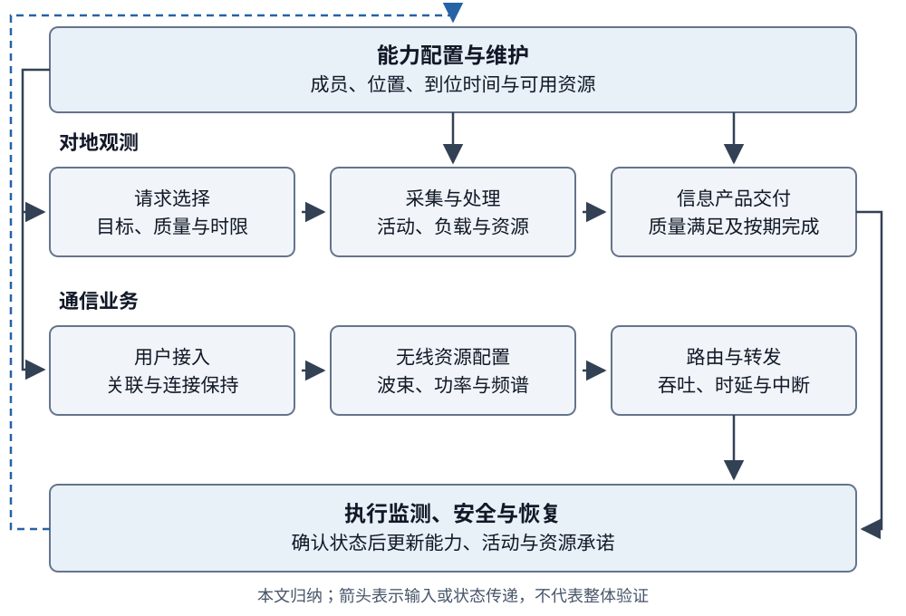
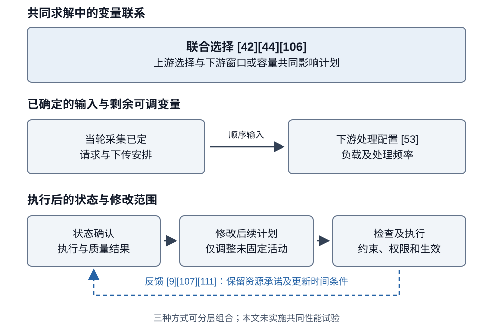

# 大型卫星星座智能管理与调度研究综述

Intelligent Management and Scheduling of Large Satellite Constellations: Service Completion, Resource Coupling, and Operational Feedback

**v2.0 · 2026-10-16 · 投稿前作者审阅稿；证据、声明和期刊适配尚待作者终核**

## 摘要

大型卫星星座的持续运行需要协调能力配置、时变业务需求与执行反馈。现有研究分别优化覆盖、任务收益、网络性能或安全处置，其决策范围与完成条件不同，限制了方法之间的直接比较。本文采用问题导向的叙述性综述，以对地观测和通信为核心业务，梳理长期能力维持、任务规划、网络资源管理以及安全与恢复的技术路线，并从业务完成条件、资源耦合和信息权限三个方面开展综合分析。代表研究表明，观测收益、下传数据量和按期完成请求对应不同结果；库存供应、资产恢复与业务恢复也具有不同时间含义。联合选择、顺序安排和运行反馈的适用性，取决于下游瓶颈能否改变当前选择、相关状态能否及时获得，以及修改能否在机会到期前生效。计算评价还应覆盖预处理、训练、求解、协调与配置生效，并保留限时未完成和成功样本的统计分母。公开接口、独立测量、软件原型和飞行案例进一步明确了模型与运行事件的对应范围。基于这些比较，本文提出面向共同业务结果、延迟信息和可修改资源的研究问题，为大型星座管理方法的选择与评价提供条件化依据。 <!-- [claim:C0001] [evidence:E018,E023,E034,E035,E042,E044,E053,E057,E058,E065,E074,E076,E092,E096,E098,E101,E106,E109,E121] -->

**关键词：** 大型卫星星座；任务调度；通信资源管理；在轨服务；运行反馈；自主运行

## Abstract

Sustained operation of large satellite constellations requires coordinating available capabilities, changing service demand, and execution feedback. Existing studies optimize coverage, task rewards, network performance, or safety under different decision scopes and completion criteria, which limits direct comparison. This problem-driven narrative review examines Earth observation and communications alongside capability maintenance, mission planning, network resource management, and recovery. It compares representative methods through service-completion criteria, resource coupling, and information and decision authority. Observation rewards, downloaded data volume, and requests completed by their deadlines describe different outcomes; inventory supply, asset restoration, and service recovery likewise represent different events. The suitability of joint selection, sequential allocation, and operational feedback depends on whether downstream bottlenecks alter current choices, whether relevant state information arrives in time, and whether revisions can take effect before opportunities expire. Computational evaluation should include preprocessing, training, optimization, coordination, and activation, while retaining time-limited outcomes and the denominators used for successful samples. Public interfaces, independent measurements, software prototypes, and flight cases further clarify the relationship between model outputs and operational events. The synthesis identifies research questions involving common service outcomes, delayed information, and revisable resources, providing conditional guidance for selecting and evaluating constellation management methods. <!-- [claim:C0002] [evidence:E018,E023,E034,E035,E042,E044,E053,E057,E058,E065,E074,E076,E092,E096,E098,E101,E106,E109,E121] -->

**Keywords:** large satellite constellations; mission scheduling; communication resource management; on-orbit servicing; operational feedback; autonomous operations

## 1 引言

### 1.1 从任务分配到持续运行

大型星座把重复出现的活动机会、持续到达的需求和多个决策主体置于同一运行过程中。增加卫星可以扩展候选观测窗口和接入机会，也会增加资源竞争、状态交换与计划更新的负担。自动化运行研究已将资源排程、监测、配置及轨道管理列为相互关联的扩展问题[1]。因此，评价管理与调度方法需要追踪一项安排如何利用可用能力、形成业务结果，并在状态改变后继续执行。 <!-- [claim:C0003] [evidence:E001] -->

对地观测与通信呈现了不同的服务过程。观测请求通常经过成像、处理和传输，以满足质量与时限的信息产品作为完成结果；通信业务围绕持续流量配置关联、波束、功率、频谱及路径。两者共享时间、能源、存储和地面设施，但完成一次成像、增加下传数据量与维持连接质量分别回答不同问题。空间物流研究进一步将部署、补给与重构纳入能力维持[2]。这些长期决定会改变后续可用的成员、位置与资源，安全干预和异常恢复则在运行中再次修改这些条件。 <!-- [claim:C0004] [evidence:E002] -->

### 1.2 已有综述与本文的分析重点

已有综述为各问题域提供了不同的组织方式。敏捷观测综述[3]比较任务模型、约束与求解方法，卫星调度综述[4]将成像、通信和集成调度置于观测任务背景中；其分类能够揭示活动安排的结构，跨论文结果仍需保留目标函数及模型差异。多智能体综述[5]以主体、协调架构和任务管理组织分布式空间系统；自动化运行研究[1][6]则关注运行职责、地面与星上功能及工具。通信专题综述[7][8]进一步涉及网络组织、控制及资源管理，而SatOps—NetOps研究[9]直接讨论平台运行和网络需求的连接。表1据此概括本文与既有研究的衔接，不将这些视角的差别解释为其他综述未覆盖某一领域的证明。 <!-- [claim:C0005] [evidence:E003,E004,E005,E001,E006,E007,E008,E009] -->

**表1 既有综述的组织对象与本文的比较问题**

| 代表文献 | 主要组织对象 | 本文衔接的比较问题 | <!-- [claim:C0006] [evidence:E018,E023,E034,E035,E042,E044,E053,E057,E058,E065,E074,E076,E092,E096,E098,E101,E106,E109,E121] -->
| --- | --- | --- |
| 观测与卫星调度[3][4] | 任务、资源约束与求解方法 | 采集、处理、下传与请求交付分别如何完成 | <!-- [claim:C0007] [evidence:E003,E004] -->
| 分布式空间系统[5] | 智能体、协调方式与任务管理 | 共享何种信息、何时共享、谁有权修改活动 | <!-- [claim:C0008] [evidence:E005] -->
| 自动化运行[1][6] | 运行职责、自动化模式及工具 | 计划输出如何经过执行检查而改变运行状态 | <!-- [claim:C0009] [evidence:E001,E006] -->
| 通信管理[7][8] | 网络组织、控制和资源配置 | 持续用户流量与观测数据下传的目标有何差别 | <!-- [claim:C0010] [evidence:E007,E008] -->
| SatOps—NetOps[9] | 平台运行与网络管理的交互 | 共同选择、顺序传递和反馈分别保留哪些权限 | <!-- [claim:C0011] [evidence:E009] -->

本文以业务完成为比较起点，围绕三个相互衔接的问题组织分析。第一，同类技术名称下的模型究竟奖励什么结果，研究中的成功事件与统计分母是否一致。第二，后续处理、传输或恢复条件在何时进入当前选择，哪些变量已固定，哪些仍可修改。第三，方法的收益建立在怎样的准备成本、信息条件和执行过程之上。第3章以代表研究展开这些比较，第4章归纳适用条件和可检验问题；本文不构造异构算例的统一性能排名。 <!-- [claim:C0012] [evidence:E018,E023,E034,E035,E042,E044,E053,E057,E058,E065,E074,E076,E092,E096,E098,E101,E106,E109,E121] -->

### 1.3 范围、选录方式与证据使用

本文是一篇问题导向的叙述性综述。文献来自既有主题文献库、代表研究的参考链追溯和专题补充，按管理职责及其对业务结果的作用选录。对地观测和通信是核心业务；构型、补给、在轨服务、安全与恢复按其支撑作用纳入。单星、地球同步轨道、深空及通用多智能体研究用于解释相关方法，论述中保留原任务域。“大型”表示成员、候选活动或协调规模已对求解和运行组织产生实质影响，不设置统一卫星数量阈值。“智能管理”涵盖基于状态与目标的优化、规则推理、协调和学习。 <!-- [claim:C0013] [evidence:E018,E023,E034,E035,E042,E044,E053,E057,E058,E065,E074,E076,E092,E096,E098,E101,E106,E109,E121] -->

比较字段包括决策对象、可选变量、资源约束、可获得的信息、更新权限、完成事件、评价量和验证环境。关键比较以已核读的正文段落为基础；仅有摘要或书目信息的研究用于方向性概述，不承载精确规模、算法细节或性能归因。作者稿与工作论文的方法按实际阅读版本说明。原研究观察、作者解释和本文归纳分别表述，文献版本与命题定位保存在配套记录中。该选录方式不支持穷尽性的文献频率估计，本文也不进行跨论文性能元分析；未覆盖的研究不能据此视为不存在。 <!-- [claim:C0014] [evidence:E018,E023,E034,E035,E042,E044,E053,E057,E058,E065,E074,E076,E092,E096,E098,E101,E106,E109,E121] -->

## 2 管理对象与比较基础

### 2.1 业务过程与可用能力

观测与通信共享平台资源，却具有不同的业务完成过程。观测管理需要把目标请求转化为可执行的采集、处理和交付活动；通信管理需要使有限资源持续响应空间分布和时间变化的流量。构型及维护决定能力在何处、何时可用，安全与恢复根据执行事件改变成员和任务状态。图1以业务过程为横向主线，以能力、资源与反馈为共同管理职责，避免将某个求解器等同于完整运行体系。 <!-- [claim:C0015] [evidence:E018,E023,E034,E035,E042,E044,E053,E057,E058,E065,E074,E076,E092,E096,E098,E101,E106,E109,E121] -->

图1 业务过程与共同管理职责。箭头表示任务、资源或状态的传递，为本文归纳；具体研究可以只优化其中一部分，不表示图中全部功能已在同一系统验证。 <!-- [claim:C0016] [evidence:E018,E023,E034,E035,E042,E044,E053,E057,E058,E065,E074,E076,E092,E096,E098,E101,E106,E109,E121] -->

### 2.2 决策时域、权限与资源承诺

长期配置选择资产、位置和未来能力，业务调度据此选择活动，执行与恢复再更新状态。时间尺度之外，还需要说明哪些决定可以修改。本文将已经确认的安排对后续选择的限制称为资源承诺，并区分其来源：预约服务的配置及变更规则[52]、接触图算法对已分配容量的保留[106]，以及激光链路建立的物理时间[121]分别约束不同环节。比较重规划时，应说明承诺由谁作出、是否允许撤回及修改何时生效。 <!-- [claim:C0017] [evidence:E052,E106,E121] -->

集中、分层和分布式描述信息汇集与决策权限；主问题—子问题分解描述求解组织；集中训练与分散执行描述学习阶段。一个方法可以同时具有这些特征。管理拓扑研究[10]关注成员组织及中心切换，观测分配研究[34][35]关注任务竞争和冲突信息。两者的消息范围、决策权限及计时对象需要分别报告。 <!-- [claim:C0018] [evidence:E010,E034,E035] -->

### 2.3 完成事件、评价量与比较分母

约束限定可行活动，目标函数决定模型奖励的结果。在观测链中，成像、质量满足、处理完成、数据下传和请求按期交付可以发生在不同时刻。联合观测—传输模型[42][44]即采用不同的奖励构造：按成功安排请求计权，与并列奖励观测和下传体积具有不同含义。通信吞吐、排队时延、公平性和中断也依赖各自的统计对象。表2将这些结果与决策变量并列，作为后文比较的基础。 <!-- [claim:C0019] [evidence:E042,E044] -->

**表2 管理对象、可选变量与结果定义**

| 管理对象 | 典型可选变量 | 需要明确的完成事件或分母 | <!-- [claim:C0020] [evidence:E018,E023,E034,E035,E042,E044,E053,E057,E058,E065,E074,E076,E092,E096,E098,E101,E106,E109,E121] -->
| --- | --- | --- |
| 观测请求 | 目标、成员、窗口及活动顺序 | 采集、质量满足、按期交付；重复观测的价值 | <!-- [claim:C0021] [evidence:E018,E023,E034,E035,E042,E044,E053,E057,E058,E065,E074,E076,E092,E096,E098,E101,E106,E109,E121] -->
| 处理与传输 | 处理节点、负载、频率及路径 | 处理结束、下传字节或完整产品；成功请求子集 | <!-- [claim:C0022] [evidence:E018,E023,E034,E035,E042,E044,E053,E057,E058,E065,E074,E076,E092,E096,E098,E101,E106,E109,E121] -->
| 通信业务 | 关联、波束、功率、频谱及路由 | 流量满足、排队/端到端时延、越限或实际中断 | <!-- [claim:C0023] [evidence:E018,E023,E034,E035,E042,E044,E053,E057,E058,E065,E074,E076,E092,E096,E098,E101,E106,E109,E121] -->
| 能力维持 | 备星、补给、设施及维修行动 | 库存供应、资产到位、任务能力恢复、业务重分配 | <!-- [claim:C0024] [evidence:E018,E023,E034,E035,E042,E044,E053,E057,E058,E065,E074,E076,E092,E096,E098,E101,E106,E109,E121] -->
| 安全与恢复 | 跟踪、机动、诊断及计划修复 | 风险信息、约束满足、安全退出及原任务恢复 | <!-- [claim:C0025] [evidence:E018,E023,E034,E035,E042,E044,E053,E057,E058,E065,E074,E076,E092,E096,E098,E101,E106,E109,E121] -->

评价量还应与试验总体一致。成功请求的平均时延不能替代全部请求的按期完成率，限时内找到可行解与证明最优也属于不同状态。本文据此同时考察结果、未完成情况及获取结果所需的成本。模型仿真、软件测试、硬件原型、运行接口、外部测量和飞行事件分别支持其实际观察对象。 <!-- [claim:C0026] [evidence:E018,E023,E034,E035,E042,E044,E053,E057,E058,E065,E074,E076,E092,E096,E098,E101,E106,E109,E121] -->

## 3 主要技术路线及代表研究比较

### 3.1 长期能力配置与持续维护

#### 3.1.1 构型选择与能力到位

构型设计的决策范围取决于目标状态是否预先给定。终端条件下的重构机动[11]、区域构型与卫星指派的共同选择[12]，以及已知阶段需求间的重构[13]，依次增加了终端位置或阶段之间的可选量。访问模式优化[14]利用覆盖的组合结构，不确定关注区域下的部署[15]则评价未来需求情景，并以增发成员补充能力。阶段数量增加说明规划范围扩大，其在线适应性仍取决于信息何时揭示和已部署成员是否允许改变。 <!-- [claim:C0027] [evidence:E011,E012,E013,E014,E015] -->

能力到位还受部署过程约束。Gwon和Ahn[16]将停泊、J₂引起的升交点赤经漂移、发射容量和完成窗口纳入设计；其筛选得到潜在可达对象，最终选集仍需满足覆盖要求。通信平台与星座联合设计[17]进一步把天线、波束及平台参数与地域需求相联系。两类研究分别说明形成能力需要的时间和单位资产能提供的容量。细化覆盖或波束能够增加选择，也会带来平台复杂度及运行配置负担，因而构型比较应报告目标能力、到位时刻与实现条件。 <!-- [claim:C0028] [evidence:E016,E017] -->

#### 3.1.2 补给状态与业务恢复

多级库存模型[18]将地面、停泊轨道和轨道面内备星连接起来，计入停泊层向轨道面补给的漂移与转移等待，同时将轨道面内备星接替视为即时可用。双通道研究[19]在间接补给之外加入直接注入，并保留面内即时替换等前提。马尔可夫链模型[20][21]进一步描述库存、接触机会及在途补给阶段。离散时间步、实际交付机会和资产到位时刻分别控制模型精度、供给条件和运行结果，不能用平均库存量替代全部时间信息。 <!-- [claim:C0029] [evidence:E018,E019,E020,E021] -->

集成在轨服务的维护研究[23]同时考虑运营方年维护成本与服务方利润，并用库存订货满足率约束供给水平。已核作者稿的案例允许较长维修周转与较高订货满足率并存，原因在于备件缓冲；这也说明维修历时与用户业务中断需要不同的状态描述。其经济前沿还受定价、可修复故障比例及修后如新等假设影响，不直接代表实际市场均衡。 <!-- [claim:C0030] [evidence:E023] -->

Iridium公开的备星部署[22]提供了备用能力投入的工程例子。将这些资料与库存模型连接时，可区分四个事件：替代资源可得、资源到位、任务能力恢复，以及受影响业务重新分配。已有模型细化了其中不同阶段。进一步评价通信中断或未满足观测请求，需要把这些事件与共同的故障和需求序列关联；这是本文提出的比较接口。 <!-- [claim:C0031] [evidence:E022] -->

#### 3.1.3 设施布局、访问与滚动维护

服务设施通过位置和客户分配限定维护可达范围。轨道仓库研究[24]先在离散候选中选择设施与指派，再在固定部分决定后连续细化；位置—线路模型[25]则交替更新连续位置与多客户线路。两者的差别在于哪些变量共同变化，而非简单的离散与连续之分。服务船预部署[26]、滚动物流[27]、高低推力服务框架[28]及生命周期评估[29]进一步涉及潜在需求、动态需求、转移代价与不确定性。 <!-- [claim:C0032] [evidence:E024,E025,E026,E027,E028,E029] -->

这些模型连接日常调度的输出是带有时间、位置和剩余资源的能力。[27]在滚动时域内只执行计划前缀，并在需求揭示后更新后续安排；[28]则使推进条件和质量影响转移的可用范围。共同的比较问题是：当前计划依据哪些已知需求，下一轮仍可修改哪些资产和活动，以及求解预算内返回的安排何时能够执行。固定客户顺序下的位置细化、后验多客户组合与全时域联合路由应分别解释。 <!-- [claim:C0033] [evidence:E027,E028] -->

### 3.2 对地观测与在轨服务调度

#### 3.2.1 活动选择与跨星协调

观测调度把请求选择转化为满足姿态和可见窗口的活动序列。经典研究[30]比较了特定窗口约束问题中的贪心、动态规划、约束规划和局部搜索，后续研究将强化学习[31]、分解学习[32]及能量感知分支定价[33]用于相关调度问题。算法分类有助于识别求解思路；其可扩展性还取决于候选窗口、冲突结构、资源模型及停止条件。本文对尚未取得方法正文的来源保留方向性介绍，不引入其精确优化界或实验规模。 <!-- [claim:C0034] [evidence:E030,E031,E032,E033] -->

已核分布式实例展示了信息与计算的具体取舍。Parjan和Chien[34]比较集中、广播及高度去中心化分配，增量规划减少重复计算，也保留了更多重复观测。Zilberstein等[35]利用几何邻域和分布式约束优化压缩协调范围，同时评价任务满足、计算及消息量。前者复用旧计划，后者利用竞争的局部结构；两者都应将节省的成本与任务结果并列，且应区分并行时间估算和实际测量。 <!-- [claim:C0035] [evidence:E034,E035] -->

协调方法的保证取决于信息与评分条件。多主体观测模型[36]区分请求所属主体和协调角色；一致性任务包算法（CBBA）[37]交换赢家、报价和时间戳，并在规定的评分及通信条件下消解冲突。其贪心等价和价值界具有各自前提。通信约束下的在线调度[38]、延迟通信协同规划[39]、不确定环境协调[40]及异步市场方法[41]进一步涉及消息可达性与状态变化。将这些方法迁移到星座时，需要核对任务互补价值、消息传播条件和最终执行权限。 <!-- [claim:C0036] [evidence:E036,E037,E038,E039,E040,E041] -->

#### 3.2.2 观测、处理与交付的连接

联合安排观测与传输可以使下游机会影响目标选择，但具体收益由完成定义决定。He等[42]的作者公开稿以期限内完成观测和传输的请求加权值为目标，将窗口关联与窗内配置分层求解；其模型采用无误码传输，并忽略成像角度对图像质量的影响。因此，该结果主要说明所设窗口与资源条件下的请求安排。 <!-- [claim:C0037] [evidence:E042] -->

Rocha等[44]的机构工作论文同时奖励观测收益与向地面下传的数据量，并考虑姿态、存储和能源。两个奖励项需要分别解释，下载更多数据不必对应更多完整请求。其图缩减依赖重叠任务分组及必要切换约束的覆盖，简化整数模型还可能舍弃可行解。图表示、模型简化和邻域求解因而是不同的计算处理，应分别分析对可行序列和搜索成本的作用。这里采用的是工作论文的方法，期刊版对应关系保留在来源记录中。能源约束联合调度[43]和异构提示—精细观测任务[45]则补充了能源及前后任务依赖的研究方向。 <!-- [claim:C0038] [evidence:E044,E043,E045] -->

地面设施使链路机会进一步受到共享容量约束。单星多站调度[46]、卫星控制网络[47]、下传排程[48]及深空网络（DSN）优化[49]采用不同的实例结构、人工输入和求解预算；深空网络运营[50]还包含请求解释、候选安排、协商与确认。所引Planet和AWS公开文档[51][52]分别定义质量/交付状态与预约配置。它们为模型中的完成事件和承诺变更提供操作参照，算法性能仍应由相应实验评价。 <!-- [claim:C0039] [evidence:E046,E047,E048,E049,E050,E051,E052] -->

Soret等[53]的作者稿采用另一种连接方式：先确定采集负载及下传安排，再联合配置星地处理负载和频率。其采集阶段省略存储约束，处理阶段约束平均时延；固定流水线及稳定星间链路支持分阶段求解。质量失败还可触发下一轮重采。因此，本次处理优化保持上游计划，与跨轮次质量反馈可以同时存在；平均处理时延也应与逐帧截止期区分。 <!-- [claim:C0040] [evidence:E053] -->

卸载及协同推理研究[54][55][56]主要围绕计算位置和资源管理。已核轨道感知调度[57]把离开地面可见域作为返回结果的边界，成功计数可包含超过业务截止期、但离域前完成的请求；其成功比例和平均响应时间应保留各自分母。Kodan[58]则通过专用模型、图块和处理跳过，将处理配置连接到下传中高价值比特的比例，提供了已有的价值映射。其地面硬件测量及轨道链路仿真仍对应特定任务，价值密度与完整产品交付需要分别评价。 <!-- [claim:C0041] [evidence:E054,E055,E056,E057,E058] -->

#### 3.2.3 动态请求与学习作用的位置

动态任务研究以分层规划[59]、学习辅助大邻域搜索[63]及滚动时域学习[64]等方式更新安排。不确定性模型还决定了获得新信息后能否改排。云量机会约束[60]、收益扰动预算下的鲁棒模型[61]及多阶段随机模型[62]采用不同的不确定性表达。特别是，[61]的预算参数控制收益扰动的保守范围，[62]的两阶段形式评价既定计划，三阶段形式才允许在天气信息揭示后修改未来活动。阶段名称和保守程度均需对应实际可改变量。 <!-- [claim:C0042] [evidence:E059,E063,E064,E060,E061,E062] -->

学习方法还应按其在完整流程中的位置比较。[63]以强化学习辅助搜索，其全文中的模块贡献仍待核；更具正文依据的单星策略复用[65]将训练策略用于多个成员，配合动作屏蔽、分配及完成状态共享。共享已完成状态有助于减少重复，却未直接提供同一决策时段的未来意图。Basilisk中的算法比较[66]进一步把策略、训练和安全动作处理置于共同仿真流程。在线推理快、生成可行动作和跨星无冲突分配分别依赖不同环节，评价时应报告它们各自的作用和成本。 <!-- [claim:C0043] [evidence:E063,E065,E066] -->

#### 3.2.4 在轨服务的转移与补给

在轨服务的候选活动由轨道转移及服务资源共同生成。可加注多轨服务[67]、不确定持续时间调度[68]、多服务星规划[69]及混合加注与碎片移除[70]分别涉及访问、补给、转移和不确定性。它们与观测调度共享选择及排序结构，但改变访问顺序还会改变质量、时刻和后续可达性，边权的物理含义必须与所用推进模型一致。 <!-- [claim:C0044] [evidence:E067,E068,E069,E070] -->

低推力预计算研究[72]在轨道、质量及时刻等维度生成代价，再利用插值支持序列搜索；漂移服务研究[71]则联合推力—漂移—推力转移、访问与加注。两者都需保留相位处理的边界。[72]的飞行时间由控制权重及终止准则等共同产生，代价表不自动支持任意指定到达时刻。评价此类方法时，应同时说明预计算成本、插值参照、直接动力学复核及未纳入的终端条件。 <!-- [claim:C0045] [evidence:E072,E071] -->

**表3 观测与服务调度中的代表性决策组织**

| 研究路线 | 主要决定或机制 | 比较条件 | <!-- [claim:C0046] [evidence:E018,E023,E034,E035,E042,E044,E053,E057,E058,E065,E074,E076,E092,E096,E098,E101,E106,E109,E121] -->
| --- | --- | --- |
| 学习与结构化优化[31][32][33] | 观测调度的学习或数学规划方法 | 本文仅作方向性概述；方法正文未确认 | <!-- [claim:C0047] [evidence:E031,E032,E033] -->
| 增量与几何邻域[34][35] | 计划复用或局部竞争协调 | 重复观测、任务满足、消息及计时范围 | <!-- [claim:C0048] [evidence:E034,E035] -->
| 拍卖与异步协调[37][38][41] | 竞价、冲突消解与消息传播 | 评分前提、网络条件和原任务域 | <!-- [claim:C0049] [evidence:E037,E038,E041] -->
| 观测—传输[42] | 期限内成功请求的加权收益 | 作者稿；无误码传输和图像质量简化 | <!-- [claim:C0050] [evidence:E042] -->
| 观测—下传[44] | 观测收益及数据量；图缩减与邻域求解 | 工作论文；分组、切换约束和可行域变化 | <!-- [claim:C0051] [evidence:E044] -->
| 顺序处理配置[53] | 固定本轮采集，再配置负载与频率 | 作者稿；平均时延、质量重采及流水线 | <!-- [claim:C0052] [evidence:E053] -->
| 计算与信息价值[57][58] | 处理机会、成功返回或价值密度 | 截止期、成功子集、误判及硬件条件 | <!-- [claim:C0053] [evidence:E057,E058] -->
| 策略复用[65][66] | 学习策略与屏蔽、分配或状态共享 | 训练、推理和跨星协调分别计量 | <!-- [claim:C0054] [evidence:E065,E066] -->
| 低推力服务[71][72] | 转移代价生成、访问及补给 | 质量、时间、相位与预计算/复核成本 | <!-- [claim:C0055] [evidence:E071,E072] -->

### 3.3 通信网络管理与资源调度

#### 3.3.1 需求估计、波束与功率

流量预测为配置提供输入，配置再将资源转化为服务。预测研究[73]在合成自相似流量上组合经验模态分解、自回归模型与神经网络，评价的是需求预测误差，路由应用被列为后续工作。因而，预测对吞吐或排队的作用需要通过使用预测的具体策略说明。 <!-- [claim:C0056] [evidence:E073] -->

波束与功率研究[74]的作者稿先按平均功率选束，再固定当槽选择优化连续功率，并随到达和剩余需求更新。所设单星场景以供需平方差及满意度比的Jain指数评价匹配与公平性。对照采用相同选束规则而改变功率处理，但队列变化仍可能影响后续选择；该比较更适合解释分阶段配置的作用，而非整段时域中固定全部照射动作的单因素消融。 <!-- [claim:C0057] [evidence:E074] -->

多星覆盖重叠引入关联及共存。负载平衡波束跳变[75]的摘要涉及非地球同步轨道（NGSO）与地球同步轨道（GSO）系统共存；需求感知资源分配[76]的作者稿则由数字孪生侧多星选束与星内连续功率配置协作完成，并显式表示队列。其公平量使用覆盖小区队列包龄的极差，与[74]的Jain指数方向和对象均不同。原文的固定功率与动态功率对照还同时改变功率动作与配置组织，吞吐差异随负载而变化。这些结果表明，增加决策自由度的价值需要放在实际瓶颈及共同对照条件下解释。 <!-- [claim:C0058] [evidence:E075,E076,E074] -->

#### 3.3.2 接入切换与服务变化

接入选择可以把即时链路质量与后续网络代价结合。切换研究[77]的公开摘要将端到端时延及切换开销纳入学习策略，为接入与路由的衔接提供研究方向。其效果还需对应业务保持时间、路径和信息更新条件，本文不据摘要拆分模块收益。 <!-- [claim:C0059] [evidence:E077] -->

独立测量为这些模型提供了不同性质的证据。Mohan等[78]观察到Starlink重配置边界附近的时延和吞吐变化，并在仅有单颗候选卫星的受控连接窗口中仍观察到波动。这支持服务变化在相应条件下无需以卫星切换为前提；周期性网络调度属于原作者对现象的解释。该例提示应分别记录接入对象、资源配置状态和最终业务性能。 <!-- [claim:C0060] [evidence:E078] -->

#### 3.3.3 路由结构与配置生效

无直接星间链路的路由[79]及地面辅助流量工程[80]围绕地面转发组织路径、流量和恢复，本文仅按摘要说明其研究对象。动态激光链路研究[121]的作者稿则把建立新链路的时间纳入路径选择。其模型提前计算并分发路径，省略排队与初始配置时延；在给定建链代价下，路径保持及活动感知策略表现出不同取舍。部分保持策略在低建链代价时会增加平均时延，不能据此概括所有活动感知方法。 <!-- [claim:C0061] [evidence:E079,E080,E121] -->

该研究的性能实验与计算成本分析还采用不同裁边设置[121]，需要分别解释。更一般地，路径搜索耗时、控制消息传播和链路建立时间决定了不同阶段的更新成本。适合高建链代价的策略，在队列主导或状态滞后的业务中还需重新评价，路径寿命本身不足以确定完整服务收益。 <!-- [claim:C0062] [evidence:E121] -->

#### 3.3.4 分层配置与局部权限

分层资源管理[81]将网络控制中心、空间基站和终端置于不同职责层级，以全局服务区域及频谱配置约束局部波束、时隙和信道安排，并交换需求与价格。其不同实验对应不同组件及负载，不能把组件收益相加为整体架构增益。分层的关键作用不仅是减少计算规模，还在于明确谁能修改哪些资源、使用何种状态以及上层配置何时对局部决策有效。 <!-- [claim:C0063] [evidence:E081] -->

**表4 通信研究中的结果定义与主要条件**

| 研究 | 决策或观察对象 | 需要保留的条件 | <!-- [claim:C0064] [evidence:E018,E023,E034,E035,E042,E044,E053,E057,E058,E065,E074,E076,E092,E096,E098,E101,E106,E109,E121] -->
| --- | --- | --- |
| 流量预测[73] | 需求估计误差 | 合成流量；配置效果需另评 | <!-- [claim:C0065] [evidence:E073] -->
| 单星波束—功率[74] | 供需匹配和满意度公平性 | 作者稿；分阶段选择、队列随时间变化 | <!-- [claim:C0066] [evidence:E074] -->
| 共存配置[75] | 关联与照射模式 | 摘要级方向；NGSO—GSO场景 | <!-- [claim:C0067] [evidence:E075] -->
| 需求感知配置[76] | 多星选束、功率和包龄公平量 | 作者稿；整体策略对照、负载依赖 | <!-- [claim:C0068] [evidence:E076] -->
| 接入选择[77] | 接入及后续路径代价 | 摘要级方向；模块贡献未分离 | <!-- [claim:C0069] [evidence:E077] -->
| 独立测量[78] | 时延及吞吐变化 | 单候选卫星窗口；内部机制为解释 | <!-- [claim:C0070] [evidence:E078] -->
| 地面辅助网络[79][80] | 分层路由、流量与恢复 | 摘要级方向；转发结构不同 | <!-- [claim:C0071] [evidence:E079,E080] -->
| 动态激光链路[121] | 路径与建链代价 | 作者稿；无队列、预分发；成本配置另列 | <!-- [claim:C0072] [evidence:E121] -->
| 分层管理[81] | 全局配置与局部响应 | 层间权限、交换信息及组件实验范围 | <!-- [claim:C0073] [evidence:E081] -->

### 3.4 安全执行与异常恢复

#### 3.4.1 从风险信息到处置输入

安全信息链包含不同计算任务。最近接近方法[82]利用分段近似及距离极值搜索细化候选事件；筛查与CUDA研究[84]压缩配对并组织并行计算，其速度和遗漏表现依赖目录、步长及实现。风险感知跟踪[83]则属于利用风险与信息增益配置传感器的研究方向。三者分别改变单个候选的精算成本、候选集合和输入质量，宜按环节组合评价。 <!-- [claim:C0074] [evidence:E082,E084,E083] -->

风险预测竞赛[87]估计后续报文中的风险，机动综述[86]整理可选处置方法，运行仿真[85]生成用于规则评估的场景与接近事件。竞赛综合分数、事件生成一致性与机动安全对应不同验证对象。CCSDS报文[88]和所引Starlink流程[89]进一步说明跨组织信息、风险重估及动作更新的接口。将风险处置接入业务调度，还需记录机动占用及其后可用活动，而不是以风险估计值直接替代任务结果。 <!-- [claim:C0075] [evidence:E087,E086,E085,E088,E089] -->

#### 3.4.2 轨迹安全与上层任务条件

轨迹研究将安排转化为受动力学约束的动作。被动安全交会[90]、锥优化[91]、反馈模型预测控制（MPC）[92]、机会约束交会[93]、视觉伺服[94]及特定轨道下的连续安全约束[95]提供了不同表达。本文按其原任务域比较条件，不将它们直接列为同一星座调度问题的性能竞争者。 <!-- [claim:C0076] [evidence:E090,E091,E092,E093,E094,E095] -->

已核方法进一步揭示保证的层次。[91]的凸子问题、逐次更新过程与原非线性问题具有不同的最优性和计时范围；[92]的避碰半空间、通信范围、误差界、离散步长及求解期限共同限制安全结论。通过延长终止时刻恢复可行性还可能改变上层活动的时间承诺。[93]的设计概率和有限样本检验、[95]的连续约束表达和数值容差也需分开解释；完全失推保护的结论应保留对部分推力不足的排除范围。 <!-- [claim:C0077] [evidence:E091,E092,E093,E095] -->

安全屏蔽研究[96]说明对照设置同样重要。同一学习策略的屏蔽开关实验，与未屏蔽策略对概率路线图的燃料—时间比较属于两组不同试验；后者还使用不同样本数量。屏蔽会改变允许动作和安全要求，路线图在执行机动时也进行状态校正。因此，比较应报告被改变的机制、安全标准和执行更新，而非仅使用“开环”或“闭环”标签。 <!-- [claim:C0078] [evidence:E096] -->

ADRAS-J公开记录的自主中止与安全后撤[97]提供了实际事件参照。安全退出保护了航天器，但原定接近或服务活动的后续完成仍需另行判断。业务层评价由此需要同时记录安全结果、被放弃或推迟的活动以及恢复后的能力。 <!-- [claim:C0079] [evidence:E097] -->

#### 3.4.3 告警、诊断与计划恢复

遥测异常检测为恢复提供线索。[98]将预测残差、平滑、阈值及告警区间处理结合，主要对照中的收益应归于实际变化的后处理；不平衡数据检测[99]和持续学习[100]则分别涉及不确定性与模型更新。评价复核[101]显示，测试标签、阈值选择及事件匹配规则会改变离线分数。告警命中、及时发现、准确诊断与恢复成功因此需要各自的结果定义。 <!-- [claim:C0080] [evidence:E098,E099,E100,E101] -->

故障检测、隔离与恢复（FDIR）规则原型[102]将故障事实、动作选择、执行及结果确认连接起来，并在恢复后向导航模式交接。Schedule Manager[103]和反应式计划修复[104]分别提供预定义应急安排与在线修复的研究方向。评价恢复时，关键问题是诊断依据何时可用、由谁授权动作、如何确认效果以及剩余任务如何继续。规则覆盖、模型知识和重新生效的时间会共同影响适用范围。 <!-- [claim:C0081] [evidence:E102,E103,E104] -->

**表5 安全与恢复的输出及验证对象**

| 环节及代表来源 | 直接输出 | 需要核对的保证范围 | <!-- [claim:C0082] [evidence:E018,E023,E034,E035,E042,E044,E053,E057,E058,E065,E074,E076,E092,E096,E098,E101,E106,E109,E121] -->
| --- | --- | --- |
| 接近计算与筛查[82][84] | 候选事件及最近接近结果 | 传播/数值参照、目录、步长与遗漏 | <!-- [claim:C0083] [evidence:E082,E084] -->
| 跟踪、预测与场景[83][85][87] | 测量分配、后续风险或事件列表 | 各自数据、评分与场景；处置效果另评 | <!-- [claim:C0084] [evidence:E083,E085,E087] -->
| 安全轨迹[90][91][92][93][94][95] | 轨迹、控制及条件化约束保证 | 原任务域、误差/分布、连续性与求解期限 | <!-- [claim:C0085] [evidence:E090,E091,E092,E093,E094,E095] -->
| 学习屏蔽[96] | 经检查的动作及安全干预 | 两组对照、安全标准和执行校正 | <!-- [claim:C0086] [evidence:E096] -->
| 检测与模型更新[98][99][100][101] | 异常线索或检测模型 | 阈值、标签、分母及部署条件 | <!-- [claim:C0087] [evidence:E098,E099,E100,E101] -->
| 故障及计划恢复[102][103][104] | 恢复动作或后续活动安排 | 原型/模型、效果确认与任务交接 | <!-- [claim:C0088] [evidence:E102,E103,E104] -->

### 3.5 多问题连接与综合运行

#### 3.5.1 联合选择、顺序输入与反馈

自动化工具[6]和可信自主运行综述[105]提供了功能组织背景，具体连接仍需回到决策变量。[106]的接触图调度为请求选择采集节点并检验交付路径，扣减已分配容量；逐请求交付及成功样本时延是其主要评价量，模型还假设能源与存储无限。[42]在观测—传输请求层共同安排，[44]采用观测与下传体积奖励，[53]保留当轮采集后优化处理。它们都连接相邻活动，但保留的上游修改权限及完成语义不同。 <!-- [claim:C0089] [evidence:E006,E105,E106,E042,E044,E053] -->

接触不可靠时，[106]还允许传输阶段依据当前连接局部选择路径。保留任务分配并允许绕行，与重新选择采集节点具有不同反馈范围。图2据此区分同次选择、先后输入和执行反馈；它们可在不同层次组合，而非互斥的架构等级。 <!-- [claim:C0090] [evidence:E106] -->

图2 联合选择、顺序安排与运行反馈。图中代表研究按实际阅读版本解释：共同选择[42][44][106]、顺序配置[53]及状态更新[9][107][111]。虚线表示反馈只作用于仍允许修改的活动；图示为本文归纳。 <!-- [claim:C0091] [evidence:E042,E044,E106,E053,E009,E107,E111] -->

#### 3.5.2 统一模型与状态驱动配置

SatOps—NetOps框架[9]把平台资源与网络需求写入任务模型，通过构造、局部搜索和事件触发重排形成安排；其架构分类与具体集成原型的性能实验应分别理解。分层管理[81]则用上层配置约束局部响应。两者都连接职责，区别在于是否共同选择变量，以及配置传递后局部仍保留哪些权限。 <!-- [claim:C0092] [evidence:E009,E081] -->

推理式观测调度[107]根据预测的观测、传输、存储和能源状态调整策略权重，再插入任务并检查约束。这使资源状态参与活动选择，其模型预测、规则和活动构造仍有不同职责。该方法的单星仿真与多星统一任务模型提供互补例子，均需保留各自的状态表达和验证范围。 <!-- [claim:C0093] [evidence:E107] -->

#### 3.5.3 从计划到执行的功能交接

Remote Agent[108]将规划、执行及诊断连接起来，并处理局部失败活动与全局约束之间的恢复关系。EO-1[109]进一步展示科学分析产生目标、CASPER调整活动、SCL检查执行的流程，同时保留地面规划和星历更新。IPEX[110][111]提供单星星上处理与持续规划经验。参考架构[112]和cFS演示包[113]则分别描述功能职责与软件连接，其用途与飞行事件不同。 <!-- [claim:C0094] [evidence:E108,E109,E110,E111,E112,E113] -->

Starling[114]以四星共享观测状态并协调后续观测；Starling 1.5[115]在模拟接近场景中进行责任协调和实际机动。这些案例扩大了共享信息和动作权限的范围，但观测选择与跨运营方处置具有不同触发事件。Basilisk[116]及形式化研究[117]为模型仿真和规格检查提供工具。综合运行的评价需要进一步确认状态、计划及动作是否按同一语义交接，以及最终业务结果如何产生。 <!-- [claim:C0095] [evidence:E114,E115,E116,E117] -->

## 4 综合认识与研究问题

### 4.1 以共同结果和完整成本解释可扩展性

技术收益首先来自被利用的问题结构。窗口分层[42]、图缩减及邻域求解[44]、轨迹预计算[71][72]、计划复用[34]和几何邻域[35]分别改变搜索维度、候选表示、准备成本和协调范围。较少的变量或消息能够降低部分负担，也可能保留更多冗余或舍弃候选。对图变换、保守约束和候选筛选，应同时检查解质量和可行活动集合的变化。 <!-- [claim:C0096] [evidence:E042,E044,E071,E072,E034,E035] -->

规模比较还应区分系统对象、实际入模需求和候选变量。[28]可按时域内需求压缩服务对象，[48]的不同排列可映射到同一排程，而情景展开[62]会使少量物理成员形成大量变量。名义卫星数不能单独代表搜索难度。限时可行率、求解器间隙及未完成原因应与质量指标共同报告；[25]成功实例上的平均改善即需要同时保留成功率，未在预算内找到安排也不能直接解释为物理不可行。 <!-- [claim:C0097] [evidence:E028,E048,E062,E025] -->

完整决策成本包括候选与模型准备、在线求解及协调、修改后的资源生效。轨迹网格[72]和学习策略[65]把部分计算前移，DSN求解[49]还包含特定准备及撤收约束，动态链路[121]则对新连接显式计时代价。预处理能否摊销取决于复用次数和环境变化，单次求解时间应放在剩余活动窗口中解释。可复核的比较宜同时给出准备成本、重复次数、在线预算、消息开销和资源生效时刻，并使用相同的业务定义。 <!-- [claim:C0098] [evidence:E072,E065,E049,E121] -->

### 4.2 资源耦合何时值得共同求解

扩大决策范围的价值取决于下游约束能否改变当前候选。[42]让传输窗口参与观测安排，[106]在采集节点选择时检查交付容量，[53]则在采集固定后配置计算资源。若下游瓶颈会淘汰某些上游选择，将其提前纳入模型可以避免占用无法兑现的机会；若上游已经执行，适用问题便转为剩余资源配置或下一轮反馈。该区别由变量和承诺决定，而非“联合”这一名称。 <!-- [claim:C0099] [evidence:E042,E106,E053] -->

共同选择还要面对计算、信息及时机条件。图缩减或模型简化[44]可能改变表示和可行范围；迟到的下游状态会降低共同模型对当前任务的解释能力；可撤销活动若仍有充足修正时间，顺序安排加反馈也可能适用。表6据代表研究给出条件化分析。它是本综述的定性归纳，尚不是统一阈值定理或三类方式的共同实验结果。 <!-- [claim:C0100] [evidence:E044] -->

**表6 决策连接的适用条件与评价要求**

| 连接方式及参考研究 | 主要适用条件 | 应固定的比较口径 | 主要代价 | <!-- [claim:C0101] [evidence:E018,E023,E034,E035,E042,E044,E053,E057,E058,E065,E074,E076,E092,E096,E098,E101,E106,E109,E121] -->
| --- | --- | --- | --- |
| 联合选择[42][44][106] | 下游状态可得且影响当前节点、窗口或次序 | 完成定义、奖励分项、候选与部分交付规则 | 耦合规模、近似及可行集合变化 | <!-- [claim:C0102] [evidence:E042,E044,E106] -->
| 顺序配置[53][74] | 上游已定，下游仍有可调资源 | 固定变量、输入负载及局部目标 | 上游在本次求解中保留的限制 | <!-- [claim:C0103] [evidence:E053,E074] -->
| 状态反馈[9][107][111] | 新状态已确认，后续活动尚可修改 | 状态版本、更新窗口和已承诺资源 | 信息传播、重排、冲突检查及生效 | <!-- [claim:C0104] [evidence:E009,E107,E111] -->
| 分层组合（本文归纳） | 各阶段具有不同信息、时域及权限 | 共同任务/扰动、层间输入及交接事件 | 权限交叠、重复调整及状态不一致 | <!-- [claim:C0105] [evidence:E018,E023,E034,E035,E042,E044,E053,E057,E058,E065,E074,E076,E092,E096,E098,E101,E106,E109,E121] -->

业务瓶颈还会改变单个模块的价值。Kodan[58]中，处理时间是否达到帧期限，会改变提速与分类精度对有效下传的作用；波束和功率研究[74][76]中，负载及队列决定配置自由度的作用。评价联合程度时，宜先保持完成定义、负载和资源条件一致，再分别改变允许修改的变量。这样才能区分来自信息利用、资源自由度和奖励构造的差异。 <!-- [claim:C0106] [evidence:E058,E074,E076] -->

### 4.3 信息、权限与学习模块的接口

信息共享的作用取决于待协调的决定。完成状态[65]帮助识别已满足目标，同步竞争还需要分配或意图信息；通信约束调度[38]关注消息机会，异步算法在有损网络下的表现需要单独评价[118]。标准CBBA[37]的评分和传播条件、分层管理[81]的权限分配也会限制结论。信息内容、获得时刻和修改权限应共同写入比较，而不是用一个“可通信”假设替代。 <!-- [claim:C0107] [evidence:E065,E038,E118,E037,E081] -->

资源承诺进一步确定更新范围。预约规则[52]、既有容量分配[106]及新链路建立[121]分别约束组织、算法和物理执行。局部修复与全局重算的比较，应使用相同状态、承诺和生效条件，评价保留旧计划、修改后续活动或采取保守响应造成的业务差异。 <!-- [claim:C0108] [evidence:E052,E106,E121] -->

学习的贡献则应对应明确模块。需求预测[73]输出状态估计，搜索辅助[63]提供求解线索，策略复用[65]生成动作，屏蔽[96]检查可执行性，模型更新[100]改变后续检测器。具体比较需要记录训练与部署条件、下游约束及替代模块。整体方案同时改变网络、候选、约束或安全要求时，应报告整体效果；单模块归因则需要在共同任务及相同其他条件下检验。 <!-- [claim:C0109] [evidence:E073,E063,E065,E096,E100] -->

### 4.4 运行实践及验证范围

工程资料的价值在于明确模型中的事件如何落到实际职责。表7将公开接口、测量、原型与飞行案例按观察对象组织。Planet与AWS文档[51][52]解释完成状态及预约，DSN运营[50]补充候选、协商与确认，独立测量[78]观察服务现象，EO-1和Starling系列[109][114][115]展示限定任务中的状态反馈与执行。它们为综述提供互补依据，各自的验证对象仍须保留。 <!-- [claim:C0110] [evidence:E051,E052,E050,E078,E109,E114,E115] -->

**表7 运行资料与工具能够支持的认识**

| 资料或案例 | 公开的状态、动作或性质 | 对综述的用途与边界 | <!-- [claim:C0111] [evidence:E018,E023,E034,E035,E042,E044,E053,E057,E058,E065,E074,E076,E092,E096,E098,E101,E106,E109,E121] -->
| --- | --- | --- |
| Iridium[22] | 备用资产投入 | 能力配置例子；库存最优性及恢复时间另评 | <!-- [claim:C0112] [evidence:E022] -->
| Planet、AWS与DSN[50][51][52] | 质量、交付、预约及安排确认 | 完成事件和承诺过程；内部优化性能另评 | <!-- [claim:C0113] [evidence:E050,E051,E052] -->
| Starlink流程及独立测量[78][89] | 风险行动流程；时延与吞吐现象 | 运营方说明与外部测量分开解释 | <!-- [claim:C0114] [evidence:E078,E089] -->
| ADRAS-J[97] | 异常后的自主中止及后撤 | 安全处置事件；原任务后续完成另评 | <!-- [claim:C0115] [evidence:E097] -->
| EO-1与IPEX[109][110][111] | 星上处理、重规划与执行检查 | 单星功能交接及地面职责 | <!-- [claim:C0116] [evidence:E109,E110,E111] -->
| Starling系列[114][115] | 共享观测与实际机动协调 | 试验目标、成员规模及模拟事件条件 | <!-- [claim:C0117] [evidence:E114,E115] -->
| CCSDS、cFS及形式化研究[88][113][117][119][120] | 报文、组件与规格性质 | 互操作及软件依据；业务结果另评 | <!-- [claim:C0118] [evidence:E088,E113,E117,E119,E120] -->

验证链应将所用工件、性质和环境对应起来。受监督重配置[119]与模型检查[120]讨论配置及规格性质，规则原型[102]测量特定软硬件过程，Basilisk[116]支持可配置动力学仿真。规格满足、模型可行、有限样本无违反和飞行事件分别具有不同的证据含义。资源限制导致的未完成分析也应保留，避免将软件验证通过直接解释为持续服务得到改善。 <!-- [claim:C0119] [evidence:E119,E120,E102,E116] -->

### 4.5 面向持续服务的研究问题

首先，可在共同故障与需求序列下连接能力恢复和业务损失。库存、双通道补给与维修[18][19][23]提供不同恢复途径，比较应分别记录资源可得、到位、载荷恢复和业务重分配时间，再评价未满足请求或通信中断。这允许使用分层及事件驱动模型，不要求把全部库存、轨迹与活动一次联立。 <!-- [claim:C0120] [evidence:E018,E019,E023] -->

其次，可在同一任务样本下检验决策连接范围。围绕[42][44][53][106]所示机制，设置采集优先、顺序处理与下传、共同选择以及允许事件修复的方案，保持窗口、存储、容量和截止期一致，并预先确定请求完成与数据量的分项指标。比较最终业务结果、限时可行率和准备/在线/执行成本，可以检验表6的条件分析。本文提出的是后续试验设计，未实施这些跨论文复现。 <!-- [claim:C0121] [evidence:E042,E044,E053,E106] -->

最后，在线调整与学习评价可使用共同的事件时间轴。记录任务到达、状态确认、求解结束、冲突消解和配置生效，区分已完成、未来意图及已承诺资源[52][65][81][106][121]；为预测、搜索辅助和动作生成设置对应替代方法，并保留训练、推理与修复成本。共同输入能够增强比较的解释力，轨道模型、权限和验证保真度的差异仍需单列。 <!-- [claim:C0122] [evidence:E052,E065,E081,E106,E121] -->

## 5 结论

本文以对地观测与通信为核心，比较了大型星座能力维持、任务安排、网络配置以及安全恢复的代表研究。各路线连接业务的方式不同：构型和补给决定能力可用的时间与位置，观测调度安排离散请求，通信管理响应持续流量，安全和故障处置再改变后续状态。共同的比较基础是明确决定、完成事件及其约束，而非仅按算法家族归类。 <!-- [claim:C0123] [evidence:E018,E023,E034,E035,E042,E044,E053,E057,E058,E065,E074,E076,E092,E096,E098,E101,E106,E109,E121] -->

代表文献支持三点条件性认识。第一，收益应对应具体完成定义和统计分母，并与完整决策成本共同报告。第二，联合、顺序与反馈的适用性由下游瓶颈、状态时效和可修改活动共同决定；这些方式可以分层组合。第三，信息共享和快速生成计划仍需通过权限、冲突检查及执行交接形成业务结果，学习或优化模块的效果应在其实际职责内解释。 <!-- [claim:C0124] [evidence:E018,E023,E034,E035,E042,E044,E053,E057,E058,E065,E074,E076,E092,E096,E098,E101,E106,E109,E121] -->

公开接口、独立测量、软件验证和飞行事件补充了不同层面的运行依据。后续研究可在共同任务及扰动下检验恢复过程、耦合范围与延迟更新的取舍，并将局部模型结果追踪到最终服务。本文的归纳提供了比较问题和适用条件，不构成跨业务性能定律或已部署统一系统的验证结论。 <!-- [claim:C0125] [evidence:E018,E023,E034,E035,E042,E044,E053,E057,E058,E065,E074,E076,E092,E096,E098,E101,E106,E109,E121] -->

## 参考文献

1. Mohamed Khalil Ben-Larbi; Kattia Flores Pozo; Tom Haylok; et al. Towards the automated operations of large distributed satellite systems. Part 1: Review and paradigm shifts. Advances in Space Research, 2021, 67(11): 3598–3619. DOI: 10.1016/j.asr.2020.08.009. [来源](https://doi.org/10.1016/j.asr.2020.08.009)

2. Koki Ho. Space Logistics Modeling and Optimization: Review of the State of the Art. Journal of Spacecraft and Rockets, 2024, 61(5): 1417–1427. DOI: 10.2514/1.A35982. [来源](https://doi.org/10.2514/1.A35982)

3. Xinwei Wang; Guohua Wu; Lining Xing; et al. Agile Earth Observation Satellite Scheduling Over 20 Years: Formulations, Methods, and Future Directions. IEEE Systems Journal, 2021, 15(3): 3881–3892. DOI: 10.1109/JSYST.2020.2997050. [来源](https://doi.org/10.1109/JSYST.2020.2997050)

4. Benedetta Ferrari; Jean-François Cordeau; Maxence Delorme; et al. Satellite Scheduling Problems: A survey of applications in Earth and outer space observation. Computers & Operations Research, 2025, 173: 106875. DOI: 10.1016/j.cor.2024.106875. [来源](https://doi.org/10.1016/j.cor.2024.106875)

5. Mohammad Reza Jabbarpour; Bao Quoc Vo; Ghaith El-Dalahmeh; et al. Agent-based approaches for distributed space systems and mission management: Methodologies, current practices and challenges. Acta Astronautica, 2026, 238: 237–257. DOI: 10.1016/j.actaastro.2025.10.018. [来源](https://doi.org/10.1016/j.actaastro.2025.10.018)

6. Mohamed Khalil Ben-Larbi; Kattia Flores Pozo; Mirue Choi; et al. Towards the automated operations of large distributed satellite systems. Part 2: Classifications and tools. Advances in Space Research, 2021, 67(11): 3620–3637. DOI: 10.1016/j.asr.2020.08.018. [来源](https://doi.org/10.1016/j.asr.2020.08.018)

7. 龚李赠; 张文龙; 陈全; 等. 低轨巨型星座智能组网技术综述. 航空学报, 2026; online 23 March 2026. DOI: 10.7527/S1000-6893.2026.32935. [来源](https://doi.org/10.7527/S1000-6893.2026.32935)

8. 邸航; 董涛; 刘志慧; 等. 低轨通信卫星星座网络资源管控与优化技术综述. 宇航学报, 2026, 47(2): 270–283. DOI: 10.3873/j.issn.1000-1328.2026.02.002. [来源](https://doi.org/10.3873/j.issn.1000-1328.2026.02.002)

9. Arnau Singla; Franco Criscola; David Canales; et al. Toward Integrated Satellite Operations and Network Management: A Review and Novel Framework. Technologies, 2025, 13(8): 312. DOI: 10.3390/technologies13080312. [来源](https://doi.org/10.3390/technologies13080312)

10. Yuhe Mao; Yunhua Wu; Xiaozhe Ju; et al. Dynamic Management Topology Construction, Evolution, and Maintenance of Low Earth Orbit Mega-Constellation. Space: Science & Technology, 2025, 5: 0248. DOI: 10.34133/space.0248. [来源](https://doi.org/10.34133/space.0248)

11. Leonid Appel; Moshe Guelman; David Mishne. Optimization of satellite constellation reconfiguration maneuvers. Acta Astronautica, 2014, 99: 166–174. DOI: 10.1016/j.actaastro.2014.02.016. [来源](https://doi.org/10.1016/j.actaastro.2014.02.016)

12. Hang Woon Lee; Koki Ho. Regional Constellation Reconfiguration Problem: Integer Linear Programming Formulation and Lagrangian Heuristic Method. Journal of Spacecraft and Rockets, 2023, 60(6): 1828–1845. DOI: 10.2514/1.A35685. [来源](https://doi.org/10.2514/1.A35685)

13. Hang Woon Lee; David O. Williams Rogers; Brycen D. Pearl; et al. Deterministic Multistage Constellation Reconfiguration Using Integer Programming and Sequential Decision-Making Methods. Journal of Spacecraft and Rockets, 2025, 62(1): 206–222. DOI: 10.2514/1.A35990. [来源](https://doi.org/10.2514/1.A35990)

14. Hang Woon Lee; Seiichi Shimizu; Shoji Yoshikawa; et al. Satellite Constellation Pattern Optimization for Complex Regional Coverage. Journal of Spacecraft and Rockets, 2020, 57(6): 1309–1327. DOI: 10.2514/1.A34657. [来源](https://doi.org/10.2514/1.A34657)

15. Hang Woon Lee; Pauline C. Jakob; Koki Ho; et al. Optimization of satellite constellation deployment strategy considering uncertain areas of interest. Acta Astronautica, 2018, 153: 213–228. DOI: 10.1016/j.actaastro.2018.03.054. [来源](https://doi.org/10.1016/j.actaastro.2018.03.054)

16. Beomjin Gwon; Jaemyung Ahn. Two-Stage Framework for Deployment-Aware Optimization of Satellite Constellation Pattern Design. International Journal of Aeronautical and Space Sciences, 2026. DOI: 10.1007/s42405-026-01298-1. [来源](https://doi.org/10.1007/s42405-026-01298-1)

17. Samuel Martínez Zamacola; Ramón Martínez Rodríguez-Osorio; Miguel A. Salas-Natera. Joint satellite platform and constellation sizing for instantaneous beam-hopping in 5G/6G Non-Terrestrial Networks. Computer Networks, 2025, 257: 110942. DOI: 10.1016/j.comnet.2024.110942. [来源](https://doi.org/10.1016/j.comnet.2024.110942)

18. Pauline Jakob; Seiichi Shimizu; Shoji Yoshikawa; et al. Optimal Satellite Constellation Spare Strategy Using Multi-Echelon Inventory Control. Journal of Spacecraft and Rockets, 2019, 56(5): 1449–1461. DOI: 10.2514/1.A34387. [来源](https://doi.org/10.2514/1.A34387)

19. Jaewoo Kim; Jaemyung Ahn; Taehyun Sung. Replenishment Strategy for Satellite Constellation with Dual Supply Modes. Journal of Spacecraft and Rockets, 2025, 62(5): 1567–1583. DOI: 10.2514/1.A36281. [来源](https://doi.org/10.2514/1.A36281)

20. Seungyeop Han; Zachary Grieser; Shoji Yoshikawa; et al. Spare Strategy Analysis and Design for Mega Satellite Constellations Using Markov Chain. Journal of Spacecraft and Rockets, 2026: 1–12. DOI: 10.2514/1.A36599. [来源](https://doi.org/10.2514/1.A36599)

21. Seungyeop Han; Shoji Yoshikawa; Takumi Noro; et al. Spare strategy for large-scale satellite constellations under dual resupply channels using Markov chain. Acta Astronautica, 2026, 248: 614–629; assigned issue: November 2026. DOI: 10.1016/j.actaastro.2026.06.020. [来源](https://doi.org/10.1016/j.actaastro.2026.06.020)

22. Iridium. Iridium Adds to Constellation Resilience with Launch of Spare Satellites. Official operational release; accessed 10 October 2026 (inherited access date). https://investor.iridium.com/2023-05-20-Iridium-Adds-to-Constellation-Resilience-with-Launch-of-Spare-Satellites. [来源](https://investor.iridium.com/2023-05-20-Iridium-Adds-to-Constellation-Resilience-with-Launch-of-Spare-Satellites)

23. Jaewoo Kim; Taehyun Sung; Woonam Hwang; et al. On-Orbit Servicing-Integrated Maintenance Strategy for a Satellite Constellation. Journal of Spacecraft and Rockets, 2026: 1–18. DOI: 10.2514/1.A36684. [来源](https://doi.org/10.2514/1.A36684)

24. Yuri Shimane; Nicholas Gollins; Koki Ho. Orbital Facility Location Problem for Satellite Constellation Servicing Depots. Journal of Spacecraft and Rockets, 2024, 61(3): 808–825. DOI: 10.2514/1.A35691. [来源](https://doi.org/10.2514/1.A35691)

25. Euihyeon Choi; Koki Ho. Orbital Depot Location Optimization for Satellite Constellation Servicing with Low-Thrust Transfers. Journal of Spacecraft and Rockets, 2026, 63(1): 4–13. DOI: 10.2514/1.A36386. [来源](https://doi.org/10.2514/1.A36386)

26. Yaxiong Li; Xinglong Sun; Xinxue Liu; et al. Deployment of On-Orbit Service Vehicles Using a Fuzzy Adaptive Particle Swarm Optimization Algorithm. Modelling and Simulation in Engineering, 2021, 2021: 1–15. DOI: 10.1155/2021/6644339. [来源](https://doi.org/10.1155/2021/6644339)

27. Tristan Sarton du Jonchay; Hao Chen; Onalli Gunasekara; et al. Framework for Modeling and Optimization of On-Orbit Servicing Operations Under Demand Uncertainties. Journal of Spacecraft and Rockets, 2021, 58(4): 1157–1173. DOI: 10.2514/1.A34978. [来源](https://doi.org/10.2514/1.A34978)

28. Tristan Sarton du Jonchay; Hao Chen; Masafumi Isaji; et al. On-Orbit Servicing Optimization Framework with High- and Low-Thrust Propulsion Tradeoff. Journal of Spacecraft and Rockets, 2022, 59(1): 33–48. DOI: 10.2514/1.A35094. [来源](https://doi.org/10.2514/1.A35094)

29. Wen Yao; Xiaoqian Chen; Yiyong Huang; et al. On-orbit servicing system assessment and optimization methods based on lifecycle simulation under mixed aleatory and epistemic uncertainties. Acta Astronautica, 2013, 87: 107–126. DOI: 10.1016/j.actaastro.2013.02.005. [来源](https://doi.org/10.1016/j.actaastro.2013.02.005)

30. Michel Lemaître; Gérard Verfaillie; Frank Jouhaud; et al. Selecting and scheduling observations of agile satellites. Aerospace Science and Technology, 2002, 6(5): 367–381. DOI: 10.1016/S1270-9638(02)01173-2. [来源](https://doi.org/10.1016/S1270-9638(02)01173-2)

31. Yongming He; Lining Xing; Yingwu Chen; et al. A Generic Markov Decision Process Model and Reinforcement Learning Method for Scheduling Agile Earth Observation Satellites. IEEE Transactions on Systems, Man, and Cybernetics: Systems, 2022, 52(3): 1463–1474. DOI: 10.1109/TSMC.2020.3020732. [来源](https://doi.org/10.1109/TSMC.2020.3020732)

32. Jing Qi; Min Hu; Lining Xing. A decompose-and-learn multi-objective algorithm for scheduling large-scale earth observation satellites. Swarm and Evolutionary Computation, 2025, 92: 101792. DOI: 10.1016/j.swevo.2024.101792. [来源](https://doi.org/10.1016/j.swevo.2024.101792)

33. Pedro Marcolin Antunes; Laio Oriel Seman; Eduardo Camponogara. A branch-and-price algorithm for energy aware task scheduling of constellations of nanosatellites. Computers & Operations Research, 2026, 185: 107259. DOI: 10.1016/j.cor.2025.107259. [来源](https://doi.org/10.1016/j.cor.2025.107259)

34. Shreya Parjan; Steve A. Chien. Decentralized Observation Allocation for a Large-Scale Constellation. Journal of Aerospace Information Systems, 2023, 20(8): 447–461. DOI: 10.2514/1.I011215. [来源](https://doi.org/10.2514/1.I011215)

35. Itai Zilberstein; Ananya Rao; Matthew Salis; et al. Decentralized, Decomposition-Based Observation Scheduling for a Large-Scale Satellite Constellation. Journal of Artificial Intelligence Research, 2025, 82: 169–208. DOI: 10.1613/jair.1.16997. [来源](https://doi.org/10.1613/jair.1.16997)

36. Shai Krigman; Tal Grinshpoun; Lihi Dery. Scheduling of Earth observing satellites using distributed constraint optimization. Journal of Scheduling, 2024, 27(5): 507–524. DOI: 10.1007/s10951-024-00816-x. [来源](https://doi.org/10.1007/s10951-024-00816-x)

37. Han-Lim Choi; L. Brunet; J. P. How. Consensus-Based Decentralized Auctions for Robust Task Allocation. IEEE Transactions on Robotics, 2009, 25(4): 912–926. DOI: 10.1109/TRO.2009.2022423. [来源](https://doi.org/10.1109/TRO.2009.2022423)

38. Guoliang Li. Online scheduling of distributed Earth observation satellite system under rigid communication constraints. Advances in Space Research, 2020, 65(11): 2475–2496. DOI: 10.1016/j.asr.2020.02.018. [来源](https://doi.org/10.1016/j.asr.2020.02.018)

39. Chong Wang; Jinhui Tang; Xiaohang Cheng; et al. Distributed cooperative task planning algorithm for multiple satellites in delayed communication environment. Journal of Systems Engineering and Electronics, 2016, 27(3): 619–633. DOI: 10.1109/JSEE.2016.00066. [来源](https://doi.org/10.1109/JSEE.2016.00066)

40. Weiyi Yang; Lei He; Xiaolu Liu; et al. Onboard coordination and scheduling of multiple autonomous satellites in an uncertain environment. Advances in Space Research, 2021, 68(11): 4505–4524. DOI: 10.1016/j.asr.2021.09.003. [来源](https://doi.org/10.1016/j.asr.2021.09.003)

41. Ben Rachmut; Sofia Amador Nelke; Roie Zivan. Asynchronous Communication Aware Multi-Agent Task Allocation. Proceedings of IJCAI, 2023: 262–270. DOI: 10.24963/ijcai.2023/30. [来源](https://doi.org/10.24963/ijcai.2023/30)

42. Lijun He; Ben Liang; Jiandong Li; et al. Joint Observation and Transmission Scheduling in Agile Satellite Networks. IEEE Transactions on Mobile Computing, 2022, 21(12): 4381–4396. DOI: 10.1109/TMC.2021.3076088. [来源](https://doi.org/10.1109/TMC.2021.3076088)

43. Minghao Shang; Ronggang Yuan; Bin Song; et al. Joint observation and transmission scheduling of multiple agile satellites with energy constraint using improved ACO algorithm. Acta Astronautica, 2025, 230: 92–103. DOI: 10.1016/j.actaastro.2025.02.008. [来源](https://doi.org/10.1016/j.actaastro.2025.02.008)

44. Yure Rocha; Guilherme O. Chagas; Leandro C. Coelho; et al. The integrated agile Earth observation satellite scheduling problem. Computers & Operations Research, 2025, 184: 107212. DOI: 10.1016/j.cor.2025.107212. [来源](https://doi.org/10.1016/j.cor.2025.107212)

45. Sung Jun Kim; Minchae Kim; Han-Lim Choi. Tip-and-cue mission scheduling in heterogeneous satellite constellations using mixed-integer linear programming. Acta Astronautica, 2026, 246: 921–940. DOI: 10.1016/j.actaastro.2026.04.059. [来源](https://doi.org/10.1016/j.actaastro.2026.04.059)

46. Sara Spangelo; James Cutler; Kyle Gilson; et al. Optimization-based scheduling for the single-satellite, multi-ground station communication problem. Computers & Operations Research, 2015, 57: 1–16. DOI: 10.1016/j.cor.2014.11.004. [来源](https://doi.org/10.1016/j.cor.2014.11.004)

47. Laura Barbulescu; Jean-Paul Watson; L. Darrell Whitley; et al. Scheduling Space–Ground Communications for the Air Force Satellite Control Network. Journal of Scheduling, 2004, 7(1): 7–34. DOI: 10.1023/B:JOSH.0000013053.32600.3c. [来源](https://doi.org/10.1023/B:JOSH.0000013053.32600.3c)

48. Daniel Karapetyan; Snezana Mitrovic Minic; Krishna T. Malladi; et al. Satellite downlink scheduling problem: A case study. Omega, 2015, 53: 115–123. DOI: 10.1016/j.omega.2015.01.001. [来源](https://doi.org/10.1016/j.omega.2015.01.001)

49. Alex Sabol; Ryan Alimo; Farhad Kamangar; et al. Deep Space Network Scheduling via Mixed-Integer Linear Programming. IEEE Access, 2021, 9: 39985–39994. DOI: 10.1109/ACCESS.2021.3064928. [来源](https://doi.org/10.1109/ACCESS.2021.3064928)

50. Mark D. Johnston; Daniel Tran; Belinda Arroyo; et al. Automated Scheduling for NASA's Deep Space Network. AI Magazine, 2014, 35(4): 7–25. DOI: 10.1609/aimag.v35i4.2552. [来源](https://doi.org/10.1609/aimag.v35i4.2552)

51. Planet. Tasking API. Official documentation; accessed 10 October 2026 (inherited access date). https://docs.planet.com/develop/apis/tasking/. [来源](https://docs.planet.com/develop/apis/tasking/)

52. Amazon Web Services. Work with contacts. Official documentation; accessed 10 October 2026 (inherited access date). https://docs.aws.amazon.com/ground-station/latest/ug/contacts.html. [来源](https://docs.aws.amazon.com/ground-station/latest/ug/contacts.html)

53. Beatriz Soret; Antonio M. Mercado-Martínez; Antonio Jurado-Navas; et al. Edge Intelligence for Satellite-Based Earth Observation: Scheduling Image Acquisition and Processing. International Journal of Satellite Communications and Networking, 2026: 1–22; advance online publication, 24 August 2026. DOI: 10.1002/sat.70082. [来源](https://doi.org/10.1002/sat.70082)

54. Min Jia; Liang Zhang; Jian Wu; et al. Deep Multiagent Reinforcement Learning for Task Offloading and Resource Allocation in Satellite Edge Computing. IEEE Internet of Things Journal, 2025, 12(4): 3832–3845. DOI: 10.1109/JIOT.2024.3482290. [来源](https://doi.org/10.1109/JIOT.2024.3482290)

55. Hai Li; Jinyang Yu; Lili Cao; et al. Multi-agent reinforcement learning based computation offloading and resource allocation for LEO Satellite edge computing networks. Computer Communications, 2024, 222: 268–276. DOI: 10.1016/j.comcom.2024.05.008. [来源](https://doi.org/10.1016/j.comcom.2024.05.008)

56. Wenhao Fan; Qingcheng Meng; Guan Wang; et al. Satellite Edge Intelligence: DRL-Based Resource Management for Task Inference in LEO-Based Satellite-Ground Collaborative Networks. IEEE Transactions on Mobile Computing, 2025, 24(10): 10710–10728. DOI: 10.1109/TMC.2025.3570799. [来源](https://doi.org/10.1109/TMC.2025.3570799)

57. Danilo Magliarisi; Emiliano Casalicchio; Vincenzo Salvatore. Orbit-aware task scheduling in satellite edge computing. Cluster Computing, 2025, 28(16): 1013. DOI: 10.1007/s10586-025-05663-9. [来源](https://doi.org/10.1007/s10586-025-05663-9)

58. Bradley Denby; Krishna Chintalapudi; Ranveer Chandra; et al. Kodan: Addressing the Computational Bottleneck in Space. Proceedings of ASPLOS, Volume 3, 2023: 392–403. DOI: 10.1145/3582016.3582043. [来源](https://doi.org/10.1145/3582016.3582043)

59. Jiahao Qin; Hongxia Wang; Xudong Gao; et al. Lagrangian hierarchical mixed-integer programming for ultra-large-scale satellite scheduling under dynamic task delivery. Advances in Space Research, 2026, 77(11): 11252–11270. DOI: 10.1016/j.asr.2025.12.008. [来源](https://doi.org/10.1016/j.asr.2025.12.008)

60. Jianjiang Wang; Erik Demeulemeester; Dishan Qiu. A pure proactive scheduling algorithm for multiple earth observation satellites under uncertainties of clouds. Computers & Operations Research, 2016, 74: 1–13. DOI: 10.1016/j.cor.2016.04.014. [来源](https://doi.org/10.1016/j.cor.2016.04.014)

61. Xinwei Wang; Guopeng Song; Roel Leus; et al. Robust Earth Observation Satellite Scheduling With Uncertainty of Cloud Coverage. IEEE Transactions on Aerospace and Electronic Systems, 2020, 56(3): 2450–2461. DOI: 10.1109/TAES.2019.2947978. [来源](https://doi.org/10.1109/TAES.2019.2947978)

62. Christopher G. Valicka; Deanna Garcia; Andrea Staid; et al. Mixed-integer programming models for optimal constellation scheduling given cloud cover uncertainty. European Journal of Operational Research, 2019, 275(2): 431–445. DOI: 10.1016/j.ejor.2018.11.043. [来源](https://doi.org/10.1016/j.ejor.2018.11.043)

63. Jing Qi; Min Hu; Lining Xing; et al. Deep reinforcement learning-assisted large neighborhood search for online scheduling large-scale emergency tasks to Earth-observing satellites. Expert Systems with Applications, 2025, 291: 128502. DOI: 10.1016/j.eswa.2025.128502. [来源](https://doi.org/10.1016/j.eswa.2025.128502)

64. Zhe Li; Xin Zhu; Changdi Liu; et al. Dynamic task scheduling optimization by rolling horizon deep reinforcement learning for distributed satellite system. Expert Systems with Applications, 2025, 289: 128350. DOI: 10.1016/j.eswa.2025.128350. [来源](https://doi.org/10.1016/j.eswa.2025.128350)

65. Adam Herrmann; Mark A. Stephenson; Hanspeter Schaub. Single-Agent Reinforcement Learning for Scalable Earth-Observing Satellite Constellation Operations. Journal of Spacecraft and Rockets, 2024, 61(1): 114–132. DOI: 10.2514/1.A35736. [来源](https://doi.org/10.2514/1.A35736)

66. Adam Herrmann; Hanspeter Schaub. A comparative analysis of reinforcement learning algorithms for earth-observing satellite scheduling. Frontiers in Space Technologies, 2023, 4: 1263489. DOI: 10.3389/frspt.2023.1263489. [来源](https://doi.org/10.3389/frspt.2023.1263489)

67. Susan E. Sorenson; Sarah G. Nurre Pinkley. Multi-orbit routing and scheduling of refuellable on-orbit servicing space robots. Computers & Industrial Engineering, 2023, 176: 108852. DOI: 10.1016/j.cie.2022.108852. [来源](https://doi.org/10.1016/j.cie.2022.108852)

68. Shuai Yin; Chuanjiang Li; Edoardo Fadda; et al. On-orbit refueling robust mission scheduling with uncertain duration for geosynchronous orbit spacecraft. Chinese Journal of Aeronautics, 2026, 39(1): 103774. DOI: 10.1016/j.cja.2025.103774. [来源](https://doi.org/10.1016/j.cja.2025.103774)

69. K. Daneshjou; A. A. Mohammadi-Dehabadi; M. Bakhtiari. Mission planning for on-orbit servicing through multiple servicing satellites: A new approach. Advances in Space Research, 2017, 60(6): 1148–1162. DOI: 10.1016/j.asr.2017.05.037. [来源](https://doi.org/10.1016/j.asr.2017.05.037)

70. Weikui Liang; Hui Zhi; Peng Han; et al. GEO satellite on-orbit refueling and debris removal hybrid mission planning under uncertainty. Advances in Space Research, 2024, 74(5): 2376–2387. DOI: 10.1016/j.asr.2024.05.059. [来源](https://doi.org/10.1016/j.asr.2024.05.059)

71. Riccardo Apa; Jennifer Hudson; Marcello Romano. Low-Thrust Propulsion and Drift Orbit Optimization for Multi-Client Servicing Missions in Low Earth Orbit. The Journal of the Astronautical Sciences, 2026, 73(2): 36. DOI: 10.1007/s40295-026-00580-4. [来源](https://doi.org/10.1007/s40295-026-00580-4)

72. Riccardo Apa; Shambo Bhattacharjee; Jennifer Hudson; et al. Optimal Multi-Client Trajectory Planning for A Low-Thrust Servicing Satellite in the Presence of Perturbations. The Journal of the Astronautical Sciences, 2025, 72(2): 7. DOI: 10.1007/s40295-025-00487-6. [来源](https://doi.org/10.1007/s40295-025-00487-6)

73. Chi Han; Wei Xiong; Ronghuan Yu. A Hybrid Forecasting Model for Self-Similar Traffic in LEO Mega-Constellation Networks. Aerospace, 2024, 11(3): 191. DOI: 10.3390/aerospace11030191. [来源](https://doi.org/10.3390/aerospace11030191)

74. Shuang Zheng; Xing Zhang; Peng Wang; Wenbo Wang. Joint Beam Scheduling and Power Optimization for Beam Hopping LEO Satellite Systems. China Communications, 2024, 21(10): 1–14. DOI: 10.23919/JCC.ja.2022-0864. [来源](https://doi.org/10.23919/JCC.ja.2022-0864)

75. Zhiyuan Lin; Zuyao Ni; Linling Kuang; et al. NGSO Satellites Beam Hopping Strategy Based on Load Balancing and Interference Avoidance for Coexistence With GSO Systems. IEEE Communications Letters, 2023, 27(1): 278–282. DOI: 10.1109/LCOMM.2022.3213912. [来源](https://doi.org/10.1109/LCOMM.2022.3213912)

76. Ruili Zhao; Jun Cai; Jiangtao Luo; et al. Demand-Aware Beam Hopping and Power Allocation for Load Balancing in Digital Twin Empowered LEO Satellite Networks. IEEE Transactions on Wireless Communications, 2025, 24(6): 5084–5098. DOI: 10.1109/TWC.2025.3545745. [来源](https://doi.org/10.1109/TWC.2025.3545745)

77. Zhenglong Yin; Quan Chen; Lei Yang; et al. Routing cost-integrated intelligent handover strategy for multi-layer LEO mega-constellation networks. Chinese Journal of Aeronautics, 2025, 38(6): 103263. DOI: 10.1016/j.cja.2024.09.039. [来源](https://doi.org/10.1016/j.cja.2024.09.039)

78. Nitinder Mohan; Andrew E. Ferguson; Hendrik Cech; et al. A Multifaceted Look at Starlink Performance. Proceedings of the ACM Web Conference 2024: 2723–2734. DOI: 10.1145/3589334.3645328. [来源](https://doi.org/10.1145/3589334.3645328)

79. Shengyu Zhang; Kwan L. Yeung. Scalable routing in low-Earth orbit satellite constellations: Architecture and algorithms. Computer Communications, 2022, 188: 26–38. DOI: 10.1016/j.comcom.2022.02.015. [来源](https://doi.org/10.1016/j.comcom.2022.02.015)

80. Shengyu Zhang; Xiaoqian Li; Kwan Lawrence Yeung. Segment routing for traffic engineering and effective recovery in low-earth orbit satellite constellations. Digital Communications and Networks, 2024, 10(3): 706–715. DOI: 10.1016/j.dcan.2022.09.022. [来源](https://doi.org/10.1016/j.dcan.2022.09.022)

81. Liang Gou; Dongming Bian; Yulei Nie; et al. Hierarchical Resource Management for Mega-LEO Satellite Constellation. Sensors, 2025, 25(3): 902. DOI: 10.3390/s25030902. [来源](https://doi.org/10.3390/s25030902)

82. Elad Denenberg. Satellite closest approach calculation through Chebyshev Proxy Polynomials. Acta Astronautica, 2020, 170: 55–65. DOI: 10.1016/j.actaastro.2020.01.020. [来源](https://doi.org/10.1016/j.actaastro.2020.01.020)

83. Nicholas Ravago; Brandon A. Jones. Risk-aware sensor scheduling and tracking of large constellations. Advances in Space Research, 2021, 68(6): 2530–2550. DOI: 10.1016/j.asr.2021.04.042. [来源](https://doi.org/10.1016/j.asr.2021.04.042)

84. Phasawee Saingyen; Sittiporn Channumsin; Suwat Sreesawet; et al. Performance Investigation of the Conjunction Filter Methods and Enhancement of Computation Speed on Conjunction Assessment Analysis with CUDA Techniques. Aerospace, 2023, 10(6): 543. DOI: 10.3390/aerospace10060543. [来源](https://doi.org/10.3390/aerospace10060543)

85. Simon Burgis; Lukas Rohrmüller; Martin Michel; et al. Simulation of satellites and constellations for the assessment of collision avoidance operations. CEAS Space Journal, 2023, 15(5): 655–670. DOI: 10.1007/s12567-022-00471-y. [来源](https://doi.org/10.1007/s12567-022-00471-y)

86. Zeno Pavanello; Luigi De Maria; Andrea De Vittori; et al. CAMmary: A review of spacecraft collision avoidance manoeuvre design methods. Acta Astronautica, 2025, 236: 770–789. DOI: 10.1016/j.actaastro.2025.07.027. [来源](https://doi.org/10.1016/j.actaastro.2025.07.027)

87. Thomas Uriot; Dario Izzo; Luís F. Simões; et al. Spacecraft collision avoidance challenge: Design and results of a machine learning competition. Astrodynamics, 2021, 6(2): 121–140. DOI: 10.1007/s42064-021-0101-5. [来源](https://doi.org/10.1007/s42064-021-0101-5)

88. Consultative Committee for Space Data Systems. Conjunction Data Message. CCSDS 508.0-B-1, June 2013; Technical Corrigendum 2, October 2021; accessed 10 October 2026 (inherited access date). https://ccsds.org/publications/bluebooks/entry/3064/. [来源](https://ccsds.org/publications/bluebooks/entry/3064/)

89. SpaceX. Starlink Collision Avoidance CONOPS. Official operational documentation; accessed 10 October 2026 (inherited access date). https://space-safety.starlink.com/docs/space-safety-articles/starlink_cola_conops/. [来源](https://space-safety.starlink.com/docs/space-safety-articles/starlink_cola_conops/)

90. Louis Breger; Jonathan P. How. Safe Trajectories for Autonomous Rendezvous of Spacecraft. Journal of Guidance, Control, and Dynamics, 2008, 31(5): 1478–1489. DOI: 10.2514/1.29590. [来源](https://doi.org/10.2514/1.29590)

91. Ping Lu; Xinfu Liu. Autonomous Trajectory Planning for Rendezvous and Proximity Operations by Conic Optimization. Journal of Guidance, Control, and Dynamics, 2013, 36(2): 375–389. DOI: 10.2514/1.58436. [来源](https://doi.org/10.2514/1.58436)

92. Daniel Morgan; Soon-Jo Chung; Fred Y. Hadaegh. Model Predictive Control of Swarms of Spacecraft Using Sequential Convex Programming. Journal of Guidance, Control, and Dynamics, 2014, 37(6): 1725–1740. DOI: 10.2514/1.G000218. [来源](https://doi.org/10.2514/1.G000218)

93. Francisco Gavilan; Rafael Vazquez; Eduardo F. Camacho. Chance-constrained model predictive control for spacecraft rendezvous with disturbance estimation. Control Engineering Practice, 2012, 20(2): 111–122. DOI: 10.1016/j.conengprac.2011.09.006. [来源](https://doi.org/10.1016/j.conengprac.2011.09.006)

94. Zhenbo Zhao; Fan Wu; Jian Chen. Chance-constrained visual servoing MPC for non-cooperative spacecraft rendezvous. Aerospace Science and Technology, 2026, 169: 111237. DOI: 10.1016/j.ast.2025.111237. [来源](https://doi.org/10.1016/j.ast.2025.111237)

95. Purnanand Elango; Abraham P. Vinod; Kenji Kitamura; et al. Continuous-Time Successive Convexification for Passively-Safe Spacecraft Rendezvous on a Near Rectilinear Halo Orbit. AIAA SCITECH 2026 Forum, 2026. DOI: 10.2514/6.2026-2446. [来源](https://doi.org/10.2514/6.2026-2446)

96. Mark Stephenson; Hanspeter Schaub. Two Approaches to Autonomous Spacecraft Inspection: Shielded Reinforcement Learning versus Probabilistic Roadmaps. The Journal of the Astronautical Sciences, 2026, 73: 89. DOI: 10.1007/s40295-026-00631-w. [来源](https://doi.org/10.1007/s40295-026-00631-w)

97. Astroscale. Astroscale’s ADRAS-J Achieves Historic 15-Meter Approach to Space Debris. Official mission release; accessed 10 October 2026 (inherited access date). https://www.astroscale.com/en/news/astroscales-adras-j-achieves-historic-15-meter-approach-to-space-debris. [来源](https://www.astroscale.com/en/news/astroscales-adras-j-achieves-historic-15-meter-approach-to-space-debris)

98. Kyle Hundman; Valentino Constantinou; Christopher Laporte; et al. Detecting Spacecraft Anomalies Using LSTMs and Nonparametric Dynamic Thresholding. Proceedings of ACM SIGKDD, 2018: 387–395. DOI: 10.1145/3219819.3219845. [来源](https://doi.org/10.1145/3219819.3219845)

99. Junfu Chen; Dechang Pi; Zhiyuan Wu; et al. Imbalanced satellite telemetry data anomaly detection model based on Bayesian LSTM. Acta Astronautica, 2021, 180: 232–242. DOI: 10.1016/j.actaastro.2020.12.012. [来源](https://doi.org/10.1016/j.actaastro.2020.12.012)

100. Nils Kuhn; Bruno Sánchez Gómez; Natalia Moreno Blasco; et al. Validation-gated continual learning for anomaly detection in satellite telemetry. Acta Astronautica, 2026, 249: 971–985; assigned issue: December 2026. DOI: 10.1016/j.actaastro.2026.07.065. [来源](https://doi.org/10.1016/j.actaastro.2026.07.065)

101. Lars Herrmann; Marie Bieber; Wim J. C. Verhagen; et al. Unmasking overestimation: a re-evaluation of deep anomaly detection in spacecraft telemetry. CEAS Space Journal, 2024, 16(2): 225–237. DOI: 10.1007/s12567-023-00529-5. [来源](https://doi.org/10.1007/s12567-023-00529-5)

102. Sascha Wanninger. Knowledge-based satellite failure detection, isolation and recovery (FDIR). CEAS Space Journal, 2026, 18(5): 991–1004. DOI: 10.1007/s12567-025-00651-6. [来源](https://doi.org/10.1007/s12567-025-00651-6)

103. Antony Gillette; Alan George. Resilient Autonomous Mission Management for Decentralized Multispacecraft Missions. Journal of Aerospace Information Systems, 2023, 20(7): 387–397. DOI: 10.2514/1.I011208. [来源](https://doi.org/10.2514/1.I011208)

104. Chao Chen; Rui Xu; Shengying Zhu; et al. RPRS: a reactive plan repair strategy for rapid response to plan failures of deep space missions. Acta Astronautica, 2020, 175: 155–162. DOI: 10.1016/j.actaastro.2020.05.011. [来源](https://doi.org/10.1016/j.actaastro.2020.05.011)

105. Kathiravan Thangavel; Roberto Sabatini; Alessandro Gardi; et al. Artificial Intelligence for Trusted Autonomous Satellite Operations. Progress in Aerospace Sciences, 2024, 144: 100960. DOI: 10.1016/j.paerosci.2023.100960. [来源](https://doi.org/10.1016/j.paerosci.2023.100960)

106. Christopher John Lowe; Ruaridh Alexander Clark; Ciara Norah McGrath; et al. A delay-tolerant network approach to satellite pickup and delivery scheduling. Ad Hoc Networks, 2023, 151: 103289. DOI: 10.1016/j.adhoc.2023.103289. [来源](https://doi.org/10.1016/j.adhoc.2023.103289)

107. Changyuan He; Yunfeng Dong; Hongjue Li; et al. Reasoning-Based Scheduling Method for Agile Earth Observation Satellite with Multi-Subsystem Coupling. Remote Sensing, 2023, 15(6): 1577. DOI: 10.3390/rs15061577. [来源](https://doi.org/10.3390/rs15061577)

108. Nicola Muscettola; P. Pandurang Nayak; Barney Pell; et al. Remote Agent: to boldly go where no AI system has gone before. Artificial Intelligence, 1998, 103(1–2): 5–47. DOI: 10.1016/S0004-3702(98)00068-X. [来源](https://doi.org/10.1016/S0004-3702(98)00068-X)

109. Gregg Rabideau; Daniel Tran; Steve Chien; et al. Mission Operations of Earth Observing-1 with Onboard Autonomy. SMC-IT, 2006: 367–373. DOI: 10.1109/SMC-IT.2006.48. [来源](https://doi.org/10.1109/SMC-IT.2006.48)

110. Steve Chien; Joshua Doubleday; David R. Thompson; et al. Onboard Autonomy on the Intelligent Payload Experiment CubeSat Mission. Journal of Aerospace Information Systems, 2017, 14(6): 307–315. DOI: 10.2514/1.I010386. [来源](https://doi.org/10.2514/1.I010386)

111. NASA Jet Propulsion Laboratory. IPEX. Official project documentation; accessed 10 October 2026 (inherited access date). https://ai.jpl.nasa.gov/public/projects/ipex/. [来源](https://ai.jpl.nasa.gov/public/projects/ipex/)

112. Francesco Basciani; Luciana Rebelo; Patrizio Pelliccione. Reference architecture for autonomy and adaptivity in satellites. Journal of Systems and Software, 2026, 236: 112802. DOI: 10.1016/j.jss.2026.112802. [来源](https://doi.org/10.1016/j.jss.2026.112802)

113. NASA Goddard Space Flight Center. Core Flight System – Demo Bundle. Official software repository; accessed 10 October 2026 (inherited access date). https://github.com/nasa/cFS. [来源](https://github.com/nasa/cFS)

114. NASA. What is Starling?. Official mission documentation; accessed 10 October 2026 (inherited access date). https://www.nasa.gov/smallspacecraft/what-is-starling/. [来源](https://www.nasa.gov/smallspacecraft/what-is-starling/)

115. NASA. NASA Starling and SpaceX Starlink Improve Space Traffic Coordination. Official mission release; accessed 10 October 2026 (inherited access date). https://www.nasa.gov/centers-and-facilities/ames/nasa-starling-and-spacex-starlink-improve-space-traffic-coordination/. [来源](https://www.nasa.gov/centers-and-facilities/ames/nasa-starling-and-spacex-starlink-improve-space-traffic-coordination/)

116. Patrick W. Kenneally; Scott Piggott; Hanspeter Schaub. Basilisk: A Flexible, Scalable and Modular Astrodynamics Simulation Framework. Journal of Aerospace Information Systems, 2020, 17(9): 496–507. DOI: 10.2514/1.I010762. [来源](https://doi.org/10.2514/1.I010762)

117. Steve A. Chien. Formal Methods for Trusted Space Autonomy: Boon or Bane?. NASA Formal Methods, Lecture Notes in Computer Science, 2022: 3–13. DOI: 10.1007/978-3-031-06773-0_1. [来源](https://doi.org/10.1007/978-3-031-06773-0_1)

118. Matthew Rantanen; Jalil Modares; Nicholas Mastronarde; et al. Performance of the Asynchronous Consensus Based Bundle Algorithm in Lossy Network Environments. IEEE SAM, 2018: 311–315. DOI: 10.1109/SAM.2018.8448984. [来源](https://doi.org/10.1109/SAM.2018.8448984)

119. Francesco Basciani; Arianna Fedeli; Daniele Masti; et al. A model-driven framework for supervised reconfiguration of satellite schedulers. Software and Systems Modeling, 2026. DOI: 10.1007/s10270-026-01426-1. [来源](https://doi.org/10.1007/s10270-026-01426-1)

120. Philipp Chrszon; Paulina Maurer; George Saleip; et al. Model checking of spacecraft operational designs: a scalability analysis. Software and Systems Modeling, 2025, 24(6): 1825–1846. DOI: 10.1007/s10270-025-01281-6. [来源](https://doi.org/10.1007/s10270-025-01281-6)

121. Dhiraj Bhattacharjee; Pablo G. Madoery; Aizaz U. Chaudhry; et al. On-Demand Routing in LEO Mega-Constellations With Dynamic Laser Inter-Satellite Links. IEEE Transactions on Aerospace and Electronic Systems, 2024, 60(5): 7089–7105. DOI: 10.1109/TAES.2024.3415571. [来源](https://doi.org/10.1109/TAES.2024.3415571)
