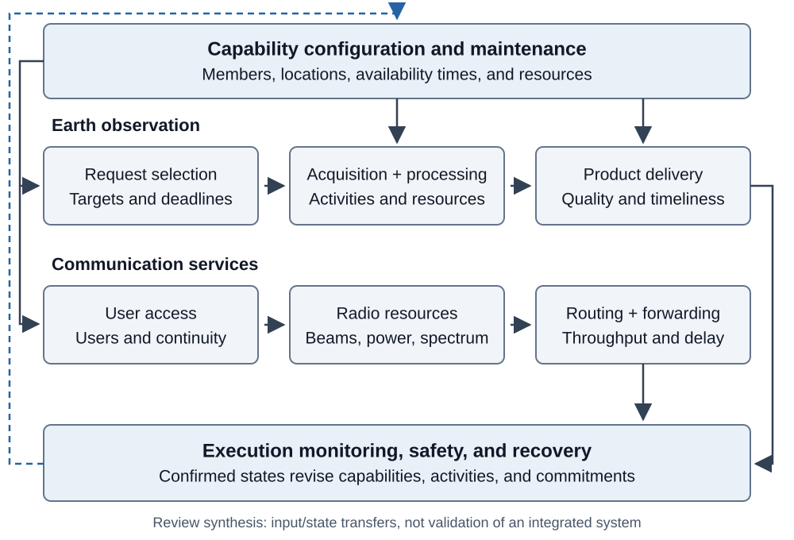
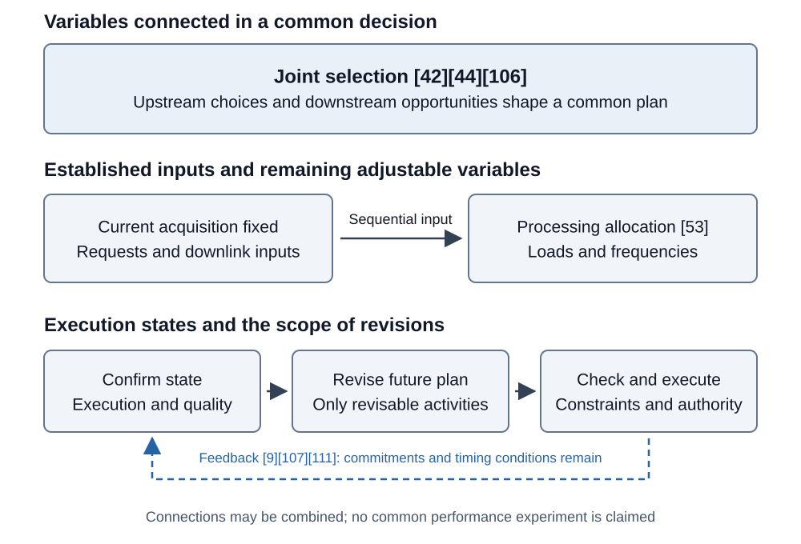

# Intelligent Management and Scheduling of Large Satellite Constellations

Service Completion, Resource Coupling, and Operational Feedback

**v2.0 · 16 October 2026 · Pre-submission author-review draft; evidence, declarations, and journal compliance await author verification**

## Abstract

Sustained operation of large satellite constellations requires coordinating available capabilities, changing service demand, and execution feedback. Existing studies optimize coverage, task rewards, network performance, or safety under different decision scopes and completion criteria, which limits direct comparison. This problem-driven narrative review examines Earth observation and communications alongside capability maintenance, mission planning, network resource management, and recovery. It compares representative methods through service-completion criteria, resource coupling, and information and decision authority. Observation rewards, downloaded data volume, and requests completed by their deadlines describe different outcomes; inventory supply, asset restoration, and service recovery likewise represent different events. The suitability of joint selection, sequential allocation, and operational feedback depends on whether downstream bottlenecks alter current choices, whether relevant state information arrives in time, and whether revisions can take effect before opportunities expire. Computational evaluation should include preprocessing, training, optimization, coordination, and activation, while retaining time-limited outcomes and the denominators used for successful samples. Public interfaces, independent measurements, software prototypes, and flight cases further clarify the relationship between model outputs and operational events. The synthesis identifies research questions involving common service outcomes, delayed information, and revisable resources, providing conditional guidance for selecting and evaluating constellation management methods. <!-- [claim:C1001] [evidence:E018,E023,E034,E035,E042,E044,E053,E057,E058,E065,E074,E076,E092,E096,E098,E101,E106,E109,E121] -->

**Keywords:** large satellite constellations; mission scheduling; communication resource management; on-orbit servicing; operational feedback; autonomous operations

## 1 Introduction

### 1.1 From task allocation to sustained operations

Large constellations bring recurring activity opportunities, continuing demand, and multiple decision makers into a shared operational process. Additional satellites can expand observation windows and access opportunities while increasing resource contention, state exchange, and plan-update effort. Research on automated operations identifies resource scheduling, monitoring, configuration, and orbit management as related scaling challenges [1]. Evaluating management and scheduling therefore requires tracing how an allocation uses available capabilities, produces a service outcome, and remains executable after state changes. <!-- [claim:C1002] [evidence:E001] -->

Earth observation and communications involve different service processes. An observation request typically passes through imaging, processing, and transmission to produce an information product that satisfies quality and timing requirements. Communication services allocate associations, beams, power, spectrum, and routes to continuing traffic. They share time, energy, storage, and ground facilities, but image acquisition, downloaded data volume, and connection quality represent different outcomes. Space logistics also encompasses deployment, replenishment, and reconfiguration [2]. These longer-term decisions determine available members, locations, and resources, which safety interventions and recovery can subsequently change. <!-- [claim:C1003] [evidence:E002] -->

### 1.2 Existing reviews and the analytical focus

Existing reviews organize the field around different objects. Reviews of agile observation [3] and satellite scheduling [4] compare task models, constraints, and solution methods, including communication and integrated scheduling within observation missions. Their classifications expose scheduling structure, while performance interpretation still requires the original objectives and assumptions. The multi-agent review [5] organizes distributed space systems by agents, coordination architectures, and mission management. Studies of automated operations [1][6] emphasize responsibilities, ground and onboard functions, and tools. Communication reviews [7][8] address network organization, control, and resource management, whereas SatOps–NetOps research [9] directly examines the connection between platform operations and network demand. Table 1 positions this review alongside those perspectives; differences in organization do not establish that another review omitted an entire field. <!-- [claim:C1004] [evidence:E003,E004,E005,E001,E006,E007,E008,E009] -->

**Table 1 Existing organizing perspectives and the comparisons developed here**

| Representative literature | Main organizing object | Connecting question | <!-- [claim:C1005] [evidence:E018,E023,E034,E035,E042,E044,E053,E057,E058,E065,E074,E076,E092,E096,E098,E101,E106,E109,E121] -->
| --- | --- | --- |
| Observation and satellite scheduling [3][4] | Tasks, resource constraints, and solution methods | How are acquisition, processing, downlink, and request delivery completed? | <!-- [claim:C1006] [evidence:E003,E004] -->
| Distributed space systems [5] | Agents, coordination, and mission management | What information is shared, when, and with what revision authority? | <!-- [claim:C1007] [evidence:E005] -->
| Automated operations [1][6] | Operational responsibilities, automation modes, and tools | How do plans pass execution checks and change operational states? | <!-- [claim:C1008] [evidence:E001,E006] -->
| Communication management [7][8] | Network organization, control, and resources | How does continuing user traffic differ from observation downlink? | <!-- [claim:C1009] [evidence:E007,E008] -->
| SatOps–NetOps [9] | Interaction between platform and network management | Which decisions remain revisable under joint, sequential, or feedback connections? | <!-- [claim:C1010] [evidence:E009] -->

This review starts from service completion and develops three connected comparisons. First, it asks what outcome a model rewards and whether success events and statistical denominators are consistent. Second, it examines when processing, transmission, or recovery conditions enter current decisions, which variables are fixed, and which remain revisable. Third, it relates reported benefits to preparation costs, information conditions, and execution. Section 3 develops these comparisons through representative studies, and Section 4 synthesizes applicability conditions and testable questions. Heterogeneous experiments are not combined into a common performance ranking. <!-- [claim:C1011] [evidence:E018,E023,E034,E035,E042,E044,E053,E057,E058,E065,E074,E076,E092,E096,E098,E101,E106,E109,E121] -->

### 1.3 Scope, selection, and use of evidence

This is a problem-driven narrative review. Sources were assembled from an existing thematic collection, reference-chain tracing of representative studies, and topic-specific additions, then selected by their management responsibilities and relationship to service outcomes. Earth observation and communications are the core services. Configuration, replenishment, on-orbit servicing, safety, and recovery are included through their supporting roles. Single-satellite, geosynchronous-orbit, deep-space, and general multi-agent studies explain relevant methods while retaining their original domains. “Large” indicates that the number of members, candidate activities, or coordination interactions materially affects optimization or operational organization; no common satellite-count threshold is imposed. Intelligent management includes state- and objective-dependent optimization, rule-based reasoning, coordination, and learning. <!-- [claim:C1012] [evidence:E018,E023,E034,E035,E042,E044,E053,E057,E058,E065,E074,E076,E092,E096,E098,E101,E106,E109,E121] -->

The comparison fields are decision objects, selectable variables, resource constraints, available information, update authority, completion events, metrics, and validation environments. Detailed comparisons use inspected body passages. Sources available only as abstracts or bibliographic records establish research directions without supporting precise scales, algorithmic details, or performance attribution. Author manuscripts and working papers are identified where their methods are discussed. Source observations, source-author interpretations, and this review’s synthesis are distinguished, with version and claim-location records maintained separately. This selection does not support exhaustive publication-frequency estimates, and no cross-paper performance meta-analysis is performed. Absence from the collection is not evidence that a research direction does not exist. <!-- [claim:C1013] [evidence:E018,E023,E034,E035,E042,E044,E053,E057,E058,E065,E074,E076,E092,E096,E098,E101,E106,E109,E121] -->

## 2 Management objects and comparison principles

### 2.1 Service processes and available capabilities

Observation and communication services share platform resources but have different completion processes. Observation management converts target requests into executable acquisition, processing, and delivery activities. Communication management allocates limited resources to spatially and temporally changing traffic. Configuration and maintenance determine where and when capabilities are available; safety and recovery alter member and task states through execution events. Figure 1 places service processes alongside these shared responsibilities, avoiding identification of a single solver with the complete operational system. <!-- [claim:C1014] [evidence:E018,E023,E034,E035,E042,E044,E053,E057,E058,E065,E074,E076,E092,E096,E098,E101,E106,E109,E121] -->

Figure 1. Service processes and shared management responsibilities. Arrows represent task, resource, or state transfers synthesized in this review. Individual studies may optimize only part of the diagram; the figure does not represent an integrated system validated across all functions. <!-- [claim:C1015] [evidence:E018,E023,E034,E035,E042,E044,E053,E057,E058,E065,E074,E076,E092,E096,E098,E101,E106,E109,E121] -->

### 2.2 Decision horizons, authority, and resource commitments

Long-term configuration selects assets, locations, and future capabilities. Scheduling selects activities using those conditions, while execution and recovery update the state. Beyond timescale, a comparison must identify which decisions remain revisable. Resource commitment denotes restrictions imposed by confirmed allocations. Reservation and configuration rules [52], preservation of allocated capacity in contact-graph scheduling [106], and the physical time required to establish laser links [121] impose different restrictions. Replanning should specify who makes a commitment, whether it can be withdrawn, and when a revision becomes effective. <!-- [claim:C1016] [evidence:E052,E106,E121] -->

Centralized, hierarchical, and distributed organization describe information aggregation and decision authority. Master–subproblem decomposition describes solution organization, while centralized training and decentralized execution describe learning stages. These features can coexist. Management-topology research [10] concerns member organization and management-center changes; observation allocation [34][35] concerns task competition and conflict information. Their message scope, authority, and timing measures therefore require separate interpretation. <!-- [claim:C1017] [evidence:E010,E034,E035] -->

### 2.3 Completion events, metrics, and denominators

Constraints define feasible activities, while objectives define rewarded outcomes. Within an observation chain, acquisition, quality satisfaction, processing, downlink, and on-time request delivery may occur at different times. Integrated models [42][44] illustrate this distinction: weighting successfully scheduled requests differs from separately rewarding observation and downloaded volume. Throughput, queueing delay, fairness, and interruption likewise depend on their statistical objects. Table 2 relates these outcomes to decision variables. <!-- [claim:C1018] [evidence:E042,E044] -->

**Table 2 Management objects, selectable variables, and outcome definitions**

| Management object | Typical selectable variables | Completion event or denominator to specify | <!-- [claim:C1019] [evidence:E018,E023,E034,E035,E042,E044,E053,E057,E058,E065,E074,E076,E092,E096,E098,E101,E106,E109,E121] -->
| --- | --- | --- |
| Observation requests | Targets, members, windows, and activity order | Acquisition, quality, on-time delivery, and the value of repeated observations | <!-- [claim:C1020] [evidence:E018,E023,E034,E035,E042,E044,E053,E057,E058,E065,E074,E076,E092,E096,E098,E101,E106,E109,E121] -->
| Processing and transmission | Processing nodes, loads, frequencies, and paths | Processing completion, bytes, complete products, and successful-request subsets | <!-- [claim:C1021] [evidence:E018,E023,E034,E035,E042,E044,E053,E057,E058,E065,E074,E076,E092,E096,E098,E101,E106,E109,E121] -->
| Communication services | Association, beams, power, spectrum, and routing | Served traffic, queueing or end-to-end delay, threshold exceedance, or actual interruption | <!-- [claim:C1022] [evidence:E018,E023,E034,E035,E042,E044,E053,E057,E058,E065,E074,E076,E092,E096,E098,E101,E106,E109,E121] -->
| Capability maintenance | Spares, replenishment, facilities, and repair | Inventory supply, asset arrival, capability restoration, and service reassignment | <!-- [claim:C1023] [evidence:E018,E023,E034,E035,E042,E044,E053,E057,E058,E065,E074,E076,E092,E096,E098,E101,E106,E109,E121] -->
| Safety and recovery | Tracking, maneuvers, diagnosis, and plan repair | Risk information, constraint satisfaction, safe exit, and mission recovery | <!-- [claim:C1024] [evidence:E018,E023,E034,E035,E042,E044,E053,E057,E058,E065,E074,E076,E092,E096,E098,E101,E106,E109,E121] -->

Metrics must also retain the experimental population. Mean delay over successful requests differs from the fraction of all requests completed on time. Finding a feasible plan within a limit and proving optimality are separate outcomes. This review therefore considers results, incomplete cases, and the cost of obtaining them together. Simulation, software tests, hardware prototypes, interfaces, external measurements, and flight events support their respective observed objects. <!-- [claim:C1025] [evidence:E018,E023,E034,E035,E042,E044,E053,E057,E058,E065,E074,E076,E092,E096,E098,E101,E106,E109,E121] -->

## 3 Technical approaches and representative comparisons

### 3.1 Long-term capability configuration and maintenance

#### 3.1.1 Configuration selection and capability availability

The scope of configuration design depends on whether the terminal state is prescribed. Reconfiguration under terminal conditions [11], joint regional-configuration and satellite assignment [12], and reconfiguration between known stages [13] introduce different terminal or inter-stage choices. Access-pattern optimization [14] exploits coverage structure, whereas deployment under uncertain areas of interest [15] evaluates future demand scenarios and adds members to supplement capabilities. Additional stages expand the planning scope; online adaptability still depends on when information becomes available and whether deployed members may change. <!-- [claim:C1026] [evidence:E011,E012,E013,E014,E015] -->

Deployment also constrains capability availability. Gwon and Ahn [16] include parking, J₂-driven right-ascension drift, launch capacity, and completion windows. Their screening identifies potential reachability, while the final selection must satisfy coverage. Joint communication-platform and constellation design [17] connects antennas, beams, and platform parameters to regional demand. These studies respectively expose the time needed to establish capabilities and the capacity of individual assets. Finer coverage or beams increase choice while adding platform and configuration demands; comparisons should retain the capability provided, its availability time, and implementation conditions. <!-- [claim:C1027] [evidence:E016,E017] -->

#### 3.1.2 Replenishment states and service recovery

Multi-echelon inventory models [18] connect ground, parking-orbit, and in-plane spares. They include drift and transfer waiting for replenishment from parking orbits while treating in-plane replacement as immediately available. Dual-channel replenishment [19] adds direct injection while retaining assumptions such as instantaneous in-plane replacement. Markov-chain models [20][21] further represent inventory, delivery opportunities, and replenishment in transit. Numerical time steps, actual delivery opportunities, and asset-arrival times govern different aspects of model resolution and operations; average inventory cannot replace all of that timing information. <!-- [claim:C1028] [evidence:E018,E019,E020,E021] -->

Maintenance integrated with on-orbit servicing [23] considers the operator’s annual maintenance cost and the provider’s profit, using an inventory order fill-rate requirement. In the inspected author manuscript, spare buffers permit relatively long repair turnaround alongside a high fill rate. Repair duration and user-service interruption consequently require different state descriptions. Pricing, the fraction of repairable failures, and the as-good-as-new assumption also condition the economic frontier, which does not directly establish a market equilibrium. <!-- [claim:C1029] [evidence:E023] -->

Iridium’s documented spare deployment [22] provides an operational example of investing in reserve capability. Connecting such evidence to inventory models requires distinguishing four events: replacement resources become available, arrive, restore mission capability, and enable reassignment of affected services. Existing models develop different portions of that sequence. Evaluating communication interruption or unmet observation requests additionally requires a common failure-and-demand history; this connection is a comparison interface proposed here. <!-- [claim:C1030] [evidence:E022] -->

#### 3.1.3 Facilities, visits, and rolling maintenance

Facility locations and customer assignments constrain servicing reachability. Orbital-depot research [24] selects facilities and assignments from discrete candidates before continuous refinement with some decisions fixed. Location–routing optimization [25] alternates continuous locations and multi-client routes. Their distinction concerns which variables can change together, rather than a simple discrete-versus-continuous classification. Servicer predeployment [26], rolling logistics [27], high- and low-thrust servicing frameworks [28], and lifecycle assessment [29] add perspectives on potential demand, changing requests, transfer costs, and uncertainty. <!-- [claim:C1031] [evidence:E024,E025,E026,E027,E028,E029] -->

Their interface to daily scheduling is capability characterized by time, location, and remaining resources. Rolling planning [27] executes only a plan prefix and revises later decisions as demand is revealed. Propulsion and mass constrain the transfer opportunities in [28]. Common questions are which known demands support a plan, which assets and activities remain revisable, and when a solution returned within the computational budget can be executed. Location refinement for a fixed route, subsequent grouping of clients, and joint routing over the entire horizon require separate interpretation. <!-- [claim:C1032] [evidence:E027,E028] -->

### 3.2 Earth-observation and on-orbit servicing scheduling

#### 3.2.1 Activity selection and coordination

Observation scheduling converts request selection into sequences satisfying attitude and visibility constraints. Classical work [30] compares greedy methods, dynamic programming, constraint programming, and local search for a particular window-constrained problem. Later studies apply reinforcement learning [31], decomposition and learning [32], and energy-aware branch-and-price [33] to related problems. Algorithm families identify solution ideas, but scalability also depends on candidate windows, conflict structure, resource models, and stopping conditions. Sources without inspected methods are retained as directional coverage without precise optimality bounds or experimental scales. <!-- [claim:C1033] [evidence:E030,E031,E032,E033] -->

Inspected distributed studies illustrate concrete information–computation tradeoffs. Parjan and Chien [34] compare centralized, broadcast, and highly decentralized allocation. Incremental planning reduces repeated computation while retaining more redundant observations. Zilberstein et al. [35] exploit geometric neighborhoods and distributed constraint optimization, evaluating task satisfaction, computation, and messages. One reuses prior plans, while the other exploits local competition. Both should relate saved effort to task outcomes and distinguish estimated parallel time from measurements. <!-- [claim:C1034] [evidence:E034,E035] -->

Coordination guarantees depend on information and scoring conditions. Multi-stakeholder observation models [36] distinguish request owners and coordination roles. The consensus-based bundle algorithm (CBBA) [37] exchanges winners, bids, and timestamps and resolves conflicts under specified scoring and communication conditions. Its greedy equivalence and value bounds have distinct assumptions. Communication-constrained online scheduling [38], delayed-communication planning [39], uncertain-environment coordination [40], and asynchronous markets [41] further address message reachability and state changes. Transfer to constellations requires checking complementary task values, propagation conditions, and execution authority. <!-- [claim:C1035] [evidence:E036,E037,E038,E039,E040,E041] -->

#### 3.2.2 Connecting observation, processing, and delivery

Joint observation and transmission can expose downstream opportunities to target selection, but benefits depend on completion definitions. The public author manuscript of He et al. [42] rewards weighted requests whose observations and transmissions are scheduled within deadlines, decomposing window association and within-window allocation. It assumes error-free transmission and neglects imaging-angle effects on quality. The results therefore concern request scheduling under the stated windows and resources. <!-- [claim:C1036] [evidence:E042] -->

The institutional working paper of Rocha et al. [44] separately rewards observation and data downloaded to ground, incorporating attitude, storage, and energy. More downloaded data need not mean more complete requests. Its graph reduction depends on overlap grouping and coverage of necessary switching constraints, while a simplified integer model may discard feasible solutions. Graph representation, model simplification, and neighborhood optimization therefore affect different parts of feasibility and computational cost. These method details are attributed to the working paper, with journal-version correspondence retained in the source records. Energy-constrained joint scheduling [43] and heterogeneous tip-and-cue missions [45] provide further directions involving energy and task precedence. <!-- [claim:C1037] [evidence:E044,E043,E045] -->

Ground facilities turn communication opportunities into shared-capacity decisions. Single-satellite multi-station scheduling [46], satellite control networks [47], downlink scheduling [48], and Deep Space Network (DSN) optimization [49] use different instance structures, human inputs, and budgets. Deep Space Network operations [50] additionally include request interpretation, candidate schedules, negotiation, and confirmation. The cited Planet and AWS documents [51][52] specify quality and delivery states and reservation configurations. They provide operational references for modeled completion and commitment changes; algorithmic performance still requires the corresponding experiments. <!-- [claim:C1038] [evidence:E046,E047,E048,E049,E050,E051,E052] -->

The author manuscript of Soret et al. [53] uses a different connection: acquisition loads and downlink schedules are established before processing loads and frequencies are jointly allocated between space and ground. Its acquisition stage omits storage constraints, and processing constrains average delay. A fixed pipeline and stable inter-satellite links support the staged solution. Quality failures may also trigger reacquisition in a later cycle. Holding acquisition fixed during the current processing optimization can thus coexist with quality feedback between cycles, and average processing delay remains distinct from a per-frame deadline. <!-- [claim:C1039] [evidence:E053] -->

Offloading and collaborative inference [54][55][56] primarily address computing location and resource management. In the inspected orbit-aware scheduling study [57], leaving the ground visibility region limits result return. Its success count can include requests completed after their service deadline but before departure, requiring separate interpretation of success ratios and response-time denominators. Kodan [58] instead connects specialized models, tiling, and skipped processing to the proportion of valuable downlinked bits. This is an existing value mapping, supported by ground-hardware measurements and orbit/link simulation for particular applications. Value density and delivery of complete products remain separate metrics. <!-- [claim:C1040] [evidence:E054,E055,E056,E057,E058] -->

#### 3.2.3 Dynamic requests and the role of learning

Dynamic scheduling uses approaches including hierarchical planning [59], learning-assisted large-neighborhood search [63], and rolling-horizon learning [64]. Uncertainty formulations also determine whether decisions can change after new information arrives. Cloud chance constraints [60], budgeted reward uncertainty [61], and multistage stochastic models [62] describe different uncertainties. In particular, the budget parameter in [61] controls conservative reward deviations; the two-stage formulation in [62] evaluates an established plan, while its three-stage formulation permits future activities to change after weather information is revealed. Stage labels and conservatism must be related to actual revisable variables. <!-- [claim:C1041] [evidence:E059,E063,E064,E060,E061,E062] -->

Learning should also be located within the complete solution process. Study [63] combines reinforcement learning with search, but its detailed component contributions remain unverified here. Inspected single-satellite policy reuse [65] combines a trained policy with shielding, assignment, and shared completion states across members. Completion information reduces repeated fulfillment without directly communicating simultaneous future intentions. Algorithm comparisons in Basilisk [66] place policies, training, and safe-action handling within a common simulation process. Fast inference, feasible actions, and conflict-free multi-satellite assignment depend on different components and should be evaluated separately. <!-- [claim:C1042] [evidence:E063,E065,E066] -->

#### 3.2.4 Transfers and replenishment in servicing

Servicing opportunities are generated jointly by orbital transfers and service resources. Refuellable multi-orbit servicing [67], uncertain-duration scheduling [68], multiple-servicer planning [69], and combined refueling and debris removal [70] address visits, replenishment, transfers, and uncertainty. They share selection and sequencing with observation scheduling, but a changed visit sequence also changes mass, time, and subsequent reachability. Edge costs must retain their physical meaning under the chosen propulsion model. <!-- [claim:C1043] [evidence:E067,E068,E069,E070] -->

Low-thrust precomputation [72] generates costs over orbital, mass, and timing dimensions and uses interpolation during sequence search. Drift-based servicing [71] combines thrust–drift–thrust transfers, visits, and refueling. Both retain limits in their treatment of phase. In [72], flight time results from control weights and termination criteria; a cost table does not automatically support an arbitrary specified arrival time. Evaluation should report precomputation, interpolation references, direct-dynamics checks, and excluded terminal conditions together. <!-- [claim:C1044] [evidence:E072,E071] -->

**Table 3 Representative decision organizations in observation and servicing**

| Approach | Main decision or mechanism | Conditions retained in comparison | <!-- [claim:C1045] [evidence:E018,E023,E034,E035,E042,E044,E053,E057,E058,E065,E074,E076,E092,E096,E098,E101,E106,E109,E121] -->
| --- | --- | --- |
| Learning and mathematical optimization [31][32][33] | Learning or programming approaches to observation scheduling | Directional coverage only; method bodies unconfirmed here | <!-- [claim:C1046] [evidence:E031,E032,E033] -->
| Incremental and geometric neighborhoods [34][35] | Plan reuse or local competition | Redundancy, satisfaction, messages, and timing scope | <!-- [claim:C1047] [evidence:E034,E035] -->
| Auctions and asynchronous coordination [37][38][41] | Bids, conflict resolution, and propagation | Score assumptions, network conditions, and original domain | <!-- [claim:C1048] [evidence:E037,E038,E041] -->
| Observation–transmission [42] | Weighted successful requests within deadlines | Author manuscript; error-free links and simplified quality | <!-- [claim:C1049] [evidence:E042] -->
| Observation–downlink [44] | Observation reward and data volume | Working paper; grouping, switching constraints, feasible-set changes | <!-- [claim:C1050] [evidence:E044] -->
| Sequential processing [53] | Loads and frequencies after acquisition is fixed | Author manuscript; average delay, quality feedback, pipeline | <!-- [claim:C1051] [evidence:E053] -->
| Computing and information value [57][58] | Processing opportunities, returned results, or value density | Deadlines, successful subsets, errors, and hardware | <!-- [claim:C1052] [evidence:E057,E058] -->
| Policy reuse [65][66] | Policies with shielding, assignment, or state sharing | Separate training, inference, and coordination costs | <!-- [claim:C1053] [evidence:E065,E066] -->
| Low-thrust servicing [71][72] | Transfer generation, visits, and replenishment | Mass, timing, phase, precomputation, and verification | <!-- [claim:C1054] [evidence:E071,E072] -->

### 3.3 Communication network and resource management

#### 3.3.1 Demand estimation, beams, and power

Traffic prediction supplies inputs, while configuration converts resources into service. Prediction research [73] combines empirical mode decomposition, autoregressive modeling, and neural methods for synthetic self-similar traffic. It evaluates prediction error and leaves routing applications to future work. Effects on throughput or queues therefore require an explicit allocation strategy that uses the predictions. <!-- [claim:C1055] [evidence:E073] -->

The beam-and-power author manuscript [74] first selects beams using average power, fixes the current selection to optimize continuous power, and updates arrivals and remaining demand between slots. Its single-satellite setting evaluates supply–demand squared error and Jain fairness over satisfaction ratios. A comparison uses the same beam-selection rule with different power allocation, but changed queues can alter later selections. It explains staged configuration rather than a single-factor experiment with all illumination actions fixed across the horizon. <!-- [claim:C1056] [evidence:E074] -->

Overlapping coverage introduces association and coexistence. The abstract of load-balanced beam hopping [75] addresses non-geostationary/geostationary system coexistence. The demand-aware author manuscript [76] coordinates multi-satellite beam selection in a digital twin with continuous power allocation within each satellite and explicitly represents queues. Its fairness quantity uses queue-age ranges, differing in object and direction from the Jain index in [74]. Its fixed-power and dynamic-power baselines also differ in power actions and configuration organization, with throughput differences depending on load. Additional decision freedom should consequently be interpreted through the active bottleneck and comparison conditions. <!-- [claim:C1057] [evidence:E075,E076,E074] -->

#### 3.3.2 Access handover and service variation

Access selection can combine immediate link quality with subsequent network costs. The public abstract of [77] includes end-to-end delay and handover overhead in a learning strategy, establishing a direction that connects access and routing. Effects still depend on service duration, paths, and update conditions; component benefits are not inferred from the abstract. <!-- [claim:C1058] [evidence:E077] -->

Independent measurement supplies a different form of evidence. Mohan et al. [78] observe delay and throughput changes near Starlink reconfiguration boundaries and retain such variation during controlled windows with only one candidate satellite. Under those conditions, a satellite handover is not a prerequisite for the service variation. Periodic network scheduling is the source authors’ interpretation. This example motivates separate records of access identity, resource-configuration state, and service performance. <!-- [claim:C1059] [evidence:E078] -->

#### 3.3.3 Routing structure and configuration activation

Routing without direct inter-satellite links [79] and ground-assisted traffic engineering [80] organize paths, flows, and recovery through terrestrial forwarding; their abstracts are used only to describe research objects. The dynamic-laser-link author manuscript [121] explicitly includes link-establishment time in route selection. It assumes routes are calculated and distributed beforehand and omits queueing and initial configuration delay. Path retention and activity-aware policies exhibit different tradeoffs under the chosen establishment costs. Some retention policies increase average delay at low establishment costs, which does not generalize to every activity-aware approach. <!-- [claim:C1060] [evidence:E079,E080,E121] -->

Performance and computational analyses in [121] also use different edge-pruning settings and require separate interpretation. More generally, route-search time, control-message propagation, and physical link establishment determine different update costs. A policy suited to expensive establishment requires reevaluation under queue-dominated or stale-state conditions; path lifetime alone does not determine its service benefit. <!-- [claim:C1061] [evidence:E121] -->

#### 3.3.4 Hierarchical allocation and local authority

Hierarchical resource management [81] assigns responsibilities to a network control center, space base stations, and terminals. Global service regions and spectrum allocations constrain local beams, slots, and channels, coordinated through demand and price exchanges. Its experiments evaluate different components and loads, whose gains cannot simply be added into an architectural total. Hierarchy specifies who can revise resources, which state they use, and when an upper-level allocation becomes effective locally, as well as dividing computation. <!-- [claim:C1062] [evidence:E081] -->

**Table 4 Outcome definitions and conditions in communication studies**

| Study | Decision or observation | Conditions retained | <!-- [claim:C1063] [evidence:E018,E023,E034,E035,E042,E044,E053,E057,E058,E065,E074,E076,E092,E096,E098,E101,E106,E109,E121] -->
| --- | --- | --- |
| Traffic prediction [73] | Demand-estimation error | Synthetic traffic; allocation effects require separate evaluation | <!-- [claim:C1064] [evidence:E073] -->
| Single-satellite beams and power [74] | Demand matching and satisfaction fairness | Author manuscript; staged decisions and evolving queues | <!-- [claim:C1065] [evidence:E074] -->
| Coexistence [75] | Association and illumination | Abstract-level coverage; non-geostationary/geostationary setting | <!-- [claim:C1066] [evidence:E075] -->
| Demand-aware allocation [76] | Beams, power, and queue-age fairness | Author manuscript; whole-policy comparisons and load dependence | <!-- [claim:C1067] [evidence:E076] -->
| Access selection [77] | Access and downstream path costs | Abstract-level coverage; component effects not separated | <!-- [claim:C1068] [evidence:E077] -->
| Independent measurements [78] | Delay and throughput changes | Single-candidate windows; internal mechanism is interpretation | <!-- [claim:C1069] [evidence:E078] -->
| Ground-assisted networking [79][80] | Routing, traffic, and recovery | Abstract-level coverage; different forwarding structure | <!-- [claim:C1070] [evidence:E079,E080] -->
| Dynamic laser links [121] | Routes and establishment costs | Author manuscript; no queues, pre-distributed routes; separate timing configuration | <!-- [claim:C1071] [evidence:E121] -->
| Hierarchical management [81] | Global allocation and local response | Authority, exchanged information, and component-specific tests | <!-- [claim:C1072] [evidence:E081] -->

### 3.4 Safe execution and anomaly recovery

#### 3.4.1 Risk information and decision inputs

The safety-information chain contains distinct computations. Closest-approach methods [82] refine candidate events using piecewise approximation and distance-extremum searches. Screening and CUDA research [84] reduces candidate pairs and organizes parallel computation, with speed and missed-event behavior dependent on catalogs, step sizes, and implementation. Risk-aware tracking [83] concerns sensor allocation using risk and information gain. These approaches respectively change per-candidate refinement cost, candidate sets, and input quality and should be evaluated at those stages. <!-- [claim:C1073] [evidence:E082,E084,E083] -->

Risk-prediction competitions [87] estimate risk in later conjunction messages, maneuver reviews [86] organize response methods, and operational simulation [85] generates scenarios and conjunction events for rule evaluation. Composite competition scores, event-generation agreement, and maneuver safety concern different validation objects. CCSDS messages [88] and the cited Starlink process [89] further describe interfaces for organizational exchange, reassessment, and action updates. Connecting risk management to service scheduling requires tracing maneuver occupancy and subsequent activity opportunities instead of substituting a risk estimate for a mission outcome. <!-- [claim:C1074] [evidence:E087,E086,E085,E088,E089] -->

#### 3.4.2 Trajectory safety and task-level conditions

Trajectory research converts schedules into dynamically constrained actions. Passive-safe rendezvous [90], conic optimization [91], feedback model predictive control (MPC) [92], chance-constrained rendezvous [93], visual servoing [94], and orbit-specific continuous safety constraints [95] offer different formulations. Their original mission domains are retained rather than treating them as performance competitors for a common constellation-scheduling problem. <!-- [claim:C1075] [evidence:E090,E091,E092,E093,E094,E095] -->

Inspected methods expose several levels of guarantee. The convex subproblems, successive updates, and original nonlinear problem in [91] have different optimality and timing scopes. The safe half-spaces, communication range, error bounds, discretization, and solution deadline in [92] jointly limit safety conclusions. Extending terminal time to regain feasibility can also change task-level commitments. Design probabilities and finite-sample tests in [93], and continuous constraints and numerical tolerances in [95], likewise require separate interpretation. Protection against complete loss of thrust must retain exclusions concerning partial underburn. <!-- [claim:C1076] [evidence:E091,E092,E093,E095] -->

Safety shielding [96] illustrates the importance of experimental design. Shield-enabled and shield-disabled versions of the same policy form a different experiment from the unshielded-policy versus probabilistic-roadmap fuel–time comparison, which also uses different sample counts. Shielding changes admissible actions and safety requirements, while roadmap execution includes state-based correction of maneuvers. Comparison should therefore identify changed mechanisms, safety criteria, and execution updates beyond an open-loop or closed-loop label. <!-- [claim:C1077] [evidence:E096] -->

The documented autonomous abort and retreat of ADRAS-J [97] provides an operational reference. Safe exit protected the spacecraft, while subsequent completion of the intended approach or service requires separate assessment. Service-level evaluation should retain the safety outcome, abandoned or postponed activities, and capabilities available after recovery. <!-- [claim:C1078] [evidence:E097] -->

#### 3.4.3 From alarms and diagnosis to plan recovery

Telemetry anomaly detection supplies recovery cues. Study [98] combines prediction residuals, smoothing, thresholds, and alarm-interval processing; gains in its main comparison belong to the postprocessing that actually changed. Imbalanced-data detection [99] and continual learning [100] address uncertainty and model updates. Evaluation research [101] shows how test labels, threshold selection, and event matching change offline scores. Alarm detection, timeliness, diagnosis, and recovery success consequently need separate outcome definitions. <!-- [claim:C1079] [evidence:E098,E099,E100,E101] -->

The rule-based fault detection, isolation, and recovery (FDIR) prototype [102] connects facts, action selection, execution, and outcome confirmation before returning control to navigation. Schedule Manager [103] and reactive plan repair [104] provide directions involving prepared contingency schedules and online repair. Evaluation should identify when diagnostic evidence becomes available, who authorizes actions, how outcomes are confirmed, and how remaining tasks continue. Rule coverage, domain knowledge, and activation time jointly condition applicability. <!-- [claim:C1080] [evidence:E102,E103,E104] -->

**Table 5 Outputs and validation objects in safety and recovery**

| Stage and representative sources | Direct output | Guarantee scope to inspect | <!-- [claim:C1081] [evidence:E018,E023,E034,E035,E042,E044,E053,E057,E058,E065,E074,E076,E092,E096,E098,E101,E106,E109,E121] -->
| --- | --- | --- |
| Closest approach and screening [82][84] | Candidate events and refined approaches | Propagation/numerical reference, catalog, step size, and omissions | <!-- [claim:C1082] [evidence:E082,E084] -->
| Tracking, prediction, and scenarios [83][85][87] | Measurements, later risk, or event lists | Respective data, scores, and scenarios; response outcomes evaluated separately | <!-- [claim:C1083] [evidence:E083,E085,E087] -->
| Safe trajectories [90][91][92][93][94][95] | Trajectories, controls, and conditional constraints | Domain, errors/distributions, continuity, and solution deadlines | <!-- [claim:C1084] [evidence:E090,E091,E092,E093,E094,E095] -->
| Learned shielding [96] | Checked actions and interventions | Distinct experiments, safety criteria, and execution correction | <!-- [claim:C1085] [evidence:E096] -->
| Detection and updates [98][99][100][101] | Anomaly cues or updated detectors | Thresholds, labels, denominators, and deployment conditions | <!-- [claim:C1086] [evidence:E098,E099,E100,E101] -->
| Fault and plan recovery [102][103][104] | Recovery actions or subsequent plans | Prototype/model scope, outcome confirmation, and handover | <!-- [claim:C1087] [evidence:E102,E103,E104] -->

### 3.5 Connecting decisions in integrated operations

#### 3.5.1 Joint selection, sequential inputs, and feedback

Automation tools [6] and trusted-autonomy reviews [105] provide functional context, but concrete connections depend on variables. Contact-graph scheduling [106] selects acquisition nodes and checks delivery paths for requests while deducting allocated capacity. It evaluates delivered requests and delay over successful samples and assumes unlimited energy and storage. Study [42] jointly schedules observation–transmission requests; [44] rewards observation and downloaded volume; [53] retains current acquisition before optimizing processing. Each connects adjacent activities, but with different upstream authority and completion semantics. <!-- [claim:C1088] [evidence:E006,E105,E106,E042,E044,E053] -->

With unreliable contacts, [106] also permits local transmission routing using currently available connections. Retaining task assignments while rerouting differs from selecting new acquisition nodes. Figure 2 distinguishes common decisions, sequential inputs, and execution feedback. They can be combined at different levels rather than treated as exclusive architectural grades. <!-- [claim:C1089] [evidence:E106] -->

Figure 2. Joint selection, sequential allocation, and operational feedback. Representative studies are interpreted in their inspected versions: common selection [42][44][106], staged allocation [53], and state updates [9][107][111]. Dashed feedback reaches activities that remain revisable. The diagram is this review’s synthesis. <!-- [claim:C1090] [evidence:E042,E044,E106,E053,E009,E107,E111] -->

#### 3.5.2 Common models and state-driven allocation

The SatOps–NetOps framework [9] represents platform resources and network requirements within a task model and uses construction, local search, and event-triggered replanning. Its architectural classification and performance experiment on an integrated prototype should be distinguished. Hierarchical management [81] instead constrains local responses through upper-level allocations. Both connect responsibilities, with different joint variables and local authority after allocation. <!-- [claim:C1091] [evidence:E009,E081] -->

Reasoning-based observation scheduling [107] predicts observation, transmission, storage, and energy states, adjusts strategy weights, and inserts targets with constraint checks. Resource states thus influence activity selection through distinct prediction, rule-selection, and construction functions. Its single-satellite simulation and multi-satellite task-model studies offer complementary examples within their respective representations and validation scopes. <!-- [claim:C1092] [evidence:E107] -->

#### 3.5.3 Functional handover from plans to execution

Remote Agent [108] connects planning, execution, and diagnosis, including recovery interactions between failed activities and global constraints. EO-1 [109] demonstrates science analysis generating goals, CASPER revising activities, and SCL checking execution, while retaining ground planning and ephemeris updates. IPEX [110][111] provides single-satellite experience with onboard processing and continuing planning. Reference architectures [112] and cFS demonstration packages [113] instead describe functional responsibilities and software connections, with roles distinct from flight events. <!-- [claim:C1093] [evidence:E108,E109,E110,E111,E112,E113] -->

Starling [114] shares observation states among four spacecraft to coordinate later observations. Starling 1.5 [115] coordinates responsibility and performs actual maneuvers in simulated conjunction scenarios. These cases extend shared information and action authority, but observation selection and inter-operator responses have different triggers. Basilisk [116] and formal-methods research [117] support simulation and specification checks. Integrated evaluation must further establish consistent handover between states, plans, and actions and trace the resulting service outcomes. <!-- [claim:C1094] [evidence:E114,E115,E116,E117] -->

## 4 Synthesis and research questions

### 4.1 Scalability through common outcomes and complete costs

Benefits originate in the problem structure being exploited. Window decomposition [42], graph reduction and neighborhood search [44], transfer precomputation [71][72], plan reuse [34], and geometric neighborhoods [35] change search dimensions, candidate representations, preparation, and coordination. Fewer variables or messages can reduce effort while retaining redundancy or discarding candidates. Graph transformations, conservative constraints, and screening should therefore be evaluated for both solution quality and changes in feasible activities. <!-- [claim:C1095] [evidence:E042,E044,E071,E072,E034,E035] -->

Scale should also distinguish system objects, actual demand, and candidate variables. Servicing [28] can reduce clients to those relevant within the horizon; different permutations in [48] can represent the same schedule; scenario expansion [62] can produce many variables from few physical members. Nominal satellite count alone cannot represent difficulty. Feasibility within the time limit, solver gaps, and incomplete cases belong alongside quality measures. Mean improvements over successful instances in [25] require the success rate; failure to find a plan within budget does not establish physical infeasibility. <!-- [claim:C1096] [evidence:E028,E048,E062,E025] -->

Complete decision cost covers candidate/model preparation, online solution and coordination, and resource activation after revision. Transfer grids [72] and policies [65] move computation offline; Deep Space Network optimization [49] also includes specific setup and teardown constraints; dynamic links [121] explicitly charge establishment. Amortization depends on reuse and environmental change, while a solve time must be interpreted against the remaining opportunity. Reproducible comparisons should report preparation, reuse count, online budget, messages, and resource-activation times under a common service definition. <!-- [claim:C1097] [evidence:E072,E065,E049,E121] -->

### 4.2 When resource coupling warrants common optimization

Broader decisions matter when downstream constraints change current candidates. Study [42] includes transmission opportunities in observation selection; [106] checks delivery capacity when selecting acquisition nodes; [53] allocates computation after acquisition is fixed. If a downstream bottleneck excludes an upstream choice, including it earlier can avoid commitments that cannot be fulfilled. Once acquisition has occurred, the applicable problem instead concerns remaining resources or later-cycle feedback. Variables and commitments determine this distinction beyond a “joint” label. <!-- [claim:C1098] [evidence:E042,E106,E053] -->

Common decisions additionally require computational tractability, relevant information, and adequate timing. Reductions in [44] can change representations and feasible sets; stale downstream states limit the meaning of a common current model; and sequential allocation with feedback may suffice when activities remain revocable and time permits correction. Table 6 synthesizes these conditions. It is a qualitative analysis, not a common experiment or universal threshold theorem. <!-- [claim:C1099] [evidence:E044] -->

**Table 6 Applicability conditions and evaluation requirements for connecting decisions**

| Connection and references | Main applicability condition | Comparison quantities to hold fixed | Main cost or restriction | <!-- [claim:C1100] [evidence:E018,E023,E034,E035,E042,E044,E053,E057,E058,E065,E074,E076,E092,E096,E098,E101,E106,E109,E121] -->
| --- | --- | --- | --- |
| Joint selection [42][44][106] | Downstream states are available and affect current nodes, windows, or order | Completion, reward components, candidates, and partial-delivery rules | Coupled scale, approximation, and feasible-set changes | <!-- [claim:C1101] [evidence:E042,E044,E106] -->
| Sequential allocation [53][74] | Upstream decisions are established; downstream resources remain adjustable | Fixed variables, input loads, and local objectives | Restrictions retained from upstream in the present solve | <!-- [claim:C1102] [evidence:E053,E074] -->
| State feedback [9][107][111] | New states are confirmed and future activities remain revisable | State versions, update windows, and committed resources | Propagation, replanning, conflict checks, and activation | <!-- [claim:C1103] [evidence:E009,E107,E111] -->
| Hierarchical combinations (review synthesis) | Stages have different information, horizons, and authority | Common tasks/disturbances, inter-stage inputs, and handover events | Overlapping authority, repeated changes, and inconsistent states | <!-- [claim:C1104] [evidence:E018,E023,E034,E035,E042,E044,E053,E057,E058,E065,E074,E076,E092,E096,E098,E101,E106,E109,E121] -->

Active bottlenecks also change the value of individual modules. In Kodan [58], reaching a frame deadline changes the contribution of faster processing relative to classification precision. In beam-and-power studies [74][76], load and queues affect the value of allocation freedom. Comparisons should first hold completion, demand, and resources fixed, then vary revisable variables. This separates differences in information use, resource freedom, and reward construction. <!-- [claim:C1105] [evidence:E058,E074,E076] -->

### 4.3 Interfaces between information, authority, and learning

The value of sharing depends on the decision being coordinated. Completion states [65] identify fulfilled targets, while simultaneous competition requires assignment or intention information. Communication-constrained scheduling [38] concerns message opportunities; asynchronous algorithms under loss require separate evaluation [118]. Scoring and propagation assumptions in CBBA [37] and hierarchical authority [81] further constrain conclusions. Information content, arrival time, and revision authority should be represented together rather than subsumed into a communication-availability assumption. <!-- [claim:C1106] [evidence:E065,E038,E118,E037,E081] -->

Commitments additionally define update scope. Reservation rules [52], allocated contact capacity [106], and new-link establishment [121] respectively constrain organizational processes, algorithms, and physical execution. Comparing local repair and global replanning requires common states, commitments, and activation conditions, including the consequences of retaining prior plans, revising future activities, or adopting conservative responses. <!-- [claim:C1107] [evidence:E052,E106,E121] -->

Learning contributions should likewise correspond to identifiable modules. Prediction [73] estimates demand, search assistance [63] guides solution generation, policy reuse [65] generates actions, shielding [96] checks execution, and model updates [100] alter future detectors. Evaluation should retain training/deployment conditions, downstream constraints, and replacement modules. When a whole system changes networks, candidates, constraints, or safety criteria together, its results should be presented as system-level comparisons. Component attribution needs common tasks with other conditions held fixed. <!-- [claim:C1108] [evidence:E073,E063,E065,E096,E100] -->

### 4.4 Operational practice and validation scope

Operational materials clarify how modeled events map to responsibilities. Table 7 organizes interfaces, measurements, prototypes, and flights by observation object. Planet and AWS documents [51][52] define completion and reservation states; Deep Space Network operations [50] adds candidates, negotiation, and confirmation; independent measurements [78] observe service behavior; EO-1 and Starling [109][114][115] demonstrate feedback and execution within defined missions. These are complementary forms of evidence with distinct scopes. <!-- [claim:C1109] [evidence:E051,E052,E050,E078,E109,E114,E115] -->

**Table 7 Contributions of operational materials and tools**

| Material or case | Publicly described state, action, or property | Use and boundary | <!-- [claim:C1110] [evidence:E018,E023,E034,E035,E042,E044,E053,E057,E058,E065,E074,E076,E092,E096,E098,E101,E106,E109,E121] -->
| --- | --- | --- |
| Iridium [22] | Reserve-asset deployment | Capability investment; inventory optimality and recovery time evaluated separately | <!-- [claim:C1111] [evidence:E022] -->
| Planet, AWS, and DSN [50][51][52] | Quality, delivery, reservations, and schedule confirmation | Completion and commitments; internal optimization performance evaluated separately | <!-- [claim:C1112] [evidence:E050,E051,E052] -->
| Starlink process and measurements [78][89] | Risk-action procedures; delay and throughput | Operator accounts distinguished from external observations | <!-- [claim:C1113] [evidence:E078,E089] -->
| ADRAS-J [97] | Autonomous abort and retreat | Safety event; subsequent original-mission completion evaluated separately | <!-- [claim:C1114] [evidence:E097] -->
| EO-1 and IPEX [109][110][111] | Onboard processing, replanning, and execution checks | Single-satellite handover and ground responsibilities | <!-- [claim:C1115] [evidence:E109,E110,E111] -->
| Starling missions [114][115] | Shared observations and maneuver coordination | Test objectives, member counts, and simulated-event conditions | <!-- [claim:C1116] [evidence:E114,E115] -->
| CCSDS, cFS, and formal methods [88][113][117][119][120] | Messages, components, and specification properties | Interoperability and software evidence; service outcomes evaluated separately | <!-- [claim:C1117] [evidence:E088,E113,E117,E119,E120] -->

Validation must identify artifacts, properties, and environments. Supervised reconfiguration [119] and model checking [120] examine configuration and specification properties; rule prototypes [102] measure particular software/hardware processes; Basilisk [116] enables configured dynamics simulation. Specification satisfaction, model feasibility, finite-sample non-violation, and flight events have different evidential meanings. Resource-limited incomplete analysis must also remain visible, avoiding interpretation of passed software checks as demonstrated service improvement. <!-- [claim:C1118] [evidence:E119,E120,E102,E116] -->

### 4.5 Research questions for sustained service

First, capability recovery can be connected to service loss under common failure and demand histories. Inventories, dual-channel replenishment, and repair [18][19][23] provide different restoration routes. Recording resource availability, arrival, payload restoration, and service reassignment separately would enable evaluation of unmet requests or communication interruptions. Hierarchical and event-driven models can support this comparison without jointly optimizing every inventory, trajectory, and activity variable. <!-- [claim:C1119] [evidence:E018,E019,E023] -->

Second, decision scope can be tested on common tasks. Mechanisms in [42][44][53][106] motivate acquisition-first, sequential processing/downlink, common selection, and event-repair variants. Windows, storage, capacities, and deadlines should remain fixed, with request completion and data volume defined beforehand as separate metrics. Final outcomes, time-limited feasibility, and preparation/online/execution costs can test Table 6. These are proposed experiments; this review has not performed cross-paper reproductions. <!-- [claim:C1120] [evidence:E042,E044,E053,E106] -->

Finally, updates and learning can be evaluated on a common event timeline. Records should include request arrival, state confirmation, solution completion, conflict resolution, and configuration activation, distinguishing completed activities, future intentions, and commitments [52][65][81][106][121]. Prediction, search assistance, and action generation require corresponding replacement methods, including training, inference, and repair costs. Common inputs improve interpretability while leaving orbital-model, authority, and validation-fidelity differences to be reported separately. <!-- [claim:C1121] [evidence:E052,E065,E081,E106,E121] -->

## 5 Conclusions

This review examines constellation capability maintenance, scheduling, networking, safety, and recovery around Earth observation and communication services. Each approach connects to service differently: configuration and replenishment determine when and where capabilities exist; observation scheduling allocates discrete requests; communication management serves continuing traffic; and safety and fault responses alter later states. Explicit decisions, completion events, and constraints provide a common comparison basis beyond algorithm families. <!-- [claim:C1122] [evidence:E018,E023,E034,E035,E042,E044,E053,E057,E058,E065,E074,E076,E092,E096,E098,E101,E106,E109,E121] -->

Representative studies support three conditional conclusions. First, benefits should retain completion definitions and statistical denominators alongside complete decision costs. Second, downstream bottlenecks, state freshness, and revisable activities jointly determine the suitability of joint, sequential, and feedback connections, which can be combined hierarchically. Third, shared information and rapidly generated plans require authority, conflict checks, and execution handover before producing service outcomes. Learning and optimization should be interpreted within their actual responsibilities. <!-- [claim:C1123] [evidence:E018,E023,E034,E035,E042,E044,E053,E057,E058,E065,E074,E076,E092,E096,E098,E101,E106,E109,E121] -->

Interfaces, independent measurements, software validation, and flight events supply complementary operational evidence. Future work can use common tasks and disturbances to test recovery, coupling scope, and delayed updates while tracing local results to delivered services. The synthesis offers comparison questions and applicability conditions, rather than a cross-service performance law or validation of an already deployed unified system. <!-- [claim:C1124] [evidence:E018,E023,E034,E035,E042,E044,E053,E057,E058,E065,E074,E076,E092,E096,E098,E101,E106,E109,E121] -->

## References

1. Mohamed Khalil Ben-Larbi; Kattia Flores Pozo; Tom Haylok; et al. Towards the automated operations of large distributed satellite systems. Part 1: Review and paradigm shifts. Advances in Space Research, 2021, 67(11): 3598–3619. DOI: 10.1016/j.asr.2020.08.009. [Source](https://doi.org/10.1016/j.asr.2020.08.009)

2. Koki Ho. Space Logistics Modeling and Optimization: Review of the State of the Art. Journal of Spacecraft and Rockets, 2024, 61(5): 1417–1427. DOI: 10.2514/1.A35982. [Source](https://doi.org/10.2514/1.A35982)

3. Xinwei Wang; Guohua Wu; Lining Xing; et al. Agile Earth Observation Satellite Scheduling Over 20 Years: Formulations, Methods, and Future Directions. IEEE Systems Journal, 2021, 15(3): 3881–3892. DOI: 10.1109/JSYST.2020.2997050. [Source](https://doi.org/10.1109/JSYST.2020.2997050)

4. Benedetta Ferrari; Jean-François Cordeau; Maxence Delorme; et al. Satellite Scheduling Problems: A survey of applications in Earth and outer space observation. Computers & Operations Research, 2025, 173: 106875. DOI: 10.1016/j.cor.2024.106875. [Source](https://doi.org/10.1016/j.cor.2024.106875)

5. Mohammad Reza Jabbarpour; Bao Quoc Vo; Ghaith El-Dalahmeh; et al. Agent-based approaches for distributed space systems and mission management: Methodologies, current practices and challenges. Acta Astronautica, 2026, 238: 237–257. DOI: 10.1016/j.actaastro.2025.10.018. [Source](https://doi.org/10.1016/j.actaastro.2025.10.018)

6. Mohamed Khalil Ben-Larbi; Kattia Flores Pozo; Mirue Choi; et al. Towards the automated operations of large distributed satellite systems. Part 2: Classifications and tools. Advances in Space Research, 2021, 67(11): 3620–3637. DOI: 10.1016/j.asr.2020.08.018. [Source](https://doi.org/10.1016/j.asr.2020.08.018)

7. GONG Lizeng; ZHANG Wenlong; CHEN Quan; YANG Lei; YAO Wen. A Survey of Intelligent Networking Technologies for LEO Mega-Constellations. Acta Aeronautica et Astronautica Sinica, 2026, network-first version; final publication metadata pending (in Chinese). DOI: 10.7527/S1000-6893.2026.32935. [Source](https://doi.org/10.7527/S1000-6893.2026.32935)

8. DI Hang; DONG Tao; LIU Zhihui; WEI Shuotong; ZHANG Dingyun. Review on Resource Management and Optimization Technologies for LEO Communication Satellite Constellation Networks. Journal of Astronautics, 2026, 47(2): 270–283 (in Chinese). DOI: 10.3873/j.issn.1000-1328.2026.02.002. [Source](https://doi.org/10.3873/j.issn.1000-1328.2026.02.002)

9. Arnau Singla; Franco Criscola; David Canales; et al. Toward Integrated Satellite Operations and Network Management: A Review and Novel Framework. Technologies, 2025, 13(8): 312. DOI: 10.3390/technologies13080312. [Source](https://doi.org/10.3390/technologies13080312)

10. Yuhe Mao; Yunhua Wu; Xiaozhe Ju; et al. Dynamic Management Topology Construction, Evolution, and Maintenance of Low Earth Orbit Mega-Constellation. Space: Science & Technology, 2025, 5: 0248. DOI: 10.34133/space.0248. [Source](https://doi.org/10.34133/space.0248)

11. Leonid Appel; Moshe Guelman; David Mishne. Optimization of satellite constellation reconfiguration maneuvers. Acta Astronautica, 2014, 99: 166–174. DOI: 10.1016/j.actaastro.2014.02.016. [Source](https://doi.org/10.1016/j.actaastro.2014.02.016)

12. Hang Woon Lee; Koki Ho. Regional Constellation Reconfiguration Problem: Integer Linear Programming Formulation and Lagrangian Heuristic Method. Journal of Spacecraft and Rockets, 2023, 60(6): 1828–1845. DOI: 10.2514/1.A35685. [Source](https://doi.org/10.2514/1.A35685)

13. Hang Woon Lee; David O. Williams Rogers; Brycen D. Pearl; et al. Deterministic Multistage Constellation Reconfiguration Using Integer Programming and Sequential Decision-Making Methods. Journal of Spacecraft and Rockets, 2025, 62(1): 206–222. DOI: 10.2514/1.A35990. [Source](https://doi.org/10.2514/1.A35990)

14. Hang Woon Lee; Seiichi Shimizu; Shoji Yoshikawa; et al. Satellite Constellation Pattern Optimization for Complex Regional Coverage. Journal of Spacecraft and Rockets, 2020, 57(6): 1309–1327. DOI: 10.2514/1.A34657. [Source](https://doi.org/10.2514/1.A34657)

15. Hang Woon Lee; Pauline C. Jakob; Koki Ho; et al. Optimization of satellite constellation deployment strategy considering uncertain areas of interest. Acta Astronautica, 2018, 153: 213–228. DOI: 10.1016/j.actaastro.2018.03.054. [Source](https://doi.org/10.1016/j.actaastro.2018.03.054)

16. Beomjin Gwon; Jaemyung Ahn. Two-Stage Framework for Deployment-Aware Optimization of Satellite Constellation Pattern Design. International Journal of Aeronautical and Space Sciences, 2026. DOI: 10.1007/s42405-026-01298-1. [Source](https://doi.org/10.1007/s42405-026-01298-1)

17. Samuel Martínez Zamacola; Ramón Martínez Rodríguez-Osorio; Miguel A. Salas-Natera. Joint satellite platform and constellation sizing for instantaneous beam-hopping in 5G/6G Non-Terrestrial Networks. Computer Networks, 2025, 257: 110942. DOI: 10.1016/j.comnet.2024.110942. [Source](https://doi.org/10.1016/j.comnet.2024.110942)

18. Pauline Jakob; Seiichi Shimizu; Shoji Yoshikawa; et al. Optimal Satellite Constellation Spare Strategy Using Multi-Echelon Inventory Control. Journal of Spacecraft and Rockets, 2019, 56(5): 1449–1461. DOI: 10.2514/1.A34387. [Source](https://doi.org/10.2514/1.A34387)

19. Jaewoo Kim; Jaemyung Ahn; Taehyun Sung. Replenishment Strategy for Satellite Constellation with Dual Supply Modes. Journal of Spacecraft and Rockets, 2025, 62(5): 1567–1583. DOI: 10.2514/1.A36281. [Source](https://doi.org/10.2514/1.A36281)

20. Seungyeop Han; Zachary Grieser; Shoji Yoshikawa; et al. Spare Strategy Analysis and Design for Mega Satellite Constellations Using Markov Chain. Journal of Spacecraft and Rockets, 2026: 1–12. DOI: 10.2514/1.A36599. [Source](https://doi.org/10.2514/1.A36599)

21. Seungyeop Han; Shoji Yoshikawa; Takumi Noro; et al. Spare strategy for large-scale satellite constellations under dual resupply channels using Markov chain. Acta Astronautica, 2026, 248: 614–629; assigned issue: November 2026. DOI: 10.1016/j.actaastro.2026.06.020. [Source](https://doi.org/10.1016/j.actaastro.2026.06.020)

22. Iridium. Iridium Adds to Constellation Resilience with Launch of Spare Satellites. Official operational release; accessed 10 October 2026 (inherited access date). https://investor.iridium.com/2023-05-20-Iridium-Adds-to-Constellation-Resilience-with-Launch-of-Spare-Satellites. [Source](https://investor.iridium.com/2023-05-20-Iridium-Adds-to-Constellation-Resilience-with-Launch-of-Spare-Satellites)

23. Jaewoo Kim; Taehyun Sung; Woonam Hwang; et al. On-Orbit Servicing-Integrated Maintenance Strategy for a Satellite Constellation. Journal of Spacecraft and Rockets, 2026: 1–18. DOI: 10.2514/1.A36684. [Source](https://doi.org/10.2514/1.A36684)

24. Yuri Shimane; Nicholas Gollins; Koki Ho. Orbital Facility Location Problem for Satellite Constellation Servicing Depots. Journal of Spacecraft and Rockets, 2024, 61(3): 808–825. DOI: 10.2514/1.A35691. [Source](https://doi.org/10.2514/1.A35691)

25. Euihyeon Choi; Koki Ho. Orbital Depot Location Optimization for Satellite Constellation Servicing with Low-Thrust Transfers. Journal of Spacecraft and Rockets, 2026, 63(1): 4–13. DOI: 10.2514/1.A36386. [Source](https://doi.org/10.2514/1.A36386)

26. Yaxiong Li; Xinglong Sun; Xinxue Liu; et al. Deployment of On-Orbit Service Vehicles Using a Fuzzy Adaptive Particle Swarm Optimization Algorithm. Modelling and Simulation in Engineering, 2021, 2021: 1–15. DOI: 10.1155/2021/6644339. [Source](https://doi.org/10.1155/2021/6644339)

27. Tristan Sarton du Jonchay; Hao Chen; Onalli Gunasekara; et al. Framework for Modeling and Optimization of On-Orbit Servicing Operations Under Demand Uncertainties. Journal of Spacecraft and Rockets, 2021, 58(4): 1157–1173. DOI: 10.2514/1.A34978. [Source](https://doi.org/10.2514/1.A34978)

28. Tristan Sarton du Jonchay; Hao Chen; Masafumi Isaji; et al. On-Orbit Servicing Optimization Framework with High- and Low-Thrust Propulsion Tradeoff. Journal of Spacecraft and Rockets, 2022, 59(1): 33–48. DOI: 10.2514/1.A35094. [Source](https://doi.org/10.2514/1.A35094)

29. Wen Yao; Xiaoqian Chen; Yiyong Huang; et al. On-orbit servicing system assessment and optimization methods based on lifecycle simulation under mixed aleatory and epistemic uncertainties. Acta Astronautica, 2013, 87: 107–126. DOI: 10.1016/j.actaastro.2013.02.005. [Source](https://doi.org/10.1016/j.actaastro.2013.02.005)

30. Michel Lemaître; Gérard Verfaillie; Frank Jouhaud; et al. Selecting and scheduling observations of agile satellites. Aerospace Science and Technology, 2002, 6(5): 367–381. DOI: 10.1016/S1270-9638(02)01173-2. [Source](https://doi.org/10.1016/S1270-9638(02)01173-2)

31. Yongming He; Lining Xing; Yingwu Chen; et al. A Generic Markov Decision Process Model and Reinforcement Learning Method for Scheduling Agile Earth Observation Satellites. IEEE Transactions on Systems, Man, and Cybernetics: Systems, 2022, 52(3): 1463–1474. DOI: 10.1109/TSMC.2020.3020732. [Source](https://doi.org/10.1109/TSMC.2020.3020732)

32. Jing Qi; Min Hu; Lining Xing. A decompose-and-learn multi-objective algorithm for scheduling large-scale earth observation satellites. Swarm and Evolutionary Computation, 2025, 92: 101792. DOI: 10.1016/j.swevo.2024.101792. [Source](https://doi.org/10.1016/j.swevo.2024.101792)

33. Pedro Marcolin Antunes; Laio Oriel Seman; Eduardo Camponogara. A branch-and-price algorithm for energy aware task scheduling of constellations of nanosatellites. Computers & Operations Research, 2026, 185: 107259. DOI: 10.1016/j.cor.2025.107259. [Source](https://doi.org/10.1016/j.cor.2025.107259)

34. Shreya Parjan; Steve A. Chien. Decentralized Observation Allocation for a Large-Scale Constellation. Journal of Aerospace Information Systems, 2023, 20(8): 447–461. DOI: 10.2514/1.I011215. [Source](https://doi.org/10.2514/1.I011215)

35. Itai Zilberstein; Ananya Rao; Matthew Salis; et al. Decentralized, Decomposition-Based Observation Scheduling for a Large-Scale Satellite Constellation. Journal of Artificial Intelligence Research, 2025, 82: 169–208. DOI: 10.1613/jair.1.16997. [Source](https://doi.org/10.1613/jair.1.16997)

36. Shai Krigman; Tal Grinshpoun; Lihi Dery. Scheduling of Earth observing satellites using distributed constraint optimization. Journal of Scheduling, 2024, 27(5): 507–524. DOI: 10.1007/s10951-024-00816-x. [Source](https://doi.org/10.1007/s10951-024-00816-x)

37. Han-Lim Choi; L. Brunet; J. P. How. Consensus-Based Decentralized Auctions for Robust Task Allocation. IEEE Transactions on Robotics, 2009, 25(4): 912–926. DOI: 10.1109/TRO.2009.2022423. [Source](https://doi.org/10.1109/TRO.2009.2022423)

38. Guoliang Li. Online scheduling of distributed Earth observation satellite system under rigid communication constraints. Advances in Space Research, 2020, 65(11): 2475–2496. DOI: 10.1016/j.asr.2020.02.018. [Source](https://doi.org/10.1016/j.asr.2020.02.018)

39. Chong Wang; Jinhui Tang; Xiaohang Cheng; et al. Distributed cooperative task planning algorithm for multiple satellites in delayed communication environment. Journal of Systems Engineering and Electronics, 2016, 27(3): 619–633. DOI: 10.1109/JSEE.2016.00066. [Source](https://doi.org/10.1109/JSEE.2016.00066)

40. Weiyi Yang; Lei He; Xiaolu Liu; et al. Onboard coordination and scheduling of multiple autonomous satellites in an uncertain environment. Advances in Space Research, 2021, 68(11): 4505–4524. DOI: 10.1016/j.asr.2021.09.003. [Source](https://doi.org/10.1016/j.asr.2021.09.003)

41. Ben Rachmut; Sofia Amador Nelke; Roie Zivan. Asynchronous Communication Aware Multi-Agent Task Allocation. Proceedings of IJCAI, 2023: 262–270. DOI: 10.24963/ijcai.2023/30. [Source](https://doi.org/10.24963/ijcai.2023/30)

42. Lijun He; Ben Liang; Jiandong Li; et al. Joint Observation and Transmission Scheduling in Agile Satellite Networks. IEEE Transactions on Mobile Computing, 2022, 21(12): 4381–4396. DOI: 10.1109/TMC.2021.3076088. [Source](https://doi.org/10.1109/TMC.2021.3076088)

43. Minghao Shang; Ronggang Yuan; Bin Song; et al. Joint observation and transmission scheduling of multiple agile satellites with energy constraint using improved ACO algorithm. Acta Astronautica, 2025, 230: 92–103. DOI: 10.1016/j.actaastro.2025.02.008. [Source](https://doi.org/10.1016/j.actaastro.2025.02.008)

44. Yure Rocha; Guilherme O. Chagas; Leandro C. Coelho; et al. The integrated agile Earth observation satellite scheduling problem. Computers & Operations Research, 2025, 184: 107212. DOI: 10.1016/j.cor.2025.107212. [Source](https://doi.org/10.1016/j.cor.2025.107212)

45. Sung Jun Kim; Minchae Kim; Han-Lim Choi. Tip-and-cue mission scheduling in heterogeneous satellite constellations using mixed-integer linear programming. Acta Astronautica, 2026, 246: 921–940. DOI: 10.1016/j.actaastro.2026.04.059. [Source](https://doi.org/10.1016/j.actaastro.2026.04.059)

46. Sara Spangelo; James Cutler; Kyle Gilson; et al. Optimization-based scheduling for the single-satellite, multi-ground station communication problem. Computers & Operations Research, 2015, 57: 1–16. DOI: 10.1016/j.cor.2014.11.004. [Source](https://doi.org/10.1016/j.cor.2014.11.004)

47. Laura Barbulescu; Jean-Paul Watson; L. Darrell Whitley; et al. Scheduling Space–Ground Communications for the Air Force Satellite Control Network. Journal of Scheduling, 2004, 7(1): 7–34. DOI: 10.1023/B:JOSH.0000013053.32600.3c. [Source](https://doi.org/10.1023/B:JOSH.0000013053.32600.3c)

48. Daniel Karapetyan; Snezana Mitrovic Minic; Krishna T. Malladi; et al. Satellite downlink scheduling problem: A case study. Omega, 2015, 53: 115–123. DOI: 10.1016/j.omega.2015.01.001. [Source](https://doi.org/10.1016/j.omega.2015.01.001)

49. Alex Sabol; Ryan Alimo; Farhad Kamangar; et al. Deep Space Network Scheduling via Mixed-Integer Linear Programming. IEEE Access, 2021, 9: 39985–39994. DOI: 10.1109/ACCESS.2021.3064928. [Source](https://doi.org/10.1109/ACCESS.2021.3064928)

50. Mark D. Johnston; Daniel Tran; Belinda Arroyo; et al. Automated Scheduling for NASA's Deep Space Network. AI Magazine, 2014, 35(4): 7–25. DOI: 10.1609/aimag.v35i4.2552. [Source](https://doi.org/10.1609/aimag.v35i4.2552)

51. Planet. Tasking API. Official documentation; accessed 10 October 2026 (inherited access date). https://docs.planet.com/develop/apis/tasking/. [Source](https://docs.planet.com/develop/apis/tasking/)

52. Amazon Web Services. Work with contacts. Official documentation; accessed 10 October 2026 (inherited access date). https://docs.aws.amazon.com/ground-station/latest/ug/contacts.html. [Source](https://docs.aws.amazon.com/ground-station/latest/ug/contacts.html)

53. Beatriz Soret; Antonio M. Mercado-Martínez; Antonio Jurado-Navas; et al. Edge Intelligence for Satellite-Based Earth Observation: Scheduling Image Acquisition and Processing. International Journal of Satellite Communications and Networking, 2026: 1–22; advance online publication, 24 August 2026. DOI: 10.1002/sat.70082. [Source](https://doi.org/10.1002/sat.70082)

54. Min Jia; Liang Zhang; Jian Wu; et al. Deep Multiagent Reinforcement Learning for Task Offloading and Resource Allocation in Satellite Edge Computing. IEEE Internet of Things Journal, 2025, 12(4): 3832–3845. DOI: 10.1109/JIOT.2024.3482290. [Source](https://doi.org/10.1109/JIOT.2024.3482290)

55. Hai Li; Jinyang Yu; Lili Cao; et al. Multi-agent reinforcement learning based computation offloading and resource allocation for LEO Satellite edge computing networks. Computer Communications, 2024, 222: 268–276. DOI: 10.1016/j.comcom.2024.05.008. [Source](https://doi.org/10.1016/j.comcom.2024.05.008)

56. Wenhao Fan; Qingcheng Meng; Guan Wang; et al. Satellite Edge Intelligence: DRL-Based Resource Management for Task Inference in LEO-Based Satellite-Ground Collaborative Networks. IEEE Transactions on Mobile Computing, 2025, 24(10): 10710–10728. DOI: 10.1109/TMC.2025.3570799. [Source](https://doi.org/10.1109/TMC.2025.3570799)

57. Danilo Magliarisi; Emiliano Casalicchio; Vincenzo Salvatore. Orbit-aware task scheduling in satellite edge computing. Cluster Computing, 2025, 28(16): 1013. DOI: 10.1007/s10586-025-05663-9. [Source](https://doi.org/10.1007/s10586-025-05663-9)

58. Bradley Denby; Krishna Chintalapudi; Ranveer Chandra; et al. Kodan: Addressing the Computational Bottleneck in Space. Proceedings of ASPLOS, Volume 3, 2023: 392–403. DOI: 10.1145/3582016.3582043. [Source](https://doi.org/10.1145/3582016.3582043)

59. Jiahao Qin; Hongxia Wang; Xudong Gao; et al. Lagrangian hierarchical mixed-integer programming for ultra-large-scale satellite scheduling under dynamic task delivery. Advances in Space Research, 2026, 77(11): 11252–11270. DOI: 10.1016/j.asr.2025.12.008. [Source](https://doi.org/10.1016/j.asr.2025.12.008)

60. Jianjiang Wang; Erik Demeulemeester; Dishan Qiu. A pure proactive scheduling algorithm for multiple earth observation satellites under uncertainties of clouds. Computers & Operations Research, 2016, 74: 1–13. DOI: 10.1016/j.cor.2016.04.014. [Source](https://doi.org/10.1016/j.cor.2016.04.014)

61. Xinwei Wang; Guopeng Song; Roel Leus; et al. Robust Earth Observation Satellite Scheduling With Uncertainty of Cloud Coverage. IEEE Transactions on Aerospace and Electronic Systems, 2020, 56(3): 2450–2461. DOI: 10.1109/TAES.2019.2947978. [Source](https://doi.org/10.1109/TAES.2019.2947978)

62. Christopher G. Valicka; Deanna Garcia; Andrea Staid; et al. Mixed-integer programming models for optimal constellation scheduling given cloud cover uncertainty. European Journal of Operational Research, 2019, 275(2): 431–445. DOI: 10.1016/j.ejor.2018.11.043. [Source](https://doi.org/10.1016/j.ejor.2018.11.043)

63. Jing Qi; Min Hu; Lining Xing; et al. Deep reinforcement learning-assisted large neighborhood search for online scheduling large-scale emergency tasks to Earth-observing satellites. Expert Systems with Applications, 2025, 291: 128502. DOI: 10.1016/j.eswa.2025.128502. [Source](https://doi.org/10.1016/j.eswa.2025.128502)

64. Zhe Li; Xin Zhu; Changdi Liu; et al. Dynamic task scheduling optimization by rolling horizon deep reinforcement learning for distributed satellite system. Expert Systems with Applications, 2025, 289: 128350. DOI: 10.1016/j.eswa.2025.128350. [Source](https://doi.org/10.1016/j.eswa.2025.128350)

65. Adam Herrmann; Mark A. Stephenson; Hanspeter Schaub. Single-Agent Reinforcement Learning for Scalable Earth-Observing Satellite Constellation Operations. Journal of Spacecraft and Rockets, 2024, 61(1): 114–132. DOI: 10.2514/1.A35736. [Source](https://doi.org/10.2514/1.A35736)

66. Adam Herrmann; Hanspeter Schaub. A comparative analysis of reinforcement learning algorithms for earth-observing satellite scheduling. Frontiers in Space Technologies, 2023, 4: 1263489. DOI: 10.3389/frspt.2023.1263489. [Source](https://doi.org/10.3389/frspt.2023.1263489)

67. Susan E. Sorenson; Sarah G. Nurre Pinkley. Multi-orbit routing and scheduling of refuellable on-orbit servicing space robots. Computers & Industrial Engineering, 2023, 176: 108852. DOI: 10.1016/j.cie.2022.108852. [Source](https://doi.org/10.1016/j.cie.2022.108852)

68. Shuai Yin; Chuanjiang Li; Edoardo Fadda; et al. On-orbit refueling robust mission scheduling with uncertain duration for geosynchronous orbit spacecraft. Chinese Journal of Aeronautics, 2026, 39(1): 103774. DOI: 10.1016/j.cja.2025.103774. [Source](https://doi.org/10.1016/j.cja.2025.103774)

69. K. Daneshjou; A. A. Mohammadi-Dehabadi; M. Bakhtiari. Mission planning for on-orbit servicing through multiple servicing satellites: A new approach. Advances in Space Research, 2017, 60(6): 1148–1162. DOI: 10.1016/j.asr.2017.05.037. [Source](https://doi.org/10.1016/j.asr.2017.05.037)

70. Weikui Liang; Hui Zhi; Peng Han; et al. GEO satellite on-orbit refueling and debris removal hybrid mission planning under uncertainty. Advances in Space Research, 2024, 74(5): 2376–2387. DOI: 10.1016/j.asr.2024.05.059. [Source](https://doi.org/10.1016/j.asr.2024.05.059)

71. Riccardo Apa; Jennifer Hudson; Marcello Romano. Low-Thrust Propulsion and Drift Orbit Optimization for Multi-Client Servicing Missions in Low Earth Orbit. The Journal of the Astronautical Sciences, 2026, 73(2): 36. DOI: 10.1007/s40295-026-00580-4. [Source](https://doi.org/10.1007/s40295-026-00580-4)

72. Riccardo Apa; Shambo Bhattacharjee; Jennifer Hudson; et al. Optimal Multi-Client Trajectory Planning for A Low-Thrust Servicing Satellite in the Presence of Perturbations. The Journal of the Astronautical Sciences, 2025, 72(2): 7. DOI: 10.1007/s40295-025-00487-6. [Source](https://doi.org/10.1007/s40295-025-00487-6)

73. Chi Han; Wei Xiong; Ronghuan Yu. A Hybrid Forecasting Model for Self-Similar Traffic in LEO Mega-Constellation Networks. Aerospace, 2024, 11(3): 191. DOI: 10.3390/aerospace11030191. [Source](https://doi.org/10.3390/aerospace11030191)

74. Shuang Zheng; Xing Zhang; Peng Wang; Wenbo Wang. Joint Beam Scheduling and Power Optimization for Beam Hopping LEO Satellite Systems. China Communications, 2024, 21(10): 1–14. DOI: 10.23919/JCC.ja.2022-0864. [Source](https://doi.org/10.23919/JCC.ja.2022-0864)

75. Zhiyuan Lin; Zuyao Ni; Linling Kuang; et al. NGSO Satellites Beam Hopping Strategy Based on Load Balancing and Interference Avoidance for Coexistence With GSO Systems. IEEE Communications Letters, 2023, 27(1): 278–282. DOI: 10.1109/LCOMM.2022.3213912. [Source](https://doi.org/10.1109/LCOMM.2022.3213912)

76. Ruili Zhao; Jun Cai; Jiangtao Luo; et al. Demand-Aware Beam Hopping and Power Allocation for Load Balancing in Digital Twin Empowered LEO Satellite Networks. IEEE Transactions on Wireless Communications, 2025, 24(6): 5084–5098. DOI: 10.1109/TWC.2025.3545745. [Source](https://doi.org/10.1109/TWC.2025.3545745)

77. Zhenglong Yin; Quan Chen; Lei Yang; et al. Routing cost-integrated intelligent handover strategy for multi-layer LEO mega-constellation networks. Chinese Journal of Aeronautics, 2025, 38(6): 103263. DOI: 10.1016/j.cja.2024.09.039. [Source](https://doi.org/10.1016/j.cja.2024.09.039)

78. Nitinder Mohan; Andrew E. Ferguson; Hendrik Cech; et al. A Multifaceted Look at Starlink Performance. Proceedings of the ACM Web Conference 2024: 2723–2734. DOI: 10.1145/3589334.3645328. [Source](https://doi.org/10.1145/3589334.3645328)

79. Shengyu Zhang; Kwan L. Yeung. Scalable routing in low-Earth orbit satellite constellations: Architecture and algorithms. Computer Communications, 2022, 188: 26–38. DOI: 10.1016/j.comcom.2022.02.015. [Source](https://doi.org/10.1016/j.comcom.2022.02.015)

80. Shengyu Zhang; Xiaoqian Li; Kwan Lawrence Yeung. Segment routing for traffic engineering and effective recovery in low-earth orbit satellite constellations. Digital Communications and Networks, 2024, 10(3): 706–715. DOI: 10.1016/j.dcan.2022.09.022. [Source](https://doi.org/10.1016/j.dcan.2022.09.022)

81. Liang Gou; Dongming Bian; Yulei Nie; et al. Hierarchical Resource Management for Mega-LEO Satellite Constellation. Sensors, 2025, 25(3): 902. DOI: 10.3390/s25030902. [Source](https://doi.org/10.3390/s25030902)

82. Elad Denenberg. Satellite closest approach calculation through Chebyshev Proxy Polynomials. Acta Astronautica, 2020, 170: 55–65. DOI: 10.1016/j.actaastro.2020.01.020. [Source](https://doi.org/10.1016/j.actaastro.2020.01.020)

83. Nicholas Ravago; Brandon A. Jones. Risk-aware sensor scheduling and tracking of large constellations. Advances in Space Research, 2021, 68(6): 2530–2550. DOI: 10.1016/j.asr.2021.04.042. [Source](https://doi.org/10.1016/j.asr.2021.04.042)

84. Phasawee Saingyen; Sittiporn Channumsin; Suwat Sreesawet; et al. Performance Investigation of the Conjunction Filter Methods and Enhancement of Computation Speed on Conjunction Assessment Analysis with CUDA Techniques. Aerospace, 2023, 10(6): 543. DOI: 10.3390/aerospace10060543. [Source](https://doi.org/10.3390/aerospace10060543)

85. Simon Burgis; Lukas Rohrmüller; Martin Michel; et al. Simulation of satellites and constellations for the assessment of collision avoidance operations. CEAS Space Journal, 2023, 15(5): 655–670. DOI: 10.1007/s12567-022-00471-y. [Source](https://doi.org/10.1007/s12567-022-00471-y)

86. Zeno Pavanello; Luigi De Maria; Andrea De Vittori; et al. CAMmary: A review of spacecraft collision avoidance manoeuvre design methods. Acta Astronautica, 2025, 236: 770–789. DOI: 10.1016/j.actaastro.2025.07.027. [Source](https://doi.org/10.1016/j.actaastro.2025.07.027)

87. Thomas Uriot; Dario Izzo; Luís F. Simões; et al. Spacecraft collision avoidance challenge: Design and results of a machine learning competition. Astrodynamics, 2021, 6(2): 121–140. DOI: 10.1007/s42064-021-0101-5. [Source](https://doi.org/10.1007/s42064-021-0101-5)

88. Consultative Committee for Space Data Systems. Conjunction Data Message. CCSDS 508.0-B-1, June 2013; Technical Corrigendum 2, October 2021; accessed 10 October 2026 (inherited access date). https://ccsds.org/publications/bluebooks/entry/3064/. [Source](https://ccsds.org/publications/bluebooks/entry/3064/)

89. SpaceX. Starlink Collision Avoidance CONOPS. Official operational documentation; accessed 10 October 2026 (inherited access date). https://space-safety.starlink.com/docs/space-safety-articles/starlink_cola_conops/. [Source](https://space-safety.starlink.com/docs/space-safety-articles/starlink_cola_conops/)

90. Louis Breger; Jonathan P. How. Safe Trajectories for Autonomous Rendezvous of Spacecraft. Journal of Guidance, Control, and Dynamics, 2008, 31(5): 1478–1489. DOI: 10.2514/1.29590. [Source](https://doi.org/10.2514/1.29590)

91. Ping Lu; Xinfu Liu. Autonomous Trajectory Planning for Rendezvous and Proximity Operations by Conic Optimization. Journal of Guidance, Control, and Dynamics, 2013, 36(2): 375–389. DOI: 10.2514/1.58436. [Source](https://doi.org/10.2514/1.58436)

92. Daniel Morgan; Soon-Jo Chung; Fred Y. Hadaegh. Model Predictive Control of Swarms of Spacecraft Using Sequential Convex Programming. Journal of Guidance, Control, and Dynamics, 2014, 37(6): 1725–1740. DOI: 10.2514/1.G000218. [Source](https://doi.org/10.2514/1.G000218)

93. Francisco Gavilan; Rafael Vazquez; Eduardo F. Camacho. Chance-constrained model predictive control for spacecraft rendezvous with disturbance estimation. Control Engineering Practice, 2012, 20(2): 111–122. DOI: 10.1016/j.conengprac.2011.09.006. [Source](https://doi.org/10.1016/j.conengprac.2011.09.006)

94. Zhenbo Zhao; Fan Wu; Jian Chen. Chance-constrained visual servoing MPC for non-cooperative spacecraft rendezvous. Aerospace Science and Technology, 2026, 169: 111237. DOI: 10.1016/j.ast.2025.111237. [Source](https://doi.org/10.1016/j.ast.2025.111237)

95. Purnanand Elango; Abraham P. Vinod; Kenji Kitamura; et al. Continuous-Time Successive Convexification for Passively-Safe Spacecraft Rendezvous on a Near Rectilinear Halo Orbit. AIAA SCITECH 2026 Forum, 2026. DOI: 10.2514/6.2026-2446. [Source](https://doi.org/10.2514/6.2026-2446)

96. Mark Stephenson; Hanspeter Schaub. Two Approaches to Autonomous Spacecraft Inspection: Shielded Reinforcement Learning versus Probabilistic Roadmaps. The Journal of the Astronautical Sciences, 2026, 73: 89. DOI: 10.1007/s40295-026-00631-w. [Source](https://doi.org/10.1007/s40295-026-00631-w)

97. Astroscale. Astroscale’s ADRAS-J Achieves Historic 15-Meter Approach to Space Debris. Official mission release; accessed 10 October 2026 (inherited access date). https://www.astroscale.com/en/news/astroscales-adras-j-achieves-historic-15-meter-approach-to-space-debris. [Source](https://www.astroscale.com/en/news/astroscales-adras-j-achieves-historic-15-meter-approach-to-space-debris)

98. Kyle Hundman; Valentino Constantinou; Christopher Laporte; et al. Detecting Spacecraft Anomalies Using LSTMs and Nonparametric Dynamic Thresholding. Proceedings of ACM SIGKDD, 2018: 387–395. DOI: 10.1145/3219819.3219845. [Source](https://doi.org/10.1145/3219819.3219845)

99. Junfu Chen; Dechang Pi; Zhiyuan Wu; et al. Imbalanced satellite telemetry data anomaly detection model based on Bayesian LSTM. Acta Astronautica, 2021, 180: 232–242. DOI: 10.1016/j.actaastro.2020.12.012. [Source](https://doi.org/10.1016/j.actaastro.2020.12.012)

100. Nils Kuhn; Bruno Sánchez Gómez; Natalia Moreno Blasco; et al. Validation-gated continual learning for anomaly detection in satellite telemetry. Acta Astronautica, 2026, 249: 971–985; assigned issue: December 2026. DOI: 10.1016/j.actaastro.2026.07.065. [Source](https://doi.org/10.1016/j.actaastro.2026.07.065)

101. Lars Herrmann; Marie Bieber; Wim J. C. Verhagen; et al. Unmasking overestimation: a re-evaluation of deep anomaly detection in spacecraft telemetry. CEAS Space Journal, 2024, 16(2): 225–237. DOI: 10.1007/s12567-023-00529-5. [Source](https://doi.org/10.1007/s12567-023-00529-5)

102. Sascha Wanninger. Knowledge-based satellite failure detection, isolation and recovery (FDIR). CEAS Space Journal, 2026, 18(5): 991–1004. DOI: 10.1007/s12567-025-00651-6. [Source](https://doi.org/10.1007/s12567-025-00651-6)

103. Antony Gillette; Alan George. Resilient Autonomous Mission Management for Decentralized Multispacecraft Missions. Journal of Aerospace Information Systems, 2023, 20(7): 387–397. DOI: 10.2514/1.I011208. [Source](https://doi.org/10.2514/1.I011208)

104. Chao Chen; Rui Xu; Shengying Zhu; et al. RPRS: a reactive plan repair strategy for rapid response to plan failures of deep space missions. Acta Astronautica, 2020, 175: 155–162. DOI: 10.1016/j.actaastro.2020.05.011. [Source](https://doi.org/10.1016/j.actaastro.2020.05.011)

105. Kathiravan Thangavel; Roberto Sabatini; Alessandro Gardi; et al. Artificial Intelligence for Trusted Autonomous Satellite Operations. Progress in Aerospace Sciences, 2024, 144: 100960. DOI: 10.1016/j.paerosci.2023.100960. [Source](https://doi.org/10.1016/j.paerosci.2023.100960)

106. Christopher John Lowe; Ruaridh Alexander Clark; Ciara Norah McGrath; et al. A delay-tolerant network approach to satellite pickup and delivery scheduling. Ad Hoc Networks, 2023, 151: 103289. DOI: 10.1016/j.adhoc.2023.103289. [Source](https://doi.org/10.1016/j.adhoc.2023.103289)

107. Changyuan He; Yunfeng Dong; Hongjue Li; et al. Reasoning-Based Scheduling Method for Agile Earth Observation Satellite with Multi-Subsystem Coupling. Remote Sensing, 2023, 15(6): 1577. DOI: 10.3390/rs15061577. [Source](https://doi.org/10.3390/rs15061577)

108. Nicola Muscettola; P. Pandurang Nayak; Barney Pell; et al. Remote Agent: to boldly go where no AI system has gone before. Artificial Intelligence, 1998, 103(1–2): 5–47. DOI: 10.1016/S0004-3702(98)00068-X. [Source](https://doi.org/10.1016/S0004-3702(98)00068-X)

109. Gregg Rabideau; Daniel Tran; Steve Chien; et al. Mission Operations of Earth Observing-1 with Onboard Autonomy. SMC-IT, 2006: 367–373. DOI: 10.1109/SMC-IT.2006.48. [Source](https://doi.org/10.1109/SMC-IT.2006.48)

110. Steve Chien; Joshua Doubleday; David R. Thompson; et al. Onboard Autonomy on the Intelligent Payload Experiment CubeSat Mission. Journal of Aerospace Information Systems, 2017, 14(6): 307–315. DOI: 10.2514/1.I010386. [Source](https://doi.org/10.2514/1.I010386)

111. NASA Jet Propulsion Laboratory. IPEX. Official project documentation; accessed 10 October 2026 (inherited access date). https://ai.jpl.nasa.gov/public/projects/ipex/. [Source](https://ai.jpl.nasa.gov/public/projects/ipex/)

112. Francesco Basciani; Luciana Rebelo; Patrizio Pelliccione. Reference architecture for autonomy and adaptivity in satellites. Journal of Systems and Software, 2026, 236: 112802. DOI: 10.1016/j.jss.2026.112802. [Source](https://doi.org/10.1016/j.jss.2026.112802)

113. NASA Goddard Space Flight Center. Core Flight System – Demo Bundle. Official software repository; accessed 10 October 2026 (inherited access date). https://github.com/nasa/cFS. [Source](https://github.com/nasa/cFS)

114. NASA. What is Starling?. Official mission documentation; accessed 10 October 2026 (inherited access date). https://www.nasa.gov/smallspacecraft/what-is-starling/. [Source](https://www.nasa.gov/smallspacecraft/what-is-starling/)

115. NASA. NASA Starling and SpaceX Starlink Improve Space Traffic Coordination. Official mission release; accessed 10 October 2026 (inherited access date). https://www.nasa.gov/centers-and-facilities/ames/nasa-starling-and-spacex-starlink-improve-space-traffic-coordination/. [Source](https://www.nasa.gov/centers-and-facilities/ames/nasa-starling-and-spacex-starlink-improve-space-traffic-coordination/)

116. Patrick W. Kenneally; Scott Piggott; Hanspeter Schaub. Basilisk: A Flexible, Scalable and Modular Astrodynamics Simulation Framework. Journal of Aerospace Information Systems, 2020, 17(9): 496–507. DOI: 10.2514/1.I010762. [Source](https://doi.org/10.2514/1.I010762)

117. Steve A. Chien. Formal Methods for Trusted Space Autonomy: Boon or Bane?. NASA Formal Methods, Lecture Notes in Computer Science, 2022: 3–13. DOI: 10.1007/978-3-031-06773-0_1. [Source](https://doi.org/10.1007/978-3-031-06773-0_1)

118. Matthew Rantanen; Jalil Modares; Nicholas Mastronarde; et al. Performance of the Asynchronous Consensus Based Bundle Algorithm in Lossy Network Environments. IEEE SAM, 2018: 311–315. DOI: 10.1109/SAM.2018.8448984. [Source](https://doi.org/10.1109/SAM.2018.8448984)

119. Francesco Basciani; Arianna Fedeli; Daniele Masti; et al. A model-driven framework for supervised reconfiguration of satellite schedulers. Software and Systems Modeling, 2026. DOI: 10.1007/s10270-026-01426-1. [Source](https://doi.org/10.1007/s10270-026-01426-1)

120. Philipp Chrszon; Paulina Maurer; George Saleip; et al. Model checking of spacecraft operational designs: a scalability analysis. Software and Systems Modeling, 2025, 24(6): 1825–1846. DOI: 10.1007/s10270-025-01281-6. [Source](https://doi.org/10.1007/s10270-025-01281-6)

121. Dhiraj Bhattacharjee; Pablo G. Madoery; Aizaz U. Chaudhry; et al. On-Demand Routing in LEO Mega-Constellations With Dynamic Laser Inter-Satellite Links. IEEE Transactions on Aerospace and Electronic Systems, 2024, 60(5): 7089–7105. DOI: 10.1109/TAES.2024.3415571. [Source](https://doi.org/10.1109/TAES.2024.3415571)
