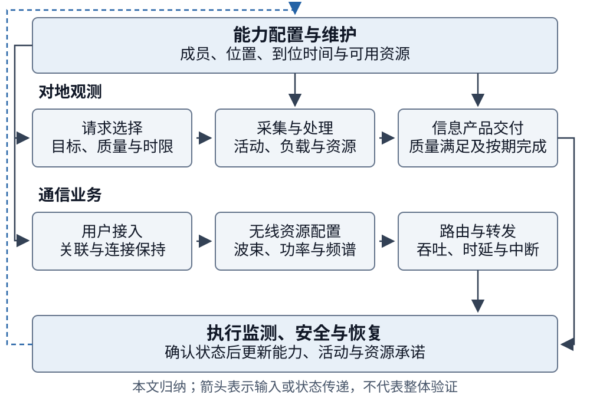
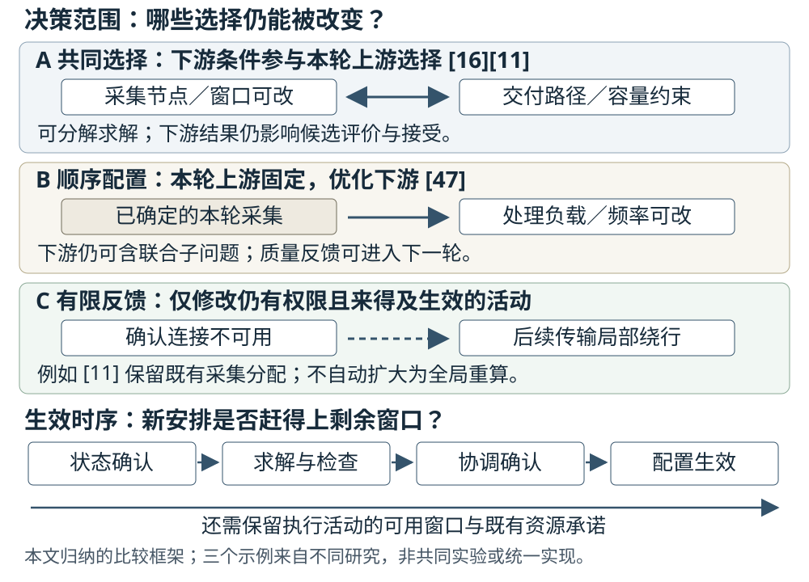

# 大型卫星星座智能管理与调度研究综述

Intelligent Management and Scheduling of Large Satellite Constellations: Service Completion, Resource Coupling, and Operational Feedback

**v2.3-CN · 2026-10-17 · 作者审阅稿；科学内容、版本及投稿声明仍待作者终核**

## 摘要

大型卫星星座的持续运行需要把能力配置、业务安排与执行反馈连接起来。现有研究采用不同的完成条件、决策范围和验证环境，方法收益及计算规模因而难以直接比较。本文采用问题导向的叙述性综述，以对地观测和通信为核心，梳理能力维持、任务规划、网络资源管理及安全恢复，围绕业务完成、资源耦合和信息权限比较代表研究。综合分析表明：成像、下传与按期交付的差别决定了收益的业务含义；可扩展性来自候选压缩、计划与模型复用、计算前移以及协调范围限制，其代价需覆盖准备、在线计算和配置生效；当下游瓶颈会改变尚可修改的上游选择时，共同选择才具有明确作用，而联合建模仍可采用分解求解；运行反馈的有效范围取决于状态确认、资源承诺和剩余执行窗口。公开接口、独立测量、软件原型与飞行案例进一步说明上述关系的运行含义。本文据此归纳联合选择、顺序配置及反馈的适用条件，并提出连接能力恢复与业务损失、确定耦合范围以及协调延迟信息的研究问题。 <!-- [claim:CN23C001] [evidence:] -->

**关键词：** 大型卫星星座；任务调度；通信资源管理；在轨服务；运行反馈；自主运行

## Abstract

Sustained operation of large satellite constellations connects capability configuration, service scheduling, and execution feedback. Existing studies use different completion criteria, decision scopes, and validation environments, making their benefits and computational scale difficult to compare directly. This problem-driven narrative review examines capability maintenance, mission planning, network resource management, and safety and recovery, focusing on Earth observation and communications. Representative studies are compared through service completion, resource coupling, and information and decision authority. The synthesis yields four conditional insights. First, imaging, data download, and delivery by a deadline give different operational meanings to reported gains. Second, scalability relies on candidate reduction, plan and model reuse, computation moved offline, and restricted coordination; its costs include preparation, online computation, and configuration activation. Third, joint selection matters when a downstream bottleneck can change a revisable upstream choice, whereas a joint model may still use a decomposed solver. Fourth, effective feedback depends on confirmed state, resource commitments, and the remaining execution window. Public interfaces, independent measurements, software prototypes, and flight cases clarify the operational meaning of these relationships. The review identifies conditions for combining joint selection, sequential allocation, and feedback, and outlines research questions linking capability recovery to service loss, the extent of coupling, and coordination under delayed information. <!-- [claim:CN23C002] [evidence:] -->

**Keywords:** large satellite constellations; mission scheduling; communication resource management; on-orbit servicing; operational feedback; autonomous operations

## 1 引言

### 1.1 从任务分配到持续运行

大型星座把重复出现的活动机会、持续到达的需求和多个决策主体置于同一运行过程中。增加卫星可以扩展候选观测窗口和接入机会，也会增加资源竞争、状态交换与计划更新的负担。自动化运行研究已将资源排程、监测、配置及轨道管理列为相互关联的扩展问题[1]。因此，评价管理与调度方法需要追踪一项安排如何利用可用能力、形成业务结果，并在状态改变后继续执行。 <!-- [claim:CN23C003] [evidence:E001] -->

对地观测与通信呈现了不同的服务过程。观测请求通常经过成像、处理和传输，以满足质量与时限的信息产品作为完成结果；通信业务围绕持续流量配置关联、波束、功率、频谱及路径。两者共享时间、能源、存储和地面设施，但完成一次成像、增加下传数据量与维持连接质量分别回答不同问题。空间物流研究进一步将部署、补给与重构纳入能力维持[2]。这些长期决定会改变后续可用的成员、位置与资源，安全干预和异常恢复则在运行中再次修改这些条件。 <!-- [claim:CN23C004] [evidence:E002] -->

### 1.2 已有综述与本文的分析重点

已有综述为各问题域提供了不同的组织方式。敏捷观测综述[3]比较任务模型、约束与求解方法，卫星调度综述[4]将成像、通信和集成调度置于观测任务背景中；其分类能够揭示活动安排的结构，跨论文结果仍需保留目标函数及模型差异。多智能体综述[5]以主体、协调架构和任务管理组织分布式空间系统；自动化运行研究[1][6]则关注运行职责、地面与星上功能及工具。通信专题综述[7][8]进一步涉及网络组织、控制及资源管理，而SatOps—NetOps研究[9]直接讨论平台运行和网络需求的连接。表1据此概括本文与既有研究的衔接，不将这些视角的差别解释为其他综述未覆盖某一领域的证明。 <!-- [claim:CN23C005] [evidence:E003,E004,E005,E001,E006,E007,E008,E009] -->

**表1 既有综述的组织对象与本文的比较问题**

| 代表文献 | 主要组织对象 | 本文衔接的比较问题 | <!-- [claim:CN23C006] [evidence:] -->
| --- | --- | --- |
| 观测与卫星调度[3][4] | 任务、资源约束与求解方法 | 采集、处理、下传与请求交付分别如何完成 | <!-- [claim:CN23C007] [evidence:E003,E004] -->
| 分布式空间系统[5] | 智能体、协调方式与任务管理 | 共享何种信息、何时共享、谁有权修改活动 | <!-- [claim:CN23C008] [evidence:E005] -->
| 自动化运行[1][6] | 运行职责、自动化模式及工具 | 计划输出如何经过执行检查而改变运行状态 | <!-- [claim:CN23C009] [evidence:E001,E006] -->
| 通信管理[7][8] | 网络组织、控制和资源配置 | 持续用户流量与观测数据下传的目标有何差别 | <!-- [claim:CN23C010] [evidence:E007,E008] -->
| SatOps—NetOps[9] | 平台运行与网络管理的交互 | 共同选择、顺序传递和反馈分别保留哪些权限 | <!-- [claim:CN23C011] [evidence:E009] -->

本文在既有架构与运行交互研究[9]基础上，围绕三个决策问题综合代表文献：模型何时、以何种对象作为业务完成；下游约束能否改变尚可修改的上游选择；方法利用何种结构减少计算和协调，新安排能否及时生效。第3章比较方法机制和证据，第4章以表6总结适用条件并提出研究问题，图2连接可改变量与反馈时序。本文保留任务域与模型差异，不据异构算例构造统一性能排名。 <!-- [claim:CN23C012] [evidence:E009] -->

### 1.3 范围、选录方式与证据使用

本文是一篇问题导向的叙述性综述。文献来自既有主题文献库、代表研究的参考链追溯和专题补充，按管理职责及其对业务结果的作用选录。对地观测和通信是核心业务；构型、补给、在轨服务、安全与恢复按其支撑作用纳入。单星、地球同步轨道、深空及通用多智能体研究用于解释相关方法，论述中保留原任务域。“大型”表示成员、候选活动或协调规模已对求解和运行组织产生实质影响，不设置统一卫星数量阈值。“智能管理”涵盖基于状态与目标的优化、规则推理、协调和学习。 <!-- [claim:CN23C013] [evidence:] -->

本文按决策对象、可选变量、资源约束、可获得信息、更新权限、完成事件、评价量和验证环境提取比较内容。纳入方法分析的学术来源须具有可获取且已定向核读的正文，原始研究承担相应的方法和结果论述，既有综述用于界定研究范围与分类视角。出版社PDF、完整HTML、机构接受稿及作者预印本均按实际版本使用；涉及模型假设、结果条件和版本差别的限制保留在相应论述中。官方工程资料用于说明接口、软件性质或具体运行事件。本文分别表述原研究结果与跨研究归纳，不据此作穷尽性的文献频率估计或跨论文性能元分析。 <!-- [claim:CN23C014] [evidence:] -->

## 2 管理对象与比较基础

### 2.1 业务过程与可用能力

观测与通信共享平台资源，却具有不同的业务完成过程。观测管理需要把目标请求转化为可执行的采集、处理和交付活动；通信管理需要使有限资源持续响应空间分布和时间变化的流量。构型及维护决定能力在何处、何时可用，安全与恢复根据执行事件改变成员和任务状态。图1以业务过程为横向主线，以能力、资源与反馈为共同管理职责，避免将某个求解器等同于完整运行体系。 <!-- [claim:CN23C015] [evidence:] -->

### 2.2 决策时域、权限与资源承诺

长期配置选择资产、位置和未来能力，业务调度据此选择活动，执行与恢复再更新状态。时间尺度之外，还需要说明哪些决定可以修改。本文将已经确认的安排对后续选择的限制称为资源承诺，并区分其来源：预约服务的配置及变更规则[10]、接触图算法对已分配容量的保留[11]，以及激光链路建立的物理时间[12]分别约束不同环节。比较重规划时，应说明承诺由谁作出、是否允许撤回及修改何时生效。 <!-- [claim:CN23C017] [evidence:E052,E106,E121] -->

集中、分层和分布式描述信息汇集与决策权限；主问题—子问题分解描述求解组织；集中训练与分散执行描述学习阶段。决策范围与求解组织需要分开识别：共同选择相邻活动，并不要求一次性整体求解；采用分层算法，也不必先固定上游结果。管理拓扑研究[13]关注成员组织及中心切换，观测分配研究[14][15]关注任务竞争和冲突信息。比较这些方法时，应说明各主体获知什么、能够修改什么，以及计时覆盖哪些步骤。 <!-- [claim:CN23C018] [evidence:E010,E034,E035] -->

图1 业务过程与共同管理职责。箭头表示任务、资源或状态的传递，为本文归纳；具体研究可以只优化其中一部分，不表示图中全部功能已在同一系统验证。 <!-- [claim:CN23C016] [evidence:] -->

### 2.3 完成事件、评价量与比较分母

约束限定可行活动，目标函数决定模型奖励的结果。在观测链中，成像、质量满足、处理完成、数据下传和请求按期交付可以发生在不同时刻。联合观测—传输模型[16][17]即采用不同的奖励构造：按成功安排请求计权，与并列奖励观测和下传体积具有不同含义。通信吞吐、排队时延、公平性和中断也依赖各自的统计对象。表2将这些结果与决策变量并列，作为后文比较的基础。 <!-- [claim:CN23C019] [evidence:E042,E044] -->

**表2 管理对象、可选变量与结果定义**

| 管理对象 | 典型可选变量 | 需要明确的完成事件或分母 | <!-- [claim:CN23C020] [evidence:] -->
| --- | --- | --- |
| 观测请求 | 目标、成员、窗口及活动顺序 | 采集、质量满足、按期交付；重复观测的价值 | <!-- [claim:CN23C021] [evidence:] -->
| 处理与传输 | 处理节点、负载、频率及路径 | 处理结束、下传字节或完整产品；成功请求子集 | <!-- [claim:CN23C022] [evidence:] -->
| 通信业务 | 关联、波束、功率、频谱及路由 | 流量满足、排队/端到端时延、越限或实际中断 | <!-- [claim:CN23C023] [evidence:] -->
| 能力维持 | 备星、补给、设施及维修行动 | 库存供应、资产到位、任务能力恢复、业务重分配 | <!-- [claim:CN23C024] [evidence:] -->
| 安全与恢复 | 跟踪、机动、诊断及计划修复 | 风险信息、约束满足、安全退出及原任务恢复 | <!-- [claim:CN23C025] [evidence:] -->

评价量还应与试验总体一致。成功请求的平均时延不能替代全部请求的按期完成率，限时内找到可行解与证明最优也属于不同状态。本文据此同时考察结果、未完成情况及获取结果所需的成本。模型仿真、软件测试、硬件原型、运行接口、外部测量和飞行事件分别支持其实际观察对象。 <!-- [claim:CN23C026] [evidence:] -->

## 3 主要技术路线及代表研究比较

### 3.1 长期能力配置与持续维护

#### 3.1.1 构型选择与能力到位

构型设计的决策范围取决于目标状态是否预先给定。终端条件下的重构机动[18]、区域构型与卫星指派的共同选择[19]，以及已知阶段需求间的重构[20]，依次增加了终端位置或阶段之间的可选量。访问模式优化[21]利用覆盖的组合结构，不确定关注区域下的部署[22]则评价未来需求情景，并以增发成员补充能力。阶段数量增加说明规划范围扩大，其在线适应性仍取决于信息何时揭示和已部署成员是否允许改变。 <!-- [claim:CN23C027] [evidence:E011,E012,E013,E014,E015] -->

能力到位还受部署过程约束。Gwon和Ahn[23]将停泊、J₂引起的升交点赤经漂移、发射容量和完成窗口纳入设计；其筛选得到潜在可达对象，最终选集仍需满足覆盖要求。通信平台与星座联合设计[24]进一步把天线、波束及平台参数与地域需求相联系。两类研究分别说明形成能力需要的时间和单位资产能提供的容量。细化覆盖或波束能够增加选择，也会带来平台复杂度及运行配置负担，因而构型比较应报告目标能力、到位时刻与实现条件。 <!-- [claim:CN23C028] [evidence:E016,E017] -->

#### 3.1.2 补给状态与业务恢复

多级库存模型[25]将地面、停泊轨道和轨道面内备星连接起来，计入停泊层向轨道面补给的漂移与转移等待，同时将轨道面内备星接替视为即时可用。双通道研究[26]在间接补给之外加入直接注入，并保留面内即时替换等前提。马尔可夫链模型[27][28]进一步描述库存、接触机会及在途补给阶段。离散时间步、实际交付机会和资产到位时刻分别控制模型精度、供给条件和运行结果，不能用平均库存量替代全部时间信息。 <!-- [claim:CN23C029] [evidence:E018,E019,E020,E021] -->

集成在轨服务的维护研究[29]同时考虑运营方年维护成本与服务方利润，并用库存订货满足率约束供给水平。已核作者稿的案例允许较长维修周转与较高订货满足率并存，原因在于备件缓冲；这也说明维修历时与用户业务中断需要不同的状态描述。其经济前沿还受定价、可修复故障比例及修后如新等假设影响，不直接代表实际市场均衡。 <!-- [claim:CN23C030] [evidence:E023] -->

Iridium公开的备星部署[30]提供了备用能力投入的工程例子。将这些资料与库存模型连接时，可区分四个事件：替代资源可得、资源到位、任务能力恢复，以及受影响业务重新分配。已有模型细化了其中不同阶段。进一步评价通信中断或未满足观测请求，需要把这些事件与共同的故障和需求序列关联；这是本文提出的比较接口。 <!-- [claim:CN23C031] [evidence:E022] -->

#### 3.1.3 设施布局、访问与滚动维护

服务设施通过位置和客户分配限定维护可达范围。轨道仓库研究[31]先在离散候选中选择设施与指派，再在固定部分决定后连续细化；位置—线路模型[32]则交替更新连续位置与多客户线路。两者的差别在于哪些变量共同变化。服务船预部署[33]为给定服务对象配置初始能力，滚动物流[34]允许需求逐步揭示，高低推力服务框架[35]进一步把转移代价和质量变化纳入访问安排。这些研究连接了设施、需求与行动，但其输出分别对应部署方案、服务计划和可达转移，尚需通过一致的任务结果解释其关系。 <!-- [claim:CN23C032] [evidence:E024,E025,E026,E027,E028] -->

这些模型连接日常调度的输出是带有时间、位置和剩余资源的能力。[34]在滚动时域内只执行计划前缀，并在需求揭示后更新后续安排；[35]则使推进条件和质量影响转移的可用范围。共同的比较问题是：当前计划依据哪些已知需求，下一轮仍可修改哪些资产和活动，以及求解预算内返回的安排何时能够执行。固定客户顺序下的位置细化、后验多客户组合与全时域联合路由应分别解释。 <!-- [claim:CN23C033] [evidence:E027,E028] -->

### 3.2 对地观测与在轨服务调度

#### 3.2.1 活动选择与跨星协调

观测调度把请求选择转化为满足姿态和可见窗口的活动序列。经典研究[36]比较了特定窗口约束问题中的贪心、动态规划、约束规划和局部搜索；能量感知研究[37]进一步将轨道光照、电池状态和任务共享纳入混合整数线性模型，区分单星专属任务、星座共享任务与同时执行的冗余任务。个体收益、星座收益与冗余因此形成资源竞争，而非单纯增加成员即可同时改善的目标。该研究以通用整数规划求解器验证1—5星场景，适合解释资源模型如何改变可行活动；其规模结论仍限于所设实例。 <!-- [claim:CN23C034] [evidence:E030,E122] -->

分布式实例利用了不同的可复用结构。Parjan和Chien[14]在滚动推进时移除撤回请求、安排新激活请求，复用已知计划以减少重复计算；其广播分配同时可能保留重复观测。Zilberstein等[15]依据几何邻域识别竞争者，再用分布式约束优化缩小协调范围。前者减少需要重新安排的活动，后者减少需要协商的主体，收益分别受到计划变化和竞争结构影响。[14]的实验采用单线程仿真，其并行完成时间另作估算；计算节省、重复观测和任务满足应结合对应计时口径解释。 <!-- [claim:CN23C035] [evidence:E034,E035] -->

协调方法的保证取决于信息与评分条件。多主体观测模型[38]区分请求所属主体和协调角色；一致性任务包算法（CBBA）[39]交换赢家、报价和时间戳，并在规定的评分及通信条件下消解冲突。其贪心等价和价值界具有各自前提。延迟通信协同规划[40]把消息到达条件引入联合任务安排，异步市场方法[41]则在各主体独立更新时维持任务竞争关系。迁移这些方法时，应核对任务互补价值、状态传播条件和最终执行权限，分别评价减少通信与改变任务分配带来的结果。 <!-- [claim:CN23C036] [evidence:E036,E037,E039,E041] -->

#### 3.2.2 观测、处理与交付的连接

He等[16]的作者公开稿以期限内完成观测和传输的请求加权值为目标，使下传机会在目标与窗口选择时参与决策。算法在上层用遗传搜索构造观测—传输窗口关联，在下层对给定关联作半定松弛，再经随机化和调整恢复可行配置。分层降低了直接处理全部变量的负担，但上层仍依据下层结果评价候选，因此属于联合决策的分解求解。该模型采用无误码传输，并忽略成像角度对图像质量的影响；其收益对应这些条件下的按期请求安排，不能直接解释为质量已确认的信息产品交付。 <!-- [claim:CN23C037] [evidence:E042] -->

Rocha等[17]的机构工作论文同时奖励观测收益与向地面下传的数据量，并考虑姿态、存储和能源。算法先通过图结构减少候选连接，再以简化整数模型和局部混合整数规划（MIP）邻域改善安排；前者改变候选表示，后者通过固定部分变量控制每次搜索规模。图压缩依赖重叠任务分组及切换条件，保守简化还可能舍弃可行序列。其计算收益因而来自结构利用与搜索范围控制，并不意味着压缩在任意任务组合下均保持原可行域。两个奖励项也须分别解释：与[16]的按期请求计奖相比，增加观测收益或下载体积未必增加完整请求数。 <!-- [claim:CN23C038] [evidence:E044,E042] -->

地面设施使链路机会进一步受到共享容量约束。卫星控制网络[42]、下传排程[43]及深空网络（DSN）优化[44]采用不同的实例结构、人工输入和求解预算；深空网络运营[45]还包含请求解释、候选安排、协商与确认。所引Planet和AWS公开文档[46][10]分别定义质量/交付状态与预约配置。它们使模型中的完成事件和承诺变更具有具体的操作参照，算法性能仍应由相应实验评价。 <!-- [claim:CN23C039] [evidence:E047,E048,E049,E050,E051,E052] -->

Soret等[47]的作者稿先用整数规划确定本轮采集，再配置处理负载与处理器频率。给定负载时，可由处理时限求得节能频率并代回模型，将剩余负载配置转为其假设下的凸问题。这种顺序配置利用固定采集输入简化下游求解，与[16]中下游结果仍影响窗口关联有所不同。其采集阶段省略存储约束，处理阶段采用平均时延约束，并依赖固定流水线及稳定星间链路。质量失败可以触发下一轮重采，但不会使本轮已固定的采集重新成为该处理问题的变量；平均约束也不等于逐帧截止期保证。 <!-- [claim:CN23C040] [evidence:E053,E042] -->

处理配置还可以通过返回机会或信息价值连接业务。轨道感知调度[48]把离开地面可见域作为返回结果的边界，成功计数可包含超过业务截止期、但离域前完成的请求；其成功比例和平均响应时间应保留各自分母。Kodan[49]通过专用模型、图块和处理跳过，将处理配置连接到下传中高价值比特的比例，提供了另一种价值映射。前者直接评价请求的返回，后者关注有限下传容量中保留的信息价值。地面硬件测量与轨道链路仿真仍对应特定任务，价值密度与完整产品交付需要分别评价。 <!-- [claim:CN23C041] [evidence:E057,E058] -->

#### 3.2.3 动态请求与学习作用的位置

动态调度首先需要明确何时触发重规划，以及哪些活动仍可修改。滚动时域研究[50]结合周期与事件触发，将等待和新到任务纳入当前任务集，再以启发式分配卫星与时间窗；其4—6星实验用于解释重新安排等待任务的作用。与任务到达不同，不确定性模型还决定新信息揭示后能否改排。鲁棒模型[51]以预算参数控制收益扰动的保守范围，多阶段随机模型[52]则区分评价既定计划的两阶段形式与允许天气信息揭示后修改未来活动的三阶段形式。重新规划、保守预留和信息揭示后的调整由此具有不同的可改变量。 <!-- [claim:CN23C042] [evidence:E127,E061,E062] -->

学习方法还应按其在完整流程中的位置比较。Song等[53]用Q-learning依据适应度改善选择遗传算子，再由时间窗选择器筛选窗口并调整执行时间。学习控制搜索方向，解的可行性仍依赖解码过程。其两星、100—1400任务实验不代表同等数量卫星的协同验证。单星策略复用[54]则将训练策略用于多个成员，配合动作屏蔽、任务分配及完成状态共享；共享完成状态有助于减少重复，却未直接提供同一决策时段的未来意图。Basilisk中的算法比较[55]进一步把策略、训练与安全动作处理置于共同仿真流程。搜索效率、动作可行性和跨星协调需要分别说明实现环节与成本。 <!-- [claim:CN23C043] [evidence:E123,E065,E066] -->

#### 3.2.4 在轨服务的转移与补给

在轨服务改变了候选活动的形成方式。观测常利用预先给定的目标可见窗口，服务访问则需由推进、质量和时间条件生成可达转移[56][57]。改变访问顺序会改变后续转移的起点、资源和可用时刻，因而不能仅把空间距离作为统一任务边权。高低推力服务与滚动物流研究[34][35]还表明，轨迹模型与需求更新应通过明确的起止状态交接，再由上层安排访问与补给。 <!-- [claim:CN23C044] [evidence:E071,E072,E027,E028] -->

低推力预计算研究[57]在轨道、质量及时刻等维度生成代价，再利用插值支持序列搜索；漂移服务研究[56]则联合推力—漂移—推力转移、访问与加注。两者都需保留相位处理的边界。[57]的飞行时间由控制权重及终止准则等共同产生，代价表不自动支持任意指定到达时刻。评价此类方法时，应同时说明预计算成本、插值参照、直接动力学复核及未纳入的终端条件。 <!-- [claim:CN23C045] [evidence:E072,E071] -->

**表3 观测与服务调度的决定、目标和方法条件**

| 代表研究 | 可修改决定及主要方法 | 业务结果或目标 | 主要适用条件 | <!-- [claim:CN23C046] [evidence:] -->
| --- | --- | --- | --- |
| 分布式观测[14][15] | 复用计划或按几何邻域压缩协调范围 | 任务满足、重复观测及计算/消息成本 | 竞争结构与计时口径须对应 | <!-- [claim:CN23C047] [evidence:E034,E035] -->
| 拍卖与异步协调[39][40][41] | 竞价、延迟消息处理及冲突消解 | 原模型的任务价值及分配结果 | 评分、消息条件与执行权限分别保留 | <!-- [claim:CN23C048] [evidence:E037,E039,E041] -->
| 联合观测—传输[16] | 遗传搜索窗口关联；松弛与可行性恢复配置窗内资源 | 期限内成功请求的加权收益 | 无误码传输；图像质量简化 | <!-- [claim:CN23C049] [evidence:E042] -->
| 观测—下传一体安排[17] | 图压缩减少连接；局部MIP邻域限制搜索规模 | 观测收益与下传体积分别计奖 | 分组及切换条件；保守简化可缩小可行域 | <!-- [claim:CN23C050] [evidence:E044] -->
| 顺序处理配置[47] | 固定采集；按负载消去频率并优化剩余配置 | 节能配置及平均时延约束 | 固定流水线、稳定星间链路；跨轮次质量重采 | <!-- [claim:CN23C051] [evidence:E053] -->
| 计算与信息价值[48][49] | 利用返回机会或选择处理配置 | 成功返回、响应时间或价值密度 | 统计分母、帧期限、误判及硬件条件不同 | <!-- [claim:CN23C052] [evidence:E057,E058] -->
| 策略复用[54][55] | 策略、动作检查及分配/状态共享 | 原仿真中的观测调度结果 | 训练、推理和跨星协调分别评价 | <!-- [claim:CN23C053] [evidence:E065,E066] -->
| 低推力服务[56][57] | 转移代价生成、访问及补给 | 原模型的转移与服务结果 | 质量、时间、相位及预计算/复核成本 | <!-- [claim:CN23C054] [evidence:E071,E072] -->
| 能量约束与学习辅助搜索[37][53] | 电池/光照下选任务；学习选择遗传算子 | QoS权衡或电磁探测收益 | 1—5星与两星任务扩展分别验证；学习和可行解码分开 | <!-- [claim:CN23C127] [evidence:E122,E123] -->

[16][47]按作者稿、[17]按机构工作论文解释方法，正式出版版的一致性尚待对照。表中比较的是变量、完成事件和求解机制；奖励、输入及计时条件不同的结果不能直接组成性能排序。 <!-- [claim:CN23C055] [evidence:E042,E053,E044] -->

### 3.3 通信网络管理与资源调度

#### 3.3.1 需求估计、波束与功率

流量预测为配置提供输入，配置再将资源转化为服务。预测研究[58]在合成自相似流量上组合经验模态分解、自回归模型与神经网络，评价的是需求预测误差，路由应用被列为后续工作。因而，预测对吞吐或排队的作用需要通过使用预测的具体策略说明。 <!-- [claim:CN23C056] [evidence:E073] -->

波束与功率研究[59]的作者稿先按平均功率选束，再固定当槽选择优化连续功率，并随到达和剩余需求更新。所设单星场景以供需平方差及满意度比的Jain指数评价匹配与公平性。对照采用相同选束规则而改变功率处理，但队列变化仍可能影响后续选择；该比较更适合解释分阶段配置的作用，而非整段时域中固定全部照射动作的单因素消融。 <!-- [claim:CN23C057] [evidence:E074] -->

多星覆盖重叠使成员关联和功率配置相互影响。需求感知资源分配[60]的作者稿由数字孪生侧多星选束与星内连续功率配置协作完成，并显式表示队列。其公平量使用覆盖小区队列包龄的极差，与单星模型[59]的满意度比Jain指数具有不同对象和方向。原文的固定功率与动态功率对照还同时改变功率动作与配置组织，吞吐差异随负载而变化。这说明增加决策自由度的价值需要结合实际瓶颈及共同对照条件解释。 <!-- [claim:CN23C058] [evidence:E076,E074] -->

共享频谱进一步引入需要保护的其他系统。Ngo等[61]的机构作者稿以LEO覆盖小区簇为智能体，通过集中评论器训练联合波束激活、子带和功率配置，并将超过GEO聚合干扰阈值的情形计入奖励惩罚。其目标同时考虑吞吐与小区间服务时延差异，智能体数不等于卫星数。与[59][60]比较时，应分别说明满意度、队列包龄与服务时延差异的定义；奖励惩罚的设置还需与执行时的约束满足分开评价。 <!-- [claim:CN23C124] [evidence:E128,E074,E076] -->

#### 3.3.2 接入切换与服务变化

切换控制既涉及目标卫星选择，也涉及协议过程中的信令与资源竞争。Lee等[62]通过学习接入状态调整切换请求，并省去传统流程中的测量报告环节。在一颗服务星与两颗目标星的仿真中，接入时延改善并不总伴随随机接入前导碰撞减少。该结果说明，应分别记录协议开销、资源块不足和接入竞争；接入阶段的改善还需通过后续路径和业务条件才能转化为端到端效果。 <!-- [claim:CN23C059] [evidence:E124] -->

独立测量为这些模型提供了不同性质的证据。Mohan等[63]观察到Starlink重配置边界附近的时延和吞吐变化，并在仅有单颗候选卫星的受控连接窗口中仍观察到波动。这支持服务变化在相应条件下无需以卫星切换为前提；周期性网络调度属于原作者对现象的解释。该例提示应分别记录接入对象、资源配置状态和最终业务性能。 <!-- [claim:CN23C060] [evidence:E078] -->

#### 3.3.3 路由结构与配置生效

路由方法的计算瓶颈会随架构改变。Handley[64]的机构接受稿研究无直接星间链路时的地面中继路径；在其实现中，反复构图和更新边时延比最短路搜索更耗时。地理分块减少待检查中继，保留扩展覆盖区内的图并更新边权则减少重建。给定1584星、5000中继及2.7 GHz Core i7的历史仿真算例，构图并计算从一个源到所有目的地路径的时间由1.55 s降至61 ms。该数值反映特定实现与2019年部署假设，不包含真实网络的全部控制和业务开销。动态激光链路研究[12]则将新链路建立时间计入路径选择，研究对象和时间成本随之改变。 <!-- [claim:CN23C061] [evidence:E125,E121] -->

动态激光链路研究[12]的作者稿比较即时最短路、保留路径以及考虑未来平均代价的选择。较稳定的路径可能增加传播距离，却减少新建链路的次数，故建链代价决定两者的权衡；低建链代价时，部分路径保持策略反而增加平均时延。其性能实验和裁边计时分析采用不同裁边阈值，不能把后者的计算节省与前者的性能直接合并。该模型采用预计算和路径分发，省略排队及初始配置时延。因此，路径稳定的价值首先对应所设传播与建链模型，在队列主导或状态滞后时还需重新评价。 <!-- [claim:CN23C062] [evidence:E121] -->

转发信息的表示又影响更新与恢复代价。Zhang等[65]的作者预印本以包内Bloom filter编码星间链路标识，通过分段再编码平衡额外转发和编码时延；遇到失效链路时，本地重算路线与使用预定绕行路径具有不同的路径质量和处理成本。其66星包级仿真与MATLAB数值实验采用不同的环路处理，结果需要分别解释。与地面中继[64]及动态建链[12]相比，该方法改变的是有星间链路网络的路径表示和失效响应方式，不能把三者的时延或恢复结果直接排序。 <!-- [claim:CN23C125] [evidence:E126,E125,E121] -->

#### 3.3.4 分层配置与局部权限

分层资源管理[66]将网络控制中心、空间基站和终端置于不同职责层级，以全局服务区域及频谱配置约束局部波束、时隙和信道安排，并交换需求与价格。其不同实验对应不同组件及负载，不能把组件收益相加为整体架构增益。分层的关键作用不仅是减少计算规模，还在于明确谁能修改哪些资源、使用何种状态以及上层配置何时对局部决策有效。 <!-- [claim:CN23C063] [evidence:E081] -->

**表4 通信管理代表研究的决策与结果定义**

| 研究及证据对象 | 决策或观察方式 | 主要结果定义 | 适用条件与解释范围 | <!-- [claim:CN23C064] [evidence:] -->
| --- | --- | --- | --- |
| 流量预测[58] | 需求估计模型 | 合成流量上的预测误差 | 配置收益由后续使用预测的策略决定 | <!-- [claim:CN23C065] [evidence:E073] -->
| 单星波束—功率[59] | 选束后优化连续功率并随需求更新 | 供需匹配及满意度公平性 | 单星；队列和后续选择随时间变化 | <!-- [claim:CN23C066] [evidence:E074] -->
| 多星需求感知配置[60] | 多星选束与星内功率配置协作 | 吞吐与队列包龄差异 | 整体策略对照；负载与动作表示不同 | <!-- [claim:CN23C067] [evidence:E076] -->
| GEO—LEO共存[61] | 以小区簇为智能体联合选束/子带/功率 | 吞吐与服务时延差异 | 机构作者稿；干扰奖励惩罚不等于逐动作硬保证 | <!-- [claim:CN23C128] [evidence:E128] -->
| 接入协议[62] | 学习调整请求并减少信令环节 | 接入时延与随机接入碰撞 | 三星仿真；两指标可呈相反变化 | <!-- [claim:CN23C129] [evidence:E124] -->
| 地面中继[64] | 分块建图、图复用及差分更新 | 传播时延、路由计算和路径变化 | 2019部署假设；接受稿，非当前现网测量 | <!-- [claim:CN23C130] [evidence:E125] -->
| 链路标识路由[65] | 包内路径编码、分段及本地失效响应 | 转发/编码成本、时延与交付率 | 有星间链路、66星仿真；按作者预印本解释 | <!-- [claim:CN23C131] [evidence:E126] -->
| 动态激光链路[12] | 路径选择计入新链路建立代价 | 原模型的端到端时延及路由更新 | 无队列、路径预分发；性能与成本配置分开 | <!-- [claim:CN23C068] [evidence:E121] -->
| 分层资源管理[66] | 全局配置约束局部波束等安排 | 原方案的服务和资源配置结果 | 层间权限、交换信息及组件实验范围 | <!-- [claim:CN23C069] [evidence:E081] -->
| 独立测量[63] | 观察受控连接窗口中的网络服务 | 时延与吞吐变化 | 外部现象；内部机制为原作者解释 | <!-- [claim:CN23C070] [evidence:E078] -->

表中作者稿、机构接受稿与预印本均按实际阅读版本解释。接入协议、传播路径、队列和路由更新采用不同的时延定义，异构场景中的结果不合并排名；公平量及成功样本的统计口径也分别保留。 <!-- [claim:CN23C071] [evidence:] -->

### 3.4 安全执行与异常恢复

#### 3.4.1 从风险信息到处置输入

安全信息链包含不同计算任务。最近接近方法[67]利用分段近似及距离极值搜索细化候选事件；筛查与CUDA研究[68]则压缩配对并组织并行计算，其速度和遗漏表现依赖目录、步长及实现。前者改善单个候选的精算过程，后者改变需要处理的候选集合及计算组织。组合使用时，应以同一传播与事件判定条件检查精度、遗漏和总耗时。 <!-- [claim:CN23C072] [evidence:E082,E084] -->

风险预测竞赛[69]估计后续报文中的风险，机动综述[70]整理可选处置方法，运行仿真[71]生成用于规则评估的场景与接近事件。竞赛综合分数、事件生成一致性与机动安全对应不同验证对象。CCSDS报文[72]和所引Starlink流程[73]进一步说明跨组织信息、风险重估及动作更新的接口。将风险处置接入业务调度，还需记录机动占用及其后可用活动，而不是以风险估计值直接替代任务结果。 <!-- [claim:CN23C073] [evidence:E087,E086,E085,E088,E089] -->

#### 3.4.2 轨迹安全与上层任务条件

轨迹研究将上层安排转化为受动力学约束的动作。锥优化[74]、反馈模型预测控制（MPC）[75]、机会约束交会[76]及特定轨道下的连续安全约束[77]采用不同的可行域和保证条件。它们向上层提供可执行轨迹、占用时间或安全退出条件；比较时需要保留误差模型、轨道环境及终端要求，避免把一种任务中的安全结论迁移为所有星座活动的通用保证。 <!-- [claim:CN23C074] [evidence:E091,E092,E093,E095] -->

已核方法进一步揭示保证的层次。[74]的凸子问题、逐次更新过程与原非线性问题具有不同的最优性和计时范围；[75]的避碰半空间、通信范围、误差界、离散步长及求解期限共同限制安全结论。通过延长终止时刻恢复可行性还可能改变上层活动的时间承诺。[76]的设计概率和有限样本检验、[77]的连续约束表达和数值容差也需分开解释；完全失推保护的结论应保留对部分推力不足的排除范围。 <!-- [claim:CN23C075] [evidence:E091,E092,E093,E095] -->

安全屏蔽研究[78]说明对照设置同样重要。同一学习策略的屏蔽开关实验，与未屏蔽策略对概率路线图的燃料—时间比较属于两组不同试验；后者还使用不同样本数量。屏蔽会改变允许动作和安全要求，路线图在执行机动时也进行状态校正。因此，比较应报告被改变的机制、安全标准和执行更新，而非仅使用“开环”或“闭环”标签。 <!-- [claim:CN23C076] [evidence:E096] -->

ADRAS-J公开记录的自主中止与安全后撤[79]提供了实际事件参照。安全退出保护了航天器，但原定接近或服务活动的后续完成仍需另行判断。业务层评价由此需要同时记录安全结果、被放弃或推迟的活动以及恢复后的能力。 <!-- [claim:CN23C077] [evidence:E097] -->

#### 3.4.3 告警、诊断与计划恢复

遥测异常检测为恢复提供线索。[80]将预测残差、平滑、阈值及告警区间处理结合，主要对照中的收益应归于实际变化的后处理。评价复核[81]进一步显示，测试标签、阈值选择及事件匹配规则会改变离线分数。两类研究共同说明，检测模型与评估过程都参与形成最终指标。告警命中、及时发现、准确诊断与恢复成功仍需要各自的结果定义，离线分数不能直接替代恢复后的业务状态。 <!-- [claim:CN23C078] [evidence:E098,E101] -->

故障检测、隔离与恢复（FDIR）规则原型[82]将故障事实、动作选择、执行及结果确认连接起来，并在恢复后向导航模式交接。Remote Agent[83]则在规划、执行与诊断之间处理局部失败活动和全局约束的关系。二者分别展示规则原型与任务执行系统中的恢复组织。评价其与业务调度的连接时，应说明诊断依据何时可用、谁授权动作、怎样确认效果，以及剩余任务如何继续；动作被触发与任务恢复完成属于不同事件。 <!-- [claim:CN23C079] [evidence:E102,E108] -->

**表5 安全与恢复的输出及验证对象**

| 环节及代表来源 | 直接输出 | 需要核对的保证范围 | <!-- [claim:CN23C080] [evidence:] -->
| --- | --- | --- |
| 接近计算与筛查[67][68] | 候选事件及最近接近结果 | 传播/数值参照、目录、步长与遗漏 | <!-- [claim:CN23C081] [evidence:E082,E084] -->
| 风险预测与场景[71][69] | 后续风险估计或事件列表 | 各自数据、评分与场景；处置效果另评 | <!-- [claim:CN23C082] [evidence:E085,E087] -->
| 安全轨迹[74][75][76][77] | 轨迹、控制及条件化约束保证 | 原任务域、误差/分布、连续性与求解期限 | <!-- [claim:CN23C083] [evidence:E091,E092,E093,E095] -->
| 学习屏蔽[78] | 经检查的动作及安全干预 | 两组对照、安全标准和执行校正 | <!-- [claim:CN23C084] [evidence:E096] -->
| 异常检测与评价[80][81] | 预测残差、告警区间及评价分数 | 阈值、标签、事件匹配与部署条件 | <!-- [claim:CN23C085] [evidence:E098,E101] -->
| 故障与执行恢复[82][83] | 恢复动作、效果确认及后续活动 | 原型/任务系统、诊断依据与执行交接 | <!-- [claim:CN23C086] [evidence:E102,E108] -->

### 3.5 多问题连接与综合运行

#### 3.5.1 联合选择、顺序输入与反馈

自动化工具[6]和可信自主运行综述[84]提供功能组织背景，具体连接则需落到决策变量。接触图调度[11]提供了资源耦合的具体例子：算法枚举候选采集路径，为每个候选检查能否在期限内输送规定数据量，再选择采集节点和交付路径，并扣减已分配容量。下游交付条件因而在请求接受时参与选择，避免后续请求重复占用同一容量。其模型假设能源与存储无限，并以固定分配作为基线，逐请求交付和成功样本时延须按原分母解释。与[16]的窗口关联、[17]的观测和体积奖励、[47]的固定采集后处理相比，连接活动的方式会同时改变可选变量和被奖励的结果。 <!-- [claim:CN23C087] [evidence:E006,E105,E106,E042,E044,E053] -->

[11]还允许传输阶段在优选路径不可用时回到局部接触图路由。它修改数据的后续路径，同时保留采集节点及既有任务分配；原研究也指出，分布式环境中共享容量使用情况会受到间歇连接限制。因此，局部绕行不等于重新分配请求，集中掌握的容量信息也不能直接假定为所有节点实时可得。图2据此将本轮可改变量、反馈范围和生效窗口并列，说明同一系统可以在不同层次采用共同选择、顺序配置与局部修复。 <!-- [claim:CN23C088] [evidence:E106] -->

图2 相邻活动的决策范围与反馈时序。A表示下游约束可改变尚未执行的上游选择[16][11]；B表示本轮采集固定后配置处理[47]；C归纳局部修复[11]与状态更新[85][86]的有限作用范围，其中[11]的局部绕行保留既有采集分配。下方时间轴为本文归纳的评价框架，不是同一实验、统一系统实现或飞行实测。 <!-- [claim:CN23C089] [evidence:E042,E106,E053,E107,E111] -->

#### 3.5.2 统一模型与状态驱动配置

SatOps—NetOps框架[9]把平台资源与网络需求写入任务模型，通过构造、局部搜索和事件触发重排形成安排；其架构分类与具体集成原型的性能实验应分别理解。分层管理[66]则用上层配置约束局部响应。两者都连接职责，区别在于是否共同选择变量，以及配置传递后局部仍保留哪些权限。 <!-- [claim:CN23C090] [evidence:E009,E081] -->

推理式观测调度[85]根据预测的观测、传输、存储和能源状态调整策略权重，再插入任务并检查约束。这使资源状态参与活动选择，其模型预测、规则和活动构造仍有不同职责。该方法的单星仿真与多星统一任务模型提供互补例子，均需保留各自的状态表达和验证范围。 <!-- [claim:CN23C091] [evidence:E107] -->

#### 3.5.3 从计划到执行的功能交接

计划进入执行系统需要可检查的功能交接。Remote Agent[83]将规划、执行及诊断连接起来，并处理局部失败与全局约束的关系；EO-1[87]展示科学分析产生目标、CASPER调整活动和SCL检查执行的流程，同时保留地面规划与星历更新。IPEX官方资料[86]提供单星星上处理和持续规划的工程例子，cFS演示包[88]则提供软件组件连接依据。飞行事件与软件组件承担不同的证据职责，均需对应到具体输入、动作及结果。 <!-- [claim:CN23C092] [evidence:E108,E109,E111,E113] -->

配置的一致性可以在软件接口层进一步检查。Basciani等[89]用统一模型表达星上软件任务及其时序约束，将结构校验、领域规则、候选优化、仿真检查与配置生成连接起来，再由人工审定并交平台机制切换生效。模型信息变化与实际部署配置变化被分别处理，避免将所有模型更新都转成部署操作。该研究用于说明从计划到配置的交接，其对象是星上软件进程；与星座业务调度连接时，还需建立任务、资源和状态的对应关系。 <!-- [claim:CN23C126] [evidence:E119] -->

Starling[90]以四星共享观测状态并协调后续观测；Starling 1.5[91]在模拟接近场景中进行责任协调和实际机动。这些案例扩大了共享信息和动作权限的范围，但观测选择与跨运营方处置具有不同触发事件。Basilisk[92]及形式化研究[93]为模型仿真和规格检查提供工具。综合运行的评价需要进一步确认状态、计划及动作是否按同一语义交接，以及最终业务结果如何产生。 <!-- [claim:CN23C093] [evidence:E114,E115,E116,E117] -->

## 4 综合认识与研究问题

### 4.1 可扩展性来自何种结构与成本转移

不同领域的方法反复利用三类结构：缩小当前候选，复用已经形成的结果，以及限制每次调整的范围。窗口分层[16]和局部MIP邻域[17]降低单次求解负担，几何邻域[15]限制任务竞争者，增量规划[14]复用既有安排；转移网格[57]则把反复调用的动力学计算前移。它们减少的成本并不相同。图压缩和保守约束可能改变可行序列，计划复用保留历史选择，预计算受网格及终端条件限制。因此，可扩展性应解释为特定结构下业务结果与完整成本的取舍，而非单个求解器随卫星数增长的标签。 <!-- [claim:CN23C094] [evidence:E042,E044,E035,E034,E072] -->

成员数之外，实际需求、候选连接、情景数和协调主体共同决定问题规模。[35]按时域内需求压缩服务对象，[43]的多个排列可映射到同一排程，[52]的情景展开增加决策变量，[53]在两颗卫星上扩展任务量。策略复用[54]也未消除上游分配成本：在目标可见区间已经预计算的实验中，地面MIP平均求解时间从4星、200目标的0.73 s增至40星、3200目标的170 s。这两个端点同时改变成员和目标数量，不构成单因素扩展规律，却表明策略推理计时不能代表完整配置流程。限时可行率、成功实例上的质量及未完成原因仍应共同报告[32]。 <!-- [claim:CN23C095] [evidence:E028,E048,E062,E123,E065,E025] -->

完整成本还包括资源生效前的工作。轨迹网格[57]和策略训练[54]的准备投入能否摊销，取决于复用次数和环境变化；[64]说明重复建图可能比路径搜索更耗时，[12]说明即使路径已算出，新连接仍有建立代价。将准备、求解、协调和生效放在同一事件时间轴上，才能判断安排是否赶得上剩余窗口。比较时可分别给出各阶段耗时及其是否重叠，避免把阶段时间简单相加作为实际响应时间；离线投入、在线预算和在窗口内实际完成的请求则应同时保留。 <!-- [claim:CN23C096] [evidence:E072,E065,E125,E121] -->

### 4.2 下游瓶颈何时值得进入共同选择

联合选择的直接作用，是让下游瓶颈参与淘汰上游候选。[16]把可用传输窗口带入观测安排，[11]在选择采集节点时检验交付容量；如果只有部分采集能获得按期传输机会，忽略下游条件就可能消耗无法转化为交付的资源。相反，[47]固定本轮采集后优化处理，回答的是如何利用既定输入节省处理能耗。两类模型解决的问题不同：共同选择适用于下游约束可能改变尚可修改的上游决定，顺序配置适用于上游已执行、已承诺，或本次评价明确将其作为固定输入的情况。 <!-- [claim:CN23C097] [evidence:E042,E106,E053] -->

这一差别与算法是否分层无关。[16]在窗口关联与窗内资源之间分解求解，仍保留相邻活动的共同选择；[47]在给定采集后又联合配置负载和频率，说明顺序流程内部也可含联合子问题。[17]进一步通过图表示和局部邻域控制计算范围。判断耦合程度时，应先列明哪些上游选择能够被下游结果改变，再说明如何求解。表6据此区分决策范围、收益来源及代价；信息是否及时可得、修改能否生效，则决定这些选择在运行中是否可实施。 <!-- [claim:CN23C098] [evidence:E042,E053,E044] -->

**表6 决策连接的适用条件与评价要求**

| 决策方式及代表研究 | 可改变量与成立条件 | 收益来源与主要代价 | 证据与评价边界 | <!-- [claim:CN23C099] [evidence:] -->
| --- | --- | --- | --- |
| 共同选择[16][17][11] | 上游节点、窗口或顺序仍可改；下游容量等状态可得 | 提前排除无法交付的候选；增加耦合求解及信息成本 | 请求计奖与体积计奖不同；固定完成定义、候选及部分交付规则 | <!-- [claim:CN23C100] [evidence:E042,E044,E106] -->
| 顺序配置[47][59] | 固定本轮采集或选束；下游负载、频率或功率仍可调 | 利用固定输入简化子问题；本次不能回改已固定决定 | 保留流水线与平均约束；区分本轮固定和下一轮更新 | <!-- [claim:CN23C101] [evidence:E053,E074] -->
| 状态反馈[9][11][85][86] | 新状态已确认；尚有修改权限和有效窗口 | 适应偏差并利用新机会；支付传播、检查和生效代价 | 局部绕行不改采集分配；单星与多星、原型与飞行证据分别解释 | <!-- [claim:CN23C102] [evidence:E009,E106,E107,E111] -->
| 分层组合（本文归纳） | 各层交换输入、资源承诺及更新条件 | 用有限耦合连接长期配置与短期响应；协调层间相互影响 | 共同场景下比较最终业务结果与全流程成本；目前不作统一排序 | <!-- [claim:CN23C103] [evidence:] -->

耦合范围还应随实际瓶颈解释。Kodan[49]中，处理是否满足帧期限会改变提速和分类精度对有效下传的贡献；波束与功率研究[59][60]中，需求负载和队列决定新增配置自由度的作用。由此可以提出一个待共同场景验证的判断：当新增变量不能改变当前约束的瓶颈时，扩大联合范围可能主要增加计算与协调；能够改变瓶颈且仍有生效时间时，扩大范围才可能转化为更多完成业务。这是跨研究归纳，不是上述论文已共同验证的性能定律。 <!-- [claim:CN23C104] [evidence:E058,E074,E076] -->

### 4.3 信息、权限与学习模块的接口

信息共享可分为已完成事实、未来安排和资源承诺。完成事实用于移除已满足需求；未来安排用于识别即将发生的竞争；承诺说明哪些资源已不能自由使用。[54]在决策间隔结束时传播已成像或已下传状态，能减少后续重复，却不直接交换同一时段尚未执行的意图。CBBA[39]通过赢家、报价与时间戳维护竞争关系，延迟规划[40]及异步分配[41]则处理各自的信息时序。共享更多信息并非充分条件；内容、确认时刻与修改权限需要对应到同一个待协调决定。 <!-- [claim:CN23C105] [evidence:E065,E037,E039,E041] -->

承诺使反馈具有明确范围。AWS预约规则[10]、接触图容量分配[11]和激光链路建立[12]分别约束组织流程、后续分配与物理连接；分层管理[66]又限制局部节点可改的资源。新状态到达后，系统可能只能绕行、推迟尚未启动的任务，或把偏差留给下一轮。[11]的局部路由正说明了这种有限修复。评价局部修复和全局重算时，应使用相同已确认状态、承诺与生效条件，再考察修改范围、完成业务和响应时间。 <!-- [claim:CN23C106] [evidence:E052,E106,E121,E081] -->

学习的贡献应对应明确模块。需求预测[58]输出状态估计，Q-learning辅助遗传搜索[53]选择搜索算子，策略复用[54]生成调度动作，安全屏蔽[78]检查允许执行的动作，协议学习[62]则改变切换请求过程。它们的输入、输出和约束职责不同。具体比较需要保持任务、状态和安全要求一致，分别记录训练、推理、解码、修复及协调成本。整体方案同时改变多个组件时，可报告整体效果，单模块归因则需要保持其他条件相同的对照。 <!-- [claim:CN23C107] [evidence:E073,E123,E065,E096,E124] -->

### 4.4 运行实践及验证范围

工程资料的价值在于明确模型中的事件如何落到实际职责。表7将公开接口、测量、原型与飞行案例按观察对象组织。Planet与AWS文档[46][10]解释完成状态及预约，DSN运营[45]补充候选、协商与确认，独立测量[63]观察服务现象，EO-1和Starling系列[87][90][91]展示限定任务中的状态反馈与执行。它们为综述提供互补依据，各自的验证对象仍须保留。 <!-- [claim:CN23C108] [evidence:E051,E052,E050,E078,E109,E114,E115] -->

**表7 运行资料与工具能够支持的认识**

| 资料或案例 | 公开的状态、动作或性质 | 对综述的用途与边界 | <!-- [claim:CN23C109] [evidence:] -->
| --- | --- | --- |
| Iridium[30] | 备用资产投入 | 能力配置例子；库存最优性及恢复时间另评 | <!-- [claim:CN23C110] [evidence:E022] -->
| Planet、AWS与DSN[45][46][10] | 质量、交付、预约及安排确认 | 完成事件和承诺过程；内部优化性能另评 | <!-- [claim:CN23C111] [evidence:E050,E051,E052] -->
| Starlink流程及独立测量[63][73] | 风险行动流程；时延与吞吐现象 | 运营方说明与外部测量分开解释 | <!-- [claim:CN23C112] [evidence:E078,E089] -->
| ADRAS-J[79] | 异常后的自主中止及后撤 | 安全处置事件；原任务后续完成另评 | <!-- [claim:CN23C113] [evidence:E097] -->
| EO-1与IPEX[87][86] | 星上处理、重规划与执行检查 | 单星功能交接与地面职责 | <!-- [claim:CN23C114] [evidence:E109,E111] -->
| Starling系列[90][91] | 共享观测与实际机动协调 | 试验目标、成员规模及模拟事件条件 | <!-- [claim:CN23C115] [evidence:E114,E115] -->
| 受监督配置[89] | 模型校验、仿真检查、配置生成与审定 | 13进程工具链及专家反馈；不是大规模在轨验证 | <!-- [claim:CN23C132] [evidence:E119] -->
| CCSDS、cFS与形式化研究[72][88][93][94] | 报文、组件与规格性质 | 互操作及软件依据；业务结果另评 | <!-- [claim:CN23C116] [evidence:E088,E113,E117,E120] -->

验证链应将工件、性质与环境对应起来。受监督重配置[89]的13进程实例和6名专家评价说明模型、校验与配置生成的衔接，其工具链步骤计时不代表优化器或整星座重规划时延。模型检查[94]讨论规格性质，规则原型[82]测量特定软硬件过程，Basilisk[92]支持可配置动力学仿真。规格满足、模型可行、有限样本无违反与飞行事件分别具有不同含义。资源限制导致的未完成分析也应保留，避免将软件验证通过直接解释为持续服务改善。 <!-- [claim:CN23C117] [evidence:E119,E120,E102,E116] -->

### 4.5 面向持续服务的研究问题

能力维持研究需要进一步连接恢复资源与实际业务损失。库存、双通道补给及维修[25][26][29]回答不同的资源可得问题，但备用件可用、卫星到位、载荷恢复和请求重新分配并不同步。关键问题是：哪一段恢复时间主导未满足需求，长期配置改变是否真正缩短这段损失？可在共同故障与需求序列下记录各事件，再分别评价积压请求、未交付产品和通信中断；采用分层或事件驱动模型即可建立这种连接。 <!-- [claim:CN23C118] [evidence:E018,E019,E023] -->

决策耦合研究需要确定有限预算下值得保留的变量范围。[16][17][47][11]展示共同选择、顺序输入和局部修复，但并未在同一业务条件下给出统一取舍。关键问题是：下游瓶颈、负载和剩余窗口如何改变增加耦合的边际收益？可固定任务、窗口、存储、容量和截止期，逐步开放采集、处理及传输的修改权限，并将请求完成与数据体积分开统计。最终完成量、限时可行率及准备、在线和生效成本共同检验表6的条件判断；该评价仍是后续研究方案。 <!-- [claim:CN23C119] [evidence:E042,E044,E053,E106] -->

延迟信息下的反馈研究需要同时考虑状态可靠程度与承诺可撤回性。预约、完成状态共享和分层控制[10][54][66]说明，知道新状态与有权修改资源并非同一件事；容量保留及建链代价[11][12]还会使旧决定持续影响后续活动。关键问题是：在何种延迟和生效条件下应局部修复、继续原计划或启动更大范围重算？可沿任务到达、状态确认、求解结束、冲突消解和配置生效记录事件，评价过时状态、重复调整与业务损失。学习模块应按预测、搜索辅助或动作生成分别设置对照，并计入训练、解码和修复成本。 <!-- [claim:CN23C120] [evidence:E052,E065,E081,E106,E121] -->

## 5 结论

本文以对地观测与通信为核心，梳理大型星座能力维持、任务安排、网络配置及安全恢复的代表研究，并以业务完成、可改变量和运行反馈连接不同技术路线。构型与补给确定资源可用的时间和位置，业务调度将其转化为活动或持续服务，执行状态再改变后续安排。因此，模型中的决定与完成事件是解释方法联系的基础。 <!-- [claim:CN23C121] [evidence:] -->

综合分析得到四项有条件的认识。业务完成的对象与时刻决定收益的含义，采集、下传、按期请求交付和资产恢复应分别解释。可扩展性依靠候选压缩、复用、计算前移和协调限制，其价值需结合保留的可行活动与全流程成本。共同选择在下游瓶颈能够改变尚可修改的上游候选时具有直接作用，联合建模仍可采用分解求解，顺序流程也可包含联合子问题。反馈则受状态确认、资源承诺和剩余生效窗口约束，局部修复的作用不能超出其修改权限。 <!-- [claim:CN23C122] [evidence:] -->

公开接口、独立测量、软件验证与飞行案例将这些关系对应到预约、质量确认、告警、动作和恢复事件，分别提供职责、现象、性质或运行结果的证据。后续研究可进一步连接能力恢复与业务损失，在共同场景下检验有限耦合的收益，并评价延迟信息和承诺对反馈的影响。本文形成的是解释现有方法与组织后续评价的条件性框架，其适用性仍需通过共同场景试验及具体运行系统验证。 <!-- [claim:CN23C123] [evidence:] -->

## 参考文献

1. Mohamed Khalil Ben-Larbi; Kattia Flores Pozo; Tom Haylok; et al. Towards the automated operations of large distributed satellite systems. Part 1: Review and paradigm shifts〔迈向大型分布式卫星系统自动化运行，第一部分：综述与范式转变〕. Advances in Space Research, 2021, 67(11): 3598–3619. DOI: 10.1016/j.asr.2020.08.009. [来源](https://doi.org/10.1016/j.asr.2020.08.009)

2. Koki Ho. Space Logistics Modeling and Optimization: Review of the State of the Art〔空间物流建模与优化：研究现状综述〕. Journal of Spacecraft and Rockets, 2024, 61(5): 1417–1427. DOI: 10.2514/1.A35982. [来源](https://doi.org/10.2514/1.A35982)

3. Xinwei Wang; Guohua Wu; Lining Xing; et al. Agile Earth Observation Satellite Scheduling Over 20 Years: Formulations, Methods, and Future Directions〔敏捷对地观测卫星调度二十年：建模、方法与未来方向〕. IEEE Systems Journal, 2021, 15(3): 3881–3892. DOI: 10.1109/JSYST.2020.2997050. [来源](https://doi.org/10.1109/JSYST.2020.2997050)

4. Benedetta Ferrari; Jean-François Cordeau; Maxence Delorme; et al. Satellite Scheduling Problems: A survey of applications in Earth and outer space observation〔卫星调度问题：对地与外层空间观测应用综述〕. Computers & Operations Research, 2025, 173: 106875. DOI: 10.1016/j.cor.2024.106875. [来源](https://doi.org/10.1016/j.cor.2024.106875)

5. Mohammad Reza Jabbarpour; Bao Quoc Vo; Ghaith El-Dalahmeh; et al. Agent-based approaches for distributed space systems and mission management: Methodologies, current practices and challenges〔分布式航天系统与任务管理的智能体方法：方法体系、实践现状与挑战〕. Acta Astronautica, 2026, 238: 237–257. DOI: 10.1016/j.actaastro.2025.10.018. [来源](https://doi.org/10.1016/j.actaastro.2025.10.018)

6. Mohamed Khalil Ben-Larbi; Kattia Flores Pozo; Mirue Choi; et al. Towards the automated operations of large distributed satellite systems. Part 2: Classifications and tools〔迈向大型分布式卫星系统自动化运行，第二部分：分类与工具〕. Advances in Space Research, 2021, 67(11): 3620–3637. DOI: 10.1016/j.asr.2020.08.018. [来源](https://doi.org/10.1016/j.asr.2020.08.018)

7. 龚李赠; 张文龙; 陈全; 等. 低轨巨型星座智能组网技术综述. 航空学报, 2026，网络首发版本；终排信息待核. DOI: 10.7527/S1000-6893.2026.32935. [来源](https://doi.org/10.7527/S1000-6893.2026.32935)

8. 邸航; 董涛; 刘志慧; 等. 低轨通信卫星星座网络资源管控与优化技术综述. 宇航学报, 2026, 47(2): 270–283. DOI: 10.3873/j.issn.1000-1328.2026.02.002. [来源](https://doi.org/10.3873/j.issn.1000-1328.2026.02.002)

9. Arnau Singla; Franco Criscola; David Canales; et al. Toward Integrated Satellite Operations and Network Management: A Review and Novel Framework〔迈向卫星运行与网络管理的一体化：综述与新框架〕. Technologies, 2025, 13(8): 312. DOI: 10.3390/technologies13080312. [来源](https://doi.org/10.3390/technologies13080312)

10. Amazon Web Services. Work with contacts〔使用卫星过站联系〕. Official documentation; accessed 10 October 2026 (inherited access date). https://docs.aws.amazon.com/ground-station/latest/ug/contacts.html. [来源](https://docs.aws.amazon.com/ground-station/latest/ug/contacts.html)

11. Christopher John Lowe; Ruaridh Alexander Clark; Ciara Norah McGrath; et al. A delay-tolerant network approach to satellite pickup and delivery scheduling〔卫星采集与交付调度的延迟容忍网络方法〕. Ad Hoc Networks, 2023, 151: 103289. DOI: 10.1016/j.adhoc.2023.103289. [来源](https://doi.org/10.1016/j.adhoc.2023.103289)

12. Dhiraj Bhattacharjee; Pablo G. Madoery; Aizaz U. Chaudhry; et al. On-Demand Routing in LEO Mega-Constellations With Dynamic Laser Inter-Satellite Links〔具有动态激光星间链路的低轨巨型星座按需路由〕. IEEE Transactions on Aerospace and Electronic Systems, 2024, 60(5): 7089–7105. DOI: 10.1109/TAES.2024.3415571. [来源](https://doi.org/10.1109/TAES.2024.3415571)

13. Yuhe Mao; Yunhua Wu; Xiaozhe Ju; et al. Dynamic Management Topology Construction, Evolution, and Maintenance of Low Earth Orbit Mega-Constellation〔低轨巨型星座动态管理拓扑的构建、演化与维护〕. Space: Science & Technology, 2025, 5: 0248. DOI: 10.34133/space.0248. [来源](https://doi.org/10.34133/space.0248)

14. Shreya Parjan; Steve A. Chien. Decentralized Observation Allocation for a Large-Scale Constellation〔大型星座的去中心化观测分配〕. Journal of Aerospace Information Systems, 2023, 20(8): 447–461. DOI: 10.2514/1.I011215. [来源](https://doi.org/10.2514/1.I011215)

15. Itai Zilberstein; Ananya Rao; Matthew Salis; et al. Decentralized, Decomposition-Based Observation Scheduling for a Large-Scale Satellite Constellation〔面向大型卫星星座的去中心化分解式观测调度〕. Journal of Artificial Intelligence Research, 2025, 82: 169–208. DOI: 10.1613/jair.1.16997. [来源](https://doi.org/10.1613/jair.1.16997)

16. Lijun He; Ben Liang; Jiandong Li; et al. Joint Observation and Transmission Scheduling in Agile Satellite Networks〔敏捷卫星网络中的观测与传输联合调度〕. IEEE Transactions on Mobile Computing, 2022, 21(12): 4381–4396. DOI: 10.1109/TMC.2021.3076088. [来源](https://doi.org/10.1109/TMC.2021.3076088)

17. Yure Rocha; Guilherme O. Chagas; Leandro C. Coelho; et al. The integrated agile Earth observation satellite scheduling problem〔敏捷对地观测卫星成像与下传联合调度问题〕. Computers & Operations Research, 2025, 184: 107212. DOI: 10.1016/j.cor.2025.107212. [来源](https://doi.org/10.1016/j.cor.2025.107212)

18. Leonid Appel; Moshe Guelman; David Mishne. Optimization of satellite constellation reconfiguration maneuvers〔卫星星座重构机动优化〕. Acta Astronautica, 2014, 99: 166–174. DOI: 10.1016/j.actaastro.2014.02.016. [来源](https://doi.org/10.1016/j.actaastro.2014.02.016)

19. Hang Woon Lee; Koki Ho. Regional Constellation Reconfiguration Problem: Integer Linear Programming Formulation and Lagrangian Heuristic Method〔区域星座重构问题：整数线性规划模型与拉格朗日启发式方法〕. Journal of Spacecraft and Rockets, 2023, 60(6): 1828–1845. DOI: 10.2514/1.A35685. [来源](https://doi.org/10.2514/1.A35685)

20. Hang Woon Lee; David O. Williams Rogers; Brycen D. Pearl; et al. Deterministic Multistage Constellation Reconfiguration Using Integer Programming and Sequential Decision-Making Methods〔采用整数规划与序贯决策方法的确定性多阶段星座重构〕. Journal of Spacecraft and Rockets, 2025, 62(1): 206–222. DOI: 10.2514/1.A35990. [来源](https://doi.org/10.2514/1.A35990)

21. Hang Woon Lee; Seiichi Shimizu; Shoji Yoshikawa; et al. Satellite Constellation Pattern Optimization for Complex Regional Coverage〔面向复杂区域覆盖的卫星星座模式优化〕. Journal of Spacecraft and Rockets, 2020, 57(6): 1309–1327. DOI: 10.2514/1.A34657. [来源](https://doi.org/10.2514/1.A34657)

22. Hang Woon Lee; Pauline C. Jakob; Koki Ho; et al. Optimization of satellite constellation deployment strategy considering uncertain areas of interest〔考虑不确定关注区域的卫星星座部署策略优化〕. Acta Astronautica, 2018, 153: 213–228. DOI: 10.1016/j.actaastro.2018.03.054. [来源](https://doi.org/10.1016/j.actaastro.2018.03.054)

23. Beomjin Gwon; Jaemyung Ahn. Two-Stage Framework for Deployment-Aware Optimization of Satellite Constellation Pattern Design〔考虑部署过程的卫星星座模式设计两阶段优化框架〕. International Journal of Aeronautical and Space Sciences, 2026. DOI: 10.1007/s42405-026-01298-1. [来源](https://doi.org/10.1007/s42405-026-01298-1)

24. Samuel Martínez Zamacola; Ramón Martínez Rodríguez-Osorio; Miguel A. Salas-Natera. Joint satellite platform and constellation sizing for instantaneous beam-hopping in 5G/6G Non-Terrestrial Networks〔面向5G/6G非地面网络瞬时跳波束的卫星平台与星座联合规模设计〕. Computer Networks, 2025, 257: 110942. DOI: 10.1016/j.comnet.2024.110942. [来源](https://doi.org/10.1016/j.comnet.2024.110942)

25. Pauline Jakob; Seiichi Shimizu; Shoji Yoshikawa; et al. Optimal Satellite Constellation Spare Strategy Using Multi-Echelon Inventory Control〔采用多级库存控制的最优卫星星座备份策略〕. Journal of Spacecraft and Rockets, 2019, 56(5): 1449–1461. DOI: 10.2514/1.A34387. [来源](https://doi.org/10.2514/1.A34387)

26. Jaewoo Kim; Jaemyung Ahn; Taehyun Sung. Replenishment Strategy for Satellite Constellation with Dual Supply Modes〔双供给模式下的卫星星座补网策略〕. Journal of Spacecraft and Rockets, 2025, 62(5): 1567–1583. DOI: 10.2514/1.A36281. [来源](https://doi.org/10.2514/1.A36281)

27. Seungyeop Han; Zachary Grieser; Shoji Yoshikawa; et al. Spare Strategy Analysis and Design for Mega Satellite Constellations Using Markov Chain〔采用马尔可夫链的巨型卫星星座备份策略分析与设计〕. Journal of Spacecraft and Rockets, 2026: 1–12. DOI: 10.2514/1.A36599. [来源](https://doi.org/10.2514/1.A36599)

28. Seungyeop Han; Shoji Yoshikawa; Takumi Noro; et al. Spare strategy for large-scale satellite constellations under dual resupply channels using Markov chain〔采用马尔可夫链的双补给通道大型卫星星座备份策略〕. Acta Astronautica, 2026, 248: 614–629; assigned issue: November 2026. DOI: 10.1016/j.actaastro.2026.06.020. [来源](https://doi.org/10.1016/j.actaastro.2026.06.020)

29. Jaewoo Kim; Taehyun Sung; Woonam Hwang; et al. On-Orbit Servicing-Integrated Maintenance Strategy for a Satellite Constellation〔融合在轨服务的卫星星座维护策略〕. Journal of Spacecraft and Rockets, 2026: 1–18. DOI: 10.2514/1.A36684. [来源](https://doi.org/10.2514/1.A36684)

30. Iridium. Iridium Adds to Constellation Resilience with Launch of Spare Satellites〔铱星通过发射备份卫星增强星座韧性〕. Official operational release; accessed 10 October 2026 (inherited access date). https://investor.iridium.com/2023-05-20-Iridium-Adds-to-Constellation-Resilience-with-Launch-of-Spare-Satellites. [来源](https://investor.iridium.com/2023-05-20-Iridium-Adds-to-Constellation-Resilience-with-Launch-of-Spare-Satellites)

31. Yuri Shimane; Nicholas Gollins; Koki Ho. Orbital Facility Location Problem for Satellite Constellation Servicing Depots〔卫星星座服务仓库的轨道设施选址问题〕. Journal of Spacecraft and Rockets, 2024, 61(3): 808–825. DOI: 10.2514/1.A35691. [来源](https://doi.org/10.2514/1.A35691)

32. Euihyeon Choi; Koki Ho. Orbital Depot Location Optimization for Satellite Constellation Servicing with Low-Thrust Transfers〔低推力转移下卫星星座服务轨道仓库位置优化〕. Journal of Spacecraft and Rockets, 2026, 63(1): 4–13. DOI: 10.2514/1.A36386. [来源](https://doi.org/10.2514/1.A36386)

33. Yaxiong Li; Xinglong Sun; Xinxue Liu; et al. Deployment of On-Orbit Service Vehicles Using a Fuzzy Adaptive Particle Swarm Optimization Algorithm〔采用模糊自适应粒子群算法的在轨服务航天器部署〕. Modelling and Simulation in Engineering, 2021, 2021: 1–15. DOI: 10.1155/2021/6644339. [来源](https://doi.org/10.1155/2021/6644339)

34. Tristan Sarton du Jonchay; Hao Chen; Onalli Gunasekara; et al. Framework for Modeling and Optimization of On-Orbit Servicing Operations Under Demand Uncertainties〔需求不确定性下在轨服务运行的建模与优化框架〕. Journal of Spacecraft and Rockets, 2021, 58(4): 1157–1173. DOI: 10.2514/1.A34978. [来源](https://doi.org/10.2514/1.A34978)

35. Tristan Sarton du Jonchay; Hao Chen; Masafumi Isaji; et al. On-Orbit Servicing Optimization Framework with High- and Low-Thrust Propulsion Tradeoff〔兼顾高推力与低推力权衡的在轨服务优化框架〕. Journal of Spacecraft and Rockets, 2022, 59(1): 33–48. DOI: 10.2514/1.A35094. [来源](https://doi.org/10.2514/1.A35094)

36. Michel Lemaître; Gérard Verfaillie; Frank Jouhaud; et al. Selecting and scheduling observations of agile satellites〔敏捷卫星观测任务的选择与调度〕. Aerospace Science and Technology, 2002, 6(5): 367–381. DOI: 10.1016/S1270-9638(02)01173-2. [来源](https://doi.org/10.1016/S1270-9638(02)01173-2)

37. Laio Oriel Seman; Brenda F. Ribeiro; Cezar A. Rigo; Edemar Morsch Filho; Eduardo Camponogara; Rodrigo Leonardi; Eduardo A. Bezerra. An Energy-Aware Task Scheduling for Quality-of-Service Assurance in Constellations of Nanosatellites〔面向纳卫星星座服务质量保障的能量感知任务调度〕. Sensors, 2022, 22(10): 3715. DOI: 10.3390/s22103715. [来源](https://doi.org/10.3390/s22103715)

38. Shai Krigman; Tal Grinshpoun; Lihi Dery. Scheduling of Earth observing satellites using distributed constraint optimization〔采用分布式约束优化的对地观测卫星调度〕. Journal of Scheduling, 2024, 27(5): 507–524. DOI: 10.1007/s10951-024-00816-x. [来源](https://doi.org/10.1007/s10951-024-00816-x)

39. Han-Lim Choi; L. Brunet; J. P. How. Consensus-Based Decentralized Auctions for Robust Task Allocation〔用于鲁棒任务分配的基于一致性的去中心化拍卖〕. IEEE Transactions on Robotics, 2009, 25(4): 912–926. DOI: 10.1109/TRO.2009.2022423. [来源](https://doi.org/10.1109/TRO.2009.2022423)

40. Chong Wang; Jinhui Tang; Xiaohang Cheng; et al. Distributed cooperative task planning algorithm for multiple satellites in delayed communication environment〔延迟通信环境下多卫星分布式协同任务规划算法〕. Journal of Systems Engineering and Electronics, 2016, 27(3): 619–633. DOI: 10.1109/JSEE.2016.00066. [来源](https://doi.org/10.1109/JSEE.2016.00066)

41. Ben Rachmut; Sofia Amador Nelke; Roie Zivan. Asynchronous Communication Aware Multi-Agent Task Allocation〔异步通信感知的多智能体任务分配〕. Proceedings of IJCAI, 2023: 262–270. DOI: 10.24963/ijcai.2023/30. [来源](https://doi.org/10.24963/ijcai.2023/30)

42. Laura Barbulescu; Jean-Paul Watson; L. Darrell Whitley; et al. Scheduling Space–Ground Communications for the Air Force Satellite Control Network〔美国空军卫星控制网络的星地通信调度〕. Journal of Scheduling, 2004, 7(1): 7–34. DOI: 10.1023/B:JOSH.0000013053.32600.3c. [来源](https://doi.org/10.1023/B:JOSH.0000013053.32600.3c)

43. Daniel Karapetyan; Snezana Mitrovic Minic; Krishna T. Malladi; et al. Satellite downlink scheduling problem: A case study〔卫星下传调度问题：一个案例研究〕. Omega, 2015, 53: 115–123. DOI: 10.1016/j.omega.2015.01.001. [来源](https://doi.org/10.1016/j.omega.2015.01.001)

44. Alex Sabol; Ryan Alimo; Farhad Kamangar; et al. Deep Space Network Scheduling via Mixed-Integer Linear Programming〔基于混合整数线性规划的深空网络调度〕. IEEE Access, 2021, 9: 39985–39994. DOI: 10.1109/ACCESS.2021.3064928. [来源](https://doi.org/10.1109/ACCESS.2021.3064928)

45. Mark D. Johnston; Daniel Tran; Belinda Arroyo; et al. Automated Scheduling for NASA's Deep Space Network〔NASA深空网络的自动调度〕. AI Magazine, 2014, 35(4): 7–25. DOI: 10.1609/aimag.v35i4.2552. [来源](https://doi.org/10.1609/aimag.v35i4.2552)

46. Planet. Tasking API〔任务规划API〕. Official documentation; accessed 10 October 2026 (inherited access date). https://docs.planet.com/develop/apis/tasking/. [来源](https://docs.planet.com/develop/apis/tasking/)

47. Beatriz Soret; Antonio M. Mercado-Martínez; Antonio Jurado-Navas; et al. Edge Intelligence for Satellite-Based Earth Observation: Scheduling Image Acquisition and Processing〔卫星对地观测边缘智能：图像采集与处理调度〕. International Journal of Satellite Communications and Networking, 2026: 1–22; advance online publication, 24 August 2026. DOI: 10.1002/sat.70082. [来源](https://doi.org/10.1002/sat.70082)

48. Danilo Magliarisi; Emiliano Casalicchio; Vincenzo Salvatore. Orbit-aware task scheduling in satellite edge computing〔卫星边缘计算中的轨道感知任务调度〕. Cluster Computing, 2025, 28(16): 1013. DOI: 10.1007/s10586-025-05663-9. [来源](https://doi.org/10.1007/s10586-025-05663-9)

49. Bradley Denby; Krishna Chintalapudi; Ranveer Chandra; et al. Kodan: Addressing the Computational Bottleneck in Space〔Kodan：应对空间计算瓶颈〕. Proceedings of ASPLOS, Volume 3, 2023: 392–403. DOI: 10.1145/3582016.3582043. [来源](https://doi.org/10.1145/3582016.3582043)

50. Qiu Dishan; He Chuan; Liu Jin; Ma Manhao. A Dynamic Scheduling Method of Earth-Observing Satellites by Employing Rolling Horizon Strategy〔采用滚动时域策略的对地观测卫星动态调度方法〕. The Scientific World Journal, 2013, 2013(1): 304047. DOI: 10.1155/2013/304047. [来源](https://doi.org/10.1155/2013/304047) 本文依据出版社完整HTML正文。

51. Xinwei Wang; Guopeng Song; Roel Leus; et al. Robust Earth Observation Satellite Scheduling With Uncertainty of Cloud Coverage〔云覆盖不确定性下的鲁棒对地观测卫星调度〕. IEEE Transactions on Aerospace and Electronic Systems, 2020, 56(3): 2450–2461. DOI: 10.1109/TAES.2019.2947978. [来源](https://doi.org/10.1109/TAES.2019.2947978)

52. Christopher G. Valicka; Deanna Garcia; Andrea Staid; et al. Mixed-integer programming models for optimal constellation scheduling given cloud cover uncertainty〔考虑云覆盖不确定性的最优星座调度混合整数规划模型〕. European Journal of Operational Research, 2019, 275(2): 431–445. DOI: 10.1016/j.ejor.2018.11.043. [来源](https://doi.org/10.1016/j.ejor.2018.11.043)

53. Yanjie Song; Luona Wei; Qing Yang; Jian Wu; Lining Xing; Yingwu Chen. RL-GA: A Reinforcement Learning-based Genetic Algorithm for Electromagnetic Detection Satellite Scheduling Problem〔RL-GA：面向电磁探测卫星调度的强化学习遗传算法〕. Swarm and Evolutionary Computation, 2023, 77: 101236. DOI: 10.1016/j.swevo.2023.101236. [来源](https://doi.org/10.1016/j.swevo.2023.101236)

54. Adam Herrmann; Mark A. Stephenson; Hanspeter Schaub. Single-Agent Reinforcement Learning for Scalable Earth-Observing Satellite Constellation Operations〔面向可扩展对地观测卫星星座运行的单智能体强化学习〕. Journal of Spacecraft and Rockets, 2024, 61(1): 114–132. DOI: 10.2514/1.A35736. [来源](https://doi.org/10.2514/1.A35736)

55. Adam Herrmann; Hanspeter Schaub. A comparative analysis of reinforcement learning algorithms for earth-observing satellite scheduling〔对地观测卫星调度强化学习算法的比较分析〕. Frontiers in Space Technologies, 2023, 4: 1263489. DOI: 10.3389/frspt.2023.1263489. [来源](https://doi.org/10.3389/frspt.2023.1263489)

56. Riccardo Apa; Jennifer Hudson; Marcello Romano. Low-Thrust Propulsion and Drift Orbit Optimization for Multi-Client Servicing Missions in Low Earth Orbit〔低轨多客户服务任务的低推力推进与漂移轨道优化〕. The Journal of the Astronautical Sciences, 2026, 73(2): 36. DOI: 10.1007/s40295-026-00580-4. [来源](https://doi.org/10.1007/s40295-026-00580-4)

57. Riccardo Apa; Shambo Bhattacharjee; Jennifer Hudson; et al. Optimal Multi-Client Trajectory Planning for A Low-Thrust Servicing Satellite in the Presence of Perturbations〔摄动条件下低推力服务卫星的最优多客户轨迹规划〕. The Journal of the Astronautical Sciences, 2025, 72(2): 7. DOI: 10.1007/s40295-025-00487-6. [来源](https://doi.org/10.1007/s40295-025-00487-6)

58. Chi Han; Wei Xiong; Ronghuan Yu. A Hybrid Forecasting Model for Self-Similar Traffic in LEO Mega-Constellation Networks〔低轨巨型星座网络自相似流量的混合预测模型〕. Aerospace, 2024, 11(3): 191. DOI: 10.3390/aerospace11030191. [来源](https://doi.org/10.3390/aerospace11030191)

59. Shuang Zheng; Xing Zhang; Peng Wang; Wenbo Wang. Joint Beam Scheduling and Power Optimization for Beam Hopping LEO Satellite Systems〔跳波束低轨卫星系统的联合波束调度与功率优化〕. China Communications, 2024, 21(10): 1–14. DOI: 10.23919/JCC.ja.2022-0864. [来源](https://doi.org/10.23919/JCC.ja.2022-0864)

60. Ruili Zhao; Jun Cai; Jiangtao Luo; et al. Demand-Aware Beam Hopping and Power Allocation for Load Balancing in Digital Twin Empowered LEO Satellite Networks〔数字孪生赋能低轨卫星网络中面向负载平衡的需求感知跳波束与功率分配〕. IEEE Transactions on Wireless Communications, 2025, 24(6): 5084–5098. DOI: 10.1109/TWC.2025.3545745. [来源](https://doi.org/10.1109/TWC.2025.3545745)

61. Quynh Tu Ngo; Ying He; Beeshanga Jayawickrama; Eryk Dutkiewicz. Multi-Agent DDPG-Based Joint Beam Hopping and Resource Allocation for Cognitive GEO-LEO Satellite Networks〔认知GEO–LEO卫星网络中基于多智能体DDPG的联合跳波束与资源分配〕. IEEE Networking Letters, 2025, 7(4): 303-307. DOI: 10.1109/LNET.2025.3605531. [来源](https://doi.org/10.1109/LNET.2025.3605531) 本文所据UTS机构作者全文：[正文](https://opus.lib.uts.edu.au/bitstream/10453/189674/3/Multi-Agent%20DDPG-Based%20Joint%20Beam%20Hopping%20and%20Resource%20Allocation%20for%20Cognitive%20GEO-LEO%20Satellite%20Networks.pdf)。

62. Ju-Hyung Lee; Chanyoung Park; Soohyun Park; Andreas F. Molisch. Handover Protocol Learning for LEO Satellite Networks: Access Delay and Collision Minimization〔低轨卫星网络的切换协议学习：接入时延与碰撞最小化〕. IEEE Transactions on Wireless Communications, 2024, 23(7): 7624-7637. DOI: 10.1109/TWC.2023.3342975. [来源](https://doi.org/10.1109/TWC.2023.3342975)

63. Nitinder Mohan; Andrew E. Ferguson; Hendrik Cech; et al. A Multifaceted Look at Starlink Performance〔Starlink性能的多维观察〕. Proceedings of the ACM Web Conference 2024: 2723–2734. DOI: 10.1145/3589334.3645328. [来源](https://doi.org/10.1145/3589334.3645328)

64. Mark Handley. Using ground relays for low-latency wide-area routing in megaconstellations〔利用地面中继实现巨型星座低时延广域路由〕. Proceedings of the 18th ACM Workshop on Hot Topics in Networks, 2019: 125-132. DOI: 10.1145/3365609.3365859. [来源](https://doi.org/10.1145/3365609.3365859) 本文所据UCL接受稿：[正文](https://discovery.ucl.ac.uk/id/eprint/10090242/1/hotnets-ucl.pdf)。

65. Hefan Zhang; Zhiyuan Wang; Shan Zhang; Qingkai Meng; Hongbin Luo. Link-identified Routing Architecture in Space〔面向空间网络的链路标识路由架构〕. IEEE Transactions on Network Science and Engineering, 2025, 12(1): 392-408. DOI: 10.1109/TNSE.2024.3498042. [来源](https://doi.org/10.1109/TNSE.2024.3498042) 本文所据作者预印本：arXiv:2411.10926v1；DOI: 10.48550/arXiv.2411.10926。[正文](https://arxiv.org/pdf/2411.10926v1)。

66. Liang Gou; Dongming Bian; Yulei Nie; et al. Hierarchical Resource Management for Mega-LEO Satellite Constellation〔低轨巨型卫星星座的分层资源管理〕. Sensors, 2025, 25(3): 902. DOI: 10.3390/s25030902. [来源](https://doi.org/10.3390/s25030902)

67. Elad Denenberg. Satellite closest approach calculation through Chebyshev Proxy Polynomials〔采用切比雪夫代理多项式计算卫星最近接近事件〕. Acta Astronautica, 2020, 170: 55–65. DOI: 10.1016/j.actaastro.2020.01.020. [来源](https://doi.org/10.1016/j.actaastro.2020.01.020)

68. Phasawee Saingyen; Sittiporn Channumsin; Suwat Sreesawet; et al. Performance Investigation of the Conjunction Filter Methods and Enhancement of Computation Speed on Conjunction Assessment Analysis with CUDA Techniques〔接近筛选方法性能研究及基于 CUDA 的接近评估计算加速〕. Aerospace, 2023, 10(6): 543. DOI: 10.3390/aerospace10060543. [来源](https://doi.org/10.3390/aerospace10060543)

69. Thomas Uriot; Dario Izzo; Luís F. Simões; et al. Spacecraft collision avoidance challenge: Design and results of a machine learning competition〔航天器碰撞规避挑战赛：机器学习竞赛的设计与结果〕. Astrodynamics, 2021, 6(2): 121–140. DOI: 10.1007/s42064-021-0101-5. [来源](https://doi.org/10.1007/s42064-021-0101-5)

70. Zeno Pavanello; Luigi De Maria; Andrea De Vittori; et al. CAMmary: A review of spacecraft collision avoidance manoeuvre design methods〔CAMmary：航天器碰撞规避机动设计方法综述〕. Acta Astronautica, 2025, 236: 770–789. DOI: 10.1016/j.actaastro.2025.07.027. [来源](https://doi.org/10.1016/j.actaastro.2025.07.027)

71. Simon Burgis; Lukas Rohrmüller; Martin Michel; et al. Simulation of satellites and constellations for the assessment of collision avoidance operations〔用于评估碰撞规避运行的卫星与星座仿真〕. CEAS Space Journal, 2023, 15(5): 655–670. DOI: 10.1007/s12567-022-00471-y. [来源](https://doi.org/10.1007/s12567-022-00471-y)

72. Consultative Committee for Space Data Systems. Conjunction Data Message〔交会数据消息〕. CCSDS 508.0-B-1, June 2013; Technical Corrigendum 2, October 2021; accessed 10 October 2026 (inherited access date). https://ccsds.org/publications/bluebooks/entry/3064/. [来源](https://ccsds.org/publications/bluebooks/entry/3064/)

73. SpaceX. Starlink Collision Avoidance CONOPS〔Starlink碰撞规避运行概念〕. Official operational documentation; accessed 10 October 2026 (inherited access date). https://space-safety.starlink.com/docs/space-safety-articles/starlink_cola_conops/. [来源](https://space-safety.starlink.com/docs/space-safety-articles/starlink_cola_conops/)

74. Ping Lu; Xinfu Liu. Autonomous Trajectory Planning for Rendezvous and Proximity Operations by Conic Optimization〔采用锥优化的交会与近距离操作自主轨迹规划〕. Journal of Guidance, Control, and Dynamics, 2013, 36(2): 375–389. DOI: 10.2514/1.58436. [来源](https://doi.org/10.2514/1.58436)

75. Daniel Morgan; Soon-Jo Chung; Fred Y. Hadaegh. Model Predictive Control of Swarms of Spacecraft Using Sequential Convex Programming〔采用序贯凸规划的航天器群模型预测控制〕. Journal of Guidance, Control, and Dynamics, 2014, 37(6): 1725–1740. DOI: 10.2514/1.G000218. [来源](https://doi.org/10.2514/1.G000218)

76. Francisco Gavilan; Rafael Vazquez; Eduardo F. Camacho. Chance-constrained model predictive control for spacecraft rendezvous with disturbance estimation〔结合扰动估计的航天器交会机会约束模型预测控制〕. Control Engineering Practice, 2012, 20(2): 111–122. DOI: 10.1016/j.conengprac.2011.09.006. [来源](https://doi.org/10.1016/j.conengprac.2011.09.006)

77. Purnanand Elango; Abraham P. Vinod; Kenji Kitamura; et al. Continuous-Time Successive Convexification for Passively-Safe Spacecraft Rendezvous on a Near Rectilinear Halo Orbit〔近直线晕轨道被动安全交会的连续时间逐次凸化〕. AIAA SCITECH 2026 Forum, 2026. DOI: 10.2514/6.2026-2446. [来源](https://doi.org/10.2514/6.2026-2446)

78. Mark Stephenson; Hanspeter Schaub. Two Approaches to Autonomous Spacecraft Inspection: Shielded Reinforcement Learning versus Probabilistic Roadmaps〔自主航天器巡检的两种方法：带安全屏蔽的强化学习与概率路线图〕. The Journal of the Astronautical Sciences, 2026, 73: 89. DOI: 10.1007/s40295-026-00631-w. [来源](https://doi.org/10.1007/s40295-026-00631-w)

79. Astroscale. Astroscale’s ADRAS-J Achieves Historic 15-Meter Approach to Space Debris〔Astroscale的ADRAS-J完成距空间碎片15米的接近〕. Official mission release; accessed 10 October 2026 (inherited access date). https://www.astroscale.com/en/news/astroscales-adras-j-achieves-historic-15-meter-approach-to-space-debris. [来源](https://www.astroscale.com/en/news/astroscales-adras-j-achieves-historic-15-meter-approach-to-space-debris)

80. Kyle Hundman; Valentino Constantinou; Christopher Laporte; et al. Detecting Spacecraft Anomalies Using LSTMs and Nonparametric Dynamic Thresholding〔利用LSTM与非参数动态阈值检测航天器异常〕. Proceedings of ACM SIGKDD, 2018: 387–395. DOI: 10.1145/3219819.3219845. [来源](https://doi.org/10.1145/3219819.3219845)

81. Lars Herrmann; Marie Bieber; Wim J. C. Verhagen; et al. Unmasking overestimation: a re-evaluation of deep anomaly detection in spacecraft telemetry〔揭示性能高估：航天器遥测深度异常检测的重新评估〕. CEAS Space Journal, 2024, 16(2): 225–237. DOI: 10.1007/s12567-023-00529-5. [来源](https://doi.org/10.1007/s12567-023-00529-5)

82. Sascha Wanninger. Knowledge-based satellite failure detection, isolation and recovery (FDIR)〔基于知识的卫星故障检测、隔离与恢复（FDIR）〕. CEAS Space Journal, 2026, 18(5): 991–1004. DOI: 10.1007/s12567-025-00651-6. [来源](https://doi.org/10.1007/s12567-025-00651-6)

83. Nicola Muscettola; P. Pandurang Nayak; Barney Pell; et al. Remote Agent: to boldly go where no AI system has gone before〔Remote Agent：大胆迈向此前AI系统未曾涉足的领域〕. Artificial Intelligence, 1998, 103(1–2): 5–47. DOI: 10.1016/S0004-3702(98)00068-X. [来源](https://doi.org/10.1016/S0004-3702(98)00068-X)

84. Kathiravan Thangavel; Roberto Sabatini; Alessandro Gardi; et al. Artificial Intelligence for Trusted Autonomous Satellite Operations〔面向可信自主卫星运行的人工智能〕. Progress in Aerospace Sciences, 2024, 144: 100960. DOI: 10.1016/j.paerosci.2023.100960. [来源](https://doi.org/10.1016/j.paerosci.2023.100960)

85. Changyuan He; Yunfeng Dong; Hongjue Li; et al. Reasoning-Based Scheduling Method for Agile Earth Observation Satellite with Multi-Subsystem Coupling〔考虑多子系统耦合的敏捷对地观测卫星推理式调度方法〕. Remote Sensing, 2023, 15(6): 1577. DOI: 10.3390/rs15061577. [来源](https://doi.org/10.3390/rs15061577)

86. NASA Jet Propulsion Laboratory. IPEX〔智能载荷实验任务〕. Official project documentation; accessed 10 October 2026 (inherited access date). https://ai.jpl.nasa.gov/public/projects/ipex/. [来源](https://ai.jpl.nasa.gov/public/projects/ipex/)

87. Gregg Rabideau; Daniel Tran; Steve Chien; et al. Mission Operations of Earth Observing-1 with Onboard Autonomy〔具有星上自主能力的 Earth Observing-1 任务运行〕. SMC-IT, 2006: 367–373. DOI: 10.1109/SMC-IT.2006.48. [来源](https://doi.org/10.1109/SMC-IT.2006.48)

88. NASA Goddard Space Flight Center. Core Flight System – Demo Bundle〔核心飞行系统演示包〕. Official software repository; accessed 10 October 2026 (inherited access date). https://github.com/nasa/cFS. [来源](https://github.com/nasa/cFS)

89. Francesco Basciani; Arianna Fedeli; Daniele Masti; et al. A model-driven framework for supervised reconfiguration of satellite schedulers〔卫星调度器受监督重配置的模型驱动框架〕. Software and Systems Modeling, 2026. DOI: 10.1007/s10270-026-01426-1. [来源](https://doi.org/10.1007/s10270-026-01426-1)

90. NASA. What is Starling?〔Starling任务介绍〕. Official mission documentation; accessed 10 October 2026 (inherited access date). https://www.nasa.gov/smallspacecraft/what-is-starling/. [来源](https://www.nasa.gov/smallspacecraft/what-is-starling/)

91. NASA. NASA Starling and SpaceX Starlink Improve Space Traffic Coordination〔NASA Starling与SpaceX Starlink改进空间交通协调〕. Official mission release; accessed 10 October 2026 (inherited access date). https://www.nasa.gov/centers-and-facilities/ames/nasa-starling-and-spacex-starlink-improve-space-traffic-coordination/. [来源](https://www.nasa.gov/centers-and-facilities/ames/nasa-starling-and-spacex-starlink-improve-space-traffic-coordination/)

92. Patrick W. Kenneally; Scott Piggott; Hanspeter Schaub. Basilisk: A Flexible, Scalable and Modular Astrodynamics Simulation Framework〔Basilisk：灵活、可扩展且模块化的航天动力学仿真框架〕. Journal of Aerospace Information Systems, 2020, 17(9): 496–507. DOI: 10.2514/1.I010762. [来源](https://doi.org/10.2514/1.I010762)

93. Steve A. Chien. Formal Methods for Trusted Space Autonomy: Boon or Bane?〔可信空间自主系统的形式化方法：助力还是阻碍？〕. NASA Formal Methods, Lecture Notes in Computer Science, 2022: 3–13. DOI: 10.1007/978-3-031-06773-0_1. [来源](https://doi.org/10.1007/978-3-031-06773-0_1)

94. Philipp Chrszon; Paulina Maurer; George Saleip; et al. Model checking of spacecraft operational designs: a scalability analysis〔航天器运行设计的模型检测：可扩展性分析〕. Software and Systems Modeling, 2025, 24(6): 1825–1846. DOI: 10.1007/s10270-025-01281-6. [来源](https://doi.org/10.1007/s10270-025-01281-6)
