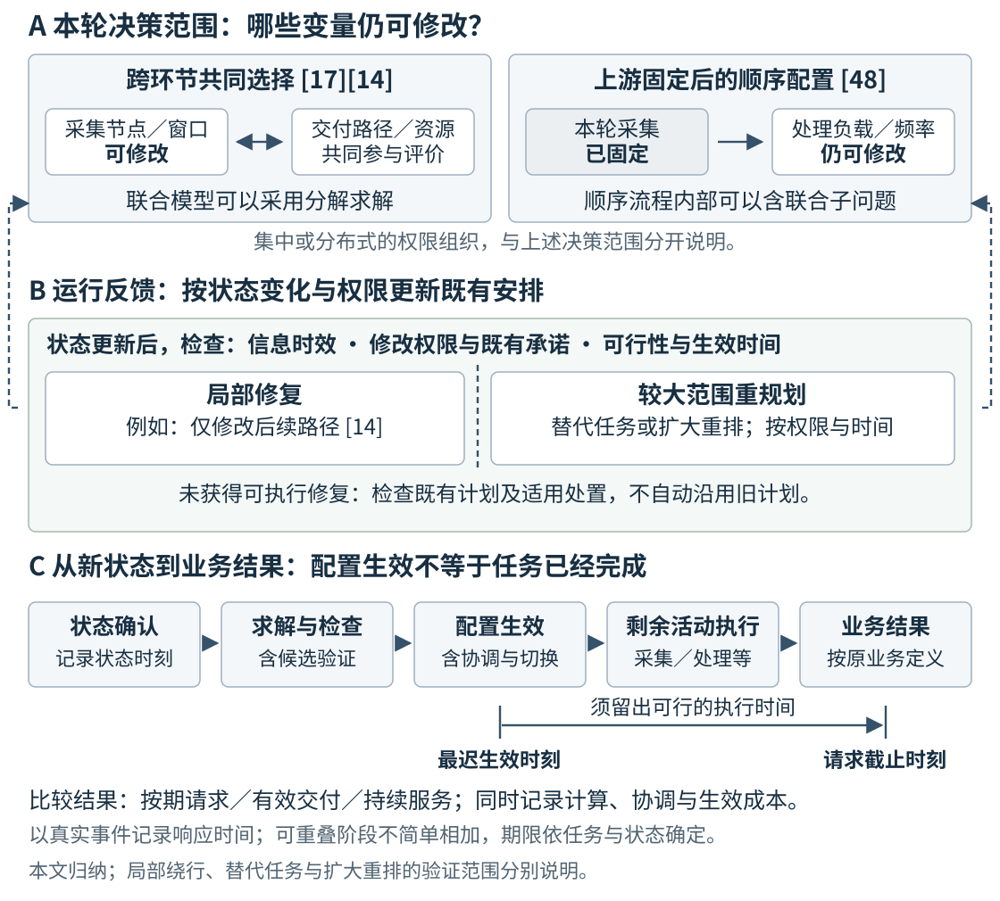

# 面向持续服务的大型卫星星座智能管理与调度综述

Intelligent Management and Scheduling of Large Satellite Constellations for Sustained Service: Resource Coupling and Operational Feedback

**v2.7-CN · 2026-10-18 · 正文证据比较精修稿；作者审阅版**

## 摘要

大型卫星星座需要在共享资源和持续变化的运行条件下，使调度决定及时转化为服务。本文采用问题导向的叙述性综述，以对地观测和通信为核心，沿能力形成、业务配置和执行更新分析代表研究，分别保留请求交付和持续通信的评价对象与时段。文献综合显示，可扩展性来自减少候选、协调和重复计算，但计划复用与模型压缩也会保留旧选择或缩小可行范围；跨环节选择的价值取决于仍可修改的变量及业务目标，联合建模可以采用分解求解；执行策略的优势还可能随条件反转，例如接触可靠性下降削弱预定路径的优势，低建链代价降低路径保持的价值。本文据此将方法机制与验证对象、更新范围和计算成本并列，区分固定实例求解、动态安排及执行阶段的业务评价，并分析学习在预测、搜索辅助和动作生成中的作用。上述认识形成有证据边界的方法比较框架，支持进一步研究能力恢复、有限预算耦合及延迟反馈对实际服务的影响。 <!-- [claim:CN27C001] [evidence:E001,E034,E035,E042,E044,E053,E065,E106,E121,E123] -->

**关键词：** 大型卫星星座；任务调度；通信资源管理；在轨服务；运行反馈；自主运行

## Abstract

Large satellite constellations must turn scheduling decisions into service under shared resources and changing operational conditions. This problem-driven narrative review examines Earth observation and communications through capability provision, service allocation, and execution updates, while retaining their distinct outcomes and evaluation intervals. The literature synthesis shows that scalability relies on reducing candidates, coordination, and repeated computation, although plan reuse and model compression may retain earlier choices or restrict feasible activities. The value of cross-stage selection depends on revisable variables and service objectives, and joint models may use decomposed solvers. Execution strategies can also exhibit reversals: unreliable contacts weaken the advantage of predefined routes, whereas low link-establishment costs reduce the value of route retention. The review therefore compares mechanisms together with validation objects, update scope, and computational costs, distinguishing fixed-instance optimization, dynamic scheduling, and service evaluation during execution. It also identifies the roles of learning in prediction, search assistance, and action generation. These evidence-bounded comparisons support further investigation of how capability recovery, coupling under limited computational budgets, and delayed feedback affect actual service. <!-- [claim:CN27C002] [evidence:E001,E034,E035,E042,E044,E053,E065,E106,E121,E123] -->

**Keywords:** large satellite constellations; mission scheduling; communication resource management; on-orbit servicing; operational feedback; autonomous operations

## 1 引言

### 1.1 大型星座为何需要面向持续服务的调度

大型星座将持续到达的需求、周期性活动机会和多个决策主体置于同一运行过程。卫星数量增加扩大了可选成员和窗口，但调度负担还取决于这些机会是否竞争相同资源、计划需要多频繁更新，以及每次更新涉及多少主体。自动化运行研究已把排程、监测、配置和轨道管理作为相互关联的职责[1]。因此，大型星座需要解决的不只是“由谁做什么”，还包括哪些工作可以复用、哪些资源必须共同安排，以及决定能否赶在相关状态和窗口改变前用于执行。 <!-- [claim:CN27C003] [evidence:E001] -->

这种压力与轨道运行的可预测性并存。观测窗口和潜在连接可以依据几何提前生成，任务撤回、流量排队和资源失效却需要在运行中处理。已有研究分别利用计划连续性减少重算、利用几何邻域限制竞争者，以及复用网络表示降低构图成本；它们并不要求每轮处理全部成员[2][3][4]。大型星座的特殊性因此不是采用一套仅适用于“大型”的优化原理，而是在大量候选与有限响应时间之间，同时利用重复结构、限制协调范围并维持资源使用的一致性。 <!-- [claim:CN27C004] [evidence:E034,E035,E125] -->

本文以对地观测和通信说明这些权衡。观测请求经采集、处理和传输形成信息产品；通信则持续配置关联、波束、功率、频谱及路径，维持流量服务。部署、补给与重构决定能力何时、何处可用[5]，安全干预和故障恢复再改变可执行活动。本文所说的持续服务，是在反复到达的需求和运行变化中维持或恢复相应业务指标的目标，不表示已经实现无中断保证，也不要求同一星座同时承担两类业务。 <!-- [claim:CN27C147] [evidence:E002] -->

### 1.2 已有综述与本文的贡献定位

已有综述已覆盖集成调度和动态运行，本文不将二者作为新发现。敏捷观测综述[6]整理模型与算法，Ferrari等[7]区分成像、通信和一体化调度，并将动态调整与故障容忍列为研究方向；多智能体综述[8]讨论主体及协调方式。自动化运行研究[1][9]梳理星地职责和工具，通信专题综述[10][11]分析网络组织与资源管控。这些工作为本研究提供应用、方法和架构分类，而非仅作为需要取代的背景。 <!-- [claim:CN27C005] [evidence:E003,E004,E005,E001,E006,E007,E008] -->

与本文最接近的Singla等[12]已经将平台约束、网络服务和质量指标纳入统一任务框架，并比较一体化、协调式与自适应组织。本文选择不同的综合对象：不是再设计一个总体架构，而是在已有方法内部追踪“改变什么决定—减少什么负担—形成什么业务结果”。例如，算法分层可能保留跨活动选择，也可能固定上游；预定路径与局部修复的取舍又可能随运行条件改变。表1给出这种分析与既有综述的具体衔接，不据题名或分类差异宣称其他研究未讨论相同问题。 <!-- [claim:CN27C133] [evidence:E009,E004,E042,E053,E106] -->

**表1 既有综述与本文条件性综合的衔接**

| 代表综述 | 已有贡献与交集 | 本文据此形成的具体比较 | <!-- [claim:CN27C006] [evidence:] -->
| --- | --- | --- |
| 观测与卫星调度[6][7] | 应用与模型分类；集成、动态调整及容错问题 | 区分请求交付与体积奖励，比较共同选择和顺序固定（3.2、4.2） | <!-- [claim:CN27C007] [evidence:E003,E004] -->
| 分布式空间系统[8] | 主体、协调方式与任务管理 | 区分减少重算和缩小竞争范围，识别完成状态与未来意图的作用（3.2、4.1、4.3） | <!-- [claim:CN27C008] [evidence:E005] -->
| 自动化运行[1][9] | 星地职责、自动化方式与工具 | 将计划生成、协调确认和配置生效分开计时（3.5、4.1） | <!-- [claim:CN27C009] [evidence:E001,E006] -->
| 通信管理[10][11] | 网络组织、控制及资源优化 | 用建链成本和接触可靠性的对照说明路径保持与修复的条件（3.3、4.3） | <!-- [claim:CN27C010] [evidence:E007,E008] -->
| SatOps—NetOps[12] | 集成、协调、自适应组织及统一任务模型 | 在架构内部比较可改变量、信息权限和生效时限，不另设总体架构（4.2—4.4） | <!-- [claim:CN27C011] [evidence:E009] -->

本文围绕三个问题综合已有证据。第一，压缩候选、限制竞争邻域和复用计划各减少什么工作，原研究是否同时评价解质量、重复活动与准备成本。第二，跨环节选择改变哪些可行活动或相对收益，相关结论来自同一研究内的对照，还是来自不同模型的结构比较。第三，执行策略的优势在何种接触可靠性、建链代价和修改权限下保持或反转。第3章呈现方法及其验证范围，第4章和表6把具体证据转为条件性认识。本文的综合贡献在于连接运行条件、决策机制与已验证结果，而不是给异构算法构造统一排名。 <!-- [claim:CN27C012] [evidence:E034,E035,E042,E044,E053,E106,E121,E068] -->

### 1.3 范围、选录方式与证据使用

本文采用问题导向的叙述性选录，使用截至2026年10月18日已经形成的主题文献库、参考链追溯与专题补充记录。对地观测和通信是核心；构型、补给、在轨服务、安全及恢复按其对可用能力和后续活动的影响纳入。“大型”以候选、竞争和更新负担是否实质影响求解及运行组织界定。单星、GEO、深空及通用多智能体研究用于解释局部机制，其验证规模与任务域单独保留。 <!-- [claim:CN27C013] [evidence:E001,E004,E005] -->

题名中的智能管理具体指利用状态和目标选择、检查并更新安排，而不专指神经网络。优化模型表达资源约束，规则与协调机制处理权限和冲突，学习可以承担需求预测、搜索辅助或动作生成。本文比较这些功能的组合及实际作用，不把采用学习算法等同于已实现自主运行，也不按模型复杂程度衡量智能性。 <!-- [claim:CN27C148] [evidence:E123,E065,E107,E108,E096] -->

选录与比较先考察研究是否说明业务对象、决策机制及资源联系，再提取可改变量、信息与权限、评价量和验证环境。正文保留95项来源，其中85篇学术研究、10项工程资料；详细方法分析采用已取得并定向核读的正文，作者稿和接受稿按实际版本解释。来源台账记录出版、作者机构及预印本入口与历史核读位置，支持从本文编号追溯到稳定来源。全文可得性和既有主题库会影响覆盖，重要最近邻及反例的补核继续保留；本文不据当前选录估计领域占比或声称检索穷尽。 <!-- [claim:CN27C014] [evidence:E004,E009] -->

## 2 管理对象与比较基础

### 2.1 业务过程与可用能力

本文以“能力形成—业务配置—执行更新”为运行主线，以规模负担、资源耦合和反馈时效作为贯穿各环节的比较问题。前者说明研究对象如何衔接，后者说明在每个环节怎样选方法。图1将观测产品交付与持续通信服务并列：长期配置改变可用成员和容量，调度选择活动或资源，监测与恢复更新后续可行条件。由此，服务访问、轨迹控制和软件配置只有在改变这些条件时才进入本综述。 <!-- [claim:CN27C015] [evidence:] -->

### 2.2 决策时域、权限与资源承诺

时间尺度与修改权限共同限定决策。长期配置形成未来能力，业务调度选定活动，执行阶段再根据状态更新。本文将已确认预约或分配对后续选择的限制称为资源承诺，例如地面站预约规则[13]和接触图容量保留[14]；是否可撤回取决于权限、条件及代价。激光链路建立时间[15]则是修改的物理成本。前者回答“允许怎样改”，后者回答“改动何时能够生效”。 <!-- [claim:CN27C017] [evidence:E052,E106,E121] -->

联合决策描述相邻环节如何共同影响选择，分解求解描述计算如何划分，集中、分层和分布式架构描述信息与决定由谁掌握。管理拓扑[16]和跨星分配[2][3]体现后两类职责；滚动规划则规定何时重新决定。扩展星座时，可重复几何有助于提前生成候选，但已分配容量、排队状态和失效信息仍需按实际时效更新。因而“提前算过”与“现在仍可使用”是两个需要通过状态交接连接的条件。 <!-- [claim:CN27C018] [evidence:E010,E034,E035,E106,E121] -->

图1 业务过程与共同管理职责。箭头表示任务、资源或状态的传递，为本文归纳；具体研究可以只优化其中一部分，不表示图中全部功能已在同一系统验证。 <!-- [claim:CN27C016] [evidence:] -->

### 2.3 业务结果、评价时段与比较分母

业务结果是跨领域比较的共同起点，而不是共同分数。观测请求可以按采集、下传或质量确认后的交付计数：[17]奖励期限内完成观测与传输的请求，[18]同时奖励观测收益和下传体积。通信业务通常在给定时段内持续提供服务，应说明吞吐、时延、公平性及中断对应的流量和用户集合，不必为整段业务虚设单一“完成时刻”。表2保留这些差别，使局部资源改善与最终服务结果能够对应。 <!-- [claim:CN27C019] [evidence:E042,E044,E074,E076] -->

**表2 管理对象、可选变量与结果定义**

| 管理对象 | 典型可选变量 | 需要明确的结果、时段或分母 | <!-- [claim:CN27C020] [evidence:] -->
| --- | --- | --- |
| 观测请求 | 目标、成员、窗口及活动顺序 | 采集、质量满足、按期交付；重复观测的价值 | <!-- [claim:CN27C021] [evidence:] -->
| 处理与传输 | 处理节点、负载、频率及路径 | 处理结束、下传字节或完整产品；成功请求子集 | <!-- [claim:CN27C022] [evidence:] -->
| 通信业务 | 关联、波束、功率、频谱及路由 | 给定时段的需求满足、吞吐、排队/端到端时延和中断；全部需求与已服务子集 | <!-- [claim:CN27C023] [evidence:] -->
| 能力维持 | 备星、补给、设施及维修行动 | 库存供应、资产到位、任务能力恢复、业务重分配 | <!-- [claim:CN27C024] [evidence:] -->
| 安全与恢复 | 跟踪、机动、诊断及计划修复 | 风险信息、约束满足、安全退出及原任务恢复 | <!-- [claim:CN27C025] [evidence:] -->

比较首先固定任务总体、到达流量及评价时段。成功请求的平均时延应与未完成请求同时报告，已服务用户的性能应与未满足需求并列。求解侧则分别记录限时可行解、松弛界及最优性证明。本文据此从业务结果、完整成本和验证环境解释方法收益；通用比较口径在此统一，后文保留各研究会改变结论的具体条件。 <!-- [claim:CN27C026] [evidence:] -->

持续运行证据还应按实际更新范围识别：固定请求与窗口的求解，检验给定输入下的安排；滚动加入或撤回请求，检验多次更新；在接触变化等执行事件下跟踪交付，进一步检验采用计划后的结果。本文将这些范围列入方法表，并与硬件测量、软件检查和飞行案例分别解释。同一研究可以覆盖多个范围，本文不据论文是否使用“动态”一词自动升级其验证层次。 <!-- [claim:CN27C154] [evidence:E034,E042,E053,E106,E121] -->

## 3 主要技术路线及代表研究比较

### 3.1 长期配置如何形成可用能力

#### 3.1.1 构型选择与能力到位

构型研究通过选择终端状态和部署阶段改变后续能力。给定终端条件的重构机动[19]、区域构型与卫星指派的共同选择[20]、已知阶段需求间的重构[21]，具有不同的决策范围。覆盖模式优化[22]利用访问机会的组合结构，不确定关注区域下的部署[23]则评价未来需求情景。它们为调度提供候选成员和窗口，在线适应程度取决于需求何时揭示、哪些部署决定尚可调整。 <!-- [claim:CN27C027] [evidence:E011,E012,E013,E014,E015] -->

能力形成还需要时间。Gwon和Ahn[24]把停泊、J₂引起的升交点赤经漂移、发射容量与完成窗口纳入部署设计；平台与星座联合设计[25]把天线、波束及平台参数连接到地域需求。前者限定能力到位的时刻，后者限定可用容量。因此，上层构型向业务调度交付的应是带有时间和资源条件的能力，而不只是最终轨道位置。 <!-- [claim:CN27C028] [evidence:E016,E017] -->

#### 3.1.2 补给状态与业务恢复

补给模型通过库存和在途状态表达能力接替过程。多级库存[26]与双通道补给[27]计入停泊层转移或直接注入，同时将轨道面内备星接替视为即时可用；马尔可夫链模型[28][29]进一步描述库存、接触机会和补给阶段。这些模型细化了资源可得性，但业务恢复仍取决于面内接替假设及后续任务重新分配。 <!-- [claim:CN27C029] [evidence:E018,E019,E020,E021] -->

维修周转与业务中断可以由备件缓冲分隔。集成在轨服务的维护研究[30]同时评价运营方年维护成本和服务方利润，并用库存订货满足率约束供给；其作者稿案例允许较长维修历时与较高满足率并存。该结果说明，维修时间需要连同备用资源一起解释，经济取舍则依赖定价、可修复故障比例及修后如新的假设。 <!-- [claim:CN27C030] [evidence:E023] -->

Iridium的备星投入[31]提供了能力接替的运行参照。结合上述模型，可以区分资源可得、资产到位、功能恢复与业务重新分配四个事件。它们之间的等待决定了维护行动何时真正影响用户需求，也是长期能力模型连接日常调度的关键。 <!-- [claim:CN27C031] [evidence:E022] -->

#### 3.1.3 设施布局、访问与滚动维护

设施布局和服务线路共同限定维护可达范围。轨道仓库研究[32]先在离散候选中选址与指派，再细化连续位置；位置—线路模型[33]交替调整位置与多客户线路。服务船预部署[34]配置初始能力，滚动物流[35]随需求揭示更新计划，高低推力服务框架[36]把推进条件和质量变化纳入访问安排。不同路线由此分别控制“从哪里出发”“服务谁”和“何时能够到达”。 <!-- [claim:CN27C032] [evidence:E024,E025,E026,E027,E028] -->

这些模型向后续调度提供位置、到位时间和剩余资源。[35]只执行滚动计划的前缀，再安排新揭示的需求；[36]则使可达转移随推进条件和质量改变。已执行活动与仍可修改的后续安排由此分开，为持续维护提供了明确的时间衔接。 <!-- [claim:CN27C033] [evidence:E027,E028] -->

长期能力扩展与调度扩展因而应分开评价：增加成员或补给可以扩大可用资源，是否缓解当前业务损失，还取决于这些资源是否到达所需位置和时段。比较服务设施或转移方法时，本综述关注其向后续安排提供的时间和资源条件，不以更大的潜在服务对象集合直接推定实际服务改善。 <!-- [claim:CN27C149] [evidence:E018,E023,E024,E027,E028] -->

### 3.2 对地观测与在轨服务调度

#### 3.2.1 活动选择与跨星协调

观测调度首先将请求选择转化为姿态和可见窗口允许的活动序列。经典研究[37]比较贪心、动态规划、约束规划和局部搜索；能量感知研究[38]把光照、电池状态以及专属、共享和同时执行的冗余任务纳入混合整数线性模型。其1—5星求解实例说明，任务收益与冗余会竞争平台资源，任务分配必须与成员自身的资源状态一致。 <!-- [claim:CN27C034] [evidence:E030,E122] -->

规模扩展可以通过减少重算或缩小协调范围实现。Parjan和Chien[2]在100星、一周规划时域的仿真中比较批量与滚动安排，滚动时域逐日推进，并改变部分请求的活动状态；增量方法保留已有计划，再移除撤回请求并安排新激活请求。Zilberstein等[3]则按几何邻域识别竞争者，用分布式约束优化限制协商范围。前者利用计划连续性，后者利用竞争稀疏性；[2]的广播分配仍可能保留重复观测，且实际采用单线程仿真，并行时间另行估算。 <!-- [claim:CN27C035] [evidence:E034,E035] -->

跨主体协调通过交换有限信息消解任务竞争。多主体观测模型[39]区分请求所属者与协调者，一致性任务包算法（CBBA）[40]交换赢家、报价和时间戳，并在规定评分及通信条件下形成无冲突分配。延迟通信规划[41]和异步市场分配[42]进一步处理消息不同步。方法选择的关键是实际网络能否提供所需消息，以及任务评分能否保留原有保证的条件。 <!-- [claim:CN27C036] [evidence:E036,E037,E039,E041] -->

#### 3.2.2 观测、处理与交付的连接

He等[17]以期限内完成观测与传输的请求加权值为目标，使下传窗口参与观测选择。其作者稿由上层搜索窗口关联，下层进行半定松弛、随机化和可行性调整，再用下层结果评价候选。在3颗敏捷观测星、12 h规划时域的STK—Matlab仿真中，图6以同一方案的联合与分开安排为对照，展示3—9 h期限下的加权成功请求收益，联合方案取得较高收益。这提供了所设资源和期限条件下跨环节选择的直接证据；模型仍采用无误码传输并简化图像质量，固定实例中的收益尚不能代表在线请求变化后的持续表现。 <!-- [claim:CN27C037] [evidence:E042] -->

Rocha等[18]的一体化模型同时优化观测收益和下传体积，并考虑姿态、存储与能源。机构工作论文通过图压缩减少候选连接，再以简化整数模型和局部混合整数规划（MIP）邻域改善安排。它将共享资源的权衡保留在模型中，同时限制每次搜索规模。保守压缩可能舍弃可行序列，两个奖励项也保留各自含义：增加观测或下传不必增加完整交付的请求。 <!-- [claim:CN27C038] [evidence:E044,E042] -->

星地通信还受共享地面设施约束。卫星控制网络[43]、下传排程[44]与深空网络（DSN）优化[45]分别处理相应窗口和容量；DSN运营[46]进一步包含请求解释、协商及安排确认。Planet和AWS文档[47][13]给出质量、交付和预约状态，使调度中的“完成”与“承诺”对应到具体操作。 <!-- [claim:CN27C039] [evidence:E047,E048,E049,E050,E051,E052] -->

Soret等[48]先确定本轮采集，再联合配置处理负载与处理器频率。其作者预印本以23颗边缘星为1颗观测星提供处理资源，观测星也可兼任边缘节点；给定采集后，利用给定负载下的处理时限消去频率变量，将剩余配置化为所设假设下的凸问题。质量失败可进入后续轮次重采；当轮处理求解仍以采集输入为给定条件。采集阶段未计存储约束，处理配置依赖固定流水线、稳定星间链路及平均时间约束。因此，其直接证据是该处理模型中的资源配置，而非逐任务截止期保证或完整动态闭环验证。 <!-- [claim:CN27C040] [evidence:E053,E042] -->

计算调度还可围绕返回机会或信息价值组织。轨道感知调度[49]将离开地面可见域作为结果返回边界，因此其成功返回可能晚于业务截止期。Kodan[50]通过专用模型、图块和处理跳过，提高有限下传中高价值比特的比例。两种方法分别改善请求返回与信息选择，说明处理能力的价值应结合交付时机和产品需求评价。 <!-- [claim:CN27C041] [evidence:E057,E058] -->

#### 3.2.3 动态请求与学习作用的位置

动态任务需要决定何时更新以及保留哪些活动。滚动时域方法[51]结合周期和事件触发，重新安排等待与新到请求；鲁棒观测模型[52]通过预算参数预先应对收益扰动，多阶段随机模型[53]则允许天气信息揭示后调整未来活动。预先保留余量与获得信息后的重排因而是两种不同手段，可按信息到达和执行条件组合。 <!-- [claim:CN27C042] [evidence:E127,E061,E062] -->

学习可参与搜索，也可直接产生动作。Song等[54]用Q-learning根据适应度改善选择遗传算子，再由窗口选择和解码形成可行安排；其两星实验扩展的是任务数量。单星策略复用[55]则把训练策略用于多个成员，并结合任务分配、动作屏蔽和完成状态共享。Basilisk中的比较[56]将策略、训练和安全动作处理纳入共同仿真流程。前者学习怎样搜索，后者学习怎样行动，跨星竞争仍需要相应分配与信息机制处理。 <!-- [claim:CN27C043] [evidence:E123,E065,E066] -->

这组研究提示，扩大成员数、增加单星任务量和加密竞争连接是不同的扩展试验。任务选择阶段的提速未必消除跨星分配或重复观测；因此应同时记录候选数、共享任务范围和需要交换的信息，再判断收益来自更快搜索、计划复用还是协调范围缩小。 <!-- [claim:CN27C150] [evidence:E034,E035,E065,E123] -->

#### 3.2.4 在轨服务的转移与补给

在轨服务的候选活动由可达转移产生。与预先给定观测窗口不同，访问顺序会改变后续转移的起点、质量和可用时刻[57][58]；滚动物流及高低推力研究[35][36]进一步连接需求更新与转移代价。因此，上层服务排程需要接收明确的起止状态、时间和资源条件。 <!-- [claim:CN27C044] [evidence:E071,E072,E027,E028] -->

转移预计算可以减少序列搜索中的重复传播。[58]在轨道、质量及时刻等维度生成代价并插值，[57]则联合推力—漂移—推力转移、访问及加注。前者的飞行时间由控制权重和终止准则等共同产生，代价表并不支持任意指定到达时刻。可复用网格需与相位、终端条件和直接动力学复核保持一致。 <!-- [claim:CN27C045] [evidence:E072,E071] -->

服务历时的不确定性还可以在计划阶段处理。Yin等[59]在GEO加注任务中，用预算不确定集约束最坏任务时间，经对偶转换结合启发式搜索安排客户指派、访问和返站。其目标包含推进消耗及向客户转交的燃料，保护范围是所设集合内的加注历时偏差。这种预防性安排保留时间裕度，但没有增加执行中的反馈改排能力。 <!-- [claim:CN27C145] [evidence:E068] -->

**表3 观测与服务调度的决定、目标和方法条件**

| 代表研究 | 决策与求解机制 | 验证对象及更新范围 | 结果与主要边界 | <!-- [claim:CN27C046] [evidence:] -->
| --- | --- | --- | --- |
| 分布式观测[2][3] | 增量复用或几何邻域协调 | [2]100星、一周时域，测试请求状态变化；[3]邻域化分配 | 任务满足、重复观测及消息量；[2]单线程仿真，并行时间为估算 | <!-- [claim:CN27C047] [evidence:E034,E035] -->
| 拍卖与异步协调[40][41][42] | 竞价及冲突消解 | 分别检验规定评分、延迟或异步消息条件下的分配 | 价值及冲突消解依赖原通信与评分条件 | <!-- [claim:CN27C048] [evidence:E037,E039,E041] -->
| 联合观测—传输[17] | 窗口关联搜索、松弛及可行性恢复 | 3颗观测星、12 h规划；同方案联合/分开对照 | 加权成功请求收益；固定实例，无误码及质量简化 | <!-- [claim:CN27C049] [evidence:E042] -->
| 观测—下传一体安排[18] | 图压缩及局部MIP邻域 | 给定观测/下传机会的资源排程；机构工作论文 | 观测收益与体积分项计奖；保守简化可能缩小可行域 | <!-- [claim:CN27C050] [evidence:E044] -->
| 顺序处理配置[48] | 固定采集，消去频率后配置负载 | 1颗观测星、23颗边缘星（角色可重合）；本轮处理与后续重采分开 | 节能配置与平均时间约束；稳定链路、固定流水线 | <!-- [claim:CN27C051] [evidence:E053] -->
| 计算与信息价值[49][50] | 返回机会或处理配置选择 | 请求返回模型或硬件测量结合轨道链路仿真 | 成功返回、响应时间或高价值比特；产品和截止期定义分别保留 | <!-- [claim:CN27C052] [evidence:E057,E058] -->
| 策略复用[55][56] | 策略动作、屏蔽与分配/状态共享 | [55]4—40星、200—3200目标的分配实验；[56]共同仿真流程 | [55]奖励及地面MIP计时；前瞻和通信条件随方案改变 | <!-- [claim:CN27C053] [evidence:E065,E066] -->
| 低推力服务[57][58] | 代价生成、插值及访问安排 | 动力学与服务序列模型；预计算和序列搜索分开 | 转移及服务目标；质量、时间、相位与终端条件限制复用 | <!-- [claim:CN27C054] [evidence:E071,E072] -->
| 能量与学习辅助搜索[38][54] | 资源模型或学习选择遗传算子 | 分别为1—5星与两星任务扩展的求解实验 | 服务质量或电磁探测收益；解码可行性与搜索收益分开 | <!-- [claim:CN27C127] [evidence:E122,E123] -->

表3中的固定实例、滚动安排和处理配置回答不同问题。[17]的直接对照检验观测与传输是否共同选择，[18]解释共享资源下的双奖励安排，[48]检验固定采集后的处理配置。前两类采用的作者稿或工作论文及其版本限制在来源台账中逐项保留。 <!-- [claim:CN27C055] [evidence:E042,E044,E053] -->

### 3.3 通信网络管理与资源调度

#### 3.3.1 需求估计、波束与功率

通信资源配置始于需求估计。[60]结合经验模态分解、自回归模型和神经网络，在合成自相似流量上评价预测误差。它提供配置所需的需求输入，预测能否改善吞吐或排队，则取决于后续策略如何使用这些信息。 <!-- [claim:CN27C056] [evidence:E073] -->

单星跳波束研究[61]先按平均功率选择波束，再固定当槽选择优化连续功率，并随到达流量和剩余需求更新。这种分阶段配置保留了功率调节自由度，评价供需匹配与满意度公平性。其对照沿用相同选束规则，但队列变化仍可能影响后续时槽的选择，收益属于整个时序流程。 <!-- [claim:CN27C057] [evidence:E074] -->

多星覆盖重叠使选束与功率分配进一步耦合。[62]由数字孪生侧多星选束与星内连续功率配置协作，利用队列状态响应负载变化。其公平量是覆盖小区队列包龄的极差，与[61]基于满意度比的Jain指数不同；固定与动态功率对照还改变了配置组织。两项研究共同说明，资源自由度的作用需结合负载和被优化的服务对象解释。 <!-- [claim:CN27C058] [evidence:E076,E074] -->

共享频谱要求同时保护其他系统。Ngo等[63]以LEO覆盖小区簇为智能体，通过集中评论器训练联合波束激活、子带与功率动作，并以奖励惩罚处理超过GEO聚合干扰阈值的情况。它将吞吐和服务时延差异纳入同一策略目标；逐动作的干扰满足情况仍需单独检查，智能体数也应按小区簇而非卫星数解释。 <!-- [claim:CN27C124] [evidence:E128,E074,E076] -->

#### 3.3.2 接入切换与服务变化

接入切换的收益取决于协议和资源竞争。Lee等[64]通过学习调整切换请求并省去传统测量报告环节；在一颗服务星和两颗目标星的仿真中，接入时延改善并不总伴随随机接入前导碰撞减少。这个结果表明，缩短信令过程与降低竞争冲突需要分别处理，接入优化还需与后续路由连接才能评价端到端业务。 <!-- [claim:CN27C059] [evidence:E124] -->

外部测量提供了另一种观察。Mohan等[65]在Starlink重配置边界附近观察到时延和吞吐变化；受控连接窗口中只有单颗候选卫星时，波动仍然存在。因而，所测服务变化不能仅由卫星切换解释，周期性网络调度是原作者提出的机制解释。方法评价需要同时记录接入对象、资源配置和最终业务状态。 <!-- [claim:CN27C060] [evidence:E078] -->

#### 3.3.3 路由结构与配置生效

路由计算可以通过复用网络表示提速。Handley[4]研究无直接星间链路时的地面中继路径，利用地理分块缩小候选中继范围，再保留已有图并更新边权。在其2019年部署假设、1584星和5000中继的实例中，2.7 GHz Core i7上的构图与单源到全部目的地路径计算由1.55 s降至61 ms。这里减少的主要是重复构图负担，计时不包含实际网络的完整控制流程。 <!-- [claim:CN27C061] [evidence:E125,E121] -->

动态激光链路研究[15]以1584星、600个1 s时槽的仿真，将新建链路时间纳入路径代价。作者稿图3显示，建链代价为1 ms时，路径保持方法ILPR和平均代价选路方法ALPR的保持倾向使平均时延略高于即时最短路ILSR；稳定性与活动性感知方法ISASR在该条件下仍优于ILSR。因此，低建链代价削弱的是部分保持策略的优势，而非使所有稳定性方法失效。该模型省略排队并采用预计算和路径分发，性能与裁边计时使用不同阈值；其取舍首先适用于所设传播和建链模型。 <!-- [claim:CN27C062] [evidence:E121] -->

转发表示也能降低更新负担。Zhang等[66]以包内Bloom filter编码星间链路标识，通过分段再编码权衡额外转发和编码时延；链路失效后，本地重算与预定绕行提供不同的质量—成本选择。其66星包级仿真和MATLAB实验采用不同环路处理。与图复用[4]、动态建链[15]相比，该方法主要改变路径表示及恢复操作，而非同一网络中的替代求解器。 <!-- [claim:CN27C125] [evidence:E126,E125,E121] -->

#### 3.3.4 分层配置与局部权限

分层资源管理[67]以全局服务区域和频谱配置约束局部波束、时隙与信道选择，并在网络控制中心、空间基站和终端间交换需求与价格。上层保留跨区域协调，局部保留较快响应，由此将计算范围与修改权限一并划分。其不同组件和负载实验应分别解释，整体架构收益仍需由共同运行流程评价。 <!-- [claim:CN27C063] [evidence:E081] -->

通信方向的共同问题，是使关联、无线资源和路径在同一评价时段内服务于到达流量。扩展覆盖并不消除共享频谱或后续路径的约束，局部接入变快也未必同步减少冲突。第4章因此以“哪一段限制当前服务、哪些选择仍可改变它”为比较起点，而不把各环节的提升百分比相加为星座整体收益。 <!-- [claim:CN27C151] [evidence:E074,E076,E124,E081,E121] -->

**表4 通信管理代表研究的决策与结果定义**

| 研究及证据对象 | 决策或观察方式 | 验证对象与状态变化 | 结果及主要解释范围 | <!-- [claim:CN27C064] [evidence:] -->
| --- | --- | --- | --- |
| 流量预测[60] | 混合需求估计模型 | 合成自相似流量序列 | 预测误差；是否改善配置需经具体策略评价 | <!-- [claim:CN27C065] [evidence:E073] -->
| 单星波束—功率[61] | 每槽选束后配置功率 | 单星时槽仿真；随到达及剩余需求更新 | 供需匹配与满意度公平性；队列会影响后续选择 | <!-- [claim:CN27C066] [evidence:E074] -->
| 多星需求感知配置[62] | 多星选束与星内功率协作 | 队列驱动的多星负载实验 | 吞吐与队列包龄极差；整体策略对照同时改变配置组织 | <!-- [claim:CN27C067] [evidence:E076] -->
| GEO—LEO共存[63] | 小区簇智能体选束/子带/功率 | 机构作者稿中的联合资源仿真 | 吞吐与服务时延差异；干扰惩罚不提供逐动作硬保证 | <!-- [claim:CN27C128] [evidence:E128] -->
| 接入协议[64] | 学习调整请求并减少信令 | 1颗服务星、2颗目标星的切换仿真 | 接入时延与碰撞；两项指标可能呈相反变化 | <!-- [claim:CN27C129] [evidence:E124] -->
| 地面中继[4] | 分块建图与图复用 | 1584星、5000中继的历史网络模型 | 构图及单源路由由1.55 s降至61 ms；非现网或全控制流程计时 | <!-- [claim:CN27C130] [evidence:E125] -->
| 链路标识路由[66] | 路径编码、分段及本地失效响应 | 66星包级仿真与MATLAB实验 | 转发、编码、交付率及时延；两类实验的环路处理不同 | <!-- [claim:CN27C131] [evidence:E126] -->
| 动态激光链路[15] | 计入建链代价的路径选择 | 1584星、600时槽；改变建链代价 | 平均时延和路由变化；无队列，性能与裁边计时分开 | <!-- [claim:CN27C068] [evidence:E121] -->
| 分层资源管理[67] | 全局服务区/频谱约束局部安排 | 频谱、用户及波束模块的负载/开关实验 | 各组件配置表现分别解释；层间信息与权限为组织依据 | <!-- [claim:CN27C069] [evidence:E081] -->
| 独立测量[65] | 受控连接窗口内的现网观察 | 包含仅有单颗候选卫星的窗口 | 时延和吞吐波动；周期性调度为原作者解释 | <!-- [claim:CN27C070] [evidence:E078] -->

表4将仿真中的需求更新、连接变化与现网观察分开。传播、接入、队列和重配置占用不同时间；识别当前服务受哪一段限制，才能选择相应决策并计算完整成本。 <!-- [claim:CN27C071] [evidence:] -->

### 3.4 安全与恢复如何改变任务条件

#### 3.4.1 从风险信息到处置输入

安全评估首先把目录信息转化为可处置事件。最近接近方法[68]利用分段近似和距离极值搜索细化单个候选，筛查与CUDA研究[69]则减少配对并组织并行计算。两者分别降低单事件计算和候选集合处理的负担，组合收益应在同一传播、步长与事件判定条件下衡量。 <!-- [claim:CN27C072] [evidence:E082,E084] -->

风险预测[70]估计后续报文中的风险，机动综述[71]整理处置选择，运行仿真[72]提供接近场景。CCSDS报文[73]和所引Starlink运行流程[74]进一步连接跨组织信息与动作更新。对业务调度而言，它们需要共同输出哪些活动受限、机动占用多久，以及干预后还有哪些资源可用。 <!-- [claim:CN27C073] [evidence:E087,E086,E085,E088,E089] -->

#### 3.4.2 轨迹安全与上层任务条件

轨迹优化为任务安排提供动力学可行性。锥优化[75]、模型预测控制（MPC）[76]、机会约束交会[77]和连续安全约束[78]分别处理轨迹、反馈、不确定性或区间安全。上层调度需要接收对应的时间占用、终端状态和保证条件，使轨迹可行性与任务窗口一致。 <!-- [claim:CN27C074] [evidence:E091,E092,E093,E095] -->

保证的对象会改变可用活动。[76]的安全结论受避碰半空间、通信范围、误差界、离散步长和求解期限限制，延长终止时刻也会改变原任务窗口；[77]的设计概率与有限样本检验各有作用，[78]针对规定失推条件的保护不包含全部部分推力不足情形。逐次凸子问题与原非线性问题的最优性[75]也须区分。因此，应把具体失效、保护区间和终端条件交给上层，而非只传递一个“安全”标签。 <!-- [claim:CN27C075] [evidence:E092,E093,E095,E091] -->

安全屏蔽在执行前限制学习策略的允许动作。[79]中，屏蔽开关对照与策略—概率路线图的燃料时间比较属于不同试验，概率路线图在执行中也采用状态校正。屏蔽的作用应由相同策略与安全条件下的对照识别，路径规划方案则按各自执行流程比较。 <!-- [claim:CN27C076] [evidence:E096] -->

ADRAS-J的自主中止与后撤[80]展示了安全退出的运行作用。退出保护航天器，同时可能推迟原有接近或服务活动；任务层因而需要同时记录安全结果、被放弃活动和恢复后的能力。 <!-- [claim:CN27C077] [evidence:E097] -->

#### 3.4.3 告警、诊断与计划恢复

故障恢复从识别异常开始。[81]将遥测预测残差、平滑、阈值和告警区间处理连接起来；[82]表明标签、阈值选择与事件匹配会影响离线评价。告警模型因此应向恢复流程提供可解释的事件和时刻，而恢复效果还需通过诊断、动作与业务状态确认。 <!-- [claim:CN27C078] [evidence:E098,E101] -->

故障检测、隔离与恢复（FDIR）原型[83]用规则连接故障事实、动作选择和效果确认，并在恢复后交接导航模式；Remote Agent[84]在规划、执行与诊断间处理局部失败和全局约束。两者说明，恢复不是单次触发动作，而是确认效果后重新确定后续可行任务的过程。 <!-- [claim:CN27C079] [evidence:E102,E108] -->

在大型星座调度中，安全与恢复的输出需要同时标明受限成员、活动区间及可继续使用的资源。个别航天器退出会触发哪些任务改排，取决于当前分配和替代能力，而非仅由成员数量决定。本综述保留控制与诊断方法的原任务条件，用其解释上层可行活动怎样变化，不把局部安全案例扩大为整星座服务保证。 <!-- [claim:CN27C152] [evidence:E091,E092,E093,E095,E097,E102,E108] -->

**表5 安全与恢复的输出及验证对象**

| 环节及代表来源 | 直接输出 | 需要核对的保证范围 | <!-- [claim:CN27C080] [evidence:] -->
| --- | --- | --- |
| 接近计算与筛查[68][69] | 候选事件及最近接近结果 | 传播/数值参照、目录、步长与遗漏 | <!-- [claim:CN27C081] [evidence:E082,E084] -->
| 风险预测与场景[72][70] | 后续风险估计或事件列表 | 各自数据、评分与场景；处置效果另评 | <!-- [claim:CN27C082] [evidence:E085,E087] -->
| 安全轨迹[75][76][77][78] | 轨迹、控制及条件化约束保证 | 原任务域、误差/分布、连续性与求解期限 | <!-- [claim:CN27C083] [evidence:E091,E092,E093,E095] -->
| 学习屏蔽[79] | 经检查的动作及安全干预 | 两组对照、安全标准和执行校正 | <!-- [claim:CN27C084] [evidence:E096] -->
| 异常检测与评价[81][82] | 预测残差、告警区间及评价分数 | 阈值、标签、事件匹配与部署条件 | <!-- [claim:CN27C085] [evidence:E098,E101] -->
| 故障与执行恢复[83][84] | 恢复动作、效果确认及后续活动 | 原型/任务系统、诊断依据与执行交接 | <!-- [claim:CN27C086] [evidence:E102,E108] -->

### 3.5 跨环节决策与执行交接

#### 3.5.1 同一任务不同阶段的可改变量

Lowe等[14]以接触图连接请求接受和数据交付：枚举采集节点及路径，检查期限内的输送容量，再扣减已分配资源。其16星、25目标、6网关的10 h离散事件仿真包含请求到达、网络负载和接触可靠性变化，因而比固定窗口实例更直接涉及执行阶段的交付。该流程逐请求安排，并保留既有容量承诺；能源与存储则假设无限。其请求成功率以已交付/已提交计，已接受请求成功率以已交付/已接受计，成功样本时延另行统计。 <!-- [claim:CN27C087] [evidence:E106,E042,E044,E053] -->

执行阶段可以采用更小的修改范围。[14]比较优先按指定路径转发的MSR与依据接触图局部选路的CGR；MSR在优选路径不可用时也允许回到CGR，保留采集指派。任务状态模型还允许原任务无法完成且期限许可时生成替代任务；这一机制涉及任务版本与跨节点冲突，其验证范围应与局部转发试验分开。联合选择、局部修复与替代任务可以位于同一流程的不同阶段。 <!-- [claim:CN27C088] [evidence:E106] -->

#### 3.5.2 统一模型与状态驱动配置

跨职责组织有两种典型连接方式。自动化工具与可信自主运行综述[9][85]提供功能背景；SatOps—NetOps框架[12]把平台资源和网络需求纳入统一任务模型，分层管理[67]则由上层配置限定局部选择。前者将相关变量带入共同安排，后者通过配置和权限限定协调范围，两种方式可以在不同层次组合。 <!-- [claim:CN27C090] [evidence:E006,E105,E009,E081] -->

状态驱动配置还可直接连接多个子系统。推理式观测调度[86]依据预测的观测、传输、存储和能源状态调整策略权重，再插入任务并检查约束。其单星模型说明，联合考虑资源可以通过活动构造实现，不必等同于一个整体数值优化器。 <!-- [claim:CN27C091] [evidence:E107] -->

#### 3.5.3 从计划到执行的功能交接

计划进入执行需要任务和资源状态的连续交接。Remote Agent[84]连接规划、执行及诊断；EO-1[87]由科学分析产生目标、CASPER调整活动、SCL检查执行，同时保留地面规划与星历更新。IPEX[88]提供星上处理和持续规划的任务例子，cFS演示包[89]提供软件组件连接方式。前两类是特定任务流程，软件组件则为实现这些流程提供基础。 <!-- [claim:CN27C092] [evidence:E108,E109,E111,E113] -->

Basciani等[90]进一步将星上软件配置的生成与部署分开。统一模型表达进程及时间约束，经结构和规则校验、候选优化、仿真检查后生成配置，再由人工审定并交平台切换。模型变化不必立即导致实际部署变化，这为业务调度中的“计算出计划”和“采用新计划”提供了具体的软件参照。 <!-- [claim:CN27C126] [evidence:E119] -->

Starling[91]以四星共享观测状态并协调后续观测，Starling 1.5[92]在模拟接近场景中完成责任协调和实际机动；Basilisk[93]与形式化研究[94]分别支持动力学仿真和规格检查。这些工作提供功能实现证据，其任务规模和验证对象各自保留。将其用于大型星座时，需要进一步检查更新触及的主体数量、状态传播和配置采用过程；共享状态、完成协调与维持业务是同一流程中的不同结果。 <!-- [claim:CN27C093] [evidence:E114,E115,E116,E117] -->

## 4 综合认识与研究问题

### 4.1 可扩展性的来源与方法取舍

可扩展性分析首先定位增长的工作量。[18]的图压缩和局部MIP分别减少候选连接与每次释放的变量，[3]的几何邻域减少协调主体，[2]的增量安排减少重复规划，[58]的网格减少重复动力学计算，[17]则利用上下层反馈组织耦合子问题。它们分别适用于候选密集、竞争局部、计划连续、模型反复调用和子问题可分解的情形，所节省的工作应与保留的活动组合及所得业务结果对应。 <!-- [claim:CN27C094] [evidence:E044,E035,E034,E072,E042] -->

这些机制可以组合，但复用条件需要落实到资源竞争。[2]保留未变化计划，适合检验局部请求变更下的重算节省；[58]的代价复用限于已建模的轨道、质量和终端范围。本文据此推论，几何上的局部变化还需检查是否牵动共享下传容量或跨星任务竞争，才能确定局部调整范围。保守压缩[18]可能删去可行序列，已有安排也可能限制后续选择；持续采用一种简化方法的代价应随需求变化重新评价。 <!-- [claim:CN27C135] [evidence:E034,E072,E044] -->

规模证据应同时保留成员数、任务数、候选连接和协调范围。[55]在目标可见区间已经预计算后，地面任务分配MIP的平均求解时间由4星、200目标的0.73 s增至40星、3200目标的170 s。该对照同时改变两类规模，不能分离星数的独立作用，却说明快速星上策略并未取消上游分配成本。[36][44][53]中的需求压缩、排程表示和情景展开又各自改变求解负担。评价学习或分布式方法时，应把这些前后端工作一并登记。 <!-- [claim:CN27C095] [evidence:E065,E028,E048,E062] -->

可预测轨道允许把部分工作前移，却不能把运行成本全部变成离线成本。[4]的图复用减少了重复构图，[15]的新路径仍要支付建链代价；准备结果失效时还需重新计算。完整响应应沿准备、在线求解、协调确认和配置生效记录，可重叠阶段按事件时间而非机械相加。对限时试验，既报告可行解质量，也报告未及时获得方案的比例[33]。这样才能区分“单个模块更快”和“更早提供可用业务配置”。 <!-- [claim:CN27C096] [evidence:E125,E121,E025,E065,E072] -->

### 4.2 联合决策的适用条件与求解组织

联合决策的收益应优先由同研究对照解释。[17]在既定仿真中比较共同与分开安排，图6显示共同选择观测和传输可提高加权成功请求收益；[14]则在请求接受时检查交付容量，并用后续交付评价安排。两者说明下游条件可以改变上游选择。固定本轮采集后优化处理的[48]回答另一问题，其模型结构用于解释可改变量，而不与前两项拼接为性能对照。 <!-- [claim:CN27C097] [evidence:E042,E106,E053] -->

跨环节影响也可来自价值和代价。[50]将计算配置连接到有限下传中的信息价值，[61][62]将资源动作连接到负载与队列；即使活动均可执行，能耗或后续占用仍会改变相对收益。对于[18]的观测与体积双奖励，应分别观察两项收益及完整交付。研究间保持业务定义后，才能讨论开放哪些变量可以改善目标，而非仅比较目标函数包含多少指标。 <!-- [claim:CN27C136] [evidence:E058,E074,E076,E044] -->

共同选择仍可采用分解求解：[17]由下层结果评价上层窗口，[48]在固定采集后联合处理负载与频率，[18]以局部邻域改善一体安排。在目标相同且可行域嵌套时，扩大选择范围具有不劣的最优值潜力；限时算法能否实现这一潜力，还取决于可行解质量和返回时刻。因而评价应同时呈现模型允许的选择与有效窗口内实际取得的安排。 <!-- [claim:CN27C098] [evidence:E042,E053,E044] -->

表6分别标注模型结构、同研究对照和流程成本证据。结构比较用于解释哪些决定能够相互影响，条件对照用于观察优势是否改变，计时证据用于辨认成本转移。图2给出这些决定进入执行的时间关系。 <!-- [claim:CN27C137] [evidence:E042,E044,E053,E106,E121,E065] -->

**表6 从运行条件到方法取舍：代表证据与解释边界**

| 运行条件与比较对象 | 机制及代表方法 | 已有对照与验证范围 | 结论边界及评价量 | <!-- [claim:CN27C099] [evidence:] -->
| --- | --- | --- | --- |
| 多个请求竞争交付机会 | 观测/采集与交付共同选择[17][14] | [17]3颗观测星、12 h实例，联合/分开安排对照；[14]到达请求与容量保留 | 前者支持特定实例中的收益；统计按期交付、拒绝及未完成请求 | <!-- [claim:CN27C100] [evidence:E042,E106] -->
| 观测与传输分项计奖 | 一体安排共享存储和能源[18] | 模型结构：工作论文中的图压缩和局部MIP | 观测收益、体积与完整请求分开；保守简化可能损失候选 | <!-- [claim:CN27C138] [evidence:E044] -->
| 本轮上游决定已固定 | 下游负载/频率或功率仍可联合配置[48][61] | 结构对照：[48]1颗观测星、23颗边缘星；[61]单星时槽更新 | 分别评价处理能耗/平均时间及供需匹配；不跨论文合并增益 | <!-- [claim:CN27C101] [evidence:E053,E074] -->
| 接触可靠性下降 | 预定路径MSR与局部路由CGR[14] | 同研究：16星、10 h；接触可靠性降至70%后，失败率优劣反转 | 保留原负载与统计分母；局部转发不扩大为任务重分配 | <!-- [claim:CN27C102] [evidence:E106] -->
| 换路需要建立新连接 | 路径保持与即时最短路[15] | 同研究：1584星；1 ms建链时ILPR/ALPR平均时延略高于ILSR | ISASR在该条件下仍占优；无队列模型，不推出通用阈值 | <!-- [claim:CN27C103] [evidence:E121] -->
| 单星策略复用于多星 | 策略动作结合地面分配/状态共享[55] | 流程成本：4—40星、200—3200目标；MIP计时不含可见区间生成 | 同时登记分配与推理；原分配对照还改变前瞻和通信条件 | <!-- [claim:CN27C139] [evidence:E065] -->

表6支持的认识具有不同证据强度。[17]的联合/分开安排及[14][15]的条件变化给出各自场景内的直接对照；[18][48][61]的跨模型分析主要解释决策范围。本文将后者归纳为选型时应检查的条件，仍需共同任务和资源设置验证。由此，扩大耦合、保持旧安排或启动反馈，都需要说明它改变了什么可行活动以及何种业务结果。 <!-- [claim:CN27C140] [evidence:E042,E106,E121,E044,E053,E074] -->

### 4.3 反馈更新的信息、权限与生效条件

反馈首先需要与可修改的决定对应。完成状态可移除已满足需求，未来安排用于识别潜在竞争，资源承诺则约束再次分配。[55]共享已成像或已下传状态，减少的是后续重复；CBBA[40]的赢家、报价和时间戳服务于冲突消解，延迟规划[41]与异步分配[42]分别处理消息时序。信息内容与到达时刻决定了它能支持哪一类调整。 <!-- [claim:CN27C105] [evidence:E065,E037,E039,E041] -->

修改范围由执行进度和权限共同限定。预约规则[13]、容量保留[14]和分层管理[67]规定哪些活动可以调整，链路建立[15]决定部分修改需要多久。同一请求可以在接收时联合选择、在传输时局部绕行，必要时再进入替代任务处理。局部修复与较大范围重算的比较，应从相同已执行前缀和可撤回条件出发。 <!-- [claim:CN27C106] [evidence:E052,E106,E081,E121] -->

Lowe等[14]提供了执行条件使优势反转的具体例子。在16星、25目标、6网关的10 h仿真中，可靠接触下，利用调度结果的预定转发MSR比局部CGR更能维持路径与容量安排的一致性；接触可靠性降至70%时，MSR的请求失败率反而高于CGR。原作者将这一变化联系到预定路径较长、接触失败后更易到期。结果表明，负载下有效的容量安排还需要与实际可达路径一致；它不构成CGR在所有负载或可靠性下更优的结论。 <!-- [claim:CN27C141] [evidence:E106,E121] -->

预先应对偏差与事后利用新信息具有不同作用。鲁棒观测[52]和GEO加注排程[59]在计划阶段处理所设扰动，多阶段安排[53]则允许信息揭示后修改未来活动。由此可以把“保留多少余量”与“保留多少修改权”作为两个比较维度；二者的组合价值仍需在相同信息、资源和时间条件下检验。 <!-- [claim:CN27C146] [evidence:E061,E068,E062] -->

反馈还须给执行留出时间。观测或服务请求的最迟配置生效时刻取决于剩余采集、处理、传输或机动；持续通信则要观察评价时段内的中断、积压及已承诺服务。配置采用前需按更新状态检查[83][84][90]。一次重规划未返回可执行方案时，执行系统仍须检查原计划是否适用，并按规定选择安全处置；超时只说明该次求解没有及时返回安排。 <!-- [claim:CN27C142] [evidence:E102,E108,E119,E074,E076,E121] -->

图2 决策范围与执行更新的衔接。上部以[17][14]和[48]区分联合选择与固定上游后的配置；中部表示反馈可以更新两者，但局部绕行、生成替代任务和扩大重排具有不同权限及验证范围。下部区分配置生效与业务结果，其中截止时刻以有期限请求为例；持续通信则按评价时段内的服务指标判断。箭头为本文归纳的功能与时间联系，不代表共同实验或统一系统的验证结果。 <!-- [claim:CN27C089] [evidence:E042,E106,E053,E121] -->

### 4.4 智能方法的作用位置与运行验证

学习方法应按实际承担的功能评价。需求预测[60]估计输入，Q-learning辅助搜索[54]选择算子，复用策略[55]生成动作；资源模型、分配协调及安全屏蔽[79]负责相应约束和冲突检查。模块指标说明输出质量，业务指标检验这些输出是否改变了实际配置。识别学习模块贡献时，可在共同信息、候选、约束处理和预算下替换对应模块，同时保留训练、解码、修复及协调成本。 <!-- [claim:CN27C107] [evidence:E073,E123,E065,E096] -->

跨星部署还需分开检验成员数量、竞争范围和需求分布的变化。[55]的分配实验中，集中方案与分散方案不仅改变分配方式，还采用不同的策略前瞻和通信条件；整体奖励差异不能单独归因于策略复用。[56]的共同仿真流程为比较策略与安全动作处理提供另一入口。本文据此将训练外变化、整体方案表现和模块替换对照分开，避免用一次配置扩展替代对不同泛化情形的检验。 <!-- [claim:CN27C153] [evidence:E065,E066] -->

运行实例用于检查这些功能是否真正接入执行。Planet、AWS与DSN[47][13][46]说明交付、预约及确认过程，外部测量[65]反映服务变化，EO-1和Starling系列[87][91][92]展示特定任务的状态共享与执行。表7按观察对象组织资料，既保留已经实现的功能，也标明其尚不能回答的星座级服务问题。 <!-- [claim:CN27C108] [evidence:E051,E052,E050,E078,E109,E114,E115] -->

**表7 运行资料与工具能够支持的认识**

| 资料或案例 | 公开的状态、动作或性质 | 对综述的用途与边界 | <!-- [claim:CN27C109] [evidence:] -->
| --- | --- | --- |
| Iridium[31] | 备用资产投入 | 能力配置例子；库存最优性及恢复时间另评 | <!-- [claim:CN27C110] [evidence:E022] -->
| Planet、AWS与DSN[46][47][13] | 质量、交付、预约及安排确认 | 完成事件和承诺过程；内部优化性能另评 | <!-- [claim:CN27C111] [evidence:E050,E051,E052] -->
| Starlink流程及独立测量[65][74] | 风险行动流程；时延与吞吐现象 | 运营方说明与外部测量分开解释 | <!-- [claim:CN27C112] [evidence:E078,E089] -->
| ADRAS-J[80] | 异常后的自主中止及后撤 | 安全处置事件；原任务后续完成另评 | <!-- [claim:CN27C113] [evidence:E097] -->
| EO-1与IPEX[87][88] | 星上处理、重规划与执行检查 | 单星功能交接与地面职责 | <!-- [claim:CN27C114] [evidence:E109,E111] -->
| Starling系列[91][92] | 共享观测与实际机动协调 | 试验目标、成员规模及模拟事件条件 | <!-- [claim:CN27C115] [evidence:E114,E115] -->
| 受监督配置[90] | 模型校验、仿真检查、配置生成与审定 | 13进程工具链及专家反馈；不是大规模在轨验证 | <!-- [claim:CN27C132] [evidence:E119] -->
| CCSDS、cFS与形式化研究[73][89][94][95] | 报文、组件与规格性质 | 互操作及软件依据；业务结果另评 | <!-- [claim:CN27C116] [evidence:E088,E113,E117,E120] -->

软件与飞行证据相互补充，但不能拼接为未实现的全系统。[90]的13进程实例和6名专家评价说明模型到配置的衔接，[95]检验规格性质，[83]测试故障处理，[93]支持动力学仿真。将这些功能组合用于大型星座时，还需检查跨主体状态一致性、配置生效与业务结果。持续服务评价应保留失败、退出和未满足需求，使功能可用、计划可行与用户实际获得服务形成可追踪的对应。 <!-- [claim:CN27C117] [evidence:E119,E120,E102,E116] -->

### 4.5 可检验的研究问题

#### 4.5.1 能力恢复如何转化为业务损失减少

能力维持研究已能表达库存供应、在途补给和维修周转[26][27][30]，下一步需要识别哪一段等待主导业务损失。可在同一故障与需求序列下，分别缩短资源可得、资产到位、功能恢复和业务重新分配的时间，观察未交付产品、积压请求及通信中断是否随之减少。这样可以区分增加维护能力与改善现有能力调度的价值，避免把资源更早到位直接等同于业务更早恢复。 <!-- [claim:CN27C118] [evidence:E018,E019,E023] -->

#### 4.5.2 有限计算预算下应保留多大的耦合范围

有限预算下的耦合范围可以围绕现有证据进一步检验。[17]已在固定观测实例中展示共同选择的收益，[48]提供固定采集后的处理配置，[14]进一步评价请求到达和执行交付。观测场景可保持窗口、资源和交付标准，逐步开放采集、处理与传输决定；通信场景则固定到达流量、用户及评价时段，开放关联、波束、功率或路径。小规模实例分析模型最优值或界，限时实验比较及时取得的配置与实际业务结果。 <!-- [claim:CN27C119] [evidence:E042,E053,E106,E044,E074,E076,E121] -->

规模因素应分开改变：成员数影响容量和候选，单位成员负载影响活动密度，竞争范围影响协调，更新频度影响复用。若同时扩大全部因素，得到的是组合场景表现。后续评价应识别哪些变量能够固定、节省多少准备和在线成本，以及有限耦合保留多少业务收益；超过有效窗口返回的事后目标值另行记录。 <!-- [claim:CN27C143] [evidence:] -->

#### 4.5.3 延迟信息下何时局部修复、重规划或不采用更新

延迟反馈可从[14][15]的条件对照扩展到信息和权限。固定已执行前缀与异常序列后，分别改变消息延迟、状态误差、接触可靠性和承诺撤回条件，比较局部修复、较大重排及保留原安排。观测跟踪请求交付，通信跟踪需求满足、中断与积压；沿状态观测、消息到达、求解结束和配置生效记录损失，识别信息过时、求解过慢和修改不能生效的不同原因。 <!-- [claim:CN27C120] [evidence:E106,E121,E052,E065,E081,E074,E076] -->

在相同当前状态检查和安全要求下，还可比较预先保留余量与执行反馈。鲁棒安排[52][59]和信息揭示后的重排[53]提供不同入口；后续实验应统计未采用计划、重复调整及响应失败，并检验两种手段在何种不确定性和通信条件下互补。 <!-- [claim:CN27C144] [evidence:E061,E068,E062,E052,E106,E121] -->

## 5 结论

本文以持续服务为目标，沿能力形成、业务配置和执行更新比较大型卫星星座的管理与调度研究。观测交付与持续通信保留各自的结果和评价时段，方法分析则共同追踪可改变量、信息权限和完整成本。规模扩展增加哪些工作、哪些工作能够复用，是选择压缩、协调和分解方式的起点。 <!-- [claim:CN27C121] [evidence:E001,E034,E035,E042,E044,E074,E076,E125] -->

文献综合形成三项认识。首先，压缩、复用与预计算减少不同成本，其适用范围取决于竞争结构、计划变化和模型复用条件。其次，共同选择可在特定场景改善业务结果，但固定输入后的局部配置承担不同职责；跨模型结构分析须与同研究性能对照分开。最后，预定路径在可靠接触下的优势以及路径保持在较高建链代价下的价值，都可能随执行条件改变。表6据此把机制、直接对照和证据边界并列，形成可继续检验的方法取舍依据。 <!-- [claim:CN27C122] [evidence:E034,E035,E042,E044,E053,E106,E121] -->

学习在预测、搜索辅助及动作生成中提供可替换的功能，资源协调和执行确认决定这些输出怎样进入运行。现有研究的验证范围从固定实例、动态仿真到特定飞行任务，能够支持的服务结论不同。后续工作宜围绕能力恢复、有限预算耦合和延迟反馈，进一步连接局部方法收益与持续运行中的实际业务改善。 <!-- [claim:CN27C123] [evidence:E073,E123,E065,E096,E108,E119] -->

## 参考文献

1. Mohamed Khalil Ben-Larbi; Kattia Flores Pozo; Tom Haylok; et al. Towards the automated operations of large distributed satellite systems. Part 1: Review and paradigm shifts. Advances in Space Research, 2021, 67(11): 3598–3619. DOI: 10.1016/j.asr.2020.08.009.

2. Shreya Parjan; Steve A. Chien. Decentralized Observation Allocation for a Large-Scale Constellation. Journal of Aerospace Information Systems, 2023, 20(8): 447–461. DOI: 10.2514/1.I011215.

3. Itai Zilberstein; Ananya Rao; Matthew Salis; et al. Decentralized, Decomposition-Based Observation Scheduling for a Large-Scale Satellite Constellation. Journal of Artificial Intelligence Research, 2025, 82: 169–208. DOI: 10.1613/jair.1.16997.

4. Mark Handley. Using ground relays for low-latency wide-area routing in megaconstellations. Proceedings of the 18th ACM Workshop on Hot Topics in Networks, 2019: 125-132. DOI: 10.1145/3365609.3365859.

5. Koki Ho. Space Logistics Modeling and Optimization: Review of the State of the Art. Journal of Spacecraft and Rockets, 2024, 61(5): 1417–1427. DOI: 10.2514/1.A35982.

6. Xinwei Wang; Guohua Wu; Lining Xing; et al. Agile Earth Observation Satellite Scheduling Over 20 Years: Formulations, Methods, and Future Directions. IEEE Systems Journal, 2021, 15(3): 3881–3892. DOI: 10.1109/JSYST.2020.2997050.

7. Benedetta Ferrari; Jean-François Cordeau; Maxence Delorme; et al. Satellite Scheduling Problems: A survey of applications in Earth and outer space observation. Computers & Operations Research, 2025, 173: 106875. DOI: 10.1016/j.cor.2024.106875.

8. Mohammad Reza Jabbarpour; Bao Quoc Vo; Ghaith El-Dalahmeh; et al. Agent-based approaches for distributed space systems and mission management: Methodologies, current practices and challenges. Acta Astronautica, 2026, 238: 237–257. DOI: 10.1016/j.actaastro.2025.10.018.

9. Mohamed Khalil Ben-Larbi; Kattia Flores Pozo; Mirue Choi; et al. Towards the automated operations of large distributed satellite systems. Part 2: Classifications and tools. Advances in Space Research, 2021, 67(11): 3620–3637. DOI: 10.1016/j.asr.2020.08.018.

10. GONG L, ZHANG W, CHEN Q, et al. A Survey of Intelligent Networking Technologies for LEO Mega-Constellations. Acta Aeronautica et Astronautica Sinica, 2026, online first. DOI: 10.7527/S1000-6893.2026.32935. (in Chinese)

11. DI H, DONG T, LIU Z, et al. Review on Resource Management and Optimization Technologies for LEO Communication Satellite Constellation Networks. Journal of Astronautics, 2026, 47(2): 270–283. DOI: 10.3873/j.issn.1000-1328.2026.02.002. (in Chinese)

12. Arnau Singla; Franco Criscola; David Canales; et al. Toward Integrated Satellite Operations and Network Management: A Review and Novel Framework. Technologies, 2025, 13(8): 312. DOI: 10.3390/technologies13080312.

13. Amazon Web Services. Work with contacts. Official documentation; accessed 10 October 2026. https://docs.aws.amazon.com/ground-station/latest/ug/contacts.html.

14. Christopher John Lowe; Ruaridh Alexander Clark; Ciara Norah McGrath; et al. A delay-tolerant network approach to satellite pickup and delivery scheduling. Ad Hoc Networks, 2023, 151: 103289. DOI: 10.1016/j.adhoc.2023.103289.

15. Dhiraj Bhattacharjee; Pablo G. Madoery; Aizaz U. Chaudhry; et al. On-Demand Routing in LEO Mega-Constellations With Dynamic Laser Inter-Satellite Links. IEEE Transactions on Aerospace and Electronic Systems, 2024, 60(5): 7089–7105. DOI: 10.1109/TAES.2024.3415571.

16. Yuhe Mao; Yunhua Wu; Xiaozhe Ju; et al. Dynamic Management Topology Construction, Evolution, and Maintenance of Low Earth Orbit Mega-Constellation. Space: Science & Technology, 2025, 5: 0248. DOI: 10.34133/space.0248.

17. Lijun He; Ben Liang; Jiandong Li; et al. Joint Observation and Transmission Scheduling in Agile Satellite Networks. IEEE Transactions on Mobile Computing, 2022, 21(12): 4381–4396. DOI: 10.1109/TMC.2021.3076088.

18. Yure Rocha; Guilherme O. Chagas; Leandro C. Coelho; et al. The integrated agile Earth observation satellite scheduling problem. Computers & Operations Research, 2025, 184: 107212. DOI: 10.1016/j.cor.2025.107212.

19. Leonid Appel; Moshe Guelman; David Mishne. Optimization of satellite constellation reconfiguration maneuvers. Acta Astronautica, 2014, 99: 166–174. DOI: 10.1016/j.actaastro.2014.02.016.

20. Hang Woon Lee; Koki Ho. Regional Constellation Reconfiguration Problem: Integer Linear Programming Formulation and Lagrangian Heuristic Method. Journal of Spacecraft and Rockets, 2023, 60(6): 1828–1845. DOI: 10.2514/1.A35685.

21. Hang Woon Lee; David O. Williams Rogers; Brycen D. Pearl; et al. Deterministic Multistage Constellation Reconfiguration Using Integer Programming and Sequential Decision-Making Methods. Journal of Spacecraft and Rockets, 2025, 62(1): 206–222. DOI: 10.2514/1.A35990.

22. Hang Woon Lee; Seiichi Shimizu; Shoji Yoshikawa; et al. Satellite Constellation Pattern Optimization for Complex Regional Coverage. Journal of Spacecraft and Rockets, 2020, 57(6): 1309–1327. DOI: 10.2514/1.A34657.

23. Hang Woon Lee; Pauline C. Jakob; Koki Ho; et al. Optimization of satellite constellation deployment strategy considering uncertain areas of interest. Acta Astronautica, 2018, 153: 213–228. DOI: 10.1016/j.actaastro.2018.03.054.

24. Beomjin Gwon; Jaemyung Ahn. Two-Stage Framework for Deployment-Aware Optimization of Satellite Constellation Pattern Design. International Journal of Aeronautical and Space Sciences, 2026. DOI: 10.1007/s42405-026-01298-1.

25. Samuel Martínez Zamacola; Ramón Martínez Rodríguez-Osorio; Miguel A. Salas-Natera. Joint satellite platform and constellation sizing for instantaneous beam-hopping in 5G/6G Non-Terrestrial Networks. Computer Networks, 2025, 257: 110942. DOI: 10.1016/j.comnet.2024.110942.

26. Pauline Jakob; Seiichi Shimizu; Shoji Yoshikawa; et al. Optimal Satellite Constellation Spare Strategy Using Multi-Echelon Inventory Control. Journal of Spacecraft and Rockets, 2019, 56(5): 1449–1461. DOI: 10.2514/1.A34387.

27. Jaewoo Kim; Jaemyung Ahn; Taehyun Sung. Replenishment Strategy for Satellite Constellation with Dual Supply Modes. Journal of Spacecraft and Rockets, 2025, 62(5): 1567–1583. DOI: 10.2514/1.A36281.

28. Seungyeop Han; Zachary Grieser; Shoji Yoshikawa; et al. Spare Strategy Analysis and Design for Mega Satellite Constellations Using Markov Chain. Journal of Spacecraft and Rockets, 2026: 1–12. DOI: 10.2514/1.A36599.

29. Seungyeop Han; Shoji Yoshikawa; Takumi Noro; et al. Spare strategy for large-scale satellite constellations under dual resupply channels using Markov chain. Acta Astronautica, 2026, 248: 614–629; assigned issue: November 2026. DOI: 10.1016/j.actaastro.2026.06.020.

30. Jaewoo Kim; Taehyun Sung; Woonam Hwang; et al. On-Orbit Servicing-Integrated Maintenance Strategy for a Satellite Constellation. Journal of Spacecraft and Rockets, 2026: 1–18. DOI: 10.2514/1.A36684.

31. Iridium. Iridium Adds to Constellation Resilience with Launch of Spare Satellites. Official operational release; accessed 10 October 2026. https://investor.iridium.com/2023-05-20-Iridium-Adds-to-Constellation-Resilience-with-Launch-of-Spare-Satellites.

32. Yuri Shimane; Nicholas Gollins; Koki Ho. Orbital Facility Location Problem for Satellite Constellation Servicing Depots. Journal of Spacecraft and Rockets, 2024, 61(3): 808–825. DOI: 10.2514/1.A35691.

33. Euihyeon Choi; Koki Ho. Orbital Depot Location Optimization for Satellite Constellation Servicing with Low-Thrust Transfers. Journal of Spacecraft and Rockets, 2026, 63(1): 4–13. DOI: 10.2514/1.A36386.

34. Yaxiong Li; Xinglong Sun; Xinxue Liu; et al. Deployment of On-Orbit Service Vehicles Using a Fuzzy Adaptive Particle Swarm Optimization Algorithm. Modelling and Simulation in Engineering, 2021, 2021: 1–15. DOI: 10.1155/2021/6644339.

35. Tristan Sarton du Jonchay; Hao Chen; Onalli Gunasekara; et al. Framework for Modeling and Optimization of On-Orbit Servicing Operations Under Demand Uncertainties. Journal of Spacecraft and Rockets, 2021, 58(4): 1157–1173. DOI: 10.2514/1.A34978.

36. Tristan Sarton du Jonchay; Hao Chen; Masafumi Isaji; et al. On-Orbit Servicing Optimization Framework with High- and Low-Thrust Propulsion Tradeoff. Journal of Spacecraft and Rockets, 2022, 59(1): 33–48. DOI: 10.2514/1.A35094.

37. Michel Lemaître; Gérard Verfaillie; Frank Jouhaud; et al. Selecting and scheduling observations of agile satellites. Aerospace Science and Technology, 2002, 6(5): 367–381. DOI: 10.1016/S1270-9638(02)01173-2.

38. Laio Oriel Seman; Brenda F. Ribeiro; Cezar A. Rigo; Edemar Morsch Filho; Eduardo Camponogara; Rodrigo Leonardi; Eduardo A. Bezerra. An Energy-Aware Task Scheduling for Quality-of-Service Assurance in Constellations of Nanosatellites. Sensors, 2022, 22(10): 3715. DOI: 10.3390/s22103715.

39. Shai Krigman; Tal Grinshpoun; Lihi Dery. Scheduling of Earth observing satellites using distributed constraint optimization. Journal of Scheduling, 2024, 27(5): 507–524. DOI: 10.1007/s10951-024-00816-x.

40. Han-Lim Choi; L. Brunet; J. P. How. Consensus-Based Decentralized Auctions for Robust Task Allocation. IEEE Transactions on Robotics, 2009, 25(4): 912–926. DOI: 10.1109/TRO.2009.2022423.

41. Chong Wang; Jinhui Tang; Xiaohang Cheng; et al. Distributed cooperative task planning algorithm for multiple satellites in delayed communication environment. Journal of Systems Engineering and Electronics, 2016, 27(3): 619–633. DOI: 10.1109/JSEE.2016.00066.

42. Ben Rachmut; Sofia Amador Nelke; Roie Zivan. Asynchronous Communication Aware Multi-Agent Task Allocation. Proceedings of IJCAI, 2023: 262–270. DOI: 10.24963/ijcai.2023/30.

43. Laura Barbulescu; Jean-Paul Watson; L. Darrell Whitley; et al. Scheduling Space–Ground Communications for the Air Force Satellite Control Network. Journal of Scheduling, 2004, 7(1): 7–34. DOI: 10.1023/B:JOSH.0000013053.32600.3c.

44. Daniel Karapetyan; Snezana Mitrovic Minic; Krishna T. Malladi; et al. Satellite downlink scheduling problem: A case study. Omega, 2015, 53: 115–123. DOI: 10.1016/j.omega.2015.01.001.

45. Alex Sabol; Ryan Alimo; Farhad Kamangar; et al. Deep Space Network Scheduling via Mixed-Integer Linear Programming. IEEE Access, 2021, 9: 39985–39994. DOI: 10.1109/ACCESS.2021.3064928.

46. Mark D. Johnston; Daniel Tran; Belinda Arroyo; et al. Automated Scheduling for NASA's Deep Space Network. AI Magazine, 2014, 35(4): 7–25. DOI: 10.1609/aimag.v35i4.2552.

47. Planet. Tasking API. Official documentation; accessed 10 October 2026. https://docs.planet.com/develop/apis/tasking/.

48. Beatriz Soret; Antonio M. Mercado-Martínez; Antonio Jurado-Navas; et al. Edge Intelligence for Satellite-Based Earth Observation: Scheduling Image Acquisition and Processing. International Journal of Satellite Communications and Networking, 2026: 1–22; advance online publication, 24 August 2026. DOI: 10.1002/sat.70082.

49. Danilo Magliarisi; Emiliano Casalicchio; Vincenzo Salvatore. Orbit-aware task scheduling in satellite edge computing. Cluster Computing, 2025, 28(16): 1013. DOI: 10.1007/s10586-025-05663-9.

50. Bradley Denby; Krishna Chintalapudi; Ranveer Chandra; et al. Kodan: Addressing the Computational Bottleneck in Space. Proceedings of ASPLOS, Volume 3, 2023: 392–403. DOI: 10.1145/3582016.3582043.

51. Qiu Dishan; He Chuan; Liu Jin; Ma Manhao. A Dynamic Scheduling Method of Earth-Observing Satellites by Employing Rolling Horizon Strategy. The Scientific World Journal, 2013, 2013(1): 304047. DOI: 10.1155/2013/304047.

52. Xinwei Wang; Guopeng Song; Roel Leus; et al. Robust Earth Observation Satellite Scheduling With Uncertainty of Cloud Coverage. IEEE Transactions on Aerospace and Electronic Systems, 2020, 56(3): 2450–2461. DOI: 10.1109/TAES.2019.2947978.

53. Christopher G. Valicka; Deanna Garcia; Andrea Staid; et al. Mixed-integer programming models for optimal constellation scheduling given cloud cover uncertainty. European Journal of Operational Research, 2019, 275(2): 431–445. DOI: 10.1016/j.ejor.2018.11.043.

54. Yanjie Song; Luona Wei; Qing Yang; Jian Wu; Lining Xing; Yingwu Chen. RL-GA: A Reinforcement Learning-based Genetic Algorithm for Electromagnetic Detection Satellite Scheduling Problem. Swarm and Evolutionary Computation, 2023, 77: 101236. DOI: 10.1016/j.swevo.2023.101236.

55. Adam Herrmann; Mark A. Stephenson; Hanspeter Schaub. Single-Agent Reinforcement Learning for Scalable Earth-Observing Satellite Constellation Operations. Journal of Spacecraft and Rockets, 2024, 61(1): 114–132. DOI: 10.2514/1.A35736.

56. Adam Herrmann; Hanspeter Schaub. A comparative analysis of reinforcement learning algorithms for earth-observing satellite scheduling. Frontiers in Space Technologies, 2023, 4: 1263489. DOI: 10.3389/frspt.2023.1263489.

57. Riccardo Apa; Jennifer Hudson; Marcello Romano. Low-Thrust Propulsion and Drift Orbit Optimization for Multi-Client Servicing Missions in Low Earth Orbit. The Journal of the Astronautical Sciences, 2026, 73(2): 36. DOI: 10.1007/s40295-026-00580-4.

58. Riccardo Apa; Shambo Bhattacharjee; Jennifer Hudson; et al. Optimal Multi-Client Trajectory Planning for A Low-Thrust Servicing Satellite in the Presence of Perturbations. The Journal of the Astronautical Sciences, 2025, 72(2): 7. DOI: 10.1007/s40295-025-00487-6.

59. Yin S; Li C; Fadda E; Guo Y; Ran G; Brandimarte P. On-orbit refueling robust mission scheduling with uncertain duration for geosynchronous orbit spacecraft. Chinese Journal of Aeronautics, 2026, 39(1): 103774. DOI: 10.1016/j.cja.2025.103774.

60. Chi Han; Wei Xiong; Ronghuan Yu. A Hybrid Forecasting Model for Self-Similar Traffic in LEO Mega-Constellation Networks. Aerospace, 2024, 11(3): 191. DOI: 10.3390/aerospace11030191.

61. Shuang Zheng; Xing Zhang; Peng Wang; Wenbo Wang. Joint Beam Scheduling and Power Optimization for Beam Hopping LEO Satellite Systems. China Communications, 2024, 21(10): 1–14. DOI: 10.23919/JCC.ja.2022-0864.

62. Ruili Zhao; Jun Cai; Jiangtao Luo; et al. Demand-Aware Beam Hopping and Power Allocation for Load Balancing in Digital Twin Empowered LEO Satellite Networks. IEEE Transactions on Wireless Communications, 2025, 24(6): 5084–5098. DOI: 10.1109/TWC.2025.3545745.

63. Quynh Tu Ngo; Ying He; Beeshanga Jayawickrama; Eryk Dutkiewicz. Multi-Agent DDPG-Based Joint Beam Hopping and Resource Allocation for Cognitive GEO-LEO Satellite Networks. IEEE Networking Letters, 2025, 7(4): 303-307. DOI: 10.1109/LNET.2025.3605531.

64. Ju-Hyung Lee; Chanyoung Park; Soohyun Park; Andreas F. Molisch. Handover Protocol Learning for LEO Satellite Networks: Access Delay and Collision Minimization. IEEE Transactions on Wireless Communications, 2024, 23(7): 7624-7637. DOI: 10.1109/TWC.2023.3342975.

65. Nitinder Mohan; Andrew E. Ferguson; Hendrik Cech; et al. A Multifaceted Look at Starlink Performance. Proceedings of the ACM Web Conference 2024: 2723–2734. DOI: 10.1145/3589334.3645328.

66. Hefan Zhang; Zhiyuan Wang; Shan Zhang; Qingkai Meng; Hongbin Luo. Link-identified Routing Architecture in Space. IEEE Transactions on Network Science and Engineering, 2025, 12(1): 392-408. DOI: 10.1109/TNSE.2024.3498042.

67. Liang Gou; Dongming Bian; Yulei Nie; et al. Hierarchical Resource Management for Mega-LEO Satellite Constellation. Sensors, 2025, 25(3): 902. DOI: 10.3390/s25030902.

68. Elad Denenberg. Satellite closest approach calculation through Chebyshev Proxy Polynomials. Acta Astronautica, 2020, 170: 55–65. DOI: 10.1016/j.actaastro.2020.01.020.

69. Phasawee Saingyen; Sittiporn Channumsin; Suwat Sreesawet; et al. Performance Investigation of the Conjunction Filter Methods and Enhancement of Computation Speed on Conjunction Assessment Analysis with CUDA Techniques. Aerospace, 2023, 10(6): 543. DOI: 10.3390/aerospace10060543.

70. Thomas Uriot; Dario Izzo; Luís F. Simões; et al. Spacecraft collision avoidance challenge: Design and results of a machine learning competition. Astrodynamics, 2022, 6(2): 121–140. DOI: 10.1007/s42064-021-0101-5.

71. Zeno Pavanello; Luigi De Maria; Andrea De Vittori; et al. CAMmary: A review of spacecraft collision avoidance manoeuvre design methods. Acta Astronautica, 2025, 236: 770–789. DOI: 10.1016/j.actaastro.2025.07.027.

72. Simon Burgis; Lukas Rohrmüller; Martin Michel; et al. Simulation of satellites and constellations for the assessment of collision avoidance operations. CEAS Space Journal, 2023, 15(5): 655–670. DOI: 10.1007/s12567-022-00471-y.

73. Consultative Committee for Space Data Systems. Conjunction Data Message. CCSDS 508.0-B-1, June 2013; Technical Corrigendum 2, October 2021; accessed 10 October 2026. https://ccsds.org/publications/bluebooks/entry/3064/.

74. SpaceX. Starlink Collision Avoidance CONOPS. Official operational documentation; accessed 10 October 2026. https://space-safety.starlink.com/docs/space-safety-articles/starlink_cola_conops/.

75. Ping Lu; Xinfu Liu. Autonomous Trajectory Planning for Rendezvous and Proximity Operations by Conic Optimization. Journal of Guidance, Control, and Dynamics, 2013, 36(2): 375–389. DOI: 10.2514/1.58436.

76. Daniel Morgan; Soon-Jo Chung; Fred Y. Hadaegh. Model Predictive Control of Swarms of Spacecraft Using Sequential Convex Programming. Journal of Guidance, Control, and Dynamics, 2014, 37(6): 1725–1740. DOI: 10.2514/1.G000218.

77. Francisco Gavilan; Rafael Vazquez; Eduardo F. Camacho. Chance-constrained model predictive control for spacecraft rendezvous with disturbance estimation. Control Engineering Practice, 2012, 20(2): 111–122. DOI: 10.1016/j.conengprac.2011.09.006.

78. Purnanand Elango; Abraham P. Vinod; Kenji Kitamura; et al. Continuous-Time Successive Convexification for Passively-Safe Spacecraft Rendezvous on a Near Rectilinear Halo Orbit. AIAA SCITECH 2026 Forum, 2026. DOI: 10.2514/6.2026-2446.

79. Mark Stephenson; Hanspeter Schaub. Two Approaches to Autonomous Spacecraft Inspection: Shielded Reinforcement Learning versus Probabilistic Roadmaps. The Journal of the Astronautical Sciences, 2026, 73: 89. DOI: 10.1007/s40295-026-00631-w.

80. Astroscale. Astroscale’s ADRAS-J Achieves Historic 15-Meter Approach to Space Debris. Official mission release; accessed 10 October 2026. https://www.astroscale.com/en/news/astroscales-adras-j-achieves-historic-15-meter-approach-to-space-debris.

81. Kyle Hundman; Valentino Constantinou; Christopher Laporte; et al. Detecting Spacecraft Anomalies Using LSTMs and Nonparametric Dynamic Thresholding. Proceedings of ACM SIGKDD, 2018: 387–395. DOI: 10.1145/3219819.3219845.

82. Lars Herrmann; Marie Bieber; Wim J. C. Verhagen; et al. Unmasking overestimation: a re-evaluation of deep anomaly detection in spacecraft telemetry. CEAS Space Journal, 2024, 16(2): 225–237. DOI: 10.1007/s12567-023-00529-5.

83. Sascha Wanninger. Knowledge-based satellite failure detection, isolation and recovery (FDIR). CEAS Space Journal, 2026, 18(5): 991–1004. DOI: 10.1007/s12567-025-00651-6.

84. Nicola Muscettola; P. Pandurang Nayak; Barney Pell; et al. Remote Agent: to boldly go where no AI system has gone before. Artificial Intelligence, 1998, 103(1–2): 5–47. DOI: 10.1016/S0004-3702(98)00068-X.

85. Kathiravan Thangavel; Roberto Sabatini; Alessandro Gardi; et al. Artificial Intelligence for Trusted Autonomous Satellite Operations. Progress in Aerospace Sciences, 2024, 144: 100960. DOI: 10.1016/j.paerosci.2023.100960.

86. Changyuan He; Yunfeng Dong; Hongjue Li; et al. Reasoning-Based Scheduling Method for Agile Earth Observation Satellite with Multi-Subsystem Coupling. Remote Sensing, 2023, 15(6): 1577. DOI: 10.3390/rs15061577.

87. Gregg Rabideau; Daniel Tran; Steve Chien; et al. Mission Operations of Earth Observing-1 with Onboard Autonomy. SMC-IT, 2006: 367–373. DOI: 10.1109/SMC-IT.2006.48.

88. NASA Jet Propulsion Laboratory. IPEX. Official project documentation; accessed 10 October 2026. https://ai.jpl.nasa.gov/public/projects/ipex/.

89. NASA Goddard Space Flight Center. Core Flight System – Demo Bundle. Official software repository; accessed 10 October 2026. https://github.com/nasa/cFS.

90. Francesco Basciani; Arianna Fedeli; Daniele Masti; et al. A model-driven framework for supervised reconfiguration of satellite schedulers. Software and Systems Modeling, 2026. DOI: 10.1007/s10270-026-01426-1.

91. NASA. What is Starling?. Official mission documentation; accessed 10 October 2026. https://www.nasa.gov/smallspacecraft/what-is-starling/.

92. NASA. NASA Starling and SpaceX Starlink Improve Space Traffic Coordination. Official mission release; accessed 10 October 2026. https://www.nasa.gov/centers-and-facilities/ames/nasa-starling-and-spacex-starlink-improve-space-traffic-coordination/.

93. Patrick W. Kenneally; Scott Piggott; Hanspeter Schaub. Basilisk: A Flexible, Scalable and Modular Astrodynamics Simulation Framework. Journal of Aerospace Information Systems, 2020, 17(9): 496–507. DOI: 10.2514/1.I010762.

94. Steve A. Chien. Formal Methods for Trusted Space Autonomy: Boon or Bane?. NASA Formal Methods, Lecture Notes in Computer Science, 2022: 3–13. DOI: 10.1007/978-3-031-06773-0_1.

95. Philipp Chrszon; Paulina Maurer; George Saleip; et al. Model checking of spacecraft operational designs: a scalability analysis. Software and Systems Modeling, 2025, 24(6): 1825–1846. DOI: 10.1007/s10270-025-01281-6.
