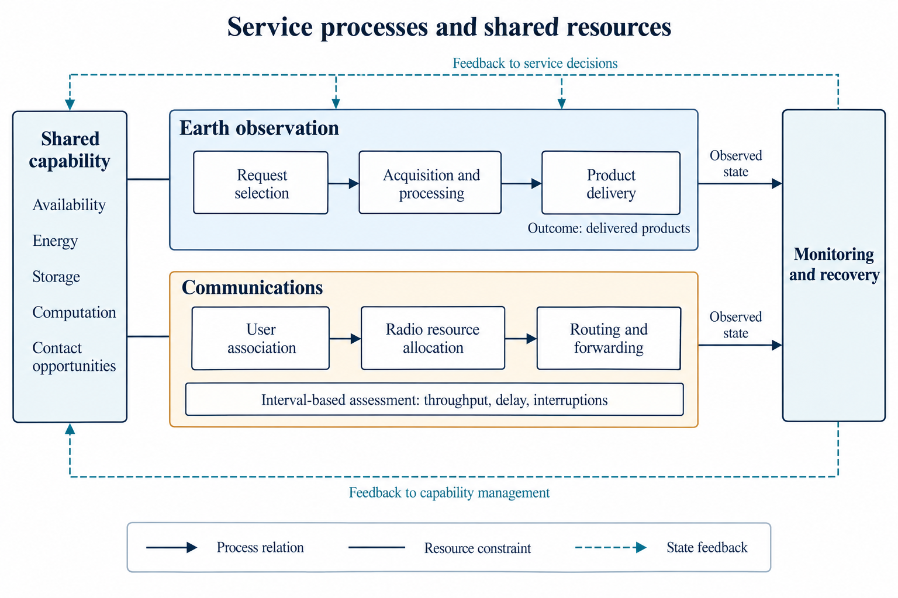
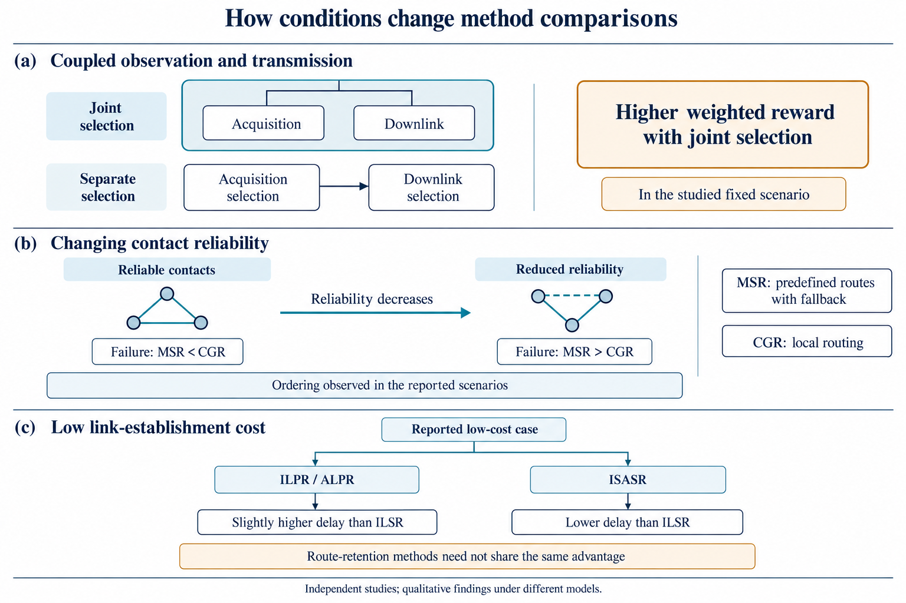

# 大型卫星星座智能运行管理中的规划与协同决策方法综述

Planning and Coordinated Decision-Making for Intelligent Operations Management of Large Satellite Constellations: A Review

**v3.5.2-CN · 2026-10-22 · 条件性综合与正文凝练版；作者审阅稿**

## 摘要

大型卫星星座的智能运行管理既要安排任务与资源，也要在构型演化和接近风险下选择轨道调整，并维持或恢复业务能力。本文采用问题导向的叙述性综述，聚焦业务与资源、轨道与安全、协同与执行三个决策领域，分析优化、启发式、学习及规则的方法机制。综合表明，决策范围宜依据机会、约束和响应期限调整：旧计划及资源承诺仍有效时，复用与局部修复可以减少重复求解；机动显著改变后续机会时，业务目标应参与轨道候选选择；时间尺度或权限不同的决定适合通过分层反馈协调。扩大联合范围的价值取决于限时可采用结果，需连同计算、通信和协调成本评价。共享状态、目标与预测轨迹分别支持当前判断和未来行动预判，效率改善还需与共同控制可行性、碰撞安全分别检验。安全验证应覆盖实际约束、模型适用域及执行区间，恢复则需确认安全达到、功能与资源可用、计划采用及业务满足四类结果。从小编队向大型星座迁移，关键在于能否限制主动耦合规模、保持信息与承诺有效，并在响应期限内完成协调。现有数值与飞行证据支持这些条件性认识；共同条件下的净业务恢复收益仍有待比较。

**关键词：** 大型卫星星座；智能运行管理；协同决策；任务规划；构型维持；自主避碰；业务恢复

## Abstract

Intelligent operations management of large satellite constellations must schedule tasks and resources, select orbital adjustments as formations evolve or conjunction risks arise, and sustain or restore service. This problem-driven narrative review connects three decision domains: services and resources, orbits and safety, and coordination and execution. It examines the mechanisms of optimization, heuristics, learning, and rules. The synthesis favors adapting decision scope to opportunities, constraints, and response deadlines. Reuse and local repair can reduce repeated computation when existing plans and resource commitments remain valid; service objectives should inform maneuver selection when orbital changes substantially alter later opportunities; decisions with different time scales or authorities can be coordinated through hierarchical feedback. Broader joint decisions should be judged by outcomes that can actually be adopted within the available time, including computation, communication, and coordination costs. Sharing states, goals, and predicted trajectories supports different forms of situational assessment and anticipation; task efficiency, joint control feasibility, and collision safety require separate assessment. Safety verification should match the enforced constraints, model domain, and execution interval. Recovery requires four distinct outcomes: an acceptable safety state, functional and resource availability, actual plan adoption, and service fulfillment. Scaling small-formation mechanisms to large constellations depends on limiting the actively coupled problem, maintaining valid information and commitments, and completing coordination before response deadlines. Numerical and flight evidence supports these conditional findings; net service-recovery benefits still require comparisons under matched conditions.

**Keywords:** large satellite constellations; intelligent operations management; coordinated decision-making; mission planning; formation maintenance; autonomous collision avoidance; service recovery

## 1 引言

### 1.1 从任务调度到运行决策

卫星星座通过多颗卫星共同承担观测、通信等业务。面对请求，需要选择执行卫星、安排活动时间并分配能源、存储、计算和通信资源；执行过程中，还需要根据请求变化、设备可用状态和资源占用，决定保留、修改或停止哪些活动。大型分布式卫星系统的自动化运行研究已将排程、监测、资源配置和轨道管理作为相互联系的职责讨论[1]。本文关注其中将状态与业务要求转化为可执行决定的规划与协同决策层，而不是将调度算法等同于全部运行管理。

多颗卫星增加了任务分配的选择，也使不同安排产生联系。同一观测请求可能由多颗卫星完成，一颗卫星可能面对多个竞争请求；多颗卫星使用同一地面站或链路时，还需协调传输时间与容量。规模负担取决于请求数量、候选机会、共享资源和更新频度，而非只由星数决定。计划复用、几何邻域协调和网络表示复用分别减少部分重算、协商和构图工作[2,3,4]。这些机制是否有用，还取决于旧结果是否适用于当前状态，以及协调后的决定能否被相关节点采用。

观测和通信提供两类主要应用。观测请求需要安排成像及后续处理、下传，并按产品质量和交付期限评价；通信业务需要持续调整用户关联、无线资源和数据路径，按给定时段的需求满足、吞吐、时延和中断评价。部署、补给和维护改变可用卫星与资源条件[5]。故障或通信机会失效时，运行决策还须确定受影响的任务、可采用的调整措施及其授权范围，随后才是如何求得新的具体安排。

一颗卫星规避外部碎片，也可能压缩邻星的安全机动空间。Błażejczyk和Zagórski的三星算例中，直接受威胁的成员需要另一成员配合让出空间[6]。此类耦合使安全处置成为群体决策：既要降低外部风险，也要保持内部间距，并确定机动后的任务和资源安排。

轨道动力学还会使可用条件随时间演化，并允许系统主动改变这些条件。面向地面目标的低推力重构[7]把业务需求与新的轨道机会相连；S-NET规划和NanoFF报告[8,9]又表明，姿态、可用时段、导航等待和执行修正会限制调整。由此，本文同时分析在给定轨道上安排任务，以及通过维持、重构和安全处置改变后续任务条件的决定。

因此，本文将三个结果分开：算法提出了什么方案，执行系统实际采用了什么，以及业务最终得到什么。研究对象仍是大型星座智能运行管理，但技术分析聚焦规划与协同决策；状态感知和底层控制按其提供的状态、可行性条件和执行结果作为接口，不展开为独立的全面技术综述。

### 1.2 已有综述与本文的研究定位

已有综述分别提供了问题分类、算法及运行组织基础。Wang等梳理敏捷观测模型与求解方法[10]；Ferrari等按成像、通信及集成安排组织卫星调度，并讨论交付、共享和动态重排，其作者稿将轨迹与构型设计排除在范围外[11]。因此，本文承认调度研究已经处理跨环节收益和状态变化，进一步比较轨道可调整时，原窗口、资源承诺与任务目标应怎样进入决定。

自主运行研究也已超出算法罗列。Jabbarpour等按智能体、组织、通信及任务管理职责分类[12]；Thangavel等讨论信息可得性、计算通信能力和星地监督关系[13]；自动化运行综述联系规划、执行、监测及工具[1,14]。这些工作为解释协同提供基础。本文进一步将信息内容、修改权、批准权和实际采用分别对应到具体任务与机动案例，分析一个节点算得方案后，其他节点在什么条件下能够继续执行。

轨道和系统优化综述同样与本题直接相邻。CAMmary分类避碰机动的风险模型、数值方法、操作约束和多次接近[15]；Singla等以统一任务表达讨论卫星运行与网络管理的集成、协调和自适应组织[16]。Yang等2026年进化计算综述的公开摘要涵盖星座设计、重构、任务调度及测控调度[17]；本文仅据摘要确认这些主题，不据此判断其正文对联合优化的讨论深度。本文的比较重点是决策耦合的条件、约束与恢复结果，研究定位由这些具体分析体现。

本文比较哪些变化只需重算业务，哪些应让业务目标参与机动选择，哪些适合通过分层信息和时序协调处理；再考察这些安排怎样影响安全、资源代价、执行时效与实际服务。第4.2节比较任务响应重构、差异阻力、业务联合安排和避碰—保持，第4.4节检查终态、连续执行与业务恢复。表1给出已有综述与这一视角的衔接。

**表1 已有综述与本文运行决策比较的衔接**

| 已有主题 | 代表来源 | 提供的基础 | 本文进一步组织的比较 |
|---|---|---|---|
| 观测与卫星调度 | [10,11] | 模型、求解、集成交付与动态安排 | 轨道可调整后，窗口、承诺和任务价值怎样参与选择 |
| 分布式空间系统 | [12] | 智能体、组织、通信及任务职责 | 信息内容与修改权限怎样影响共同决定及采用 |
| 自动化运行 | [1,14] | 规划、执行、监测及工具 | 方案形成、实际采用和结果确认分别需要什么 |
| 网络与资源管控 | [18,19] | 通信业务及资源优化 | 业务传输、数据交付和决策交换的不同约束 |
| 运行与网络集成 | [16] | 统一任务表达及交互组织 | 各层哪些变量固定、反馈或共同选择 |
| 可信自主运行 | [13] | 人机监督及信息、资源与责任条件 | 对照案例中的实际计算、批准和执行分工 |
| 空间物流 | [5] | 部署、补给与服务资源 | 能力到位怎样接续任务重分配与服务 |
| 避碰机动设计 | [15] | 风险、机动、操作条件与多事件分类 | 机动目标、路径条件及后续业务的分别确认 |
| 进化计算与系统优化 | [17] | 摘要确认设计、重构、任务及测控调度范围 | 本文比较决策耦合条件与实际恢复；摘要不足以支持正文级排他判断 |

全文的中心问题是：大型卫星星座怎样在轨道动力学演化、空间安全、任务需求变化和有限资源条件下形成业务安排与轨道调整措施，并通过信息协调、安全检查、执行反馈及更新维持业务能力？业务与资源、轨道与安全、协同与执行是三个相互联系的决策领域。第3章保留候选形成和协调机制，第4章比较分别处理、分层或部分联合的适用条件，持续服务按各业务自身结果评价。

### 1.3 研究边界与证据使用

本文所称规划包括选择任务、活动及必要的后续行动；调度进一步确定由哪些卫星、在何时、以何种资源执行；协同决策处理多个主体相互影响的选择。智能运行管理利用目标、状态、模型和规则形成、检查与更新决定，不专指神经网络，也不预设全部决定在星上或无人工介入完成。

本文采用问题导向的叙述性综述。选录以既有主题来源库和参考链追溯为入口，利用来源登记、分批定向阅读笔记、论点定位和章节采用记录，判断一项来源能否解释决定的形成、耦合、协调、采用或恢复。任务与资源、构型维持、风险决策和运行反馈之所以共同纳入，是因为它们会改变同一业务活动的机会、允许动作和完成条件。优先采用具有独立机制、同条件对照、关键反例或具体运行事件的证据；相似结果不按引用篇数累加为更强保证。

方法细节与性能判断以实际取得的原始研究正文为依据；综述用于研究定位和分类，官方流程及接口资料用于说明职责、承诺或事件定义，不证明算法优越性。同一论文的不同版本合并识别，同一飞行任务的报告按功能和阶段互补使用，不计为多个独立任务验证。保留来源ID、实际版本和原文定位，区分原作者结果与本文综合。

单星、地球静止轨道（geostationary Earth orbit，GEO）、小编队及通用多智能体研究只在解释相关机制时纳入，并同时说明动力学、信息、控制能力和验证范围。目录对象数、主动控制成员数与请求负载分别解释，“大型”不设统一星数门槛。部署和补给只说明能力到位，底层控制只提取可用动作、占用和保证条件；不全面纳入轨道控制、异常检测或网络协议研究。通信分别承担用户业务、数据交付和决策信息交换三种职责。

来源可得性限制了覆盖及比较强度。作者稿、接受稿和正式版按实际取得版本解释，图号和结论与该版本对应；仅有摘要的来源用于主题定位。本研究未形成可复现的统一数据库检索式和完整排除流程，因此不主张系统检索的穷尽性，也不进行跨论文统一性能排名。

第2章定义状态、行动、约束与评价对象；第3章保留规划求解及协调机制；第4章比较分别处理、分层和部分联合的适用条件及运行结果；第5章总结现有证据支持的认识。

## 2 智能运行管理中的决策问题与比较基础

### 2.1 任务、资源与轨道状态：已知条件和待作出的决定

以对地观测为例，请求通常给出目标位置、观测要求、优先级和完成期限。在轨道给定时，可以计算卫星与目标满足观测几何要求的时间段，以下称为几何可见时间段。它只说明几何条件；姿态转换、载荷限制及能源和存储是否允许执行，仍需另行检查。

假设一次成像持续时间已给定，需要选择执行卫星、使用哪个时间段，并确定开始时刻。多个请求由同一卫星承担时，还需安排先后顺序和姿态调整时间。若原模型已经枚举开始时刻和持续时间，算法只决定是否选择候选活动；若时间或持续时间可调，则须求出相应取值，不能替原模型增加不存在的变量。

观测后的处理和下传会反过来影响任务选择。图像占用存储，处理消耗计算资源和能源，下传需满足星地通信机会及接收容量。多个卫星共用地面站时，要协调时间和数据量；对要求按期交付的请求，需检查整段处理和传输能否及时完成。通信业务则给定用户需求、覆盖和可用容量，决定服务卫星、传输资源和路径，并随需求及覆盖变化更新。

在智能运行管理中，这些问题还要附带状态适用时刻、已执行活动和可撤回条件。已经执行的成像不能撤销，已分配传输容量限制新请求[20]，新激光链路的建立时间限制路径何时可用[21]。这里既有物理约束，也有运行规则，不能把求解器允许改变的变量直接当成系统具有的修改权限。

轨道状态既可以是规划输入，也可以因机动成为可改变的条件。轨道根数、相位和相对几何限定未来观测与接触机会；推力、推进剂、姿态、电池状态和可用时段则限制能够采取的动作。低推力任务响应[7]将目标需求转为轨道候选，差异阻力规划[8,22]将发电与运行可用性带入动作选择。本文因而区分正常维持、需求驱动重构和有风险时刻的安全处置，各自记录触发条件及响应时限。

**表2 运行决策的输入、决定及结果交接**

| 决策职责 | 已知条件或状态输入 | 需要作出的选择 | 后续需要确认的结果 |
|---|---|---|---|
| 任务与活动规划 | 请求、候选卫星、窗口、时长及已有计划 | 接受哪些请求，由谁执行，何时开始及执行顺序 | 活动及资源约束满足，相关节点采用安排 |
| 资源配置 | 能源、存储、计算和通信状态及需求 | 为哪些活动分配多少资源 | 额度和占用更新，配置实际生效 |
| 变化后的调整 | 故障或新请求、已执行前缀、可用替代活动 | 保留、推迟、取消、转移任务或扩大重规划 | 原安排撤回条件满足，替代安排无冲突 |
| 恢复行动选择 | 经确认的异常事实、允许行动及前序行动结果 | 选择下一项恢复措施或退出动作 | 措施执行成功或失败，状态可供后续规划使用 |
| 多星协调 | 任务归属、报价、资源承诺及消息时序 | 谁拥有任务或资源，哪些冲突需重新协商 | 各参与节点的相关决定一致 |
| 决定采用 | 候选计划、当前状态、授权和生效时限 | 批准、拒绝、重新计算或维持仍有效的安排 | 执行系统已采用何版本，随后实际结果是什么 |
| 构型维持与重构 | 当前轨道、相位、目标几何、摄动预测和控制能力 | 哪些成员何时调整，选择哪些目标位置及动作 | 构型偏差、到位时间、控制代价及转移安全 |
| 接近风险处置 | 预测接近、状态不确定性、更新时间及动作余量 | 等待更新、采取何种安全措施及何时承诺 | 风险定义下的约束、次生接近及执行可行性 |
| 机动后恢复 | 实际轨道、功能、剩余资源及未完成需求 | 返回、保持新轨道或转入任务可接受轨道，并重分配活动 | 后续风险、服务满足、恢复时间和成本 |

比较任务与轨道候选时，还需记录轨道及不确定性的有效时刻、机会变化、动作占用时段、终态允许偏差和必须满足的路径条件。业务评价分别使用交付期限或时段服务要求，恢复时间分别量到安全达到、能力确认、计划采用或业务满足；这样才能支持第4章对耦合范围与恢复收益的比较。

表2是本文的职责归纳，不表示所有原研究同时覆盖这些步骤。“恢复行动选择”与“故障诊断”不同：本文关心已获得何种事实足以触发何种措施，以及结果怎样进入下一次决定，而不全面比较产生这些事实的检测器。

图1概括观测、通信与共享资源的功能联系。轨道调整对机会和动作占用的影响按表2及第3.6节分析。

图1 观测与通信业务及共享资源示意。观测按产品交付、通信按给定时段的服务指标评价；箭头表示功能联系。

### 2.2 决策方法、计算位置与权限

优化用变量、约束和目标形成选择；启发式通过追加、插入、删除或交换活动构造和改进计划；学习可以预测需求、选择搜索操作或按状态提出活动；规则推理依据事实及预设条件选择策略或行动。各类方法可以组合，其输入和输出仍需区分：预测、候选计划与执行指令承担不同职责。

计算位置与决策权限是两个维度。地面节点可以生成计划并等待审批，星上节点可以在授权资源内局部调整，分布式算法也可能由地面用户执行。管理拓扑和跨星分配[2,3,23]说明计算组织，机动责任、批准权和执行权则由任务规定。CARA的拟定机动再筛查[24]与共同生成策略后的半分散执行[25]提供不同实例，其采用条件在第4.3节比较。

联合建模规定共同选择哪些变量，分解求解规定如何拆分计算，滚动规划规定何时利用新信息更新；三者可以同时采用。比较时应明确哪些决定暂时固定、何种反馈可以重新开放，以及候选何时转为经检查、获准并实际采用的配置。

### 2.3 两个说明情景：载荷不可用与避碰后任务接续

以下两个情景用于说明决策链，均为本文构造的示例，各环节的证据按具体来源分别讨论。先设一颗观测卫星的载荷暂时不可用，存储和通信仍可工作，而原计划已占用若干地面站时段。

首先要区分尚未采集的请求、已经存储的图像和仍可执行的下传，不能把载荷失效等同于卫星全部能力消失。其次，根据期限、替代卫星窗口和可撤回预约，选择保留已有图像下传、推迟未执行请求、转交其他卫星或取消不能兑现的活动。此时任务与资源调度负责形成具体安排，行动选择还须受到故障处置规则和修改权限限制。

接替节点采用新任务、旧资源释放和消息更新决定了调整何时生效。设备处置、计划采用及产品交付对应不同结果，第4.4节据此分析恢复的阻塞环节。

第二个情景是一颗观测卫星收到新的潜在接近信息。系统先区分几何提示和风险判断，再在剩余时间及权限内选择等待更新或采取措施。机动后，按新轨道检查未执行的成像和下传机会，再比较返回原轨道、保持任务可接受的新轨道或重新分配请求。载荷正常时原时间表也可能失效；其他成员的接续则可能早于原轨道恢复。

### 2.4 评价对象与证据范围

业务评价先明确事件和分母。观测中接受请求、成像、下传与合格产品交付不同：[26]按期完成观测和传输才计请求收益，[27]分别计算观测收益与下传体积。通信评价应给出用户集合、时段和未满足需求，成功子集的平均时延仅描述其中一部分结果。Planet接口对订单接受、采集和交付的区分[28]可用于统一事件终点，其用途是业务定义。

计算成本分列准备、训练、在线求解、协调和配置采用；过程重叠时按事件时刻核算。结果区分可行解、松弛界、最优解及超时，规模分别记录星数、任务量、候选连接和竞争范围。未报告的成本保留为缺失项。

安全指标须说明所查事件、时间范围、状态与协方差来源、控制能力及误差条件。瞬时碰撞概率、轨道框机会约束[29]与失控后规定窗口的分离[30]具有不同语义，TCA、最近距离和业务交付也各有终点。终态、路径与节点间要求的补强方法在第4.4.3节比较。

证据分别记录模型性质、实际完成的运行步骤和验证平台规模。静态求解、循环重规划、地面原型及飞行事件据其已检验功能使用；未采用计划、失败恢复、取消请求和安全退出均纳入结果，供第4章分析决策收益及失败原因。

## 3 规划、求解与协同决策方法

本章按候选形成、状态更新和行动协调组织方法。第3.1—3.3节分析优化、搜索和学习，第3.4节讨论多星组织及共同安全责任，第3.5节连接状态、恢复行动与计划更新，第3.6节分析构型维持、风险判断和机动恢复。算法机制、计算组织和更新方式可以组合，其运行取舍在第4章比较。

### 3.1 优化建模与分解求解

优化建模通过变量表达决定，通过约束排除不允许的安排，再根据目标函数评价候选。例如，二元变量表示请求是否接受或成像是否选择，时间变量表示活动开始时刻，资源变量表示处理和传输获得的容量。哪些量需要求解由具体模型确定。

轨道重构也包含离散分配与连续代价。Wang等先按相对轨道根数构造单星脉冲转移代价，再比较初始成员与终态位置的对应关系[31]。这使“哪颗星到哪个位置”和“怎样到达”相互关联；其四从星及开放时间算例不证明大规模组合分配性能，转移全程避碰也需另接约束。具体运行用途见3.6.1。

Seman等[32]将不同任务与能源状态纳入混合整数线性模型，依据光照和工作消耗描述电池变化，约束单星及多星共同参与或冗余执行的任务。其ε约束方法将部分目标转为给定水平的约束，改变水平后调用Gurobi分析权衡。1—5星实验说明能源与任务选择的联系，不能据此证明大型星座求解性能。

Lemaître等[33]的受限单轨道段模型将候选图像和离散开始时刻组织为动态规划状态。在图像顺序预定、收益线性并去除立体成像约束等条件下，可以获得相应受限问题的最优解。约束规划则对图像与时间变量赋值，传播约束并排除不允许的组合；两类方法的约束范围不同，最优性结论不能直接互换。

He等[26]使观测和传输共同完成成为请求获益的条件。其作者稿以观测和传输时间段、权重与期限为输入，输出窗口关联及相应时间安排，使下传条件影响观测选择。3颗观测星、12小时规划时域的仿真支持所设条件下的联合安排收益，仍需保留无误码传输和图像质量简化等假设。

Soret等[34]则先确定本轮采集，再配置处理节点负载和处理器频率。给定负载下利用时间约束消去频率，进而求解剩余资源问题。共同选择发生在下游处理，本轮采集作为输入；固定流水线、稳定链路和平均处理时间约束限定结果，不构成逐请求按期交付保证。

云覆盖不确定性研究[35]采用列生成启发式，将一条卫星轨道段内的观测序列作为候选，主问题选择已有序列，动态规划产生可改善当前目标的新序列，最后求解已生成候选上的整数问题。这避免一开始枚举全部序列，但完整整数问题的全局最优性仍取决于候选完整性及终止状态。

单星波束与功率研究[36]按时隙先选当前服务区域，再固定选束结果优化连续功率。波束表示集中向一定区域提供无线信号，功率影响当前传输量，并通过剩余需求影响下一时隙。分阶段处理因而需要说明当轮固定了什么，以及本轮结果何时影响后续选择。

上述研究区分了扩大决定范围和改变求解组织。运行管理可以预先规定哪些任务或资源不可撤回，再在剩余变量上调用适当求解方法；模型能够给出更大范围的候选，并不自动增加系统实际拥有的修改权。

### 3.2 启发式构造、局部搜索与混合求解

启发式按规则构造安排，局部搜索则反复修改已有方案。对观测任务，可以逐项选择请求并插入成像活动，检查姿态转换、时间与资源冲突；随后通过增加、删除或交换活动改善目标值。方法解释应明确每次修改什么，而不只列算法名称。

Lemaître等[33]比较贪心构造与局部搜索。贪心沿轨道段追加能够衔接的图像并估计剩余机会价值，局部搜索通过插入或删除改变序列。它们与动态规划的差别既在搜索机制，也在所保留的收益与约束，不能将不同约束组的结果直接排名。

Rocha等[27]的机构工作论文用图表示候选活动及其衔接，同时考虑观测、下传、能源和存储。方法通过减少连接、简化整数模型和局部混合整数规划邻域控制搜索规模。局部邻域每次只开放部分活动或连接，其余暂时固定；需要分别检查是否删去可行顺序，以及是否仍排除不满足姿态转换等条件的组合。观测收益和下传体积也应保留各自定义。

He等[26]的外层遗传搜索选择观测—传输窗口关联，内层通过半定松弛、随机化和可行性调整产生具体时间安排，结果返回外层评价候选。这种分层计算仍保留上下游相互影响，不能归为先固定观测后独立下传。

Handley[4]则在无直接星间链路的地面中继网络中，利用地理分块缩小候选范围，并保留网络图、更新连接代价。其节省主要来自减少重复构图，与缩小可行域或改变搜索操作不同。在线复用需要能及时反映当前连接，否则计算节省不能直接转化为有效计划。

启发式还可作为运行决策中的候选生成器，由规则限定允许动作、由后续检查判断候选能否采用。但这种组合只有在相应信息和约束确实传递时才成立；采用局部优化求解器也不赋予整个搜索流程全局最优性。

### 3.3 学习辅助搜索与活动选择

学习分别可以预测需求、选择搜索操作或提出活动，三者接收和输出的对象不同。流量预测研究[37]在合成序列上评价估计误差，直接产物是需求预测；是否改善服务还需观察资源策略怎样使用它，不能由误差下降直接推出吞吐或恢复收益。

轨道安全中的学习也可能只负责分析分流。接近数据消息（conjunction data message，CDM）事件剪枝[38]输出需要继续分析的事件集合，不输出控制命令；风险预测竞赛[39]评价的是预测与评分条件。将学习部署在这一位置时，应评价后续分析负担和危险事件漏报，并由独立流程完成风险判断及动作选择，详见3.6.2。

Song等[40]的RL-GA保留遗传搜索，以Q-learning依据适应度改善选择交叉、变异或其组合，再由窗口选择和解码得到具体安排。学习输出搜索操作，可行性仍由解码处理。两颗卫星、不同任务数量的实验扩展的是请求负载，不是星座成员规模，完整成本也应包含解码和约束处理。

Herrmann等[41]用单星环境中的蒙特卡洛树搜索提供状态—动作评价，训练神经策略，再将同一策略用于多颗卫星。上层目标分配、局部策略、动作屏蔽和完成状态共享分别负责目标归属、活动选择、允许动作及已完成任务的信息更新。共享完成状态仍可能滞后，不能完全避免同一时刻的竞争。

其4—40星实验评价了上述组合，而非仅评价神经策略。上层整数模型未联合描述下层全部资源动态，运行计算还依赖离线训练与预处理。Basilisk中的共同仿真比较[42]提供了区分策略和安全动作处理作用的条件，不能用局部推理时间代替全流程响应。

Ngo等[43]以地面覆盖小区簇为智能体，学习波束激活、频段和功率，并用奖励惩罚处理过量干扰。小区簇数不等于卫星数，惩罚项也不等于逐动作硬约束保证。对运行管理而言，还须说明策略动作处于何种授权范围，由谁检查和实际配置。

表3比较候选安排的生成机制。需求预测、学习建议、解码后计划和最终采用的动作应分别记录；不因使用学习模型就将方法归为全自主运行。

学习提出动作后还可以设置独立的安全修正。Stephenson和Schaub在巡检策略之外，用基于相对轨道动力学的屏蔽器修正脉冲，使候选动作与已有安全轨道及异步更新条件相容[44]。因此，策略收益与安全收益需要分别归因；双星仿真中屏蔽后的结果不能单独作为学习策略自身的安全证明，其更新协议见3.4及4.3。

**表3 代表规划与求解方法的作用机制**

| 代表研究 | 输入及待决定内容 | 形成候选的方法 | 主要解释边界 |
|---|---|---|---|
| 能源感知调度[32] | 任务与光照给定，选择各星任务 | 混合整数规划及多目标权衡 | 1—5星；可行解、间隙和最优性区分 |
| 观测序列优化[33] | 图像及时间条件给定，选择序列 | 动态规划或约束规划 | 受限模型和完整模型不能混用 |
| 贪心与局部搜索[33] | 构造或修改成像序列 | 追加、插入或删除 | 收益与约束范围不同 |
| 联合观测—传输[26] | 窗口、权重与期限，决定关联及时间 | 遗传搜索与内层近似优化 | 固定实例、质量及传输假设 |
| 集成观测—下传[27] | 活动图与资源，选择活动及顺序 | 图缩减与局部整数规划 | 简化可能丢失选择；双奖励分别解释 |
| 处理配置[34] | 采集已定，配置负载与频率 | 变量消元与资源优化 | 平均时间约束，不回改本轮采集 |
| 学习辅助搜索[40] | 搜索状态，选择遗传操作 | Q-learning辅助搜索 | 解码负责可行性；两星负载实验 |
| 策略复用[41] | 单星状态与目标分配，提出动作 | 策略、屏蔽及状态共享 | 上层分配与通信贡献须分开 |

### 3.4 多星协调、信息交换与修改权限

CBBA[45]由各主体计算任务边际收益、构造任务包，再交换赢家、报价和时间戳处理重复占有。任务加入顺序不同于执行顺序；失去较早加入的任务时，需要释放随后加入且报价依赖它的任务并重算。原研究的收敛和价值结论有评分及通信前提，机器人验证不直接代替轨道执行约束。

Krigman等[46]的分布式约束优化以用户为智能体、请求为变量，将观测机会或不执行作为取值，通过分布式局部搜索处理重叠和容量冲突，并按原流程处理剩余冲突。这里分散的是用户请求选择，卫星仍是执行对象，不能从多智能体标签推定计算发生在星上。

Zilberstein等[3]按观测竞争的几何邻域限制直接协商范围，从而减少每次需要共同处理的对象。邻域所覆盖的竞争关系决定这种分解的适用性；加入共享地面站或交付容量时，还需识别跨邻域依赖，其运行意义见第4.1节。

通信分层管理[47]由上层确定服务区域和频谱条件，局部节点选择波束、时隙及信道；多星需求感知配置[48]把全局选束与当前选束下的星内功率调整分开。局部可调整变量受上层结果限制。延迟通信规划[49]与异步任务分配[50]又分别处理所设时延和消息更新条件，不能把一般多智能体实验直接视为在轨验证。

轨道动作的协调还包括共同计划与分散执行的关系。Kim等先离线生成双主动星联合策略，再按预测地面接触机会同步信息，各星依据本地状态概率估计选择动作[25]。这种半分散组织仍依赖共享的初始状态概率估计和共同生成的策略；其信息同步将传输与地面协调合并为理想事件，不能据此宣布任意时延或丢包下都可安全协同。Pippia等的构型重构[51]又区分邻星当前状态与上一时刻整段预测轨迹，说明“是否通信”不足以概括信息条件。

控制屏障函数（control barrier function，CBF）与运行时保障（run-time assurance，RTA）提供另一层协调：名义计划给出动作，过滤器按安全条件修正。Parikh等的多服务模块约束与执行器限制可能使控制问题无解，估计状态下的协方差缓冲也不保留原来的确定性保证[52]。Dunlap等的集中和分散实现都掌握全部成员状态，差别在于能否联合选择控制；其失败讨论涉及互相观测时的太阳/传感器视线禁入冲突[53]。共同可行性、信息范围和控制责任因而需要分别说明，不能将所有约束违反改写为实体碰撞。

上述机制分别更新任务归属、资源分配和控制动作。将消息中的完成状态、计划与资源承诺区别编码，有助于确定一次更新影响哪些节点；结果如何获得接受并生效，见第4.3节。

安全机动还要协调控制的修改顺序。Stephenson和Schaub的屏蔽机制要求已有轨道被动安全，并在每次更新时只允许一颗服务星改变轨道；取消该次脉冲因而可作为保留原安全轨道的备选[44]。这里的协同收益部分来自执行协议，而非各星独立求解同一个算法。将它用于同时机动或受损通信时，需要重新检查其他成员的预测是否仍有效，以及避让责任能否共同实施。

### 3.5 状态驱动的策略选择、计划修复与恢复行动

#### 3.5.1 从状态估计选择规划策略

状态估计既能更新规划输入，也能选择求解策略。He等[54]先预测电量、数据和存储状态，再用规则调整目标权重，在偏向观测、下传或能源的策略之间选择，随后构造单颗敏捷卫星的活动。规则改变搜索偏好，活动及约束检查仍由后续步骤完成。

这与学习选择遗传算子[40]均作用于“怎样规划”：前者依赖预设规则和预测状态，后者依赖学习得到的操作选择。二者与直接选择“执行何种活动”的策略具有不同输出，适合按策略选择、活动构造和约束检查分别分析。

#### 3.5.2 保留事实并调整尚未执行的安排

滚动时域[55]用周期或事件触发更新规划区间，再由求解器安排等待及新到请求。增量方法进一步复用未受影响的活动，移除撤回请求并插入新增请求。Parjan和Chien[2]在100星、一周规划时域的仿真中采用这一机制；共享状态用于更新分配，仍有重复观测，其并行时间为单线程运行下的估计。

不确定性也可在计划阶段预先处理。鲁棒观测[35]以区间和预算参数保护收益偏差，GEO加注[56]用预算不确定集处理历时偏差。天气情景模型[57]则区分共享预定观测的两阶段安排，以及中午获知天气后可改排后半日的三阶段安排。前两类的保护参数描述事先偏差集合，后一机制另有信息揭示时刻和后续可调变量。

Lowe等[20]逐请求搜索采集—交付路径，接受后扣减容量并保留承诺；原路径失效时，可保留采集指派，重新选择后续转发，模型将能源和存储视为无限。动态激光链路[21]将建链时间计入换路代价，使保留连接与改路对应不同的执行安排。第4.2节据这些机制比较局部修改的适用范围。

#### 3.5.3 从异常事实选择行动并确认结果

Wanninger的故障检测、隔离与恢复（fault detection, isolation and recovery，FDIR）地面原型[58]把参数和事件转为故障事实，用规则选择恢复行动、处理互斥，再由执行规则展开操作；前一行动的成功或失败决定后续措施。Remote Agent[59]把任务与资源规划、运行执行及诊断模式信息相连，使局部处置结果能够触发必要的任务更新。两者分别提供地面特定故障和单航天器环境中的行动反馈机制。

编队恢复还涉及控制角色。VISORS的发射前双星软件在环设计[60]将故障响应与主动/被动角色切换、待命和逃逸连接，导航状态进入无控分离预测。规划层因而需要接收行动结果、新角色与可用模式，再更新可执行活动；功能恢复怎样转化为业务恢复，统一在第4.4.4节讨论。

**表4 状态变化后的决定及其实际修改范围**

| 机制与来源 | 使用的信息 | 保留或固定的内容 | 输出及后续确认 |
|---|---|---|---|
| 策略推理[54] | 预测资源和子系统限制 | 给定任务与规则 | 目标偏好，再构造和检查安排 |
| 滚动安排[55] | 新请求及更新状态 | 已执行活动 | 新时域安排 |
| 增量规划[2] | 请求激活、撤回及共享状态 | 未受影响的计划 | 更新分配，检查重复与冲突 |
| 鲁棒安排[35,56] | 事先给定的偏差集合 | 计划阶段信息 | 满足所设保护条件的候选 |
| 天气信息后改排[57] | 中午的新天气信息 | 前半日活动 | 三阶段模型重排后半日 |
| 局部路径修复[20] | 原连接失效及后续机会 | 原采集指派 | 后续转发路径及交付情况 |
| 恢复规则[58] | 异常事实及前序行动结果 | 规则和允许措施 | 下一恢复行动及效果确认；地面原型 |
| 规划—执行—诊断衔接[59] | 任务、模式及执行状态 | 已完成活动和当前约束 | 局部处置或重新规划；单航天器环境 |
| 编队模式及角色切换[60] | 故障响应、导航及无控分离预测 | 允许模式和当前执行能力 | 新角色、待命或逃逸及后续状态；双星软件在环 |

上述机制保留已执行事实，更新尚可调整的部分。载荷状态改变可用活动，轨道状态还会改变未来窗口及允许动作；第3.6节进一步分析形成轨道候选的方法。

### 3.6 轨道构型维持与自主避碰决策

#### 3.6.1 轨道构型演化、维持与重构

构型管理需要区分长期设计、正常维持和需求变化后的重构。部署感知设计[61]限定初始配置何时能够形成；运行中的维持与重构则根据当前轨道、目标几何和可用动作决定怎样调整。相同终态构型可以对应不同成员分配和转移代价，解析转移代价可作为上层分配的输入[31]，但开放时间脉冲模型中的分配结果仍需连接有时限、控制界及全程安全条件的执行检查。

维持目标还应由测量几何定义。Leroy等为内重力波层析探测设置略有倾角差的立方星，使掩星采样在两个水平方向展开；倾角差又导致J2摄动下不同的节点退行速率，单独匹配平均运动不足以保持构型。其维持规则以升交点赤经（right ascension of the ascending node，RAAN）偏差触发，在最大、最小纬度附近安排成对机动；最大加速度限制可维持的分离程度，总Δv预算限制维持寿命[62]。这是观测需求、摄动和控制能力的共同约束，证据来自理论及轨道仿真。

差异阻力通过改变迎风面积调整相对漂移，姿态同时影响发电和任务可用性。Kim和Yoon把阻力面积与发电投影面积共同纳入姿态选择，并根据电池状态及日照切换调相与充电；其验证单元是两星关键星对[22]。S-NET规划进一步把通信、值守和其他活动的影响归入运行可用率；多个星对共享参考星时，还需通过启动延迟同步高低阻力切换[8]。后者给出的是规划与未来演示建议，不能据真实星座名称将该新序列写成已完成的在轨控制。

低推力重构还可以改变未来任务机会。McGrath和Macdonald先生成升降轨、滑行和恢复组成的候选，再根据响应时间、控制代价及地面目标距离选择参与卫星[7]。24星案例把轨道动作与观测需求联系起来，但燃料均衡会增加总控制代价和完成时间，恢复全局观测模式后也未完全恢复原有轨道面内几何。这说明应同时记录任务机会、成员消耗和保留的构型偏差，不能只按某项平均覆盖改善评价重构。

重构的分散求解需要明确共享的是当前状态还是未来轨迹。Pippia等用模型预测控制（model predictive control，MPC）比较两类邻星信息，在部分成员离轨后重新形成等间隔构型；其35星模型检验构型重构和邻星预测信息，未加入避碰约束[51]。Pedari等则将任务构型、成员指派、轨迹与执行接管分层处理，10星闭环仿真与50星指派计算属于不同验证范围，终端通信可靠性也未被强制保持于整个机动过程[63]。两例分别说明邻星预测内容与层间交接怎样影响决定，具体规模与验证职责汇于表8。

#### 3.6.2 接近筛查、风险评估与安全行动选择

接近处置首先要分清计算的产物。几何筛查产生需要进一步检查的对象或事件；最近接近时刻（TCA）及距离计算描述预测几何；风险评估再使用状态不确定性等信息判断碰撞可能性。NASA CARA流程明确区分接近提示、风险评估及后续缓解规划[24]。因此，目录中筛出一个近距离对象，不直接等于已达到机动条件；降低筛查耗时也不能直接表述为碰撞风险下降。

在几何计算环节，Denenberg用Chebyshev代理多项式定位TCA及相应距离，其接受稿采用SGP4传播进行评估，所得仍是接近几何[64]。Saingyen等把多种筛查条件与CUDA计算的数据组织相结合，减少需要精算的候选并处理内存负担[65]。比较这类方法应保留传播模型、分段或步长、阈值及复核参照；同输入算法间的距离一致性不能替代真实轨道误差或概率风险校准。

已有事件还可以分流。Henry等根据接近数据消息（CDM）的特征，以降维、聚类和集成投票剪除部分低风险事件；该算法没有生成机动，训练集中的危险事件浓度条件也未给出测试集假阴性上界[38]。ESA竞赛研究则提示，评分、稀有事件采样及临近接近时刻的风险变化都会影响预测评价[39]。运行决策需要把被保留的事件送往后续分析，并说明漏报和新信息怎样触发重新评估。

风险量还应与时间范围一起解释。Wen和Qiao在固定初始误差空间计算给定时间段内的碰撞事件，避免同一偏差轨迹重复计入；其当前数值方法受随机变量维数和线性确定性动力学限制[66]。长期机动研究采用的瞬时概率约束[29,67]以及多次接近研究在不相关事件假设下组合的风险[68]，处理的事件并不相同。综述可以比较这些定义和前提，不能跨时间范围移用同一阈值，也不能把逐节点瞬时量自动改名为全时段累计碰撞概率。

等待信息更新与提前采取措施也有代价差异。CARA流程讨论了提前机动的燃料机会、风险随信息更新下降的可能性，以及承诺执行前的再次判断[24]。据此，运行层应同时考虑风险信息时效、剩余动作能力和任务期限；“等待”只有在仍保留适用处置机会时才是候选行动。具体触发条件与批准权随任务确定，本文不提出适用于所有运营者的统一机动阈值。

#### 3.6.3 避碰机动及机动后构型与任务恢复

避碰方案的比较应先说明允许改变哪些动作。Pavanello等针对正在执行的低推力轨迹，分别改变关机时长、控制矢量偏差或方向夹角，部分策略通过终端软约束接回名义轨迹；关机策略的后续恢复求解不在该文范围内[69]。长期避碰与保持研究[67]将轨道框及名义状态目标接入连续控制优化，加入保持要求会改变控制方向和代价。恢复目标是否可松弛，以及剩余时间是否足以到位，应随控制代价一并报告。

短时避碰和后续保持也可以通过终态条件联结。De Vittori等的2025年作者稿将碰撞概率条件反演为几何约束，并通过终态定点接入轨道保持[70]；这一建模方式确定终态，路径保持另见第4.4.3节。多次接近优化则用一次控制影响后续事件和风险预算[68]，其一主动星对多个被动目标的设置与多运营者责任协调具有不同决策主体。

多个主动成员则需要共同检查内部与外部安全。Błażejczyk和Zagórski在三星例中联合选择控制，同时约束碎片禁入区域、星间距离和终端构型，未直接受威胁的成员也可能需要配合[6]。预先分配被动相对轨道走廊的MPC[71]把部分冲突处理前移到任务设计阶段，其空间结构、采样和扰动条件与任意构型下在线联合求解不同。优化中分阶段加入约束是形成最终方案的求解过程，不是允许飞行先违反内部安全要求。

失去控制后的分离还需要单列。被动安全规划[30]为规定恢复窗口保留无控漂移间距；Scala等[72]在一星失控且故障告警可传达时，由健康成员转入安全螺旋构型。两类输出分别支持等待接管和主动重构，恢复后的功能、构型及业务接续在第4.4节进一步比较。

**表5 轨道运行决策链中的方法产物与交接条件**

| 环节及代表证据 | 算法实际产生什么 | 下一环节需要什么 | 比较时保留的边界 |
|---|---|---|---|
| 维持与调相[8,22] | 姿态、高低阻力及切换安排 | 能源、姿态可用性与共同切换确认 | 星对仿真与未来演示规划分开 |
| 重构及成员分配[7,31,51] | 参与卫星、目标位置、候选转移或相位控制 | 转移时限、控制界和全程安全检查 | 业务响应、代价计算和构型重构规模分别说明 |
| 几何筛查及TCA[64,65] | 候选对象、接近时刻及距离 | 状态不确定性和后续风险评估 | 几何结果不是碰撞概率 |
| 事件分流及风险判断[38,66] | 保留事件或给定定义下的风险量 | 更新信息、动作能力及触发规则 | 漏报、概率语义和时间范围分别说明 |
| 机动与保持[67,69,70] | 控制序列、终态及可能的松弛残差 | 实际执行、转移复核及新的任务机会 | 软恢复目标、终端满足与全程约束分开 |
| 多事件及多主动成员[6,68] | 多事件预算或联合成员控制 | 次生风险筛查、责任及方案共享 | 多被动目标不等于多主动运营者 |
| 失控分离与重构[30,72] | 安全漂移窗口或健康成员新构型 | 接管、功能确认及业务重排 | 安全状态不等于原功能或任务完成 |

表5按输出和后续条件组织不同方法。运行层接收候选时，应同时接收其时段、状态和约束前提，再决定是否保留旧任务或扩大重规划；验证职责见4.4。

## 4 运行条件下的决策取舍、采用与验证

### 4.1 规模扩大后应减少哪些工作

大型星座的负担应拆成成员、请求、候选机会、资源竞争和更新频度。图缩减[27]减少需要搜索的连接，几何邻域[3]减少直接协商对象，增量规划[2]减少重复安排；三者控制的工作不同。更快产生局部候选，还需检查跨节点协调和采用是否成为新的主要开销。

候选压缩可能删除原本可行的顺序，因此须与业务收益和可行域变化一起评价。局部协调要说明竞争是否能够在所选范围内处理；把同一地面站或交付容量纳入新的应用时，可能需要扩大关联范围。复用则以旧安排继续有效为前提，较小改动也可能限制新请求，因此应同时记录节省的计算与未满足需求，而不是只报告重算比例。

图表示复用[4]和轨迹代价预计算[73]利用可重复结构，但前者要更新连接，后者受轨道、质量、时刻及终端范围限制。学习策略的上层目标分配[41]也依赖已生成的可见机会。将这些方法用于运行管理，需要说明准备结果失效的判据、重建工作和状态确认时间，不能把已前移的计算当成永远不存在。

轨道安全增加了不同类型的工作：目录候选筛查、接近几何精算、风险信息更新及机动后的再筛查。CUDA筛查研究[65]通过计算与内存组织改变目录处理，事件剪枝[38]则在已有CDM事件中减少后续分析对象。它们分别影响候选生成和事件分流，不宜与观测排程加速百分比直接排名。完整评价还需保留传播、数据传输、精细复核及剩余响应时间；没有建立无漏报条件的缩减不能仅凭速度直接获准采用。

**表6 计算减负机制与运行采用条件**

| 主要工作 | 代表机制 | 可复用或缩小的条件 | 除算法用时外需要保留的代价 |
|---|---|---|---|
| 候选与执行顺序过多 | 图缩减、局部搜索[27] | 可以识别可合并或可舍弃连接 | 候选损失、约束检查及计划质量 |
| 直接协商主体过多 | 几何邻域协调[3] | 主要竞争位于相应邻域 | 跨邻域依赖、消息及采用一致性 |
| 重复安排未变化任务 | 增量规划[2] | 旧安排在当前状态下仍有效 | 保留决定对新需求的限制 |
| 重复构建网络表示 | 图复用及边权更新[4] | 连接变化可被及时反映 | 失效检测、更新和重建 |
| 重复动力学计算 | 代价网格与插值[73] | 查询未超出模型和网格范围 | 离线计算、误差及轨迹复核 |
| 每次活动选择成本高 | 策略复用[41] | 输入及动作条件仍适用 | 训练、上层分配、屏蔽及协调 |
| 目录与事件分析负担 | 几何筛查与事件分流[38,65] | 阈值、时间步长及事件信息适用 | 候选漏失、传播、风险复核及响应时间 |

图2概括不同计算工作的减少机制，表6列出各自的适用条件。

图2 计算工作及其减少机制。候选缩减[27]、局部协调[3]和计划复用[2]分别影响搜索、协商与重复求解；节点和计划条不对应实测数量。用于运行决策时，还需按表6检查结果的适用性及采用过程。

### 4.2 任务、资源与轨道机动应共同决定到什么范围

决定范围取决于一种选择会不会改变另一种选择的可行性或价值。给定轨道后安排业务、先选机动再重排业务，以及部分联合选择机动和任务，分别固定了不同条件。比较这些方式，需要先给出共同的业务目标、可用动作、安全要求和响应期限，再分析开放哪些变量值得付出额外计算与协调成本。

#### 4.2.1 轨道动作什么时候需要考虑未来业务

首先应区分两个方向：机动改变未来机会，业务需求反过来选择机动。轨道根数、相位或相对构型变化后，原先计算的观测窗口、覆盖和链路机会可能不再适用；是否影响既定任务，取决于变化发生的时段、几何裕量和交付期限。需要重算机会并不意味着必须联合优化全部任务。反过来，如果不同安全可行轨迹提供明显不同的后续机会，任务需求就可以成为选择轨道目标、参与成员和动作时机的依据。

低推力响应重构提供了第二个方向的直接例证。McGrath和Macdonald先产生转移候选，再按响应时间、控制代价和目标距离选择成员；其24星数值案例还显示，燃料均衡会付出额外总控制代价和时间，平均覆盖改善也可能伴随部分位置重访变差[7]。业务指标在这里已进入机动选择，但地面目标距离和覆盖统计仍不是逐请求按期交付结果。若将其接入观测调度，还应重新检查成像、处理和下传是否均可完成。

科学任务还可能要求保留某种几何，而非尽量消除全部相对偏差。内重力波探测需要倾角分离以展开采样，但较大分离会增加差异节点退行和维持负担。在该文的测量与定轨条件下，推进期间难以满足掩星测量的速度精度要求，较大的点火时间占比因而压缩可用测量时间[62]。因此，维持寿命和可用科学测量时间宜作为不同目标评价，通过轨道保持、点火时机和业务安排之间的反馈权衡。

维持动作也会与原业务竞争。差异阻力通过姿态改变迎风面积，同时改变发电条件；Kim和Yoon根据电量与日照在调相和充电间切换[22]。S-NET规划把通信、值守和其他活动归入可用时段，多个星对共享参考星时需同步阻力切换[8]。这些研究把姿态、能源和动作可用性带入构型规划，提供减少不可执行动作的机制，但未直接量化端到端业务收益。Kim和Yoon的A组对照还对基线施加了提出方法未施加的任务姿态限制，不能把该组差异全部归因于控制方法[22]。对于推进式避碰与保持，增加终态或轨道框目标会改变控制方向和代价[67,70]，因此推进剂消耗、机动占用及到位时间应与后续业务机会一起解释。

给定轨道的业务研究已直接检验部分上下游耦合。He等在3星、12小时实例中，使观测和传输共同完成才获得请求收益，并比较联合与分开安排[26]；Soret等固定采集后配置处理负载与频率[34]，Lowe等在接受请求时保留交付容量[20]。据这些机制，业务成功事件可用于选择耦合范围：若产品按期交付才有价值，下游可用性宜反馈到尚可修改的采集或轨道候选；上游活动已执行时，则在剩余处理与交付环节内优化。轨道部分的扩展是本文综合，直接验证范围仍按各原模型解释。

#### 4.2.2 分层、分阶段与部分联合的适用条件

旧计划能否复用，宜由更新状态下的约束余量判断。对时长固定为$d_i$、原开始时刻为$s_i$的活动，若更新窗口$[a'_i,b'_i]$要求容纳完整活动，可写时间窗余量

$$
m_i^{\mathrm{win}}=\min\{s_i-a'_i,\ b'_i-s_i-d_i\}.
$$

负余量说明活动不能原样保留；非负表明该窗口仍容纳原安排。若输入已是扣除时长的允许开始时刻区间，则仅检查$s_i$是否落入其中。能源、姿态、存储、传输、期限和安全条件同时成立，且采用权限仍有效时，复用才具有可行性依据。因此，“小变化”应相对于计划余量及依赖关系界定。

局部修复适合影响能够限制在部分活动及其接口内的变化。根据增量安排[2]和交付容量承诺[20]，可固定已执行事实与不可撤回承诺，把失效活动、采集—处理—下传前后继及共享资源竞争者纳入修改，检查其与保留部分之间的容量和时序；接口失效时扩大范围。这是本文依据约束关系作出的综合，提供范围选择依据，尚无跨任务通用触发阈值。

开放更多变量的直接价值，是找回小邻域排除的可行选择。DSN运行研究中的局部修复与多活动重新布局[74]说明，局部失败可以触发更大范围的调整；原研究保留旧活动的前提是其仍可使用。GSOC的运控案例[75]也利用近期常规机动的时刻或大小作局部调整，但专门避碰后复制动作较费燃料，保持被动又可能延长构型恢复。局部修改因而应保留有效备选，并允许在资源或恢复代价不利时扩大范围。

保留与修改的价值还随执行条件改变。16星采集—交付试验[20]中，指定路径优先且允许局部回退的方式，与局部选路的相对表现随接触可靠性改变。激光链路比较[21]则显示，换路收益取决于传播距离和重复建链的代价，低建链成本下不同保持策略的表现也不一致。这些同研究对照支持按容量、期限和切换成本选择修复范围，而非预设局部或全局处理普遍占优。

部分联合适合上游固定会排除重要下游机会、且响应预算容许反馈的情形。任务响应重构[7]让业务需求筛选轨道候选，观测—传输联合安排[26]使交付条件影响观测选择；可据此共同开放参与成员、目标相位、到位时限及受影响任务，其余活动保持固定。决定范围还须与目标一致：[27]分别计观测收益和下传体积，[34]固定采集后优化处理，[36]选束后调整功率，优化对象各有边界。

分层适合构型、轨迹和短时业务具有不同时间尺度、模型或授权的情形。层次化控制[63]分别处理成员指派、轨迹和执行接管；S-NET共享切换[8]又要求传递动作时段与同步条件。由此，上层可输出候选机会、控制余量和有效期，下层反馈不可用时段与执行偏差；反馈使原假设失效时重新开放相关变量。危险接近临近时，先取得可及时执行的安全候选，再修复受影响业务，也是一种分层组织；CARA的再筛查和承诺前判断[24]提供流程参照。若仍有时间评价业务，可在安全候选之间进一步选择。

上述选择应以响应期限内实际可采用的业务结果为准。目标和约束一致、原可行集合被保留时，扩大变量的理想最优值不变差；有限预算下，新增搜索、轨迹交换和批准工作可能推迟采用。复用与局部修复可节省重复工作，也可能限制跨星任务或资源选择。现有异质案例支持这些条件性取舍，净收益需在共同信息、承诺和预算下比较。

#### 4.2.3 必须满足的安全要求与可调整的恢复目标

安全可接受性限定可选集合，恢复目标再区分其中的业务和资源价值。低推力名义返回[69]及长期避碰—保持中的部分恢复目标[67]允许带惩罚的松弛，应报告残差；任务规定必须满足的碰撞或路径要求则需显式约束。终态定点[70]与全程保持的区别在第4.4.3节讨论。

恢复可以选择返回原轨道、到达另一个任务可接受轨道，或保留机动后的轨道。固定测量基线、特定相位和连续覆盖对这些选项有不同限制。任务响应重构及避碰—保持[7,67,69]表明，控制代价、到位时间和目标几何会相互制约；将可用观测及交付机会加入比较，才能判断较少Δv是否值得更长等待。

据此，可先确定满足安全、动作能力和响应期限的候选，再按后续任务可用性、资源占用及恢复时长评价，最终用实际交付或服务衡量结果。这里的检查顺序用于组织证据；安全条件固定后，业务价值、资源和恢复时间仍可按任务要求共同权衡。

### 4.3 安全信息、机动协调、权限与决定生效

协同信息的价值取决于它消除哪一种不确定性。完成状态[41]说明哪些活动已执行，赢家、报价和时间戳[45]支持未执行任务的归属，资源承诺则限定后续可用容量。状态共享描述当前运动，目标和预测轨迹帮助预判未来动作，更新后的共同计划还需经相关节点接受才能生效。

共享意图尤其适合需要预判邻星选择的任务。Dolan等的图网络用目标信息表征机动意图，所测到达成功率和平均到达时间改善，碰撞数中位数却未改变[76]；其到达指标允许碰撞后继续累计。该对照表明，应分别评价任务效率和碰撞安全。Pippia等的邻星预测[51]也需结合目标定义解释：邻居数改变参考计算，部分低输入来自重构尚未完成。因此，比较信息价值宜固定完成口径、目标和控制条件，再计更新成本；平面仿真或理想消息交换的结果仍受各自通信假设限制。

共同安全动作还需要协调控制责任。Dunlap等在相同2000组五星初态中，集中式RTA全部通过，分散实现通过率为90.95%；两者都有全部成员状态，区别包括是否联合选控制[53]。失败包含约束违反或无可行输入，删除星间约束只用于定位冲突来源。结合推力限制下多服务模块可能没有共同安全输入的结果[52]，可见全状态有助于构造约束，联合或有序分工则用于处理动作之间的相互影响。采用哪一种，还取决于可行控制集合及协调能否及时完成。

权限把共同候选转为执行安排。Basciani等[77]在星上软件调度配置中，由人工监督者批准、拒绝或要求重新计算，再生成部署配置；这一实例明确了候选与采用的分工，其对象仍限于软件进程。安全接管同样规定修改权：层次化控制[63]保持安全模式直到上层给出新轨迹，异步屏蔽[44]以一次一星更新保留原被动安全轨道。后续规划应据此识别仍在执行的动作、占用资源和允许接管时刻。

机动生效还需使共享内容、风险检查和承诺时刻一致。CARA将含拟定机动的星历重新筛查，再于承诺点结合更新风险决定执行[24]。S-NET共同切换[8]与半分散双星地面窗口同步[25]分别提供动作同步和信息到达机制。将这些安排用于多星协调时，应明确共享的是当前状态、未来轨迹、任务意图还是执行结果，并在其有效期内完成责任分配和确认。

跨运营者的运行事件说明了这种衔接的具体形式。NASA的Starling 1.5报告记录，经筛查服务提交预测轨迹并明确责任后，一颗Starling卫星自主规划和执行机动，处理与Starlink卫星的一次接近[78]。该事件支持责任确认接入自主动作，验证范围是这次单成员处置。面向多成员推广时，还须确认共同控制、更新顺序和各方授权；上述条件与计算是否分散分别评价。

协调的有效期限由业务和安全处置共同决定。有期限的活动需预留执行时间，持续通信需考虑切换中断和积压；消息或批准晚于可用窗口时，应重新检查候选及备选。这样，计算、协调、批准和实际采用才对应同一次状态有效的决定。

图3 状态变化后的修改范围与执行时序。图中检查和计划采用在不同系统中可由星上、地面或人工承担，实际授权须由所引研究说明。路径修复以[20]为例，部署批准以[77]为功能参照；下部是有期限请求的示意，不是完整自主系统或实测时延。

**表7 运行条件、决策职责与可采用的比较**

| 具体条件 | 需要作出的决定 | 代表证据 | 可以支持的认识及限制 |
|---|---|---|---|
| 有限下传竞争 | 是否让下传条件改变观测选择 | 同实例联合/分开对照[26] | 所设条件下的请求收益，不是通用联合最优规则 |
| 本轮采集固定 | 如何配置处理负载与频率 | 处理模型[34] | 下游仍可优化，跨轮反馈不回改已执行活动 |
| 原接触可能失效 | 保留指定路径或局部选路 | 可靠性条件对照[20] | 取决于接触、容量及期限，不扩大为全任务恢复 |
| 换路需要建链 | 是否支付切换成本 | 路径比较[21] | 需保留传播和建链模型，不含未测控制成本 |
| 资源限制改变 | 采用何种规划策略 | 状态预测与规则[54] | 规则选择偏好，候选仍需构造和检查；单星验证 |
| 前序恢复未成功 | 采用下一措施或调整处置 | FDIR原型[58] | 行动结果反馈；地面特定场景，不是星座级恢复证明 |
| 候选配置已生成 | 批准、拒绝或再次计算 | 受监督配置[77] | 计算与采用分开，保留人工及软件任务边界 |
| 多星共享完成状态 | 是否还需任务归属和确认信息 | 机制对照[41,45] | 完成、分配和采用各有职责，跨研究不直接排名 |
| 机动改变未来轨道 | 等待更新、执行候选或撤回 | CARA流程[24] | 拟定星历再筛查和承诺决定分开；不移用统一阈值 |
| 多成员共享动作或预测 | 谁切换、何时同步及谁能修改 | 规划与重构[8,25,51] | 同步、预测及共同可行性分别检查，不组合成更强保证 |

表7汇总上述运行条件。图4概括其中三类比较：交付期限限制联合选择，接触可靠性影响路径安排，建链代价影响换路收益。各比较保留其原研究的场景和指标。

图4 不同研究内部的条件性比较示意（AI辅助定性草图，非数值结果）。（a）[26]比较不同期限下成功安排任务的加权和；（b）[20]比较名义与接触可靠性降低时的请求失败；（c）[21]比较建链时延对端到端时延的影响。三者的指标、单位和场景不同；本图仅表示比较关系，不用于读取性能数值。

### 4.4 执行监督、能力恢复与验证范围

#### 4.4.1 运行层与控制层怎样交接

运行层需要带时段和条件的能力信息。部署与平台设计[61,79]给出成员到位和容量，库存、补给及维修[80,81,82]给出资源供应与周转，安全轨迹[83,84,85,86]给出动作占用、终端状态及失效条件。把这些输出转为任务可用条件，才能安排替代活动和资源。

执行反馈应落实到已发出和已完成的动作。VISORS的机动拆分与缓存[60]表明，原脉冲需要展开为真实命令序列，执行间隔及纠偏会改变上层允许活动。交接时记录命令状态、实际轨道、占用与允许模式，可使下一轮规划依据实际可用时刻更新。

近距离交会、编队内避碰和目录运营避碰还具有不同职责。锥优化交会、群体MPC、机会约束及近直线晕轨道（near rectilinear halo orbit，NRHO）被动安全[83,84,85,86]解释特定模型中的执行条件；目录流程[24]处理新接近、风险更新和运营处置。迁移前者的局部机制时，应另接目录筛查、风险信息和责任条件。

#### 4.4.2 结果反馈、人机分工与实际验证规模

规模证据应绑定实际完成的功能。100星增量分配[2]、24星任务响应重构[7]和35星构型重构[51]分别检验任务更新、成员选择和相位调整；双星、三星安全控制[6,30,44]检验局部耦合约束。目录筛查[65]处理大量传播目标，其中含非主动对象。表8据此将分配、控制和筛查规模分别列出，作为机制迁移的依据。

飞行证据进一步揭示动作的提出、采用和执行分工。EO-1连接星上科学分析与后续规划执行，并保留地面职责[87]。四星Starling任务的扩展报告记录SV4一次含三次点火的自主维持及网络功能[88]，飞行动力学报告说明主要机动规划、筛查和运控批准的地面职责[89]。它们与Starling 1.5的单星跨运营者处置[78]是同一任务线不同阶段的功能证据，分别使用。

NanoFF双星在轨报告记录导航等待、地面安排冲突和人工模型修正[9]，解释了轨迹算出后仍需等待的原因；已飞阻力调节与计划中的完整自主近距交叉按不同状态使用。FDIR地面原型[58]、Remote Agent[59]和受监督软件配置[77]则分别提供行动反馈、单航天器规划接续和采用权限的证据。

运行流程本身也有可检查的性质。航天器运行设计的模型检验研究发现，消息发送被禁止条件阻塞可以形成死锁；反例应回溯到建模错误或设计过约束，资源耗尽而终止则不能记为验证通过[90]。这与形式化空间自主研究对规格、模型语义和待查性质的区分一致[91]。它们支持在部署前检查具体流程，同时把离散消息性质与连续轨道安全分开。

**表8 不同环境与规模下实际验证的决策能力**

| 来源及环境 | 对象与规模 | 实际检验或完成的能力 | 对运行采用与后续评价的作用 |
|---|---|---|---|
| 状态策略及规划执行[54,59,87] | 单星模型或单航天器运行；三项研究环境不同 | 策略选择、规划执行接续或星上科学触发 | 检查状态、活动与后续结果；按各任务保留地面职责 |
| 被动安全、异步屏蔽及联合轨迹[6,30,44] | 主要双星或三星数值环境 | 恢复窗口、更新协议或内外约束下的联合控制 | 说明局部共同可行性的条件，扩大成员数需另核计算与协调 |
| 任务响应重构[7] | 24星数值案例 | 按目标需求选择成员与低推力候选 | 比较响应、控制代价和覆盖；逐请求交付还需任务安排 |
| 分散MPC重构[51] | 35星数值重构 | 不同邻星信息下恢复等间隔构型 | 评价预测交换与控制计算；所设问题不含避碰约束 |
| 层次化构型控制[63] | 10星闭环仿真；另有50星指派计算 | 层次规划、执行接管及不同规模子问题 | 指派规模与完整动态验证分开，终态通信与全程保持分开 |
| 增量观测安排[2] | 100星、约一周规划时域的数值环境 | 复用已有分配并处理新请求 | 评价分配与重算成本，不对应相同规模联合安全机动 |
| GPU目录筛查[65] | 24 023个目录对象的传播筛查案例 | 多级几何筛查和并行候选处理 | 产物进入风险评估；目录目标数不等于主动决策成员数 |
| Starling任务线[78,88,89] | 四星任务；分别记录SV4自主维持及1.5单星处置事件 | 网络与机动功能、地面运控及跨运营者责任确认 | 各阶段功能互补，不按报告数计独立飞行验证 |
| NanoFF[9] | 双星在轨任务 | 已飞推进与阻力调节及运行修正 | 导航等待、地面冲突和模型修正参与采用；计划功能另列 |
| VISORS所引设计[60] | 双星、飞行前软件在环 | 模式、角色、逃逸与命令缓存设计 | 提供执行交接条件，按所引稿保留飞行前环境 |
| DSN运行论文与Planet接口[28,74] | 特定网络运行研究与业务接口文档 | 交付、资源安排及确认流程 | 识别业务与承诺事件，内部算法性能另需证据 |
| Starlink及独立测量[92,93] | 运营说明与服务观测，证据类型不同 | 处置流程或服务现象 | 分别使用运营主张与测量结果，区分内部决策和外部观测 |
| FDIR、软件配置及形式化研究[58,77,90,91] | 地面原型、软件配置或规格检查 | 行动结果监测、监督批准或规定规格性质 | 解释相应交接与检查；业务效果需对应执行及服务记录 |

从表8的小编队机制向大型星座迁移，可以提炼三个相互联系的条件。计算上，应控制每次实际共同选择的成员、任务和候选，而不只强调总星数；增量复用[2]、几何邻域[3]和筛查[65]分别限制重算、协商和精算工作。若活动通过共享地面站或容量跨越邻域，就需把相应依赖重新纳入，才能保留局部分解的有效性。

通信上，信息更新和有效期应与动作时域相配。当前状态、未来预测[51]和同步窗口[25]支持不同判断；预测与承诺在下一次采用前仍有效时，局部计算才有共同依据。顺序更新[44]可以减少同时改变动作带来的相互影响，其等待和消息成本也必须落在可用响应时间内。

协调上，局部可行解需要在共享资源与控制边界处相容，并具有明确修改权和接管条件[52,53,63]。因此，大型星座可优先复用已验证的局部机制，再按跨组依赖扩大协调；当耦合持续扩张、信息过期或协调来不及时，应调整分组、决策范围或更新频率。这是本文对已有机制的迁移条件归纳，尚无由异质规模案例直接给出的整系统性能保证。

#### 4.4.3 从终态与节点可行到连续执行的证据

安全修正可采用的起点，是状态和控制能力支持共同安全输入。距离、视线及推力界同时激活时，过滤问题可能无解[52,53]；在相应可保持集合、共同输入及及时更新条件下，过滤器可将名义动作限制在允许范围。原轨道被动安全且其他成员动作已知时，一次一星更新和取消脉冲[44]可保留备选；燃料触发的自然停车[53]则须按其实际保持的性质使用。无可行输入时，把失败及剩余动作能力返回规划层，有助于选择适用退出措施。

独立闭环验证补充学习策略的经验表现。Dong等用相对后向投影外包络识别低拟合误差策略的不安全区域[94]。在线性离散模型、分段线性网络、状态域和误差界持续适用时，外包络包含于碰撞集合，可给出域内非碰撞初态的离散步安全充分条件；全域条件未成立时，在线集合相交检查只支持所查步，延长时域需要继续验证。这里验证线性规划（linear programming，LP）无解表示可能不安全状态与估计集合不相交，控制二次规划（quadratic programming，QP）无解则表示没有可行输入。该平面模型提供验证机制，轨道动力学和采样间运动需另行覆盖。

终态条件适于确认成员到位和后续规划起点，全程保持则需要路径条件。三星联合轨迹[6]与35星重构[51]分别包含和未包含避碰约束，规模之外还须按约束比较。De Vittori等2025年作者稿[70]通过初态、终态及接近时刻条件联结避碰与保持，未施加全程经纬度盒约束；案例文字分别描述原方案途中偏离期望保持范围，以及修改方案保持在范围内。这个对照说明，任务要求全程在框内时，应将其作为路径条件接入；它不表示已施加的硬约束被违反，也不属于带惩罚松弛量的软约束结果。

从节点检查补强到连续区间，一条路径是使用有效的运动界。群体MPC以速度、加速度和步长条件约束节点间距离[84]，走廊MPC在预分配结构、扰动界及兼容性检查下加入采样裕量[71]；界有效时，可把区间要求转为节点余量。异步屏蔽的一般节点间速度界仍含近似[44]，随机保持对网格间违约也有限制[29]，此时可进一步检查区间极值或加密传播，并给出近似与误差范围。

另一条路径是直接约束连续轨迹。NRHO逐次凸化将路径要求转为积分条件，实际求解使用正容差[86]；模型、积分精度与容差共同决定其证据强度。两条路径分别适用于可获得可信运动界或可处理连续路径模型的情形，都需保留相应动力学和数值前提。

采用前传播与执行后反馈进一步检查模型适用性。同动力学前向传播[67,69]可发现优化、积分及线性化残差；导航、推力、姿态和时序偏差则需按所评任务另查，区分扰动注入、独立模型和实飞反馈。NanoFF[9]据导航与实际效果修正安排，VISORS设计[60]处理命令缓存与逃逸，均说明反馈应使用实际动作。低推力恢复还存在迭代上限内未收敛的案例[69]，传播检查与求解成功应分列记录。

性能归因同样需要可比条件。学习方案[41]部分对照同时改变分配、前瞻和通信，共同仿真[42]可用于组合及模块比较；交会研究[85]又区分各自成功子样本成本与共同成功任务成本。沿用第2.4节的成本和分母定义，同时报告失败及可采用结果，才能判断资源节省来自方法改进还是样本选择。

#### 4.4.4 从安全退出到业务恢复的四个结果

业务恢复可按四类事件定位：安全状态达到，功能与资源可用，更新计划实际采用，以及产品按期交付或时段服务满足。它们可以交叠，各有不同完成条件。将恢复时间对应到这些事件，可以区分瓶颈来自轨道、设备资源、协调采用还是业务执行。

安全退出适于先保留后续处置余量。健康成员转入安全螺旋[72]或执行VISORS逃逸[60]，分别改变原科学基线和原活动条件；随后可按第4.2节选择返回、进入任务可接受轨道或转移任务。功能、机会、资源及采用均可衔接时，较早到位或较少燃料才有转化为业务收益的路径。

在轨材料给出了这种衔接的具体阻塞。Starling安全模式会丢失未重新装载的后续活动，高阻姿态改变漂移，外部避碰还引出构型维持[89]；NanoFF导航核查、地面安排和模型修正[9]造成采用等待。相对地，GSOC记录的TanDEM-X避碰及构型再获取中，依据构型偏差判断合成孔径雷达（synthetic aperture radar，SAR）仪器运行未受影响[75]。前两例解释额外维护和等待，后一例给出保持仪器业务的条件性个案；均未提供共同需求下的净恢复收益比较。

新信息还会缩小、推迟或取消动作。随机保持模型[29]通过模拟均值与协方差更新进行重规划，其定轨更新并非实际测量滤波。运行中，应同步检查状态有效期、缓存指令、相关节点采用版本及再筛查要求，让新的轨道与任务安排作用于同一执行状态。

恢复评价宜把策略和事件联系起来：同一需求、初态、信息、安全要求、承诺与响应预算下，比较原计划复核、局部修复和扩大重规划，用共同评价时域记录交付或服务、未满足需求、资源和采用时间。功能已恢复但窗口错过时，应检查机会或任务转移；窗口尚在而资源或批准未就绪时，应检查协调；计划已执行仍未交付时，再检查处理和传输。这样可识别收益来自机会选择、较快采用还是额外资源。

运营资料与外部测量用于补充不同证据环节。Starlink CONOPS[93]描述拟定机动星历、筛查及CDM分发后的规划；终端实验[92]观察重配置边界附近的时延和吞吐变化，内部频率或路由调整仍为作者解释。建立业务变化与具体机动的联系，还需时间对应的动作和配置事件，才可进一步估计业务损失或恢复收益。

### 4.5 可检验的研究问题

#### 4.5.1 有限预算内怎样组合任务、资源、构型与机动决定

首要问题是扩大哪一组变量最值得。可依据联合安排[26]、固定采集后的配置[34]和交付承诺[20]，在共同需求、资源与授权下逐步开放任务归属、活动时间、处理及传输；轨道部分则比较给定轨道排程、先机动后重排和部分联合。小规模求解用于考察候选集合与目标的变化，较大规模限时比较用于评价实际可采用结果。

增加可用措施与改进求解器应分别控制。允许转移任务、改变目标相位或更换参与星，扩大的是动作集合；相同变量下提高搜索速度，改变的是求解方法。任务响应重构与保持代价[7,67]提示还需控制安全、时限和成员消耗，才能识别业务收益的来源。

#### 4.5.2 信息与授权限制下怎样协调安全行动

固定动力学、控制界、初始条件和任务完成口径，分别改变消息时延、状态误差、共享意图和动作更新顺序，可比较联合求解、一次一星更新及其他候选组织。结果应包括共同输入可行性、约束违反、退出动作、任务推迟与协调完成时间；各机制原有的适用前提重新检查，尤其是异步保证与同时机动的区别。

承诺可撤回条件和批准时机则决定候选如何转为收益。以有效旧计划为基线，比较复用、局部修复及扩大范围[2,20,21]，并将事前保护[35,56]与新信息后的调整[57]区分。所需批准、采用与业务完成按同一事件口径记录，可分析更丰富信息和更大修改权何时值得其成本。

#### 4.5.3 轨道调整后怎样恢复可接受的业务能力

共同故障与需求序列中，可分别开放协同机动、功能替代和任务转移，考察安全动作的后续维护是否抵消局部节省。库存和维修[80,81,82]提供能力恢复条件，FDIR及规划执行[58,59]提供行动反馈，四类恢复事件把它们接到同一业务评价时域。

比较应保留撤回活动、窗口更新、未交付请求、通信中断及资源成本，并沿第4.4.4节的事件关系定位损失。由此判断增加备份、改进恢复行动或缩短协调采用时间中的哪一项具有更直接收益。这是现有局部证据之间有待共同检验的问题。

## 5 结论

本文围绕大型卫星星座在轨道动力学演化、空间安全、任务变化和有限资源下维持业务能力的问题，联系业务与资源、轨道与安全、协同与执行三个决策领域。优化、启发式、学习和规则提供不同候选形成机制，其运行价值取决于决定范围、信息条件、实际采用和恢复结果。

第一，决策范围宜按约束依赖和响应期限调整。旧安排及接口仍有效时，复用和局部修复可减少重复工作；机动显著改变机会时，业务目标应参与轨道候选选择；时间尺度或权限不同则宜分层反馈。观测几何、推进预算和测量时段需要共同权衡，限时可采用的业务结果决定扩大范围是否值得。

第二，信息共享和控制协调承担不同职责。状态、目标与预测轨迹分别支持当前约束和未来动作判断；信息时效满足后，仍需协调控制责任、更新顺序和采用权限。小编队机制向大型星座迁移，关键是限制实际耦合规模、覆盖跨组资源依赖，并使通信与协调落在响应时间内。

第三，安全证据宜覆盖模型和执行所需的范围。共同可行输入支持动作过滤，独立验证检查策略在给定域与时域的行为，有效区间界或连续路径模型补强节点检查，实际动作与状态反馈再修正后续规划。软恢复目标、终态到位及数值检查各有用途，采用时保留相应约束和误差条件。

第四，业务恢复需要安全达到、功能与资源可用、计划采用和业务满足相互衔接。Starling、NanoFF和GSOC材料给出具体自动化功能、地面职责、等待及业务保持条件；同一任务的不同报告按阶段互补。将这些事件纳入共同评价时域，才能分析节省控制、较早到位或功能恢复怎样改善服务。

现有证据支持上述条件性认识，尚不足以对分别处理、分层和部分联合作普遍性能排序。后续重点是在共同需求、动力学、信息、安全与授权条件下，比较实际可采用结果及净业务恢复收益，并辨明机会选择、计算减负和协调时效各自的贡献。

## 参考文献

1. Ben-Larbi MK, Flores Pozo K, Haylok T, Choi M, Grzesik B, Haas A, et al. Towards the automated operations of large distributed satellite systems. Part 1: Review and paradigm shifts. Advances in Space Research, 2021, 67(11): 3598–3619. DOI: 10.1016/j.asr.2020.08.009.

2. Parjan S, Chien SA. Decentralized Observation Allocation for a Large-Scale Constellation. Journal of Aerospace Information Systems, 2023, 20(8): 447–461. DOI: 10.2514/1.I011215.

3. Zilberstein I, Rao A, Salis M, Chien S. Decentralized, Decomposition-Based Observation Scheduling for a Large-Scale Satellite Constellation. Journal of Artificial Intelligence Research, 2025, 82: 169–208. DOI: 10.1613/jair.1.16997.

4. Handley M. Using ground relays for low-latency wide-area routing in megaconstellations. Proceedings of the 18th ACM Workshop on Hot Topics in Networks, 2019: 125-132. DOI: 10.1145/3365609.3365859.

5. Ho K. Space Logistics Modeling and Optimization: Review of the State of the Art. Journal of Spacecraft and Rockets, 2024, 61(5): 1417–1427. DOI: 10.2514/1.A35982.

6. Błażejczyk M, Zagórski P. Sequential Convex Trajectory Planning for Space-Debris Conjunction Mitigation in Satellite Formations. Applied Sciences, 2026, 16(8): 3707. DOI: 10.3390/app16083707.

7. McGrath CN, Macdonald M. General Perturbation Method for Satellite Constellation Reconfiguration Using Low-Thrust Maneuvers. Journal of Guidance, Control, and Dynamics, 2019, article in advance. DOI: 10.2514/1.G003739.

8. Ingrillini L, Traub C, Ben-Larbi MK, Turco F, Fasoulas S, Stoll E, et al. Operationalizing differential drag control: a planning routine for the S-NET satellite formation. CEAS Space Journal, 2026, 18: 685–705. DOI: 10.1007/s12567-025-00630-x.

9. Roychowdhury D, Grau S, Boyer F, Kapitola S, Legenza A, Diez JM, et al. In-orbit demonstration of propulsive and drag-based formation control using two 2U CubeSats under operational constraints. CEAS Space Journal, 2026. DOI: 10.1007/s12567-026-00702-6.

10. Wang X, Wu G, Xing L, Pedrycz W. Agile Earth Observation Satellite Scheduling Over 20 Years: Formulations, Methods, and Future Directions. IEEE Systems Journal, 2021, 15(3): 3881–3892. DOI: 10.1109/JSYST.2020.2997050.

11. Ferrari B, Cordeau JF, Delorme M, Iori M, Orosei R. Satellite Scheduling Problems: A survey of applications in Earth and outer space observation. Computers & Operations Research, 2025, 173: 106875. DOI: 10.1016/j.cor.2024.106875.

12. Jabbarpour MR, Vo BQ, El-Dalahmeh G, Tahir H, Kowalczyk R, Bessell T, et al. Agent-based approaches for distributed space systems and mission management: Methodologies, current practices and challenges. Acta Astronautica, 2026, 238: 237–257. DOI: 10.1016/j.actaastro.2025.10.018.

13. Thangavel K, Sabatini R, Gardi A, Ranasinghe K, Hilton S, Servidia P, Spiller D. Artificial Intelligence for Trusted Autonomous Satellite Operations. Progress in Aerospace Sciences, 2024, 144: 100960. DOI: 10.1016/j.paerosci.2023.100960.

14. Ben-Larbi MK, Flores Pozo K, Choi M, Haylok T, Grzesik B, Haas A, et al. Towards the automated operations of large distributed satellite systems. Part 2: Classifications and tools. Advances in Space Research, 2021, 67(11): 3620–3637. DOI: 10.1016/j.asr.2020.08.018.

15. Zeno Pavanello; Luigi De Maria; Andrea De Vittori; et al. CAMmary: A review of spacecraft collision avoidance manoeuvre design methods. Acta Astronautica, 2025, 236: 770–789. DOI: 10.1016/j.actaastro.2025.07.027.

16. Singla A, Criscola F, Canales D, Fraire JA, Calveras A, Ruiz-de-Azua JA. Toward Integrated Satellite Operations and Network Management: A Review and Novel Framework. Technologies, 2025, 13(8): 312. DOI: 10.3390/technologies13080312.

17. Yang QT, Luo LY, Zhou Q, Kwong S, Zhang J, Zhan ZH. Evolutionary Computation in Satellite System Optimization for Deployment and Scheduling: A Survey. IEEE Transactions on Systems, Man, and Cybernetics: Systems, 2026, advance online publication, 30 September. DOI: 10.1109/TSMC.2026.3729751.

18. GONG L, ZHANG W, CHEN Q, et al. A Survey of Intelligent Networking Technologies for LEO Mega-Constellations. Acta Aeronautica et Astronautica Sinica, 2026, online first. DOI: 10.7527/S1000-6893.2026.32935. (in Chinese)

19. DI H, DONG T, LIU Z, et al. Review on Resource Management and Optimization Technologies for LEO Communication Satellite Constellation Networks. Journal of Astronautics, 2026, 47(2): 270–283. DOI: 10.3873/j.issn.1000-1328.2026.02.002. (in Chinese)

20. Lowe CJ, Clark RA, McGrath CN, Macdonald M. A delay-tolerant network approach to satellite pickup and delivery scheduling. Ad Hoc Networks, 2023, 151: 103289. DOI: 10.1016/j.adhoc.2023.103289.

21. Bhattacharjee D, Madoery PG, Chaudhry AU, Yanikomeroglu H, Kurt GK, Hu P, et al. On-Demand Routing in LEO Mega-Constellations With Dynamic Laser Inter-Satellite Links. IEEE Transactions on Aerospace and Electronic Systems, 2024, 60(5): 7089–7105. DOI: 10.1109/TAES.2024.3415571.

22. Kim S, Yoon H. A Pitch-Roll Attitude Strategy for LEO Constellation Phasing with Differential Drag Under Power Constraints. International Journal of Aeronautical and Space Sciences, 2026, 27: 2488–2504. DOI: 10.1007/s42405-025-01071-w.

23. Mao Y, Wu Y, Ju X, Xie H, Yue C. Dynamic Management Topology Construction, Evolution, and Maintenance of Low Earth Orbit Mega-Constellation. Space: Science & Technology, 2025, 5: 0248. DOI: 10.34133/space.0248.

24. NASA. Conjunction Event Prediction; Close Approach Risk Assessment; Close Approach Risk Mitigation. CARA official process documentation, Steps 1–3; accessed 21 October 2026. https://www.nasa.gov/cara/step-1-conjunction-event-prediction/; https://www.nasa.gov/cara/step-2-close-approach-risk-assessment/; https://www.nasa.gov/cara/step-3-close-approach-risk-mitigation/.

25. Kim GR, Al-Husseini M, Eddy D, Kochenderfer MJ. Semi-Decentralized Multi-Spacecraft Collision Avoidance under Communication Constraints. Preprint AAS 26-860, arXiv:2607.26570v1, 2026.

26. He L, Liang B, Li J, Sheng M. Joint Observation and Transmission Scheduling in Agile Satellite Networks. IEEE Transactions on Mobile Computing, 2022, 21(12): 4381–4396. DOI: 10.1109/TMC.2021.3076088.

27. Rocha Y, Chagas GO, Coelho LC, Subramanian A. The integrated agile Earth observation satellite scheduling problem. Computers & Operations Research, 2025, 184: 107212. DOI: 10.1016/j.cor.2025.107212.

28. Planet. Tasking API. Official documentation; accessed 22 October 2026. https://docs.planet.com/develop/apis/tasking/.

29. De Vittori A, Pavanello Z, Di Lizia P, McMahon J, Armellin R. Combined Long-Term Collision Avoidance and Stochastic Station-Keeping in Geostationary Earth Orbit. Journal of Guidance, Control, and Dynamics, 2025, 48(4): 840–854. DOI: 10.2514/1.G008629.

30. Guffanti T, D’Amico S. Robust Passively Safe Spacecraft Swarming via Closed-form and Optimization-based Control Approaches. 2022 American Control Conference (ACC), 2022: 416–423. DOI: 10.23919/ACC53348.2022.9867216.

31. Wang J, Zhang J, Cao X, Wang F. Optimal satellite formation reconfiguration strategy based on relative orbital elements. Acta Astronautica, 2012, 76: 99–114. DOI: 10.1016/j.actaastro.2012.02.015.

32. Seman LO, Ribeiro BF, Rigo CA, Filho EM, Camponogara E, Leonardi R, et al. An Energy-Aware Task Scheduling for Quality-of-Service Assurance in Constellations of Nanosatellites. Sensors, 2022, 22(10): 3715. DOI: 10.3390/s22103715.

33. Lemaı̂tre M, Verfaillie G, Jouhaud F, Lachiver JM, Bataille N. Selecting and scheduling observations of agile satellites. Aerospace Science and Technology, 2002, 6(5): 367–381. DOI: 10.1016/S1270-9638(02)01173-2.

34. Soret B, Mercado‐Martínez AM, Jurado‐Navas A, Lyholm ND, Moretti M, Popovski P, et al. Edge Intelligence for Satellite-Based Earth Observation: Scheduling Image Acquisition and Processing. International Journal of Satellite Communications and Networking, 2026: 1–22; advance online publication, 24 August 2026. DOI: 10.1002/sat.70082.

35. Wang X, Song G, Leus R, Han C. Robust Earth Observation Satellite Scheduling With Uncertainty of Cloud Coverage. IEEE Transactions on Aerospace and Electronic Systems, 2020, 56(3): 2450–2461. DOI: 10.1109/TAES.2019.2947978.

36. Shuang Zheng; Xing Zhang; Peng Wang; Wenbo Wang. Joint Beam Scheduling and Power Optimization for Beam Hopping LEO Satellite Systems. China Communications, 2024, 21(10): 1–14. DOI: 10.23919/JCC.ja.2022-0864.

37. Han C, Xiong W, Yu R. A Hybrid Forecasting Model for Self-Similar Traffic in LEO Mega-Constellation Networks. Aerospace, 2024, 11(3): 191. DOI: 10.3390/aerospace11030191.

38. Henry S, Armellin R, Gateau T. Safe-event pruning in spacecraft conjunction management. Astrodynamics, 2023, 7(4): 401–413. DOI: 10.1007/s42064-023-0165-5.

39. Thomas Uriot; Dario Izzo; Luís F. Simões; et al. Spacecraft collision avoidance challenge: Design and results of a machine learning competition. Astrodynamics, 2022, 6(2): 121–140. DOI: 10.1007/s42064-021-0101-5.

40. Song Y, Wei L, Yang Q, Wu J, Xing L, Chen Y. RL-GA: A Reinforcement Learning-based Genetic Algorithm for Electromagnetic Detection Satellite Scheduling Problem. Swarm and Evolutionary Computation, 2023, 77: 101236. DOI: 10.1016/j.swevo.2023.101236.

41. Herrmann A, Stephenson MA, Schaub H. Single-Agent Reinforcement Learning for Scalable Earth-Observing Satellite Constellation Operations. Journal of Spacecraft and Rockets, 2024, 61(1): 114–132. DOI: 10.2514/1.A35736.

42. Herrmann A, Schaub H. A comparative analysis of reinforcement learning algorithms for earth-observing satellite scheduling. Frontiers in Space Technologies, 2023, 4: 1263489. DOI: 10.3389/frspt.2023.1263489.

43. Ngo QT, He Y, Jayawickrama B, Dutkiewicz E. Multi-Agent DDPG-Based Joint Beam Hopping and Resource Allocation for Cognitive GEO-LEO Satellite Networks. IEEE Networking Letters, 2025, 7(4): 303-307. DOI: 10.1109/LNET.2025.3605531.

44. Stephenson M, Schaub H. Safe, Autonomous Multi-Agent Inspection of Space Objects Leveraging Relative Orbit Dynamics. Advanced Maui Optical and Space Surveillance Technologies Conference (AMOS), 2025. DOI: 10.64861/DAUC8213.

45. Han-Lim Choi; L. Brunet; J. P. How. Consensus-Based Decentralized Auctions for Robust Task Allocation. IEEE Transactions on Robotics, 2009, 25(4): 912–926. DOI: 10.1109/TRO.2009.2022423.

46. Krigman S, Grinshpoun T, Dery L. Scheduling of Earth observing satellites using distributed constraint optimization. Journal of Scheduling, 2024, 27(5): 507–524. DOI: 10.1007/s10951-024-00816-x.

47. Gou L, Bian D, Nie Y, Zhang G, Zhou H, Shi Y, et al. Hierarchical Resource Management for Mega-LEO Satellite Constellation. Sensors, 2025, 25(3): 902. DOI: 10.3390/s25030902.

48. Zhao R, Cai J, Luo J, Gao J, Ran Y. Demand-Aware Beam Hopping and Power Allocation for Load Balancing in Digital Twin Empowered LEO Satellite Networks. IEEE Transactions on Wireless Communications, 2025, 24(6): 5084–5098. DOI: 10.1109/TWC.2025.3545745.

49. Wang C, Tang J, Cheng X, Liu Y, Wang C. Distributed cooperative task planning algorithm for multiple satellites in delayed communication environment. Journal of Systems Engineering and Electronics, 2016, 27(3): 619–633. DOI: 10.1109/JSEE.2016.00066.

50. Rachmut B, Amador Nelke S, Zivan R. Asynchronous Communication Aware Multi-Agent Task Allocation. Proceedings of IJCAI, 2023: 262–270. DOI: 10.24963/ijcai.2023/30.

51. Pippia T, Preda V, Bennani S, Keviczky T. Reconfiguration of a satellite constellation in circular formation orbit with decentralized model predictive control. Read version: arXiv:2201.10399v1, 2022.

52. Parikh D, van Wijk D, Majji M. Safe Multi-agent Satellite Servicing with Control Barrier Functions. Preprint AAS 25-091, arXiv:2502.10480v1, 2025. https://arxiv.org/abs/2502.10480v1.

53. Dunlap K, van Wijk D, Hobbs KL. Run Time Assurance for Autonomous Spacecraft Inspection. Preprint AAS 23-113, arXiv:2302.02885v2, 2023. https://arxiv.org/abs/2302.02885v2.

54. He C, Dong Y, Li H, Liew Y. Reasoning-Based Scheduling Method for Agile Earth Observation Satellite with Multi-Subsystem Coupling. Remote Sensing, 2023, 15(6): 1577. DOI: 10.3390/rs15061577.

55. Qiu Dishan; He Chuan; Liu Jin; Ma Manhao. A Dynamic Scheduling Method of Earth-Observing Satellites by Employing Rolling Horizon Strategy. The Scientific World Journal, 2013, 2013(1): 304047. DOI: 10.1155/2013/304047.

56. YIN S, LI C, FADDA E, GUO Y, RAN G, BRANDIMARTE P. On-orbit refueling robust mission scheduling with uncertain duration for geosynchronous orbit spacecraft. Chinese Journal of Aeronautics, 2026, 39(1): 103774. DOI: 10.1016/j.cja.2025.103774.

57. Valicka CG, Garcia D, Staid A, Watson JP, Hackebeil G, Rathinam S, et al. Mixed-integer programming models for optimal constellation scheduling given cloud cover uncertainty. European Journal of Operational Research, 2019, 275(2): 431–445. DOI: 10.1016/j.ejor.2018.11.043.

58. Wanninger S. Knowledge-based satellite failure detection, isolation and recovery (FDIR). CEAS Space Journal, 2026, 18(5): 991–1004. DOI: 10.1007/s12567-025-00651-6.

59. Muscettola N, Nayak PP, Pell B, Williams BC. Remote Agent: to boldly go where no AI system has gone before. Artificial Intelligence, 1998, 103(1–2): 5–47. DOI: 10.1016/S0004-3702(98)00068-X.

60. Guffanti T, Bell T, Low SYW, Murray-Cooper M, D’Amico S. Autonomous Guidance Navigation and Control of the VISORS Formation-Flying Mission. Preprint AAS 23-149, arXiv:2309.16698v1, 2023. https://arxiv.org/abs/2309.16698v1.

61. Gwon B, Ahn J. Two-Stage Framework for Deployment-Aware Optimization of Satellite Constellation Pattern Design. International Journal of Aeronautical and Space Sciences, 2026. DOI: 10.1007/s42405-026-01298-1.

62. Leroy S, Fitzgerald R, Cahoy K, Abel J, Clark J. Orbital Maintenance of a Constellation of CubeSats for Internal Gravity Wave Tomography. IEEE Journal of Selected Topics in Applied Earth Observations and Remote Sensing, 2020, 13: 307–317. DOI: 10.1109/JSTARS.2019.2961084.

63. Pedari Y, Basu H, Buchanan C, Bagrow J, Duffaut Espinosa L, Almassalkhi MR, Ossareh HR. A Hierarchical Control Architecture for Optimal Guidance and Navigation of Satellite Formations. Author preprint, 2026. https://madsalma.github.io/pubs/2026_jsr_satellite.pdf.

64. Elad Denenberg. Satellite closest approach calculation through Chebyshev Proxy Polynomials. Acta Astronautica, 2020, 170: 55–65. DOI: 10.1016/j.actaastro.2020.01.020.

65. Phasawee Saingyen; Sittiporn Channumsin; Suwat Sreesawet; et al. Performance Investigation of the Conjunction Filter Methods and Enhancement of Computation Speed on Conjunction Assessment Analysis with CUDA Techniques. Aerospace, 2023, 10(6): 543. DOI: 10.3390/aerospace10060543.

66. Wen C, Qiao D. Calculating collision probability for long-term satellite encounters through the reachable domain method. Astrodynamics, 2022, 6(2): 141–159. DOI: 10.1007/s42064-021-0119-8.

67. Pavanello Z, Pirovano L, Armellin R. Long-Term Fuel-Optimal Collision Avoidance Maneuvers with Station-Keeping Constraints. Read version: arXiv:2307.06004v2, 2024. Related DOI: 10.2514/1.G007839.

68. Pavanello Z, Pirovano L, Armellin R, De Vittori A, Di Lizia P. Collision Avoidance Maneuvers Optimization in the Presence of Multiple Encounters. Read version: arXiv:2406.03654v1, 2024. Related DOI: 10.2514/1.G008332.

69. Pavanello Z, Pirovano L, Armellin R, De Vittori A, Di Lizia P. Collision avoidance maneuver optimization during low-thrust propelled trajectories. Astrodynamics, 2025, 9(2): 247–271. DOI: 10.1007/s42064-024-0227-3.

70. De Vittori A, Dani G, Cantoni A, Di Lizia P, Armellin R. Combined Collision Avoidance and Station-Keeping Maneuvers Optimization by Collision Probability Inversion. Author preprint, 2025. Related published version: Journal of Spacecraft and Rockets, 2026, 63(1): 203–217. DOI: 10.2514/1.A36075; formal text not compared.

71. Marchesini G, Roque P, Dimarogonas DV. Corridor MPC for Multi-Agent Inspection of Orbiting Structures. 2023 62nd IEEE Conference on Decision and Control (CDC), 2023. DOI: 10.1109/CDC49753.2023.10383291. Read version: arXiv:2402.17596v1, 2024.

72. Scala F, Borges MS, Villano M. Motion Planning Strategies for Safety Procedure of Multisatellite Formation-Flying Systems. Journal of Guidance, Control, and Dynamics, 2026, 49(1): 114–129. DOI: 10.2514/1.G009169.

73. Apa R, Bhattacharjee S, Hudson J, Romano M. Optimal Multi-Client Trajectory Planning for A Low-Thrust Servicing Satellite in the Presence of Perturbations. The Journal of the Astronautical Sciences, 2025, 72(2): 7. DOI: 10.1007/s40295-025-00487-6.

74. Johnston MD, Tran D, Arroyo B, Sorensen S, Tay P, Carruth B, et al. Automated Scheduling for NASA's Deep Space Network. AI Magazine, 2014, 35(4): 7–25. DOI: 10.1609/aimag.v35i4.2552.

75. Aida S, Kirschner M. Operational Results of Conjunction Assessment and Mitigation at German Space Operations Center. Transactions of the Japan Society for Aeronautical and Space Sciences, Aerospace Technology Japan, 2012, 10(ists28): Tr_23–Tr_28. DOI: 10.2322/tastj.10.Tr_23.

76. Dolan S, Nayak S, Balakrishnan H. Satellite Navigation and Coordination with Limited Information Sharing. Read version: arXiv:2211.03658v3, 15 May 2023.

77. Basciani F, Fedeli A, Masti D, Iovino L, Serri P, Pelliccione P. A model-driven framework for supervised reconfiguration of satellite schedulers. Software and Systems Modeling, 2026. DOI: 10.1007/s10270-026-01426-1.

78. NASA. NASA Starling and SpaceX Starlink Improve Space Traffic Coordination. Official mission release; accessed 22 October 2026. https://www.nasa.gov/centers-and-facilities/ames/nasa-starling-and-spacex-starlink-improve-space-traffic-coordination/.

79. Zamacola SM, Rodríguez-Osorio RM, Salas-Natera MA. Joint satellite platform and constellation sizing for instantaneous beam-hopping in 5G/6G Non-Terrestrial Networks. Computer Networks, 2025, 257: 110942. DOI: 10.1016/j.comnet.2024.110942.

80. Jakob P, Shimizu S, Yoshikawa S, Ho K. Optimal Satellite Constellation Spare Strategy Using Multi-Echelon Inventory Control. Journal of Spacecraft and Rockets, 2019, 56(5): 1449–1461. DOI: 10.2514/1.A34387.

81. Kim J, Ahn J, Sung T. Replenishment Strategy for Satellite Constellation with Dual Supply Modes. Journal of Spacecraft and Rockets, 2025, 62(5): 1567–1583. DOI: 10.2514/1.A36281.

82. Kim J, Sung T, Hwang W, Ahn J. On-Orbit Servicing-Integrated Maintenance Strategy for a Satellite Constellation. Journal of Spacecraft and Rockets, 2026: 1–18. DOI: 10.2514/1.A36684.

83. Lu P, Liu X. Autonomous Trajectory Planning for Rendezvous and Proximity Operations by Conic Optimization. Journal of Guidance, Control, and Dynamics, 2013, 36(2): 375–389. DOI: 10.2514/1.58436.

84. Morgan D, Chung SJ, Hadaegh FY. Model Predictive Control of Swarms of Spacecraft Using Sequential Convex Programming. Journal of Guidance, Control, and Dynamics, 2014, 37(6): 1725–1740. DOI: 10.2514/1.G000218.

85. Gavilan F, Vazquez R, Camacho EF. Chance-constrained model predictive control for spacecraft rendezvous with disturbance estimation. Control Engineering Practice, 2012, 20(2): 111–122. DOI: 10.1016/j.conengprac.2011.09.006.

86. Elango P, Vinod AP, Kitamura K, Acikmese B, Di Cairano S, Weiss A. Continuous-Time Successive Convexification for Passively-Safe Spacecraft Rendezvous on a Near Rectilinear Halo Orbit. AIAA SCITECH 2026 Forum, 2026. DOI: 10.2514/6.2026-2446.

87. Gregg Rabideau; Daniel Tran; Steve Chien; et al. Mission Operations of Earth Observing-1 with Onboard Autonomy. SMC-IT, 2006: 367–373. DOI: 10.1109/SMC-IT.2006.48.

88. Hunter RC, Agasid EF, Phan S, et al. NASA’s Starling Mission and Space Situational Awareness Implications. Advanced Maui Optical and Space Surveillance Technologies Conference (AMOS), 2025. https://justin.zone/starling_amos_2025.pdf.

89. Alem N, Hendriks TG, Alvarellos JL, Levinson-Muth PG, Dono A. Mission Design and Flight Dynamics Operations for the Starling Swarm Technology Demonstration. 2025 AAS/AIAA Astrodynamics Specialist Conference, 2025. NASA NTRS 20250007355. https://ntrs.nasa.gov/citations/20250007355.

90. Chrszon P, Maurer P, Saleip G, Müller S, Fischer PM, Gerndt A, et al. Model checking of spacecraft operational designs: a scalability analysis. Software and Systems Modeling, 2025, 24(6): 1825–1846. DOI: 10.1007/s10270-025-01281-6.

91. Chien SA. Formal Methods for Trusted Space Autonomy: Boon or Bane?. NASA Formal Methods, Lecture Notes in Computer Science, 2022: 3–13. DOI: 10.1007/978-3-031-06773-0_1.

92. Mohan N, Ferguson AE, Cech H, Bose R, Renatin PR, Marina MK, et al. A Multifaceted Look at Starlink Performance. Proceedings of the ACM Web Conference 2024: 2723–2734. DOI: 10.1145/3589334.3645328.

93. SpaceX. Starlink Collision Avoidance CONOPS. Official operational documentation; accessed 22 October 2026. https://space-safety.starlink.com/docs/space-safety-articles/starlink_cola_conops/.

94. Dong Z, Omidshafiei S, Everett M. Collision Avoidance Verification of Multiagent Systems with Learned Policies. Read version: arXiv:2403.03314v2, 25 April 2024.
