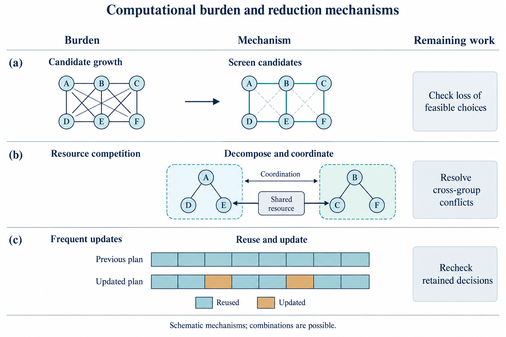

# 大型卫星星座智能运行管理中的规划与协同决策方法综述

Planning and Coordinated Decision-Making for Intelligent Operations Management of Large Satellite Constellations: A Review

**v3.5.3-CN · 2026-10-22 · 全文综述文体统一版；作者审阅稿**

## 摘要

大型卫星星座运行中，任务与资源安排随轨道演化、接近风险和执行状态而变化，形成了跨时间尺度的耦合决策问题。本文围绕业务与资源、轨道与安全、协同与执行三个决策领域，综述任务规划、构型维持、自主避碰及动态重规划的研究进展，梳理优化、启发式、学习与规则等方法的建模和求解机制。在此基础上，重点比较分别求解、分层协调与部分联合求解的适用条件，分析信息共享、决策权限和执行反馈对多星协同及业务恢复的影响。相关研究通过联合建模保留下游资源与业务机会对上游选择的影响；增量规划和局部修复则通过复用有效计划减少重复计算。各类方法的运行收益取决于决策耦合程度、求解时效及通信与协调条件。多星协同中的任务效率、共同控制可行性和碰撞安全具有不同的评价对象，机动后的安全状态、功能与资源可用、计划采用和业务满足也对应不同层次的结果。最后，结合数值研究与实际任务证据，讨论局部机制向大型星座运行迁移、连续执行安全验证以及共同条件下业务恢复效益评价等研究问题。

**关键词：** 大型卫星星座；智能运行管理；协同决策；任务规划；构型维持；自主避碰；业务恢复

## Abstract

Operations of large satellite constellations involve coupled decisions across multiple time scales as task and resource allocations change with orbital evolution, conjunction risks, and execution states. This review examines three decision domains: services and resources, orbits and safety, and coordination and execution. It surveys research on mission planning, formation maintenance, autonomous collision avoidance, and dynamic replanning, and analyzes the modeling and solution mechanisms of optimization, heuristics, learning, and rules. Building on this analysis, it compares the conditions for separate, hierarchical, and partially joint decisions, with particular attention to information sharing, decision authority, execution feedback, and service recovery. Joint models retain the influence of downstream resources and service opportunities on upstream choices, whereas incremental planning and local repair reduce repeated computation by reusing valid plans. Their operational benefits depend on decision coupling, solution timeliness, and communication and coordination conditions. Task efficiency, joint control feasibility, and collision safety address distinct outcomes. Similarly, an acceptable safety state, functional and resource availability, plan adoption, and service fulfillment represent different levels of recovery. Numerical studies and operational mission evidence are then used to discuss the transfer of local mechanisms to large constellations, safety verification over continuous execution, and the evaluation of service-recovery benefits under matched conditions.

**Keywords:** large satellite constellations; intelligent operations management; coordinated decision-making; mission planning; formation maintenance; autonomous collision avoidance; service recovery

## 1 引言

### 1.1 从任务调度到运行决策

卫星星座通过多颗卫星共同承担观测、通信等业务，其运行管理既涉及任务分配、活动安排和资源配置，也涉及执行过程中的状态更新与计划调整。大型分布式卫星系统的自动化运行研究已将排程、监测、配置和轨道管理视为相互联系的职责[1]。其中，规划与协同决策连接业务需求、系统状态和具体行动，是本文讨论的重点。

星座规模的扩大增加了任务分配的选择，也引入了更多跨星依赖。同一请求可以由不同成员执行，多个请求可能竞争同一卫星，多颗卫星还可能共享地面站和链路容量。因此，计算负担不仅与星数有关，也受请求数量、候选机会、资源竞争和更新频度影响。已有研究分别通过计划复用、几何邻域协调和网络表示复用减少重算、协商与构图工作[2–4]，其运行价值则取决于旧结果的有效性及协调后方案的实际采用。

观测与通信业务体现了不同的决策联系。观测任务包含成像、处理和下传，评价终点涉及产品质量与交付期限；通信业务需要随需求和覆盖变化调整用户关联、无线资源及数据路径，关注时段内的需求满足、吞吐、时延和中断。部署、补给及维护又改变可用成员和资源条件[5]。当故障或通信机会失效时，调整范围、替代措施与修改权限随之成为规划的一部分。

轨道动力学使这种联系进一步延伸到任务机会与安全条件。Błażejczyk和Zagórski的三星算例显示，直接受到碎片威胁的成员需要另一成员配合让出机动空间[6]；低推力重构则可以根据地面目标需求改变后续观测条件[7]。S-NET规划和NanoFF运行报告还分别揭示了姿态与可用时段、导航等待和执行修正的限制[8,9]。由此，星座运行既包含给定轨道上的任务安排，也包含通过构型维持、需求响应和安全处置改变未来机会的决策。

这些研究将算法求解、方案采用与业务结果联系起来，也显示了三者之间的差别。生成满足模型条件的候选方案，并不直接意味着相关节点已经采用，更不直接给出最终服务绩效。本文据此聚焦大型卫星星座的规划与协同决策，按状态输入、可行性条件和执行反馈使用感知与底层控制研究，保持对业务持续性及恢复结果的关注。

### 1.2 已有综述与本文的研究定位

卫星调度综述为问题建模和求解方法提供了系统基础。Wang等梳理敏捷观测任务的模型、约束及算法[10]；Ferrari等按成像、通信和集成安排组织卫星调度，讨论交付、共享与动态重排，其作者稿将轨迹和构型设计排除在范围外[11]。因此，跨环节收益和状态变化已经进入调度研究。本文在这一基础上，进一步分析轨道可调整时任务窗口、资源承诺和业务目标之间的联系。

分布式空间系统和自主运行综述则更多关注运行组织。Jabbarpour等从智能体、组织、通信与任务职责展开分类[12]，Thangavel等讨论信息可得性、计算通信能力及星地监督关系[13]，自动化运行综述将规划、执行、监测与工具联系起来[1,14]。这些工作为理解多星协同提供了依据，也引出了信息内容、修改权、批准权与方案实际生效之间的区别。

轨道与系统优化研究构成另一组相关文献。CAMmary按风险模型、数值方法、操作约束和多次接近分类避碰机动设计[15]；Singla等讨论运行与网络管理的集成、协调和自适应组织[16]。Yang等2026年进化计算综述的公开摘要涵盖星座设计、重构、任务调度及测控调度[17]。本文仅依据其摘要确认这些主题，不据此判断正文对联合优化的讨论深度。

本文以决策耦合及运行条件作为比较视角：任务、资源和轨道变量在何种条件下适合分别求解、分层协调或部分联合求解，这些组织方式又如何影响安全、资源代价、执行时效和业务恢复。任务响应重构、差异阻力、观测—传输联合安排及避碰—保持提供了不同的耦合实例；终态、连续执行与实际任务证据则用于界定这些比较的有效范围。表1概括已有综述与这一视角的联系。

**表1 已有综述与本文运行决策比较的衔接**

| 已有主题 | 代表来源 | 提供的基础 | 本文比较的运行关系 |
|---|---|---|---|
| 观测与卫星调度 | [10,11] | 模型、求解、集成交付与动态安排 | 轨道调整后窗口、承诺与任务价值的联系 |
| 分布式空间系统 | [12] | 智能体、组织、通信及任务职责 | 信息内容、修改权限与共同决定的生效 |
| 自动化运行 | [1,14] | 规划、执行、监测及工具 | 方案形成、实际采用与结果确认的条件 |
| 网络与资源管控 | [18,19] | 通信业务及资源优化 | 业务传输、数据交付和决策交换的不同约束 |
| 运行与网络集成 | [16] | 统一任务表达及交互组织 | 层间变量固定、反馈与共同选择 |
| 可信自主运行 | [13] | 人机监督及信息、资源与责任条件 | 对照案例中的实际计算、批准和执行分工 |
| 空间物流 | [5] | 部署、补给与服务资源 | 能力到位、任务重分配与服务接续 |
| 避碰机动设计 | [15] | 风险、机动、操作条件与多事件分类 | 机动目标、路径条件及后续业务的分别确认 |
| 进化计算与系统优化 | [17] | 摘要确认设计、重构、任务及测控调度范围 | 本文比较决策耦合条件与实际恢复；摘要不足以支持正文级排他判断 |

全文围绕一个核心问题展开：大型卫星星座如何在轨道动力学演化、空间安全、任务需求及资源状态变化下形成并协调运行决策，维持或恢复业务能力。业务与资源、轨道与安全、协同与执行构成三个相互联系的决策领域。本文的分析价值在于比较具体决策关系及其适用条件，不依赖对邻近综述作排他性的覆盖判断。

### 1.3 研究边界与证据使用

本文采用问题导向的叙述性综述。规划指任务、活动及必要后续行动的选择，调度进一步确定执行成员、时间和资源，协同决策处理多个主体相互影响的选择。智能运行管理涵盖利用目标、状态、模型和规则形成及更新决定的过程，既包括优化和启发式，也包括学习与规则方法，其含义不限定为神经网络或无人监督的星上执行。

文献选录以既有主题来源库和参考链追溯为入口，结合来源登记、定向阅读笔记、论点定位及章节采用记录开展。选录重点是能够解释决策形成、耦合、协调、采用或恢复的研究，尤其关注独立机制、同条件对照、关键反例和具体运行事件。任务资源、构型维持、风险决策与运行反馈共同纳入，是因为它们会改变业务活动的机会、允许动作及完成条件。

不同来源承担不同证据职责。方法细节与性能判断主要依据实际取得的原始研究正文，综述用于定位和分类，官方流程与接口资料用于解释职责、承诺及事件定义。后两类资料不作为算法优越性的证据。同一论文的版本合并识别，同一飞行任务的报告按功能和阶段互补使用，引用数量不等同于独立验证数量。稳定来源ID、实际版本与原文定位用于区分原作者结果和本文综合。

单星、地球静止轨道（geostationary Earth orbit，GEO）、小编队和通用多智能体研究能够解释部分规划与协调机制，本文在相应动力学、信息和控制条件内使用这些证据。目录对象数、主动控制成员数与请求负载分别反映不同的规模，“大型”不设统一星数门槛。部署与补给用于说明能力到位，底层控制用于提取动作、占用和保证条件；轨道控制、异常检测及网络协议的全部研究不在本文范围内。通信则按用户业务、数据交付和决策信息交换三种职责讨论。

来源可得性限制了覆盖与比较强度。作者稿、接受稿和正式版按实际取得版本解释，图号和结论与相应版本对应；仅有摘要的来源用于主题定位。本研究未形成可复现的统一数据库检索式和完整排除流程，因此不主张检索的穷尽性，也不对异质实验进行统一性能排名。

下文首先定义决策对象和比较基础，随后讨论规划、求解与协调机制，再综合分析决策范围、信息条件、方案采用及验证结果，最后归纳现有认识与研究问题。

## 2 智能运行管理中的决策问题与比较基础

### 2.1 任务、资源与轨道状态及决策变量

运行规划的变量由任务描述和模型表达共同确定。对地观测请求通常包含目标位置、观测要求、优先级和期限，给定轨道后可计算满足观测几何的时间段。几何可见性为活动提供候选机会，姿态转换、载荷能力、能源和存储进一步限定其可行性。

当成像时长已知时，决策包括执行卫星、候选窗口、开始时刻及活动顺序；同星连续活动还受到姿态转换时间约束。模型可以直接枚举开始时刻和时长，也可以将时间或持续时间作为变量。前一种表达主要选择候选活动，后一种还要求求解相应连续取值，两者对应不同的决策空间。

观测后的处理与下传使任务选择受到下游资源影响。图像占用存储，处理消耗计算能力和能源，下传受到星地接触及接收容量限制。共享地面站引入跨星时间和数据量竞争，按期交付则将这些活动连接为完整任务链。通信业务的对应变量包括服务卫星、无线资源与路径，并随用户需求、覆盖和容量变化更新。

动态运行还引入已执行事实和资源承诺。已完成成像成为后续规划的固定输入，已分配容量限制新增请求[20]，激光建链时延限定新路径的可用时刻[21]。这些条件共同说明，数学模型中的可调变量与运行中的修改权限具有不同含义：前者描述允许搜索的选择，后者决定哪些安排可以撤回、批准或执行。

轨道状态既可作为规划输入，也可通过机动改变。轨道根数、相位和相对几何限定未来观测与接触，推力、推进剂、姿态、电池及动作时段限定可用控制。低推力任务响应[7]把目标需求引入轨道候选，差异阻力规划[8,22]将发电和运行可用性引入动作选择。正常维持、需求驱动重构与具有风险时刻的安全处置由此表现出不同的触发条件和响应期限。表2归纳各类决策的输入、变量及后续接口。

**表2 运行决策的输入、决定及结果交接**

| 决策职责 | 已知条件或状态输入 | 决策变量或行动 | 结果及交接条件 |
|---|---|---|---|
| 任务与活动规划 | 请求、候选卫星、窗口、时长及已有计划 | 请求接受、执行成员、开始时刻及顺序 | 活动及资源约束满足，相关节点采用安排 |
| 资源配置 | 能源、存储、计算和通信状态及需求 | 活动资源分配及额度 | 额度和占用更新，配置实际生效 |
| 变化后的调整 | 故障或新请求、已执行前缀、可用替代活动 | 保留、推迟、取消、转移任务或扩大重规划 | 原安排撤回条件满足，替代安排无冲突 |
| 恢复行动选择 | 经确认的异常事实、允许行动及前序行动结果 | 后续恢复措施或退出动作 | 措施执行成功或失败，状态可供后续规划使用 |
| 多星协调 | 任务归属、报价、资源承诺及消息时序 | 任务资源归属及冲突重新协商 | 各参与节点的相关决定一致 |
| 决定采用 | 候选计划、当前状态、授权和生效时限 | 批准、拒绝、重新计算或维持仍有效的安排 | 执行系统采用版本及后续实际结果 |
| 构型维持与重构 | 当前轨道、相位、目标几何、摄动预测和控制能力 | 调整成员、时刻、目标位置与动作 | 构型偏差、到位时间、控制代价及转移安全 |
| 接近风险处置 | 预测接近、状态不确定性、更新时间及动作余量 | 等待更新、安全措施与承诺时刻 | 风险定义下的约束、次生接近及执行可行性 |
| 机动后恢复 | 实际轨道、功能、剩余资源及未完成需求 | 返回、保持新轨道或转入任务可接受轨道，并重分配活动 | 后续风险、服务满足、恢复时间和成本 |

轨道候选的比较涉及状态及不确定性的有效时刻、机会变化、动作占用、终态偏差和路径约束；业务评价则对应交付期限或时段服务要求。安全达到、能力确认、计划采用和业务满足形成不同的恢复终点，为第4章的耦合与恢复分析提供基础。表2是本文对职责的归纳，各来源按其实际覆盖的环节使用；恢复行动选择以已确认事实为输入，故障检测器本身的全面比较不在本文范围内。

图1概括观测、通信与共享资源的功能联系，轨道调整对机会和动作占用的影响在第3.6节进一步讨论。

图1 观测与通信业务及共享资源示意。观测按产品交付、通信按给定时段的服务指标评价；箭头表示功能联系。

### 2.2 决策方法、计算位置与权限

不同方法通过不同机制形成候选。优化模型以变量、约束和目标表达选择，启发式通过追加、插入、删除或交换构造和改进计划，学习用于预测需求、选择搜索操作或提出活动，规则推理则依据事实及预设条件选择策略或行动。它们能够组合，但预测、候选计划与执行指令在组合中仍承担不同职责。

计算组织与决策权限同样需要区分。管理拓扑和跨星分配研究[2,3,23]涉及计算如何分布，机动责任、批准权和执行权则由运行规则决定。地面节点能够生成待批计划，星上节点可以在授权范围内局部调整，分布式算法也可能由地面用户运行。CARA的机动再筛查[24]及共同策略下的半分散执行[25]分别体现了检查流程与执行分工。

联合建模、分解求解与滚动更新描述的也是不同维度。联合建模规定共同选择的变量，分解规定计算拆分方式，滚动规划规定新信息进入的时机，三者可以同时存在。其联系取决于哪些决定暂时固定、反馈能否重新开放变量，以及候选如何经过检查和授权转为实际配置。

### 2.3 两个说明情景：载荷不可用与避碰后任务接续

载荷异常与轨道机动提供了两类不同的计划更新情景。以下均为本文构造的说明示例，其环节分别对应已有来源，不构成新增实验或某个在轨系统的整体描述。

第一种情景中，一颗观测卫星的载荷暂时不可用，存储和通信仍可工作，原计划还占用若干地面站时段。尚未采集的请求失去原执行条件，已存储图像及其下传却可能继续保留。期限、替代窗口和预约可撤回性共同限定推迟、转交或取消活动的选择。任务与资源调度形成具体安排，故障处置规则及修改权限限定调整范围；接替节点接受任务、旧资源释放和消息更新则决定安排何时生效。

第二种情景中，一颗观测卫星收到新的潜在接近信息。几何提示经过风险判断后，等待更新与采取措施成为不同候选行动，其适用性受剩余时间和权限限制。机动后的新轨道改变未执行成像及下传机会，因而可能引出返回原轨道、维持任务可接受的新轨道或转移请求等选择。载荷正常并不保证原时间表有效，其他成员的业务接续也可能早于原轨道恢复。

两类情景的共同点是，状态变化通过活动机会、资源承诺和执行条件影响后续业务；差别在于前者主要改变可用功能，后者还改变几何和安全条件。设备处置、计划采用与产品交付因此具有不同的评价终点，第4.4节据此分析恢复过程。

### 2.4 评价对象与证据范围

业务评价取决于成功事件和统计分母的定义。观测中接受请求、成像、下传与合格产品交付是不同事件：[26]以观测和传输按期共同完成计请求收益，[27]分别计算观测收益与下传体积。通信评价对应给定用户集合和时段，既包括已服务性能，也包括未满足需求。Planet接口对订单接受、采集和交付的区分[28]提供了业务事件定义，成功子集的平均时延则仅描述部分结果。

计算成本包括准备、训练、在线求解、协调和配置采用。阶段重叠时，事件时刻比简单相加更能反映完整响应；未报告的成本仍是缺失项。可行解、松弛界、最优解与超时反映不同求解状态，星数、任务量、候选连接及竞争范围也分别代表不同规模维度。

安全评价还依赖事件和时间范围。瞬时碰撞概率与轨道框机会约束[29]、失控后规定窗口的分离[30]具有不同语义。最近接近时刻（time of closest approach，TCA）、最近距离、风险量和业务交付分别描述几何、风险或服务结果；状态与协方差来源、控制能力及误差条件共同限定解释范围。终态、路径和节点间要求在第4.4.3节进一步比较。

证据范围由模型性质、完成的运行步骤和验证平台规模共同确定。静态求解、循环重规划、地面原型和飞行事件能够回答不同问题，未采用计划、失败恢复、取消请求及安全退出也是运行结果的一部分。以这些区别为基础，才能比较一种方法节省了什么工作、完成了何种功能，以及业务是否得到改善。

## 3 规划、求解与协同决策方法

规划与协同方法可以从候选形成、状态更新和主体间协调三个方面理解。优化、启发式和学习决定如何构造及改进候选，多星组织与信息交换处理相互影响的选择，状态驱动机制将执行结果带入后续安排，轨道方法则进一步改变未来任务机会。以下按这些作用讨论具体机制，第4章再比较其运行适用性。

### 3.1 优化建模与分解求解

优化模型通过变量、约束和目标将运行需求转化为候选选择。任务接受和成像选择常用二元变量表示，活动开始时刻及处理、传输容量则可由时间与资源变量描述。变量范围决定模型保留哪些联系，分解和近似方法进一步决定这些联系如何参与求解。

轨道成员分配与能源感知调度体现了不同的建模侧重。Wang等先根据相对轨道根数构造单星脉冲转移代价，再比较初始成员与终态位置的对应关系[31]，将成员指派与转移代价相连；其四从星、开放时间算例未检验大规模组合分配，转移时限与全程安全还需执行模型衔接。Seman等则以混合整数线性模型描述光照、工作消耗及电池变化，包含单星、多星共同参与和冗余执行任务[32]。ε约束方法将部分目标转为给定水平的约束，再调用Gurobi考察权衡，1—5星实验验证了所设能源与任务选择的联系。

序列与时间表达还影响最优性结论。Lemaître等将候选图像和离散开始时刻组织为动态规划状态[33]，在图像顺序预定、收益线性及去除立体成像约束等条件下求得受限问题的最优解。约束规划通过赋值和约束传播排除不允许的图像及时间组合，处理的约束范围与受限动态规划不同。因此，两类方法的最优性首先对应各自模型，不能直接外推到相同的完整观测问题。

跨环节建模的差异可由观测、传输与处理研究说明。He等以观测和传输共同完成作为请求获益条件[26]，在作者稿中通过窗口关联和时间安排使下传影响观测选择，3颗观测星、12小时仿真基于无误码传输及简化图像质量条件。Soret等则固定当轮采集，配置下游处理负载与处理器频率[34]，利用时间约束消去频率后求解剩余变量。前者保留上游活动与交付机会的反馈，后者优化给定采集后的资源配置；固定流水线、稳定链路和平均处理时间约束也限定了后者对逐请求交付的解释。

分解还可以作用于候选生成。云覆盖不确定性研究以一条轨道段内的观测序列为列，主问题选择已有序列，动态规划产生能够改善当前目标的新列，最终求解已生成候选上的整数问题[35]。这种列生成启发式减少了初始枚举，但完整整数问题的全局最优性仍取决于候选完整性与终止状态。单星波束—功率研究则按时隙先选择服务区域，再固定选束结果优化连续功率[36]；功率改变当轮传输量，并通过剩余需求影响后续时隙。

这些例子表明，扩大共同决定的变量与改变求解组织是两类不同操作。联合问题可以由分解或近似方法求解，分阶段方法也可以保留跨时域反馈。模型的决策能力由开放变量及约束确定，系统中的可撤回承诺和修改权限则进一步限定这些候选能否进入执行。

### 3.2 启发式构造、局部搜索与混合求解

启发式通过活动构造和邻域修改控制组合搜索的负担。对观测序列，追加或插入请求时检查姿态、时间及资源衔接，增加、删除和交换活动则形成局部改进。方法之间的区别因而不仅是算法名称，也包括每次开放的活动、连接和时间变量。

Lemaître等的贪心方法沿轨道段追加可衔接图像，并估计后续机会价值，局部搜索通过插入或删除改变序列[33]。与动态规划相比，这些方法在搜索机制之外还采用了不同收益和约束，性能差异需要放在相应问题定义内解释。

图结构和局部整数规划提供了另一种混合方式。Rocha等的机构工作论文以图描述活动及衔接，同时考虑观测、下传、能源和存储[27]，通过连接缩减、整数模型简化和局部混合整数规划控制规模。邻域内仅开放部分活动或连接，其余暂时固定。连接删减对可行顺序的损失、姿态转换等约束是否仍有效，以及观测收益与下传体积的分别计奖，共同限定了结果的含义。

分层搜索也能保留联合选择。He等由外层遗传搜索选择观测—传输窗口关联，内层经半定松弛、随机化和可行性调整形成具体时间安排，再将结果反馈给外层[26]。这种计算分层与先固定观测、再独立安排下传不同，上下游的相互影响仍参与候选评价。

除减少搜索外，复用中间表示也能减少在线工作。Handley在没有直接星间链路的地面中继网络中，按地理分块限制候选，并保留网络图、更新连接代价[4]。其节省来自减少重复构图，效果依赖连接变化能够及时进入更新，与缩小可行域或改变搜索算子具有不同机制。

因此，启发式在运行管理中可以承担候选生成或局部改进，其结果仍由具体约束处理和后续检查限定。规则、安全检查与搜索能够组合，但信息和约束须在各环节实际传递；局部优化器的最优性也仅适用于相应邻域，不能替代整个搜索流程的全局结论。

### 3.3 学习辅助搜索与活动选择

学习在运行决策中的作用包括预测、搜索控制和动作选择，三者输出不同的对象。流量预测研究在合成序列上评价估计误差[37]，为资源策略提供需求输入；预测如何影响调度及服务仍取决于后续策略，误差改善本身尚不足以给出吞吐或恢复收益。

轨道安全研究也体现了分析与行动的区别。接近数据消息（conjunction data message，CDM）事件剪枝通过特征处理减少后续分析事件[38]，风险预测竞赛评价给定评分条件下的预测[39]，两者均不直接生成控制指令。这一位置的学习主要影响分析负担及事件保留，后续风险判断和动作选择另有模型与流程。

学习辅助搜索保留了传统求解器的活动构造职责。Song等的RL-GA利用Q-learning依据适应度改善选择交叉、变异或组合操作，再通过窗口选择和解码得到计划[40]。学习决定搜索操作，解码负责安排的可行性。其两颗卫星、不同任务数量的实验扩展的是请求负载，完整计算还包括解码与约束处理。

策略复用则尝试将单星学习结果用于多星组织。Herrmann等先以单星环境中的蒙特卡洛树搜索获得状态—动作评价并训练神经策略，再与上层目标分配、动作屏蔽及完成状态共享组合[41]。目标归属、局部活动和允许动作分别由这些环节处理，完成状态的消息滞后仍可能带来同时竞争。其4—40星实验检验了组合方案；上层整数模型没有联合描述下层全部资源动态，离线训练及预处理也参与完整成本。Basilisk共同仿真[42]为比较策略与安全动作处理提供条件，局部推理时间则只对应其中一个阶段。

多智能体标签还需要结合实际决策主体理解。Ngo等以地面覆盖小区簇作为智能体，学习波束激活、频段和功率，用奖励惩罚处理过量干扰[43]。智能体数量对应小区簇而非卫星，奖励惩罚也未给出逐动作的硬约束保证。策略输出进入实际配置时的权限和检查条件，仍属于运行组织问题。

学习策略之外的独立屏蔽进一步区分任务收益与安全作用。Stephenson和Schaub依据相对轨道动力学修正巡检脉冲，使候选与已有安全轨道及异步更新条件相容[44]。双星仿真的安全结果由策略、屏蔽与更新协议共同产生，不能仅归因于学习本身。表3据候选形成机制概括代表研究，更新与协同条件在后文展开。

**表3 代表规划与求解方法的作用机制**

| 代表研究 | 输入与决策变量 | 形成候选的方法 | 模型及验证范围 |
|---|---|---|---|
| 能源感知调度[32] | 任务与光照给定，选择各星任务 | 混合整数规划及多目标权衡 | 1—5星；可行解、间隙和最优性区分 |
| 观测序列优化[33] | 图像及时间条件给定，选择序列 | 动态规划或约束规划 | 受限模型和完整模型不能混用 |
| 贪心与局部搜索[33] | 构造或修改成像序列 | 追加、插入或删除 | 收益与约束范围不同 |
| 联合观测—传输[26] | 窗口、权重与期限，决定关联及时间 | 遗传搜索与内层近似优化 | 固定实例、质量及传输假设 |
| 集成观测—下传[27] | 活动图与资源，选择活动及顺序 | 图缩减与局部整数规划 | 简化可能丢失选择；双奖励分别解释 |
| 处理配置[34] | 采集已定，配置负载与频率 | 变量消元与资源优化 | 平均时间约束，不回改本轮采集 |
| 学习辅助搜索[40] | 搜索状态，选择遗传操作 | Q-learning辅助搜索 | 解码负责可行性；两星负载实验 |
| 策略复用[41] | 单星状态与目标分配，提出动作 | 策略、屏蔽及状态共享 | 上层分配与通信贡献须分开 |

### 3.4 多星协调、信息交换与修改权限

多星协调首先涉及任务及资源归属。一致性任务包拍卖（consensus-based bundle algorithm，CBBA）由各主体计算边际收益、构造任务包，再交换赢家、报价和时间戳处理重复占有[45]。任务的加入顺序与执行顺序不同，失去较早加入的任务时，依赖其报价的后续任务需要释放并重算。评分与通信假设限定原研究的收敛和价值结论，机器人验证与轨道执行条件仍有区别。

分散计算也可由用户或局部邻域承担。Krigman等以用户为智能体、请求为变量，将观测机会或不执行作为取值，用分布式局部搜索处理重叠与容量冲突，并按原流程处理剩余冲突[46]；卫星是执行对象，计算主体并非由此成为星上节点。Zilberstein等则按观测竞争的几何邻域缩小直接协商范围[3]。这种分解依赖邻域覆盖相应竞争，加入共享地面站及交付容量时，跨邻域联系会成为额外协调条件。

通信资源研究通过层间分工限制局部变量。分层管理由上层确定服务区域和频谱，局部节点选择波束、时隙与信道[47]；需求感知配置将全局选束与给定选束下的星内功率调整分开[48]。时延通信规划[49]和异步任务分配[50]进一步刻画消息条件，但其一般多智能体环境与在轨实现具有不同验证范围。

轨道协同还涉及共同计划与分散执行。Kim等先离线生成双主动星联合策略，再在预测地面接触机会同步信息，各星依本地状态概率估计选择动作[25]。共同策略与共享初始估计支撑了半分散组织，传输及地面协调在模型中合并为理想同步事件。Pippia等的重构研究又区分邻星当前状态和上一时刻整段预测轨迹[51]。这些研究说明，信息内容、获得时刻与共同策略同样影响协同，任意时延或丢包下的安全不能由理想同步直接推出。

控制屏障函数（control barrier function，CBF）和运行时保障（run-time assurance，RTA）将协调延伸到控制修正。名义计划提出动作，过滤器在安全条件内调整输入。Parikh等指出多服务模块约束与执行器限制可能导致无可行输入，估计状态下增加协方差缓冲也未保留原确定性保证[52]。Dunlap等的集中与分散实现均取得全部成员状态，差别在于能否共同选控制，其失败涉及互相观测时的太阳或传感器视线禁入冲突[53]。因此，状态可得性、控制责任和共同可行性分别决定不同性质，约束违反也不均指实体碰撞。

更新协议可以保留特定安全备选。Stephenson和Schaub要求已有轨道被动安全，每次只允许一颗服务星更新，从而使取消该次脉冲仍保留原安全轨道[44]。其安全作用部分来自顺序协议及其他成员已知动作；同时机动或通信受损改变这些前提时，原保证的适用性也随之变化。

任务归属、资源承诺与控制轨迹因而构成不同协调对象。完成状态、计划和承诺消息描述的内容决定更新会影响哪些节点，修改权及接管条件则决定这些结果如何生效。第4.3节在具体对照和运行事件中进一步分析这一联系。

### 3.5 状态驱动的策略选择、计划修复与恢复行动

#### 3.5.1 状态估计与规划策略选择

状态信息除了改变规划输入，也可改变求解策略。He等预测单颗敏捷卫星的电量、数据与存储，再用规则调整目标权重，在偏向观测、下传或能源的策略之间选择，随后构造活动[54]。状态估计改变搜索偏好，活动安排及约束处理仍由后续过程完成。

这一机制与学习选择遗传算子[40]都作用于规划策略，但依据分别是预设规则和学习得到的操作选择。它们与直接提出执行活动的策略具有不同输出，体现了状态信息在策略选择、活动构造和可行性处理中的不同位置。

#### 3.5.2 滚动规划、增量更新与局部修复

滚动与增量方法利用运行中的新信息更新已有安排。滚动时域以周期或事件触发规划区间更新，再安排等待及新到请求[55]；增量方法保留未受影响活动，移除撤回请求并插入新请求。Parjan和Chien在100星、一周规划时域的仿真中采用后者[2]，共享状态参与分配更新，但仍存在重复观测，其并行时间来自单线程运行的估计。

不确定性处理与执行中的调整又有不同的信息结构。鲁棒观测通过区间和预算参数保护收益偏差[35]，GEO加注以预算不确定集处理历时偏差[56]，二者在计划阶段使用预先给定的偏差集合。天气情景模型则区分两阶段的共同预定观测和三阶段在中午获得信息后的后半日调整[57]。情景数量本身不产生改排能力，信息揭示时刻及允许变化的后续变量才描述了这一能力。

局部修复还可保留任务指派而改变执行路径。Lowe等逐请求搜索采集—交付路径，接受请求后扣减容量并保留承诺，原路径失效时重新选择后续转发[20]；其能源和存储设为无限。动态激光链路进一步以建链时延描述换路代价[21]。两类机制分别改变剩余路径和连接安排，其作用范围与任务重新采集或跨星转交不同。

#### 3.5.3 恢复行动选择与执行反馈

恢复规则连接异常事实与允许行动。Wanninger的故障检测、隔离与恢复（fault detection, isolation and recovery，FDIR）地面原型将参数和事件转为故障事实，按规则选择互斥恢复措施，再展开为执行操作，前序行动结果决定后续选择[58]。Remote Agent则把任务资源规划、运行执行和诊断模式信息相连，使局部处置能够触发必要的规划更新[59]。两者分别提供地面特定故障与单航天器环境中的反馈机制。

编队恢复进一步涉及角色和允许模式。VISORS的发射前双星软件在环设计将故障响应与主动或被动角色切换、待命和逃逸相连，导航状态进入无控分离预测[60]。新的角色、模式及行动结果改变后续活动条件，也构成规划层接收恢复反馈的具体内容。表4概括不同状态更新方法所修改和保留的对象。

**表4 状态变化后的决定及其实际修改范围**

| 机制与来源 | 使用的信息 | 保留或固定的内容 | 输出与反馈 |
|---|---|---|---|
| 策略推理[54] | 预测资源和子系统限制 | 给定任务与规则 | 目标偏好，再构造和检查安排 |
| 滚动安排[55] | 新请求及更新状态 | 已执行活动 | 新时域安排 |
| 增量规划[2] | 请求激活、撤回及共享状态 | 未受影响的计划 | 更新分配，检查重复与冲突 |
| 鲁棒安排[35,56] | 事先给定的偏差集合 | 计划阶段信息 | 满足所设保护条件的候选 |
| 天气信息后改排[57] | 中午的新天气信息 | 前半日活动 | 三阶段模型重排后半日 |
| 局部路径修复[20] | 原连接失效及后续机会 | 原采集指派 | 后续转发路径及交付情况 |
| 恢复规则[58] | 异常事实及前序行动结果 | 规则和允许措施 | 下一恢复行动及效果确认；地面原型 |
| 规划—执行—诊断衔接[59] | 任务、模式及执行状态 | 已完成活动和当前约束 | 局部处置或重新规划；单航天器环境 |
| 编队模式及角色切换[60] | 故障响应、导航及无控分离预测 | 允许模式和当前执行能力 | 新角色、待命或逃逸及后续状态；双星软件在环 |

这些方法共同保留了已执行事实，调整仍可改变的部分。载荷状态主要改变可用活动，轨道状态还改变未来窗口和控制条件。功能处置与任务恢复由此存在联系，也保持各自的结果定义；第4.4节进一步讨论其业务含义。

### 3.6 轨道构型维持与自主避碰决策

#### 3.6.1 轨道构型演化、维持与重构

构型研究包含长期设计、正常维持与需求变化后的重构。部署感知设计描述初始配置的形成条件[61]，维持和重构则根据当前状态、目标几何及可用动作调整成员。相同终态构型对应不同成员分配和转移代价，解析相对轨道转移模型为上层指派提供了代价输入[31]；开放时间脉冲结果与有时限、控制界及全程安全的执行仍有不同条件。

科学任务使构型目标具有特定测量含义。Leroy等为内重力波层析探测设置略有倾角差的立方星，以展开两个水平方向的掩星采样，但J2摄动也使各星节点退行速率不同，匹配平均运动尚不足以保持构型[62]。其维持规则按升交点赤经（right ascension of the ascending node，RAAN）偏差触发，在最大、最小纬度附近安排成对机动。最大加速度限制可维持分离，总速度增量Δv预算限制寿命，观测几何、摄动和控制能力因而共同进入理论及仿真模型。

差异阻力通过姿态改变迎风面积，也改变发电与任务可用性。Kim和Yoon共同描述阻力及发电投影面积，按电池和日照在调相、充电间切换，其验证单元是两星关键星对[22]。S-NET规划将通信、值守等活动归入运行可用率，多个星对共享参考星时，以启动延迟同步高低阻力切换[8]。后者对应规划和未来演示建议，尚非该新序列的在轨控制结果。

需求响应重构则主动改变后续机会。McGrath和Macdonald产生升降轨、滑行及恢复组成的低推力候选，按响应时间、控制代价和地面目标距离选择成员[7]。24星案例将轨道选择与业务目标联系起来，同时显示燃料均衡增加总控制代价和时间，恢复全局观测模式也未完全恢复原轨道面内几何。任务机会、成员消耗及保留偏差反映了不同结果，单项平均覆盖不足以概括这种权衡。

构型重构的信息与层次组织同样影响解释。Pippia等以模型预测控制（model predictive control，MPC）比较邻星当前状态和预测轨迹，在部分成员离轨后的35星模型中恢复等间隔构型，但未加入避碰约束[51]。Pedari等分层处理构型、指派、轨迹和接管，10星闭环仿真与50星指派计算检验不同功能，终态通信可靠性也未在转移全程强制保持[63]。信息交换、终端要求及验证环节因此需要共同说明其规模意义。

#### 3.6.2 接近筛查、风险评估与安全行动选择

接近处置由几何候选逐步进入风险和行动判断。筛查产生需要复核的对象或事件，TCA与最近距离描述预测几何，风险评估结合状态不确定性分析碰撞可能性。NASA CARA将接近提示、风险评估和缓解规划分别组织[24]，表明几何接近、风险达到处置条件及实际机动是不同事件。

几何计算主要减少定位和候选处理负担。Denenberg用Chebyshev代理多项式定位TCA及距离，其接受稿以SGP4传播评估[64]；Saingyen等结合多级筛查、CUDA计算和内存组织减少精算候选[65]。传播模型、步长或分段、阈值及复核参照限定了这些计算结果。相同输入下的算法距离一致性说明几何计算的一致程度，真实轨道误差和风险校准则属于其他证据环节。

学习分流进一步作用于已有CDM事件。Henry等通过降维、聚类与投票剪除部分低风险事件，其输出不包含机动，训练集危险事件浓度条件也未给出测试集假阴性上界[38]。ESA竞赛显示评分、稀有事件采样与接近前风险更新会影响预测评价[39]。因此，这类方法的运行作用主要表现为分析负担与事件保留，后续风险判断仍依赖更新信息和适用模型。

风险定义还随时间范围变化。Wen和Qiao在固定初始误差空间计算给定时间段的碰撞事件，避免同一偏差轨迹重复计入，其数值方法仍受随机变量维数和线性确定性动力学限制[66]。长期机动采用的瞬时概率[29,67]和多次接近在不相关事件假设下组合的风险[68]具有不同事件语义。逐节点瞬时概率与全时段累计概率之间不能直接替换，阈值也需要与原定义相对应。

风险更新影响等待与提前行动的权衡。CARA讨论提前机动的燃料机会、风险随新信息下降的可能性及承诺前再次判断[24]。等待的意义因而依赖剩余处置机会，风险信息时效、动作能力与任务期限共同限制行动选择。具体触发与批准规则随任务确定，本文按各研究的既定条件比较行动，不设置统一机动阈值。

#### 3.6.3 避碰机动及机动后构型与任务恢复

机动研究通过不同控制变量和恢复目标连接安全与后续运行。Pavanello等针对既有低推力轨迹改变关机时长、控制矢量偏差或方向夹角，部分策略以终端软约束接回名义轨迹，关机策略的后续恢复求解则不在该文范围内[69]。长期避碰—保持模型将轨道框和名义状态目标接入连续控制，保持要求改变控制方向与代价[67]。软恢复残差、到位时间及控制消耗因此共同反映方案结果。

短时避碰可以通过终态条件接入保持。De Vittori等2025年作者稿反演碰撞概率条件为几何约束，以终态定点表达轨道保持[70]，路径保持的范围在第4.4.3节讨论。多次接近优化进一步以一次控制影响后续事件和风险预算[68]，但一主动星对多个被动目标的设置与多运营者责任协调不同。

多个主动成员会引入内外安全的共同约束。Błażejczyk和Zagórski在三星例中联合选择控制，同时施加碎片禁入、星间距离与终端构型条件，未直接受威胁的成员也可能参与调整[6]。预分配被动相对轨道走廊的MPC则将部分冲突前移至任务设计，其结构、采样和扰动条件限定了在线控制范围[71]。顺次加入约束属于最终方案的求解过程，不意味着飞行过程中允许先违反内部安全。

失控情景中的安全余量与恢复行动又有不同目标。被动安全规划在规定恢复窗口内保留无控漂移间距[30]，Scala等则在一星失控且告警可达时由健康成员转入安全螺旋构型[72]。前者支持等待接管，后者支持主动重构，功能和业务是否恢复仍取决于后续状态。表5按这些方法的产物及接口归纳轨道决策链。

**表5 轨道运行决策链中的方法产物与交接条件**

| 环节及代表证据 | 方法输出 | 后续接口 | 模型及证据边界 |
|---|---|---|---|
| 维持与调相[8,22] | 姿态、高低阻力及切换安排 | 能源、姿态可用性与共同切换确认 | 星对仿真与未来演示规划分开 |
| 重构及成员分配[7,31,51] | 参与卫星、目标位置、候选转移或相位控制 | 转移时限、控制界和全程安全检查 | 业务响应、代价计算和构型重构规模分别说明 |
| 几何筛查及TCA[64,65] | 候选对象、接近时刻及距离 | 状态不确定性和后续风险评估 | 几何结果不是碰撞概率 |
| 事件分流及风险判断[38,66] | 保留事件或给定定义下的风险量 | 更新信息、动作能力及触发规则 | 漏报、概率语义和时间范围分别说明 |
| 机动与保持[67,69,70] | 控制序列、终态及可能的松弛残差 | 实际执行、转移复核及新的任务机会 | 软恢复目标、终端满足与全程约束分开 |
| 多事件及多主动成员[6,68] | 多事件预算或联合成员控制 | 次生风险筛查、责任及方案共享 | 多被动目标不等于多主动运营者 |
| 失控分离与重构[30,72] | 安全漂移窗口或健康成员新构型 | 接管、功能确认及业务重排 | 安全状态不等于原功能或任务完成 |

轨道方法的产物既包含控制和终态，也包含适用时段、状态及约束前提。这些信息进入任务层后，才能用于判断旧安排的有效性、修改范围和后续业务机会，其采用与验证在第4章统一比较。

## 4 运行条件下的决策取舍、采用与验证

### 4.1 规模扩展中的计算减负与适用条件

规模扩展涉及成员、请求、候选机会、共享资源和更新频度等不同维度，相应减负机制也作用于不同计算环节。图缩减减少搜索连接[27]，几何邻域减少直接协商主体[3]，增量规划减少重复安排[2]。因此，局部求解加速与完整响应之间的关系，还取决于跨节点协调及方案采用的成本。

这些机制分别以候选筛选、竞争局部性和旧计划有效性为条件。删减连接可能损失可行顺序，跨邻域共享地面站或交付容量可能扩大协调范围，保留旧活动也可能限制新请求。计算节省与未满足需求因而共同反映减负效果，单独的重算比例不足以评价业务收益。

复用和预计算则将部分工作前移。网络图复用需要及时更新连接[4]，轨迹代价预计算受轨道、质量、时刻和终端范围限制[73]，学习策略的上层分配也依赖预先形成的可见机会[41]。准备结果的失效、更新和重建构成在线运行的一部分，局部推理或查询时间仅反映这些方法的部分成本。

轨道安全又包含筛查、几何精算、风险更新与机动再筛查。CUDA目录处理[65]改变候选生成及数据组织，CDM事件剪枝[38]改变后续分析对象，两者与观测排程减少搜索具有不同产物。传播、传输和精细复核，以及候选漏失条件，决定加速能否转化为可执行的安全处置。尚未建立无漏报条件的缩减，其速度优势本身不构成采用依据。表6和图2据此区分不同减负机制。

**表6 计算减负机制与运行采用条件**

| 主要工作 | 代表机制 | 适用条件 | 相关运行代价 |
|---|---|---|---|
| 候选与执行顺序过多 | 图缩减、局部搜索[27] | 可以识别可合并或可舍弃连接 | 候选损失、约束检查及计划质量 |
| 直接协商主体过多 | 几何邻域协调[3] | 主要竞争位于相应邻域 | 跨邻域依赖、消息及采用一致性 |
| 重复安排未变化任务 | 增量规划[2] | 旧安排在当前状态下仍有效 | 保留决定对新需求的限制 |
| 重复构建网络表示 | 图复用及边权更新[4] | 连接变化可被及时反映 | 失效检测、更新和重建 |
| 重复动力学计算 | 代价网格与插值[73] | 查询未超出模型和网格范围 | 离线计算、误差及轨迹复核 |
| 每次活动选择成本高 | 策略复用[41] | 输入及动作条件仍适用 | 训练、上层分配、屏蔽及协调 |
| 目录与事件分析负担 | 几何筛查与事件分流[38,65] | 阈值、时间步长及事件信息适用 | 候选漏失、传播、风险复核及响应时间 |

图2 计算工作及其减少机制。候选缩减[27]、局部协调[3]和计划复用[2]分别影响搜索、协商与重复求解；节点和计划条不对应实测数量，适用条件见表6。

### 4.2 任务、资源与轨道机动的决策耦合

决策耦合体现为一种选择改变其他选择的可行性或价值。给定轨道排程、先机动后重排和部分联合选择，分别固定了不同条件，也保留了不同反馈。它们之间的比较需要共同的业务目标、动作集合、安全要求和响应期限，额外开放的变量才有可解释的收益与成本。

#### 4.2.1 轨道调整与业务机会的双向影响

轨道与业务的联系具有两个方向：机动改变未来机会，业务需求也可参与机动选择。轨道根数、相位或构型变化影响观测窗口、覆盖和链路，其对既定计划的后果由变化时段、几何余量及期限限定。机会更新与全部任务联合优化仍是不同操作；当安全可行轨迹带来明显不同的后续机会时，业务目标才进一步影响轨道目标、成员及动作时机的比较。

需求响应重构提供了后一方向的直接例证。McGrath和Macdonald按响应时间、控制代价和地面目标距离选择低推力候选，其24星案例同时显示燃料均衡增加总控制代价和完成时间，平均覆盖改善也可能伴随部分位置重访变差[7]。这些指标解释了机会和成员消耗之间的权衡，逐请求按期交付则还涉及成像、处理及下传的具体安排。

科学测量对相对几何的要求进一步改变保持目标。内重力波层析需要倾角分离以展开采样，分离增大又带来差异节点退行和维持负担[62]。在原文的测量及定轨条件下，推进期间难以满足掩星测量的速度精度，较长点火占比压缩可用测量时间。因此，推进预算限定的维持寿命与有效科学测量时长是不同结果，保持策略、点火时机和业务安排之间存在实际权衡。

姿态与能源使维持动作直接占用业务条件。差异阻力的迎风面积变化同时影响发电，电量和日照参与调相与充电切换[22]；S-NET规划则以通信、值守等活动限定可用时段，并协调共享参考星的阻力切换[8]。两类机制将可执行性引入构型规划，但没有直接量化端到端业务收益。尤其是Kim和Yoon的A组比较，对基线施加了提出方法未采用的任务姿态限制，该组差异不能全部归于控制方法[22]。推进式避碰—保持中的终态或轨道框目标也会改变方向和代价[67,70]，控制消耗、占用及到位时间因而需要联系业务机会解释。

给定轨道的业务研究对上下游耦合提供了更直接的对照。He等在3星、12小时实例中，以观测和传输共同完成计收益并比较联合与分开安排[26]；Soret等固定采集后配置处理负载与频率[34]，Lowe等在接受请求时保留交付容量[20]。这些结果分别保留了不同的上下游反馈。将其用于轨道变化后的业务分析，可以由成功事件确定哪些上游选择仍值得开放，以及哪些已执行活动成为固定输入；这一轨道层扩展属于本文综合，直接验证范围仍对应各原模型。

#### 4.2.2 分层、分阶段与部分联合的适用条件

任务、资源与轨道机动的相互影响，使决策范围与计算负担之间形成权衡。相关研究既有保留既有计划的增量处理，也有开放更多变量的联合建模，以及按时间尺度和职责组织的分层方法[2,7,26,63]。这些方法的差异主要体现在固定哪些决定、保留哪些反馈，以及如何响应新的运行状态。因而，比较其适用性需要同时考察耦合关系、计划有效性和响应期限。

计划复用的依据是状态变化后仍然保留的可行性。以时间约束为例，设活动时长为$d_i$，原开始时刻为$s_i$，更新轨道后的可用窗口为$[a'_i,b'_i]$，且整个活动须位于该窗口内，则其时间窗余量可表示为

$$
m_i^{\mathrm{win}}=\min\{s_i-a'_i,\ b'_i-s_i-d_i\}.
$$

余量非负表示原安排仍满足这一窗口要求，负值则表示活动按原时刻执行已不满足窗口要求。若窗口给出的已是允许开始时刻范围，则直接判断$s_i$是否位于其中，无须再次扣除时长。由此，轨道变化的影响取决于既有计划的约束余量，并不能仅以统一的速度增量阈值衡量。能源、姿态、存储、传输、期限、安全约束及采用权限共同决定计划能否保留；上述余量只是其中一个条件。

增量规划与局部修复进一步利用受影响活动的局部性。Parjan和Chien[2]通过复用未受变化影响的安排处理请求更新，Lowe等[20]则在保留采集指派和已分配容量的基础上调整后续转发路径。综合这两类机制，局部调整的范围不仅涉及失效活动，还涉及采集、处理和下传的前后继，以及共享资源的竞争活动。已执行事实和不可撤回承诺构成固定部分，修改部分与保留部分之间的容量、时序关系限定了可行邻域。当影响能够限制在这一邻域内时，局部修复具有减少重复求解的基础；跨星资源依赖扩大时，其计算优势与受限的任务选择之间则需要重新权衡。这里的范围划分是依据已有约束关系作出的综合，尚无跨任务通用的触发阈值。

局部修改与扩大重规划也可形成互补。DSN运行研究分别讨论局部修复和允许多个活动重新布局的方法[74]，两者对应不同修改范围；小邻域内未找到解时，扩大范围仍可能保留其他选择，其中沿用旧活动以原安排仍有效为前提。GSOC的运控案例则利用近期常规机动的时刻或大小进行调整，但专门避碰后由另一成员复制动作较费燃料，保持被动又可能延长构型恢复[75]。这些结果表明，局部调整的价值同时受既有安排、可用机动机会和后续恢复代价影响。

执行条件的变化还会改变不同修复方式的相对表现。16星采集—交付试验中，优先采用指定路径并允许局部回退的方式，与局部选路的表现随接触可靠性改变[20]；动态激光链路研究中，路径保持与换路的收益取决于传播距离和重复建链代价，低建链成本下各保持策略的表现也不一致[21]。这类同研究对照提供了比算法标签更具体的比较依据：容量、交付期限和切换成本决定了保留原有安排能够节省什么，以及可能失去哪些机会。

部分联合建模的意义在于保留相互影响的选择。任务响应重构使业务需求参与轨道候选筛选[7]，观测—传输联合安排则使下游交付条件影响观测选择[26]。当先固定轨迹或任务会排除重要业务机会时，共同选择参与成员、目标相位、到位时限及受影响任务，为保留这种反馈提供了一种组织方式。联合范围仍与模型的收益定义有关：观测收益和下传体积分别计奖[27]、固定采集后优化处理负载[34]、先选波束再调整功率[36]，分别保留了不同的决策联系，不能仅凭“联合”名称判断其业务价值。

分层方法则通过层间反馈协调不同时间尺度和职责。层次化构型控制分别处理成员指派、轨迹与执行接管[63]，S-NET的共享阻力切换还涉及动作时段和同步条件[8]。综合这些机制，层间联系可由目标构型扩展到候选机会和控制余量，并利用不可用时段及执行偏差反馈更新上层安排。危险接近的响应期限还会限制求解顺序，CARA提供了拟定机动再筛查和承诺前判断的流程[24]。在这一流程约束下，先取得可及时执行的安全候选、再修复业务，构成一种分阶段组织思路；时间允许时，业务目标也可参与安全候选之间的选择。

因此，联合范围扩大与运行结果改善之间并非简单对应。目标与约束含义一致且保留原可行集合时，扩大决策空间不会使理想最优值变差；有限时间内，新增搜索、轨迹交换、协调及批准工作却可能延迟方案执行。局部修复节省了重复工作，也可能排除跨星任务和资源选择。现有研究支持依据耦合关系和响应条件比较这些安排，其净业务收益仍有待在共同信息、承诺及计算预算下评价。

#### 4.2.3 安全约束与可调整的恢复目标

安全要求与恢复目标在优化中承担不同作用。必须满足的碰撞或路径条件限定候选集合，恢复目标则区分其中的业务和资源代价。低推力名义返回[69]及长期避碰—保持中的部分目标[67]允许带惩罚的松弛，其状态残差是结果的一部分；终态定点[70]与全程轨道框也对应不同要求。

返回原轨道、进入另一任务可接受轨道和保留机动后轨道，为恢复提供不同选择。固定测量基线、相位及连续覆盖对这些选择具有不同限制。需求响应重构和避碰—保持模型[7,67,69]显示，控制代价、到位时间与几何目标会相互制约，较少Δv并不直接对应较少业务损失；后续任务机会及交付能力决定了等待和轨道偏差的业务后果。

据此，安全、动作能力和响应期限确定可执行候选的范围，任务可用性、资源占用及恢复时间用于比较其后续价值，实际交付或服务再反映运行结果。这是本文的证据组织方式，并非固定的多目标优先级；在安全条件给定后，业务、资源和恢复时长仍可共同权衡。

### 4.3 安全信息共享、机动协调与决策生效

协同信息的作用取决于其描述的对象。完成状态说明已执行活动[41]，赢家、报价与时间戳处理未执行任务的归属[45]，资源承诺限定后续容量。当前状态用于构造运动判断，目标或预测轨迹则用于预判未来动作。共同计划的计算结果与相关节点的实际采用因此具有不同含义。

信息增加带来的任务收益与安全收益也可能不同。Dolan等通过目标信息表征机动意图，所测到达成功率和平均到达时间改善，碰撞数中位数却未变化[76]；其到达指标允许碰撞后继续累计，因此并非无碰撞任务成功。Pippia等的邻星预测比较又同时受到参考目标变化的影响，部分较低控制输入来自重构未完成[51]。两例说明，信息价值需要结合完成口径和目标解释；任务效率、共同可行性与碰撞指标不能互相替代，平面环境及理想消息条件也限制了对实际通信的外推。

全状态共享仍不足以消除控制之间的冲突。Dunlap等在相同2000组五星初态中，集中式RTA全部通过，分散实现通过率为90.95%，两者均获得全部成员状态，差别包括是否共同选择控制[53]。失败包含约束违反或无可行输入，删除星间约束只是定位冲突来源。结合推力限制下多服务模块可能没有共同安全输入的结果[52]，可见信息获得、控制责任与共同输入分别对应不同问题。联合或有序分工提供了处理相互影响的途径，其价值仍受可行集合和协调时效约束，而非普遍的架构优劣结论。

决策权限进一步限定候选如何进入执行。Basciani等在软件进程调度配置中，由人工监督者批准、拒绝或要求重算后生成部署配置[77]，显示了算法计算与授权采用的分工。安全接管也包含类似时序：层次化控制保持安全模式直到上层给出新轨迹[63]，异步屏蔽按一次一星更新保留原被动安全备选[44]。正在执行的动作、资源占用和接管时刻由此成为上层规划的有效条件。

目录处置将共享意图与最终承诺联系起来。CARA对包含拟定机动的预测星历重新筛查，并在承诺点结合更新风险决定执行[24]。S-NET共同切换[8]及半分散双星地面窗口同步[25]分别涉及动作同步和信息到达。状态、未来轨迹、目标意图与执行结果在这些过程中承担不同职责，其有效期和责任分配共同限制协调结果。

Starling 1.5提供了跨运营者处置的具体事件：经筛查服务提交预测轨迹并明确责任后，一颗Starling卫星自主规划和执行机动，处理与Starlink卫星的一次接近[78]。这一单成员事件说明责任确认能够接入自主动作，其验证范围仍是相应任务阶段；多成员共同控制、更新顺序及各方授权的适用性尚需分别判断。

协调时效最终与安全及业务期限相联系。有期限的活动需要留出执行时间，持续通信则涉及切换中断与积压。消息或批准到达时若候选已失效，其局部计算优势也难以转为服务收益。计算、协调、批准和实际采用因此需要对应同一有效状态，图3和表7归纳了这些联系。

图3 状态变化后的修改范围与执行时序。检查和计划采用可由星上、地面或人工承担，具体分工以相应来源为准。路径修复以[20]为例，部署批准以[77]为参照；下部为有期限请求的示意，不代表完整自主系统或实测时延。

**表7 运行条件、决策职责与可采用的比较**

| 运行条件 | 比较的决策 | 代表证据 | 主要认识及边界 |
|---|---|---|---|
| 有限下传竞争 | 下传条件参与观测选择 | 同实例联合/分开对照[26] | 所设条件下的请求收益，不是通用联合最优规则 |
| 本轮采集固定 | 处理负载与频率配置 | 处理模型[34] | 下游仍可优化，跨轮反馈不回改已执行活动 |
| 原接触可能失效 | 保留指定路径或局部选路 | 可靠性条件对照[20] | 取决于接触、容量及期限，不扩大为全任务恢复 |
| 换路需要建链 | 连接保持与切换 | 路径比较[21] | 需保留传播和建链模型，不含未测控制成本 |
| 资源限制改变 | 状态驱动的策略选择 | 状态预测与规则[54] | 规则选择偏好，候选仍需构造和检查；单星验证 |
| 前序恢复未成功 | 采用下一措施或调整处置 | FDIR原型[58] | 行动结果反馈；地面特定场景，不是星座级恢复证明 |
| 候选配置已生成 | 批准、拒绝或再次计算 | 受监督配置[77] | 计算与采用分开，保留人工及软件任务边界 |
| 多星共享完成状态 | 完成状态、任务归属及确认信息 | 机制对照[41,45] | 完成、分配和采用各有职责，跨研究不直接排名 |
| 机动改变未来轨道 | 等待更新、执行候选或撤回 | CARA流程[24] | 拟定星历再筛查和承诺决定分开；不移用统一阈值 |
| 多成员共享动作或预测 | 切换成员、同步时刻与修改权限 | 规划与重构[8,25,51] | 同步、预测及共同可行性分别检查，不组合成更强保证 |

图4概括其中三类条件比较：交付期限、接触可靠性和建链代价分别影响联合选择、路径安排和换路收益，各比较仍保留原场景及指标。

图4 不同研究内部的条件性比较示意（AI辅助定性草图，非数值结果）。（a）[26]比较不同期限下成功安排任务的加权和；（b）[20]比较名义与接触可靠性降低时的请求失败；（c）[21]比较建链时延对端到端时延的影响。三者的指标、单位和场景不同，本图仅表示比较关系，不用于读取性能数值。

### 4.4 执行监督、能力恢复与验证范围

#### 4.4.1 运行规划与控制执行的接口

规划与控制的接口包含带时段和条件的能力信息。部署及平台设计提供成员到位和容量[61,79]，库存、补给及维修描述供应与周转[80–82]，安全轨迹给出动作占用、终态及特定失效条件[83–86]。这些输出转为任务可用条件后，才与替代活动和业务安排发生联系。

VISORS的命令拆分与缓存说明了理想轨迹和实际执行之间的区别[60]。原脉冲展开为命令序列后，执行间隔和纠偏影响允许活动；已发出、缓存中和已完成动作对应不同状态。实际轨道、占用和允许模式反馈上层，使后续规划能够据真实可用时刻更新。

近距离交会、编队内避碰与目录运营避碰也具有不同接口。锥优化、群体MPC、机会约束及近直线晕轨道（near rectilinear halo orbit，NRHO）被动安全研究[83–86]解释特定相对运动模型中的执行条件，目录流程[24]则处理新接近、风险更新和运营责任。前者的局部机制可以用于后者的相关环节，但目录覆盖、风险信息和授权仍是额外条件，不能合并为同类在轨实证。

#### 4.4.2 结果反馈、人机分工与实际验证规模

验证规模的意义取决于对象和完成的功能。100星增量分配[2]、24星任务响应重构[7]及35星构型重构[51]分别检验任务更新、成员选择和相位调整，双星、三星安全控制[6,30,44]检验局部约束耦合，目录筛查[65]则处理大量传播目标及非主动对象。这些证据对应不同的扩展能力，表8据此区分分配、控制与筛查规模。

飞行任务进一步揭示自动化功能及运行分工。EO-1将星上科学分析与后续规划执行连接，同时保留地面职责[87]。四星Starling的扩展报告记录SV4一次由三次点火组成的自主维持和网络功能[88]，飞行动力学报告描述主要机动规划、交会筛查及运控批准中的地面工作[89]。这些报告与Starling 1.5的单星跨运营者事件[78]是同一任务线不同阶段的证据，功能互补但不增加独立任务数量。

NanoFF双星在轨报告将导航等待、地面安排冲突和人工模型修正具体化[9]，解释了轨迹求得后仍需等待的原因。已飞阻力调节与计划中的完整自主近距交叉具有不同状态。相对地，FDIR原型[58]、Remote Agent[59]和受监督软件配置[77]分别提供地面行动反馈、单航天器规划接续及采用权限的证据，共同说明执行能力需要按实际环境理解。

流程验证还可发现模型中的阻塞和过约束。航天器运行设计研究显示，消息发送被禁止条件阻塞时可能形成死锁，反例需区分建模错误与设计过约束，资源耗尽而终止也不表示验证通过[90]。形式化空间自主研究同样强调规格、模型语义与待查性质的对应[91]。这些结果为离散运行流程提供检查依据，其性质与连续轨道安全分别成立。

**表8 不同环境与规模下实际验证的决策能力**

| 来源及环境 | 对象与规模 | 实际检验或完成的能力 | 对运行采用与后续评价的作用 |
|---|---|---|---|
| 状态策略及规划执行[54,59,87] | 单星模型或单航天器运行；三项研究环境不同 | 策略选择、规划执行接续或星上科学触发 | 检查状态、活动与后续结果；按各任务保留地面职责 |
| 被动安全、异步屏蔽及联合轨迹[6,30,44] | 主要双星或三星数值环境 | 恢复窗口、更新协议或内外约束下的联合控制 | 说明局部共同可行性的条件，扩大成员数需另核计算与协调 |
| 任务响应重构[7] | 24星数值案例 | 按目标需求选择成员与低推力候选 | 比较响应、控制代价和覆盖；逐请求交付还需任务安排 |
| 分散MPC重构[51] | 35星数值重构 | 不同邻星信息下恢复等间隔构型 | 评价预测交换与控制计算；所设问题不含避碰约束 |
| 层次化构型控制[63] | 10星闭环仿真；另有50星指派计算 | 层次规划、执行接管及不同规模子问题 | 指派规模与完整动态验证分开，终态通信与全程保持分开 |
| 增量观测安排[2] | 100星、约一周规划时域的数值环境 | 复用已有分配并处理新请求 | 评价分配与重算成本，不对应相同规模联合安全机动 |
| GPU目录筛查[65] | 24 023个目录对象的传播筛查案例 | 多级几何筛查和并行候选处理 | 产物进入风险评估；目录目标数不等于主动决策成员数 |
| Starling任务线[78,88,89] | 四星任务；分别记录SV4自主维持及1.5单星处置事件 | 网络与机动功能、地面运控及跨运营者责任确认 | 各阶段功能互补，不按报告数计独立飞行验证 |
| NanoFF[9] | 双星在轨任务 | 已飞推进与阻力调节及运行修正 | 导航等待、地面冲突和模型修正参与采用；计划功能另列 |
| VISORS所引设计[60] | 双星、飞行前软件在环 | 模式、角色、逃逸与命令缓存设计 | 提供执行交接条件，按所引稿保留飞行前环境 |
| DSN运行论文与Planet接口[28,74] | 特定网络运行研究与业务接口文档 | 交付、资源安排及确认流程 | 识别业务与承诺事件，内部算法性能另需证据 |
| Starlink及独立测量[92,93] | 运营说明与服务观测，证据类型不同 | 处置流程或服务现象 | 分别使用运营主张与测量结果，区分内部决策和外部观测 |
| FDIR、软件配置及形式化研究[58,77,90,91] | 地面原型、软件配置或规格检查 | 行动结果监测、监督批准或规定规格性质 | 解释相应交接与检查；业务效果需对应执行及服务记录 |

从这些局部机制向大型星座迁移，计算、通信和协调体现出相互联系的条件。计算方面，增量复用[2]、几何邻域[3]及筛查[65]分别减少重算、协商和精算，实际共同选择的成员、任务和候选比总星数更直接地描述相应负担。共享地面站或容量跨越邻域时，相关依赖仍需纳入局部边界，局部分解的有效性才有依据。

通信方面，当前状态、未来预测[51]和同步窗口[25]提供不同信息，预测及承诺在采用前持续有效，是局部结果相容的条件。一次一星更新[44]减少同时改变动作的相互影响，但等待和消息成本也消耗响应时间，减少计算与增加同步之间由此存在权衡。

协调方面，局部结果还要满足共享资源及控制边界的相容性，并具有明确修改权和接管条件[52,53,63]。已有局部机制因此为分组处理和按依赖扩大协调提供基础；耦合扩张、信息过期或协调不及时，又会改变分组、决策范围与更新频率的选择。这些是本文从既有机制归纳的迁移条件，异质规模案例尚不足以直接给出整系统性能保证。

#### 4.4.3 从终态与节点可行到连续执行的证据

控制修正的有效性首先受共同输入可行性约束。距离、视线和推力界同时激活时，过滤问题可能无解[52,53]；相应可保持集合、共同安全输入及及时更新，则支持将名义动作限制在允许范围。原轨道被动安全且其他成员动作已知时，一次一星更新和取消脉冲保留了特定备选[44]。燃料触发的自然停车也仅保留其实际覆盖的性质[53]，不能由此推及全部业务约束。无解结果及剩余动作能力返回规划层，为选择适用退出措施提供了依据。

独立闭环验证从另一角度补充策略性能。Dong等用相对后向投影外包络识别低拟合误差策略的不安全区域[94]。在线性离散动力学、分段线性网络、验证状态域和误差界持续适用时，外包络包含于碰撞集合可给出域内非碰撞初态的离散步安全充分条件；全域条件未成立时，在线相交检查只覆盖所查步，更长时域依赖继续验证。此处验证线性规划（linear programming，LP）无解表示可能不安全状态与估计集合不相交，控制二次规划（quadratic programming，QP）无解则表示没有可行输入。两种无解具有相反的安全含义，平面离散模型也尚不覆盖非线性轨道及采样间运动。

终态与路径约束的区别又影响验证内容。三星联合轨迹包含内部及外部避碰，而35星重构未包含避碰约束[6,51]，二者不能仅按成员数比较。De Vittori等2025年作者稿以初态、终态和接近时刻条件联结避碰与保持，未施加全程经纬度盒约束[70]；案例文字分别描述原方案途中偏离期望保持范围及修改方案保持在范围内。这说明终态到位没有表达全部路径要求，该例也不属于已施加硬约束被违反或带惩罚松弛的结果。任务要求全程在框内时，路径条件本身需要进入模型。

节点检查向连续区间的扩展主要依赖运动界或连续路径表达。群体MPC通过速度、加速度和步长条件限制节点间距离[84]，走廊MPC在预分配结构、扰动界及兼容性检查下使用采样裕量[71]。有效的界使区间要求能够转为节点余量；异步屏蔽的一般速度界仍含近似[44]，随机保持也受网格间违约限制[29]，区间极值检查或加密传播因而属于进一步复核，其解释仍依赖近似和误差范围。

直接约束连续轨迹提供了另一条路径。NRHO逐次凸化将路径要求转为积分条件，实际求解使用正容差[86]。连续模型、积分精度及容差共同决定其证据强度，方法名称并非零误差证书。运动界与连续路径方法分别适用于不同模型和计算条件，也各自保留动力学及数值前提。

传播和实际反馈进一步检查候选与执行的联系。同动力学前向传播有助于发现优化、积分或线性化残差[67,69]，但导航、推力幅值和方向、姿态及动作时序偏差涉及额外误差条件。模型内扰动注入、独立模型检验与实飞反馈具有不同证据范围。NanoFF依据导航及实际机动效果修正安排[9]，VISORS设计处理缓存与逃逸[60]，说明上层更新需要实际动作信息。低推力恢复中迭代上限内未收敛的案例[69]也表明，传播残差与求解成功需要分别评价。

资源表现的比较同样受条件与分母影响。学习方案的部分对照同时改变分配、前瞻和通信[41]，共同仿真[42]则为组合及模块比较提供环境；交会研究又分别统计各自成功子样本与共同成功任务的成本[85]。因此，失败比例与成功条件下的资源表现共同反映完成能力，成本降低不能脱离第2.4节定义的完整成本和统计总体解释。

#### 4.4.4 从安全退出到业务恢复的四个结果

机动或故障后的恢复包含四类结果：达到适用安全要求，功能与资源能够支持任务，更新计划由有权限节点实际采用，以及产品按期交付或时段服务满足。这些事件可以交叠，也各有完成条件。它们为解释恢复时间及业务损失提供了不同终点。

安全退出通常首先保留后续处置空间。健康成员转入安全螺旋[72]或进入VISORS所引设计的逃逸模式[60]，可能改变原科学基线与活动条件。返回原轨道、进入任务可接受轨道和转移任务因而具有不同恢复路径。较早到位或较少燃料能够转为业务收益的前提，是功能、机会、资源及计划采用相互衔接。

实际任务揭示了这种衔接中的等待与维护。Starling报告记载了安全模式后未重装载活动的丢失、高阻姿态引起的漂移变化，以及外部避碰后的构型维持需求[89]。NanoFF的导航核查、地面冲突与模型修正又带来采用等待[9]。GSOC的TanDEM-X个案则依据构型偏差判断合成孔径雷达（synthetic aperture radar，SAR）仪器运行未受影响[75]。前两例说明额外维护与等待，后一例提供保持仪器业务的条件性证据，均未在共同需求下量化净恢复收益。

新轨道信息也可能缩小、推迟或取消原动作。随机保持研究通过模拟均值与协方差更新进行重规划，其定轨更新没有包含实际测量滤波[29]。在运行层面，新状态、缓存指令、相关节点采用版本和再筛查要求共同影响后续安排；更新数学解与撤回、替换已有指令是不同环节。

共同评价条件有助于区分恢复收益的来源。在相同需求、初态、信息、安全要求、承诺及响应预算下比较原计划复核、局部修复与扩大重规划，可以将业务变化联系到机会选择、较快采用或额外资源投入。功能恢复后窗口已错过、窗口仍在但资源或批准未就绪、计划已执行却尚未交付，分别指向任务转移、协调采用及处理传输等不同限制。交付或服务、未满足需求、资源和采用时间共同组成这一比较。

运营流程与外部测量补充的是不同证据环节。Starlink CONOPS描述拟定机动星历、筛查及CDM分发后的规划[93]，终端实验观察重配置边界附近的时延与吞吐变化，内部频率或路由调整仍属于作者解释[92]。只有存在时间对应的机动和配置事件，业务变化才可能进一步与具体处置联系，异质资料本身尚不能建立单次机动的损失或恢复收益。

### 4.5 研究挑战与可检验问题

#### 4.5.1 有限预算下的决策耦合与求解组织

决定范围的价值仍需与求解组织共同研究。联合安排[26]、固定采集后的配置[34]及交付承诺[20]提供了不同变量范围。共同需求、资源和授权下，逐步开放任务归属、活动时间、处理与传输，能够区分增加选择带来的潜力与限时计算的实际表现；轨道部分相应涉及给定轨道排程、先机动后重排和部分联合。小规模问题适于分析候选与目标，较大规模限时比较则反映方案能否及时执行。

动作集合与求解器改进还具有不同贡献。任务转移、目标相位调整及成员替换增加允许选择，相同变量下加快搜索则改变求解能力。任务响应重构与保持代价[7,67]提示，安全、期限和成员消耗同样影响结果。将这些因素分别控制，是识别业务收益来源的基础。

#### 4.5.2 信息与授权约束下的安全协同

协同研究的核心问题之一，是更多信息与更大修改权何时值得其成本。共同动力学、控制界、初态及完成口径下，消息时延、状态误差、共享意图和动作更新顺序分别改变决策条件。联合求解、一次一星更新及其他组织方式因此可以围绕共同输入可行性、约束违反、退出动作、任务推迟与协调时间比较；原异步保证进入同时机动场景时，其前提也发生变化。

承诺可撤回性和批准时机进一步影响候选生效。有效旧计划上的复用、局部修复与范围扩展[2,20,21]，以及事前保护[35,56]和信息后的调整[57]，提供了不同运行组织。批准、采用及业务完成采用同一事件口径时，才有条件比较信息与权限变化对实际结果的影响。

#### 4.5.3 轨道调整后的业务恢复与效益评价

轨道安全、功能替代和任务转移之间的业务接续仍缺少共同条件下的比较。库存与维修描述能力恢复[80–82]，FDIR和规划执行提供行动反馈[58,59]，四类恢复事件将它们联系到共同业务时域。相同故障及需求序列中分别开放协同机动、功能替代和任务转移，可以研究安全动作的后续维护是否抵消局部节省。

这一问题同时涉及损失定位。撤回活动、窗口更新、未交付请求、通信中断及资源成本反映不同限制，与第4.4.4节的事件关系结合后，能够区分增加备份、改进恢复行动或缩短协调采用时间的作用。现有局部证据提供了这些比较的依据，完整净业务恢复效益仍需要共同场景验证。

## 5 结论

本文围绕大型卫星星座在轨道演化、空间安全、任务变化和有限资源下维持业务能力的问题，综述业务与资源、轨道与安全、协同与执行三个决策领域的规划及协调方法。优化、启发式、学习和规则具有不同的候选形成机制，其运行价值又与决策耦合、信息条件、方案采用和恢复结果相联系。

现有研究表明，计划复用与局部修复能够利用有效安排减少重复工作，联合建模能够保留上下游选择的联系，分层反馈则协调不同时间尺度和权限。它们的适用性取决于约束依赖、业务机会和响应期限。观测几何、推进预算及可用测量时间之间的权衡进一步说明，扩大变量范围、减少控制消耗或延长维持寿命，都需要结合后续业务解释其价值。

多星协同不仅涉及信息共享，也涉及共同控制和决策生效。当前状态、目标与预测轨迹支持不同判断，控制责任、动作更新顺序和授权决定这些信息如何转为相容的行动。局部机制向大型星座迁移的条件，集中体现为实际耦合规模、跨组资源依赖、信息有效期及协调完成时间，而非单一星数或局部算法速度。

安全与执行研究提供了互补的验证路径。共同可行输入限定控制过滤的作用，独立闭环验证刻画策略在给定模型、域和时域中的行为，有效区间界与连续路径方法补强节点检查，实际状态及动作反馈又用于后续规划更新。软恢复目标、终态到位和数值一致性各有证据范围，不能直接替代必须满足的路径要求或实际执行结果。

业务恢复则需要联系安全达到、功能资源可用、计划采用及服务满足。Starling、NanoFF和GSOC材料揭示了具体自主功能、地面分工、等待及业务保持条件，同一任务的不同报告按阶段互补使用。将这些结果置于共同评价时域，才能分析较少燃料、较早到位或功能恢复如何转化为服务收益。

总体而言，现有研究支持按耦合关系和运行条件比较分别求解、分层协调与部分联合，尚不足以由异质局部结果建立普遍性能排序。共同需求、动力学、信息、安全及授权条件下的比较，有助于进一步辨明机会选择、计算减负和协调时效的贡献，也是评价净业务恢复效益的重要研究方向。

## 参考文献

1. Ben-Larbi MK, Flores Pozo K, Haylok T, Choi M, Grzesik B, Haas A, et al. Towards the automated operations of large distributed satellite systems. Part 1: Review and paradigm shifts. Advances in Space Research, 2021, 67(11): 3598–3619. DOI: 10.1016/j.asr.2020.08.009.

2. Parjan S, Chien SA. Decentralized Observation Allocation for a Large-Scale Constellation. Journal of Aerospace Information Systems, 2023, 20(8): 447–461. DOI: 10.2514/1.I011215.

3. Zilberstein I, Rao A, Salis M, Chien S. Decentralized, Decomposition-Based Observation Scheduling for a Large-Scale Satellite Constellation. Journal of Artificial Intelligence Research, 2025, 82: 169–208. DOI: 10.1613/jair.1.16997.

4. Handley M. Using ground relays for low-latency wide-area routing in megaconstellations. Proceedings of the 18th ACM Workshop on Hot Topics in Networks, 2019: 125-132. DOI: 10.1145/3365609.3365859.

5. Ho K. Space Logistics Modeling and Optimization: Review of the State of the Art. Journal of Spacecraft and Rockets, 2024, 61(5): 1417–1427. DOI: 10.2514/1.A35982.

6. Błażejczyk M, Zagórski P. Sequential Convex Trajectory Planning for Space-Debris Conjunction Mitigation in Satellite Formations. Applied Sciences, 2026, 16(8): 3707. DOI: 10.3390/app16083707.

7. McGrath CN, Macdonald M. General Perturbation Method for Satellite Constellation Reconfiguration Using Low-Thrust Maneuvers. Journal of Guidance, Control, and Dynamics, 2019, article in advance. DOI: 10.2514/1.G003739.

8. Ingrillini L, Traub C, Ben-Larbi MK, Turco F, Fasoulas S, Stoll E, et al. Operationalizing differential drag control: a planning routine for the S-NET satellite formation. CEAS Space Journal, 2026, 18: 685–705. DOI: 10.1007/s12567-025-00630-x.

9. Roychowdhury D, Grau S, Boyer F, Kapitola S, Legenza A, Diez JM, et al. In-orbit demonstration of propulsive and drag-based formation control using two 2U CubeSats under operational constraints. CEAS Space Journal, 2026. DOI: 10.1007/s12567-026-00702-6.

10. Wang X, Wu G, Xing L, Pedrycz W. Agile Earth Observation Satellite Scheduling Over 20 Years: Formulations, Methods, and Future Directions. IEEE Systems Journal, 2021, 15(3): 3881–3892. DOI: 10.1109/JSYST.2020.2997050.

11. Ferrari B, Cordeau JF, Delorme M, Iori M, Orosei R. Satellite Scheduling Problems: A survey of applications in Earth and outer space observation. Computers & Operations Research, 2025, 173: 106875. DOI: 10.1016/j.cor.2024.106875.

12. Jabbarpour MR, Vo BQ, El-Dalahmeh G, Tahir H, Kowalczyk R, Bessell T, et al. Agent-based approaches for distributed space systems and mission management: Methodologies, current practices and challenges. Acta Astronautica, 2026, 238: 237–257. DOI: 10.1016/j.actaastro.2025.10.018.

13. Thangavel K, Sabatini R, Gardi A, Ranasinghe K, Hilton S, Servidia P, Spiller D. Artificial Intelligence for Trusted Autonomous Satellite Operations. Progress in Aerospace Sciences, 2024, 144: 100960. DOI: 10.1016/j.paerosci.2023.100960.

14. Ben-Larbi MK, Flores Pozo K, Choi M, Haylok T, Grzesik B, Haas A, et al. Towards the automated operations of large distributed satellite systems. Part 2: Classifications and tools. Advances in Space Research, 2021, 67(11): 3620–3637. DOI: 10.1016/j.asr.2020.08.018.

15. Zeno Pavanello; Luigi De Maria; Andrea De Vittori; et al. CAMmary: A review of spacecraft collision avoidance manoeuvre design methods. Acta Astronautica, 2025, 236: 770–789. DOI: 10.1016/j.actaastro.2025.07.027.

16. Singla A, Criscola F, Canales D, Fraire JA, Calveras A, Ruiz-de-Azua JA. Toward Integrated Satellite Operations and Network Management: A Review and Novel Framework. Technologies, 2025, 13(8): 312. DOI: 10.3390/technologies13080312.

17. Yang QT, Luo LY, Zhou Q, Kwong S, Zhang J, Zhan ZH. Evolutionary Computation in Satellite System Optimization for Deployment and Scheduling: A Survey. IEEE Transactions on Systems, Man, and Cybernetics: Systems, 2026, advance online publication, 30 September. DOI: 10.1109/TSMC.2026.3729751.

18. GONG L, ZHANG W, CHEN Q, et al. A Survey of Intelligent Networking Technologies for LEO Mega-Constellations. Acta Aeronautica et Astronautica Sinica, 2026, online first. DOI: 10.7527/S1000-6893.2026.32935. (in Chinese)

19. DI H, DONG T, LIU Z, et al. Review on Resource Management and Optimization Technologies for LEO Communication Satellite Constellation Networks. Journal of Astronautics, 2026, 47(2): 270–283. DOI: 10.3873/j.issn.1000-1328.2026.02.002. (in Chinese)

20. Lowe CJ, Clark RA, McGrath CN, Macdonald M. A delay-tolerant network approach to satellite pickup and delivery scheduling. Ad Hoc Networks, 2023, 151: 103289. DOI: 10.1016/j.adhoc.2023.103289.

21. Bhattacharjee D, Madoery PG, Chaudhry AU, Yanikomeroglu H, Kurt GK, Hu P, et al. On-Demand Routing in LEO Mega-Constellations With Dynamic Laser Inter-Satellite Links. IEEE Transactions on Aerospace and Electronic Systems, 2024, 60(5): 7089–7105. DOI: 10.1109/TAES.2024.3415571.

22. Kim S, Yoon H. A Pitch-Roll Attitude Strategy for LEO Constellation Phasing with Differential Drag Under Power Constraints. International Journal of Aeronautical and Space Sciences, 2026, 27: 2488–2504. DOI: 10.1007/s42405-025-01071-w.

23. Mao Y, Wu Y, Ju X, Xie H, Yue C. Dynamic Management Topology Construction, Evolution, and Maintenance of Low Earth Orbit Mega-Constellation. Space: Science & Technology, 2025, 5: 0248. DOI: 10.34133/space.0248.

24. NASA. Conjunction Event Prediction; Close Approach Risk Assessment; Close Approach Risk Mitigation. CARA official process documentation, Steps 1–3; accessed 21 October 2026. https://www.nasa.gov/cara/step-1-conjunction-event-prediction/; https://www.nasa.gov/cara/step-2-close-approach-risk-assessment/; https://www.nasa.gov/cara/step-3-close-approach-risk-mitigation/.

25. Kim GR, Al-Husseini M, Eddy D, Kochenderfer MJ. Semi-Decentralized Multi-Spacecraft Collision Avoidance under Communication Constraints. Preprint AAS 26-860, arXiv:2607.26570v1, 2026.

26. He L, Liang B, Li J, Sheng M. Joint Observation and Transmission Scheduling in Agile Satellite Networks. IEEE Transactions on Mobile Computing, 2022, 21(12): 4381–4396. DOI: 10.1109/TMC.2021.3076088.

27. Rocha Y, Chagas GO, Coelho LC, Subramanian A. The integrated agile Earth observation satellite scheduling problem. Computers & Operations Research, 2025, 184: 107212. DOI: 10.1016/j.cor.2025.107212.

28. Planet. Tasking API. Official documentation; accessed 22 October 2026. https://docs.planet.com/develop/apis/tasking/.

29. De Vittori A, Pavanello Z, Di Lizia P, McMahon J, Armellin R. Combined Long-Term Collision Avoidance and Stochastic Station-Keeping in Geostationary Earth Orbit. Journal of Guidance, Control, and Dynamics, 2025, 48(4): 840–854. DOI: 10.2514/1.G008629.

30. Guffanti T, D’Amico S. Robust Passively Safe Spacecraft Swarming via Closed-form and Optimization-based Control Approaches. 2022 American Control Conference (ACC), 2022: 416–423. DOI: 10.23919/ACC53348.2022.9867216.

31. Wang J, Zhang J, Cao X, Wang F. Optimal satellite formation reconfiguration strategy based on relative orbital elements. Acta Astronautica, 2012, 76: 99–114. DOI: 10.1016/j.actaastro.2012.02.015.

32. Seman LO, Ribeiro BF, Rigo CA, Filho EM, Camponogara E, Leonardi R, et al. An Energy-Aware Task Scheduling for Quality-of-Service Assurance in Constellations of Nanosatellites. Sensors, 2022, 22(10): 3715. DOI: 10.3390/s22103715.

33. Lemaı̂tre M, Verfaillie G, Jouhaud F, Lachiver JM, Bataille N. Selecting and scheduling observations of agile satellites. Aerospace Science and Technology, 2002, 6(5): 367–381. DOI: 10.1016/S1270-9638(02)01173-2.

34. Soret B, Mercado‐Martínez AM, Jurado‐Navas A, Lyholm ND, Moretti M, Popovski P, et al. Edge Intelligence for Satellite-Based Earth Observation: Scheduling Image Acquisition and Processing. International Journal of Satellite Communications and Networking, 2026: 1–22; advance online publication, 24 August 2026. DOI: 10.1002/sat.70082.

35. Wang X, Song G, Leus R, Han C. Robust Earth Observation Satellite Scheduling With Uncertainty of Cloud Coverage. IEEE Transactions on Aerospace and Electronic Systems, 2020, 56(3): 2450–2461. DOI: 10.1109/TAES.2019.2947978.

36. Shuang Zheng; Xing Zhang; Peng Wang; Wenbo Wang. Joint Beam Scheduling and Power Optimization for Beam Hopping LEO Satellite Systems. China Communications, 2024, 21(10): 1–14. DOI: 10.23919/JCC.ja.2022-0864.

37. Han C, Xiong W, Yu R. A Hybrid Forecasting Model for Self-Similar Traffic in LEO Mega-Constellation Networks. Aerospace, 2024, 11(3): 191. DOI: 10.3390/aerospace11030191.

38. Henry S, Armellin R, Gateau T. Safe-event pruning in spacecraft conjunction management. Astrodynamics, 2023, 7(4): 401–413. DOI: 10.1007/s42064-023-0165-5.

39. Thomas Uriot; Dario Izzo; Luís F. Simões; et al. Spacecraft collision avoidance challenge: Design and results of a machine learning competition. Astrodynamics, 2022, 6(2): 121–140. DOI: 10.1007/s42064-021-0101-5.

40. Song Y, Wei L, Yang Q, Wu J, Xing L, Chen Y. RL-GA: A Reinforcement Learning-based Genetic Algorithm for Electromagnetic Detection Satellite Scheduling Problem. Swarm and Evolutionary Computation, 2023, 77: 101236. DOI: 10.1016/j.swevo.2023.101236.

41. Herrmann A, Stephenson MA, Schaub H. Single-Agent Reinforcement Learning for Scalable Earth-Observing Satellite Constellation Operations. Journal of Spacecraft and Rockets, 2024, 61(1): 114–132. DOI: 10.2514/1.A35736.

42. Herrmann A, Schaub H. A comparative analysis of reinforcement learning algorithms for earth-observing satellite scheduling. Frontiers in Space Technologies, 2023, 4: 1263489. DOI: 10.3389/frspt.2023.1263489.

43. Ngo QT, He Y, Jayawickrama B, Dutkiewicz E. Multi-Agent DDPG-Based Joint Beam Hopping and Resource Allocation for Cognitive GEO-LEO Satellite Networks. IEEE Networking Letters, 2025, 7(4): 303-307. DOI: 10.1109/LNET.2025.3605531.

44. Stephenson M, Schaub H. Safe, Autonomous Multi-Agent Inspection of Space Objects Leveraging Relative Orbit Dynamics. Advanced Maui Optical and Space Surveillance Technologies Conference (AMOS), 2025. DOI: 10.64861/DAUC8213.

45. Han-Lim Choi; L. Brunet; J. P. How. Consensus-Based Decentralized Auctions for Robust Task Allocation. IEEE Transactions on Robotics, 2009, 25(4): 912–926. DOI: 10.1109/TRO.2009.2022423.

46. Krigman S, Grinshpoun T, Dery L. Scheduling of Earth observing satellites using distributed constraint optimization. Journal of Scheduling, 2024, 27(5): 507–524. DOI: 10.1007/s10951-024-00816-x.

47. Gou L, Bian D, Nie Y, Zhang G, Zhou H, Shi Y, et al. Hierarchical Resource Management for Mega-LEO Satellite Constellation. Sensors, 2025, 25(3): 902. DOI: 10.3390/s25030902.

48. Zhao R, Cai J, Luo J, Gao J, Ran Y. Demand-Aware Beam Hopping and Power Allocation for Load Balancing in Digital Twin Empowered LEO Satellite Networks. IEEE Transactions on Wireless Communications, 2025, 24(6): 5084–5098. DOI: 10.1109/TWC.2025.3545745.

49. Wang C, Tang J, Cheng X, Liu Y, Wang C. Distributed cooperative task planning algorithm for multiple satellites in delayed communication environment. Journal of Systems Engineering and Electronics, 2016, 27(3): 619–633. DOI: 10.1109/JSEE.2016.00066.

50. Rachmut B, Amador Nelke S, Zivan R. Asynchronous Communication Aware Multi-Agent Task Allocation. Proceedings of IJCAI, 2023: 262–270. DOI: 10.24963/ijcai.2023/30.

51. Pippia T, Preda V, Bennani S, Keviczky T. Reconfiguration of a satellite constellation in circular formation orbit with decentralized model predictive control. Read version: arXiv:2201.10399v1, 2022.

52. Parikh D, van Wijk D, Majji M. Safe Multi-agent Satellite Servicing with Control Barrier Functions. Preprint AAS 25-091, arXiv:2502.10480v1, 2025. https://arxiv.org/abs/2502.10480v1.

53. Dunlap K, van Wijk D, Hobbs KL. Run Time Assurance for Autonomous Spacecraft Inspection. Preprint AAS 23-113, arXiv:2302.02885v2, 2023. https://arxiv.org/abs/2302.02885v2.

54. He C, Dong Y, Li H, Liew Y. Reasoning-Based Scheduling Method for Agile Earth Observation Satellite with Multi-Subsystem Coupling. Remote Sensing, 2023, 15(6): 1577. DOI: 10.3390/rs15061577.

55. Qiu Dishan; He Chuan; Liu Jin; Ma Manhao. A Dynamic Scheduling Method of Earth-Observing Satellites by Employing Rolling Horizon Strategy. The Scientific World Journal, 2013, 2013(1): 304047. DOI: 10.1155/2013/304047.

56. YIN S, LI C, FADDA E, GUO Y, RAN G, BRANDIMARTE P. On-orbit refueling robust mission scheduling with uncertain duration for geosynchronous orbit spacecraft. Chinese Journal of Aeronautics, 2026, 39(1): 103774. DOI: 10.1016/j.cja.2025.103774.

57. Valicka CG, Garcia D, Staid A, Watson JP, Hackebeil G, Rathinam S, et al. Mixed-integer programming models for optimal constellation scheduling given cloud cover uncertainty. European Journal of Operational Research, 2019, 275(2): 431–445. DOI: 10.1016/j.ejor.2018.11.043.

58. Wanninger S. Knowledge-based satellite failure detection, isolation and recovery (FDIR). CEAS Space Journal, 2026, 18(5): 991–1004. DOI: 10.1007/s12567-025-00651-6.

59. Muscettola N, Nayak PP, Pell B, Williams BC. Remote Agent: to boldly go where no AI system has gone before. Artificial Intelligence, 1998, 103(1–2): 5–47. DOI: 10.1016/S0004-3702(98)00068-X.

60. Guffanti T, Bell T, Low SYW, Murray-Cooper M, D’Amico S. Autonomous Guidance Navigation and Control of the VISORS Formation-Flying Mission. Preprint AAS 23-149, arXiv:2309.16698v1, 2023. https://arxiv.org/abs/2309.16698v1.

61. Gwon B, Ahn J. Two-Stage Framework for Deployment-Aware Optimization of Satellite Constellation Pattern Design. International Journal of Aeronautical and Space Sciences, 2026. DOI: 10.1007/s42405-026-01298-1.

62. Leroy S, Fitzgerald R, Cahoy K, Abel J, Clark J. Orbital Maintenance of a Constellation of CubeSats for Internal Gravity Wave Tomography. IEEE Journal of Selected Topics in Applied Earth Observations and Remote Sensing, 2020, 13: 307–317. DOI: 10.1109/JSTARS.2019.2961084.

63. Pedari Y, Basu H, Buchanan C, Bagrow J, Duffaut Espinosa L, Almassalkhi MR, Ossareh HR. A Hierarchical Control Architecture for Optimal Guidance and Navigation of Satellite Formations. Author preprint, 2026. https://madsalma.github.io/pubs/2026_jsr_satellite.pdf.

64. Elad Denenberg. Satellite closest approach calculation through Chebyshev Proxy Polynomials. Acta Astronautica, 2020, 170: 55–65. DOI: 10.1016/j.actaastro.2020.01.020.

65. Phasawee Saingyen; Sittiporn Channumsin; Suwat Sreesawet; et al. Performance Investigation of the Conjunction Filter Methods and Enhancement of Computation Speed on Conjunction Assessment Analysis with CUDA Techniques. Aerospace, 2023, 10(6): 543. DOI: 10.3390/aerospace10060543.

66. Wen C, Qiao D. Calculating collision probability for long-term satellite encounters through the reachable domain method. Astrodynamics, 2022, 6(2): 141–159. DOI: 10.1007/s42064-021-0119-8.

67. Pavanello Z, Pirovano L, Armellin R. Long-Term Fuel-Optimal Collision Avoidance Maneuvers with Station-Keeping Constraints. Read version: arXiv:2307.06004v2, 2024. Related DOI: 10.2514/1.G007839.

68. Pavanello Z, Pirovano L, Armellin R, De Vittori A, Di Lizia P. Collision Avoidance Maneuvers Optimization in the Presence of Multiple Encounters. Read version: arXiv:2406.03654v1, 2024. Related DOI: 10.2514/1.G008332.

69. Pavanello Z, Pirovano L, Armellin R, De Vittori A, Di Lizia P. Collision avoidance maneuver optimization during low-thrust propelled trajectories. Astrodynamics, 2025, 9(2): 247–271. DOI: 10.1007/s42064-024-0227-3.

70. De Vittori A, Dani G, Cantoni A, Di Lizia P, Armellin R. Combined Collision Avoidance and Station-Keeping Maneuvers Optimization by Collision Probability Inversion. Author preprint, 2025. Related published version: Journal of Spacecraft and Rockets, 2026, 63(1): 203–217. DOI: 10.2514/1.A36075; formal text not compared.

71. Marchesini G, Roque P, Dimarogonas DV. Corridor MPC for Multi-Agent Inspection of Orbiting Structures. 2023 62nd IEEE Conference on Decision and Control (CDC), 2023. DOI: 10.1109/CDC49753.2023.10383291. Read version: arXiv:2402.17596v1, 2024.

72. Scala F, Borges MS, Villano M. Motion Planning Strategies for Safety Procedure of Multisatellite Formation-Flying Systems. Journal of Guidance, Control, and Dynamics, 2026, 49(1): 114–129. DOI: 10.2514/1.G009169.

73. Apa R, Bhattacharjee S, Hudson J, Romano M. Optimal Multi-Client Trajectory Planning for A Low-Thrust Servicing Satellite in the Presence of Perturbations. The Journal of the Astronautical Sciences, 2025, 72(2): 7. DOI: 10.1007/s40295-025-00487-6.

74. Johnston MD, Tran D, Arroyo B, Sorensen S, Tay P, Carruth B, et al. Automated Scheduling for NASA's Deep Space Network. AI Magazine, 2014, 35(4): 7–25. DOI: 10.1609/aimag.v35i4.2552.

75. Aida S, Kirschner M. Operational Results of Conjunction Assessment and Mitigation at German Space Operations Center. Transactions of the Japan Society for Aeronautical and Space Sciences, Aerospace Technology Japan, 2012, 10(ists28): Tr_23–Tr_28. DOI: 10.2322/tastj.10.Tr_23.

76. Dolan S, Nayak S, Balakrishnan H. Satellite Navigation and Coordination with Limited Information Sharing. Read version: arXiv:2211.03658v3, 15 May 2023.

77. Basciani F, Fedeli A, Masti D, Iovino L, Serri P, Pelliccione P. A model-driven framework for supervised reconfiguration of satellite schedulers. Software and Systems Modeling, 2026. DOI: 10.1007/s10270-026-01426-1.

78. NASA. NASA Starling and SpaceX Starlink Improve Space Traffic Coordination. Official mission release; accessed 22 October 2026. https://www.nasa.gov/centers-and-facilities/ames/nasa-starling-and-spacex-starlink-improve-space-traffic-coordination/.

79. Zamacola SM, Rodríguez-Osorio RM, Salas-Natera MA. Joint satellite platform and constellation sizing for instantaneous beam-hopping in 5G/6G Non-Terrestrial Networks. Computer Networks, 2025, 257: 110942. DOI: 10.1016/j.comnet.2024.110942.

80. Jakob P, Shimizu S, Yoshikawa S, Ho K. Optimal Satellite Constellation Spare Strategy Using Multi-Echelon Inventory Control. Journal of Spacecraft and Rockets, 2019, 56(5): 1449–1461. DOI: 10.2514/1.A34387.

81. Kim J, Ahn J, Sung T. Replenishment Strategy for Satellite Constellation with Dual Supply Modes. Journal of Spacecraft and Rockets, 2025, 62(5): 1567–1583. DOI: 10.2514/1.A36281.

82. Kim J, Sung T, Hwang W, Ahn J. On-Orbit Servicing-Integrated Maintenance Strategy for a Satellite Constellation. Journal of Spacecraft and Rockets, 2026: 1–18. DOI: 10.2514/1.A36684.

83. Lu P, Liu X. Autonomous Trajectory Planning for Rendezvous and Proximity Operations by Conic Optimization. Journal of Guidance, Control, and Dynamics, 2013, 36(2): 375–389. DOI: 10.2514/1.58436.

84. Morgan D, Chung SJ, Hadaegh FY. Model Predictive Control of Swarms of Spacecraft Using Sequential Convex Programming. Journal of Guidance, Control, and Dynamics, 2014, 37(6): 1725–1740. DOI: 10.2514/1.G000218.

85. Gavilan F, Vazquez R, Camacho EF. Chance-constrained model predictive control for spacecraft rendezvous with disturbance estimation. Control Engineering Practice, 2012, 20(2): 111–122. DOI: 10.1016/j.conengprac.2011.09.006.

86. Elango P, Vinod AP, Kitamura K, Acikmese B, Di Cairano S, Weiss A. Continuous-Time Successive Convexification for Passively-Safe Spacecraft Rendezvous on a Near Rectilinear Halo Orbit. AIAA SCITECH 2026 Forum, 2026. DOI: 10.2514/6.2026-2446.

87. Gregg Rabideau; Daniel Tran; Steve Chien; et al. Mission Operations of Earth Observing-1 with Onboard Autonomy. SMC-IT, 2006: 367–373. DOI: 10.1109/SMC-IT.2006.48.

88. Hunter RC, Agasid EF, Phan S, et al. NASA’s Starling Mission and Space Situational Awareness Implications. Advanced Maui Optical and Space Surveillance Technologies Conference (AMOS), 2025. https://justin.zone/starling_amos_2025.pdf.

89. Alem N, Hendriks TG, Alvarellos JL, Levinson-Muth PG, Dono A. Mission Design and Flight Dynamics Operations for the Starling Swarm Technology Demonstration. 2025 AAS/AIAA Astrodynamics Specialist Conference, 2025. NASA NTRS 20250007355. https://ntrs.nasa.gov/citations/20250007355.

90. Chrszon P, Maurer P, Saleip G, Müller S, Fischer PM, Gerndt A, et al. Model checking of spacecraft operational designs: a scalability analysis. Software and Systems Modeling, 2025, 24(6): 1825–1846. DOI: 10.1007/s10270-025-01281-6.

91. Chien SA. Formal Methods for Trusted Space Autonomy: Boon or Bane?. NASA Formal Methods, Lecture Notes in Computer Science, 2022: 3–13. DOI: 10.1007/978-3-031-06773-0_1.

92. Mohan N, Ferguson AE, Cech H, Bose R, Renatin PR, Marina MK, et al. A Multifaceted Look at Starlink Performance. Proceedings of the ACM Web Conference 2024: 2723–2734. DOI: 10.1145/3589334.3645328.

93. SpaceX. Starlink Collision Avoidance CONOPS. Official operational documentation; accessed 22 October 2026. https://space-safety.starlink.com/docs/space-safety-articles/starlink_cola_conops/.

94. Dong Z, Omidshafiei S, Everett M. Collision Avoidance Verification of Multiagent Systems with Learned Policies. Read version: arXiv:2403.03314v2, 25 April 2024.
