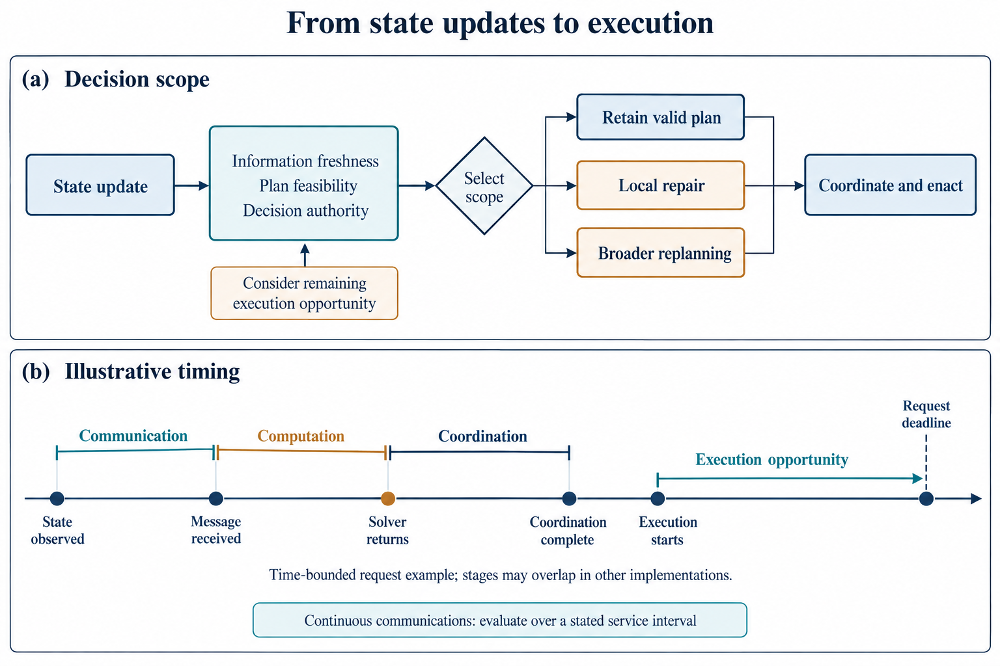

# 大型卫星星座智能运行管理中的规划与协同决策方法综述

Planning and Coordinated Decision-Making for Intelligent Operations Management of Large Satellite Constellations: A Review

## 摘要

大型卫星星座的任务执行受到轨道演化、接近风险与资源状态的共同影响，运行决策需要连接业务机会、允许动作和执行时效。本文采用问题导向的叙述性综述，围绕业务与资源、轨道与安全、协同与执行三个领域，分析规划、构型维持、自主避碰及动态重规划的主要机制。研究内对照显示，观测—传输共同安排能够在所考察期限下提高按期完成任务的加权收益；跨阶段机动预算使当前配置影响后续覆盖，但扩大规划时域的收益受限时求解能力制约，滚动或分解方法在部分实例中取得了更好的限时可行解。由此，部分联合的价值在于保留会改变后续机会的决策联系，局部复用和分层协调则依赖可维护的资源边界与有效反馈。直接比较主要覆盖业务链或轨道配置子问题，完整任务—轨道—安全过程的组织选择仍需据具体依赖作条件性综合。多星安全对照进一步表明，获得全部成员状态仍可能发生控制冲突，共同可行性需要相容输入、动作更新顺序和明确的采用权限。面向大型星座，计算与通信负担应按主动成员、请求、候选机会及耦合关系解释；恢复评价则需区分安全达到、功能资源可用、授权采用与实际业务结果。最后，讨论有限响应预算下的耦合范围、跨组信息有效性及处置事件与业务恢复结果的关联评价。

**关键词：** 大型卫星星座；智能运行管理；协同决策；任务规划；构型维持；自主避碰；业务恢复

## Abstract

Mission execution in large satellite constellations depends on orbital evolution, conjunction risks, and resource availability. Operational decisions must connect service opportunities, admissible actions, and execution deadlines. This problem-oriented narrative review examines planning, formation maintenance, autonomous collision avoidance, and dynamic replanning across three domains: missions and resources, orbits and safety, and coordination and execution. Within-study comparisons show that joint observation and transmission scheduling increases the weighted return from tasks completed by the tested deadlines. Multistage maneuver budgets connect current configurations to future coverage, but the gains from a longer planning horizon depend on finite-time solution quality: rolling-horizon and decomposition methods obtain better feasible solutions in some computationally limited cases. Partial joint optimization is therefore useful for retaining consequential dependencies, while local reuse and hierarchical coordination rely on valid resource boundaries and feedback. Direct comparisons mainly concern service-chain or orbital-configuration subproblems; their extension to integrated task, orbit, and safety decisions remains a conditional synthesis. Multi-spacecraft safety studies also show that access to all member states can coexist with conflicting controls, making compatible inputs, coordinated updates, and adoption authority essential. Scaling should be interpreted through active members, requests, candidate opportunities, and coupling structure. Recovery assessment should distinguish safety attainment, functional and resource availability, authorized adoption, and service outcomes. Open questions concern coupling under response deadlines, information validity across groups, and linking operational interventions to subsequent service recovery.

**Keywords:** large satellite constellations; intelligent operations management; coordinated decision-making; mission planning; formation maintenance; autonomous collision avoidance; service recovery

## 1 引言

### 1.1 研究脉络与运行决策问题

卫星星座通过多颗卫星共同承担观测、通信等业务，运行管理需要把任务分配、活动安排和资源配置连接到轨道变化及执行状态。大型分布式卫星系统的自动化运行研究已将排程、监测、配置和轨道管理视为相互联系的职责[1]。规划与协同决策处于这些职责之间：既选择准备执行什么，也处理哪些选择仍然可行、由谁采用，以及执行后如何更新。

任务与资源规划的一条研究线围绕活动选择和完整任务链展开。Lemaître等2002年的研究已共同处理敏捷卫星的观测选择与时序，并比较不同约束表达及求解方法[2]。较新的观测—传输模型把下游交付条件带入上游观测选择[3]，增量观测分配则利用未受变化影响的安排处理请求更新[4]。它们保留的变量与反馈不同，体现了联合建模和计划复用可以并存。通信业务中的网络表示复用与路径调整[5,6]进一步说明，重算成本、建链代价和服务时延也会改变保留旧决定的价值。

构型与轨道研究从目标几何、成员归属和可达转移等入口扩展决策范围。2012年的相对轨道根数方法在给定目标上选择成员对应关系[7]，2014年的研究通过相对终端条件联立成员转移[8]；2023年的区域重构同时选择目标轨位和成员指派[9]，2025年的多阶段模型再用逐星预算连接当前与后续配置[10]。这些工作逐步开放了目标、指派和前视范围，展示的是这条研究线中决策联系的扩展。需求响应低推力重构[11]、差异阻力规划[12,13]及多星联合避碰[14]则从业务需求、能源和共同安全出发补充动作条件，多条研究线由此在运行决策问题上交汇。

执行反馈提供了另一条贯穿性的研究线。1998年的Remote Agent研究已把任务资源规划、执行与诊断连接起来[15]，EO-1运行工作进一步讨论星上科学分析与后续规划执行的接续[16]。Starling和NanoFF的任务报告则记录了导航等待、运控审查、活动重装载及机动后维护等实际环节[17,18]。这些材料的共同价值是揭示候选方案进入执行所需的信息与职责条件，各任务实际完成的自动化功能仍需按阶段辨别。

大型星座同时增加可选成员和跨星依赖。请求可能竞争同一卫星，多颗卫星也可能共享地面站、链路或有限交付容量。计划复用、几何邻域协调和网络表示复用分别减少重算、协商与构图[4,5,19]，其效果取决于相应结构是否仍有效。观测以产品交付为业务终点，通信以时段需求、吞吐、时延和中断为主要结果，部署与补给还会改变可用能力[20]。本文据此讨论大型星座如何在任务、轨道、安全及资源不断变化时形成并协调决定，维持或恢复业务能力。

### 1.2 已有综述与本文的研究定位

卫星调度综述为问题建模和求解方法提供了系统基础。Wang等梳理敏捷观测任务的模型、约束及算法[21]；Ferrari等按成像、通信和集成安排组织卫星调度，讨论交付、共享与动态重排[22]。因此，跨环节收益和状态变化已经进入调度研究。本文在这一基础上，进一步分析轨道可调整时任务窗口、资源承诺和业务目标之间的联系。

分布式空间系统和自主运行综述则更多关注运行组织。Jabbarpour等从智能体、组织、通信与任务职责展开分类[23]，Thangavel等讨论信息可得性、计算通信能力及星地监督关系[24]，自动化运行综述将规划、执行、监测与工具联系起来[1,25]。这些工作为理解多星协同提供了依据，也引出了信息内容、修改权、批准权与方案实际生效之间的区别。

轨道与系统优化研究构成另一组相关文献。CAMmary按风险模型、数值方法、操作约束和多次接近分类避碰机动设计[26]；Singla等讨论运行与网络管理的集成、协调和自适应组织[27]。Yang等2026年进化计算综述的公开摘要涵盖星座设计、重构、任务调度及测控调度[28]，本文仅以这一可确认的主题范围进行定位。

本文以决策耦合及运行条件作为比较视角：任务、资源和轨道变量在何种条件下适合分别求解、分层协调或部分联合求解，这些组织方式又如何影响安全、资源代价、执行时效和业务恢复。任务响应重构、差异阻力、观测—传输联合安排及避碰—保持提供了不同的耦合实例；终态、连续执行与实际任务证据则用于界定这些比较的有效范围。表1概括已有综述与这一视角的联系。

**表1 已有综述与本文运行决策比较的衔接**

| 已有主题 | 代表来源 | 提供的基础 | 本文比较的运行关系 |
|---|---|---|---|
| 观测与卫星调度 | [21,22] | 模型、求解、集成交付与动态安排 | 轨道调整后窗口、承诺与任务价值的联系 |
| 分布式空间系统 | [23] | 智能体、组织、通信及任务职责 | 信息内容、修改权限与共同决定的生效 |
| 自动化运行 | [1,25] | 规划、执行、监测及工具 | 方案形成、实际采用与结果确认的条件 |
| 网络与资源管控 | [29,30] | 通信业务及资源优化 | 业务传输、数据交付和决策交换的不同约束 |
| 运行与网络集成 | [27] | 统一任务表达及交互组织 | 层间变量固定、反馈与共同选择 |
| 可信自主运行 | [24] | 人机监督及信息、资源与责任条件 | 对照案例中的实际计算、批准和执行分工 |
| 空间物流 | [20] | 部署、补给与服务资源 | 能力到位、任务重分配与服务接续 |
| 避碰机动设计 | [26] | 风险、机动、操作条件与多事件分类 | 机动目标、路径条件及后续业务的分别确认 |
| 进化计算与系统优化 | [28] | 设计、重构、任务及测控调度主题（据公开摘要） | 围绕轨道机会、资源承诺与实际采用增加条件比较 |

全文围绕一个核心问题展开：大型卫星星座如何在轨道动力学演化、空间安全、任务需求及资源状态变化下形成并协调运行决策，维持或恢复业务能力。业务与资源、轨道与安全、协同与执行构成三个相互联系的决策领域。本文集中比较三个相互联系的问题：哪些依赖值得进入共同求解，哪些信息与职责使候选能够生效，以及何种结果表明业务已经恢复。第2章建立比较基础，第3章解释机制，第4章据代表性对照归纳适用条件。

### 1.3 研究边界与证据使用

本文采用问题导向的叙述性综述。规划指任务、活动及必要后续行动的选择，调度进一步确定执行成员、时间和资源，协同决策处理多个主体相互影响的选择。智能运行管理涵盖利用目标、状态、模型和规则形成及更新决定的过程，包括优化、启发式、学习和规则方法，不限定为神经网络或无人监督的星上执行。

文献选录以既有主题来源库和参考链追溯为入口，重点纳入能够解释决策变量、耦合关系、信息条件、执行反馈及恢复结果的研究。经典方法用于说明主要建模与求解机制，直接对照和关键反例用于分析适用条件，任务报告用于辨别实际完成的功能。任务资源、构型维持、风险决策与运行反馈共同纳入，是因为它们分别改变业务机会、允许动作及完成条件。

方法细节与性能判断主要依据实际取得的原始研究正文，综述用于研究定位和分类，官方流程与接口资料用于解释职责、承诺及事件定义。综述和工程资料不代替原始算法比较。同一论文的版本合并识别，同一飞行任务的报告按功能和阶段互补使用，引用数量不等同于独立验证数量。

单星、地球静止轨道（geostationary Earth orbit，GEO）、小编队和通用多智能体研究用于解释可明确限定的局部机制，其动力学、信息和控制条件随案例说明。本文以请求负载、主动决策规模和依赖结构共同描述大型运行问题；各来源的目录对象数、控制成员数和验证功能按实际范围解释，不设单一星数门槛。部署与补给用于说明能力到位，底层控制用于提取动作和保证条件；全面的轨道控制、异常检测和网络协议分类不在本文范围内。通信按用户业务、数据交付和决策信息交换三种职责讨论。

来源可得性限制了覆盖与比较强度。作者稿、接受稿和正式版按实际取得版本解释，仅有摘要的来源用于主题定位。本文未形成可复现的统一数据库检索式和完整排除流程，不主张检索穷尽性；异质实验用于机制与条件比较，不作统一性能排名。下文先定义决策对象和评价基础，继而讨论方法，再综合分析运行取舍、协同与恢复。

## 2 智能运行管理中的决策问题与比较基础

### 2.1 任务、资源与轨道状态及决策变量

运行规划的变量由任务描述和模型表达共同确定。对地观测请求通常包含目标位置、观测要求、优先级和期限，给定轨道后可计算满足观测几何的时间段。几何可见性为活动提供候选机会，姿态转换、载荷能力、能源和存储进一步限定其可行性。

当成像时长已知时，决策包括执行卫星、候选窗口、开始时刻及活动顺序；同星连续活动还受到姿态转换时间约束。模型可以直接枚举开始时刻和时长，也可以将时间或持续时间作为变量。前一种表达主要选择候选活动，后一种还要求求解相应连续取值，两者对应不同的决策空间。

观测后的处理与下传使任务选择受到下游资源影响。图像占用存储，处理消耗计算能力和能源，下传受到星地接触及接收容量限制。共享地面站引入跨星时间和数据量竞争，按期交付则将这些活动连接为完整任务链。通信业务的对应变量包括服务卫星、无线资源与路径，并随用户需求、覆盖和容量变化更新。

动态运行还引入已执行事实和资源承诺。已完成成像成为后续规划的固定输入，已分配容量限制新增请求[31]，激光建链时延限定新路径的可用时刻[6]。这些条件共同说明，数学模型中的可调变量与运行中的修改权限具有不同含义：前者描述允许搜索的选择，后者决定哪些安排可以撤回、批准或执行。

轨道状态既可作为规划输入，也可通过机动改变。轨道根数、相位和相对几何限定未来观测与接触，推力、推进剂、姿态、电池及动作时段限定可用控制。低推力任务响应[11]把目标需求引入轨道候选，差异阻力规划[12,13]将发电和运行可用性引入动作选择。正常维持、需求驱动重构与具有风险时刻的安全处置由此表现出不同的触发条件和响应期限。表2归纳各类决策的输入、变量及后续接口。

**表2 运行决策的输入、决定及结果交接**

| 决策职责 | 已知条件或状态输入 | 决策变量或行动 | 结果及交接条件 |
|---|---|---|---|
| 任务与活动规划 | 请求、候选卫星、窗口、时长及已有计划 | 请求接受、执行成员、开始时刻及顺序 | 活动及资源约束满足，相关节点采用安排 |
| 资源配置 | 能源、存储、计算和通信状态及需求 | 活动资源分配及额度 | 额度和占用更新，配置实际生效 |
| 变化后的调整 | 故障或新请求、已执行前缀、可用替代活动 | 保留、推迟、取消、转移任务或扩大重规划 | 原安排撤回条件满足，替代安排无冲突 |
| 恢复行动选择 | 经确认的异常事实、允许行动及前序行动结果 | 后续恢复措施或退出动作 | 措施执行成功或失败，状态可供后续规划使用 |
| 多星协调 | 任务归属、报价、资源承诺及消息时序 | 任务资源归属及冲突重新协商 | 各参与节点的相关决定一致 |
| 决定采用 | 候选计划、当前状态、授权和生效时限 | 批准、拒绝、重新计算或维持仍有效的安排 | 执行系统采用版本及后续实际结果 |
| 构型维持与重构 | 当前轨道、相位、目标几何、摄动预测和控制能力 | 调整成员、时刻、目标位置与动作 | 构型偏差、到位时间、控制代价及转移安全 |
| 接近风险处置 | 预测接近、状态不确定性、更新时间及动作余量 | 等待更新、安全措施与承诺时刻 | 风险定义下的约束、次生接近及执行可行性 |
| 机动后恢复 | 实际轨道、功能、剩余资源及未完成需求 | 返回、保持新轨道或转入任务可接受轨道，并重分配活动 | 后续风险、服务满足、恢复时间和成本 |

轨道候选的比较涉及状态及不确定性的有效时刻、机会变化、动作占用、终态偏差和路径约束；业务评价则对应交付期限或时段服务要求。安全达到、能力确认、计划采用和业务满足形成不同的恢复终点，为第4章的耦合与恢复分析提供基础。表2是本文对职责的归纳，各来源按其实际覆盖的环节使用；恢复行动选择以已确认事实为输入，故障检测器本身的全面比较不在本文范围内。

图1概括观测、通信与共享资源的功能联系，轨道调整对机会和动作占用的影响在第3.6节进一步讨论。

图1 观测与通信业务及共享资源示意。观测按产品交付、通信按给定时段的服务指标评价；箭头表示功能联系。

### 2.2 决策方法、计算位置与权限

不同方法通过不同机制形成候选。优化模型以变量、约束和目标表达选择，启发式通过追加、插入、删除或交换构造和改进计划，学习用于预测需求、选择搜索操作或提出活动，规则推理则依据事实及预设条件选择策略或行动。它们能够组合，但预测、候选计划与执行指令在组合中仍承担不同职责。

计算组织与决策权限同样需要区分。管理拓扑和跨星分配研究[4,19,32]涉及计算如何分布，机动责任、批准权和执行权则由运行规则决定。地面节点能够生成待批计划，星上节点可以在授权范围内局部调整，分布式算法也可能由地面用户运行。CARA的机动再筛查[33]及共同策略下的半分散执行[34]分别体现了检查流程与执行分工。

求解范式、组织方式与决策对象构成相互交叉的分类维度。第3.1—3.3节讨论候选形成方法，第3.4—3.5节讨论协调与更新，第3.6节讨论改变任务机会的轨道决策；同一轨道问题可以采用优化或学习，也可以分层求解并滚动更新。联合建模、分解求解与滚动更新描述的同样是不同维度。联合建模规定共同选择的变量，分解规定计算拆分方式，滚动规划规定新信息进入的时机，三者可以同时存在。其联系取决于哪些决定暂时固定、反馈能否重新开放变量，以及候选如何经过检查和授权转为实际配置。

### 2.3 两个说明情景：载荷不可用与避碰后任务接续

载荷异常与轨道机动提供了两类不同的计划更新情景。以下均为本文构造的说明示例，其环节分别对应已有来源，不构成新增实验或某个在轨系统的整体描述。

第一种情景中，一颗观测卫星的载荷暂时不可用，存储和通信仍可工作，原计划还占用若干地面站时段。尚未采集的请求失去原执行条件，已存储图像及其下传却可能继续保留。期限、替代窗口和预约可撤回性共同限定推迟、转交或取消活动的选择。任务与资源调度形成具体安排，故障处置规则及修改权限限定调整范围；接替节点接受任务、旧资源释放和消息更新则决定安排何时生效。

第二种情景中，一颗观测卫星收到新的潜在接近信息。几何提示经过风险判断后，等待更新与采取措施成为不同候选行动，其适用性受剩余时间和权限限制。机动后的新轨道改变未执行成像及下传机会，因而可能引出返回原轨道、维持任务可接受的新轨道或转移请求等选择。载荷正常并不保证原时间表有效，其他成员的业务接续也可能早于原轨道恢复。

两类情景的共同点是，状态变化通过活动机会、资源承诺和执行条件影响后续业务；差别在于前者主要改变可用功能，后者还改变几何和安全条件。设备处置、计划采用与产品交付因此具有不同的评价终点，第4.4节据此分析恢复过程。

### 2.4 评价对象与证据范围

业务评价取决于成功事件和统计分母的定义。观测中接受请求、成像、下传与合格产品交付是不同事件：[3]以观测和传输按期共同完成计请求收益，[35]分别计算观测收益与下传体积。通信评价对应给定用户集合和时段，既包括已服务性能，也包括未满足需求。Planet接口对订单接受、采集和交付的区分[36]提供了业务事件定义，成功子集的平均时延则仅描述部分结果。

计算成本包括准备、训练、在线求解、协调和配置采用。阶段重叠时，事件时刻比简单相加更能反映完整响应；未报告的成本仍是缺失项。可行解、松弛界、最优解与超时反映不同求解状态，星数、任务量、候选连接及竞争范围也分别代表不同规模维度。

安全评价还依赖事件和时间范围。瞬时碰撞概率与轨道框机会约束[37]、失控后规定窗口的分离[38]具有不同语义。最近接近时刻（time of closest approach，TCA）、最近距离、风险量和业务交付分别描述几何、风险或服务结果；状态与协方差来源、控制能力及误差条件共同限定解释范围。终态、路径和节点间要求在第4.4.3节进一步比较。

据此，后文从决策范围、反馈条件、响应成本和结果终点四个方面比较方法：共同选择了哪些变量，哪些信息与承诺连接各部分，取得并采用方案需要何种工作，以及结果属于覆盖、交付还是安全。静态求解、循环重规划、地面原型和飞行事件提供不同层次的依据，失败、取消及安全退出也应按同一完成口径解释。

## 3 规划、求解与协同决策方法

规划与协同方法可以从候选形成、状态更新和主体间协调三个方面理解。优化、启发式和学习决定如何构造及改进候选，多星组织与信息交换处理相互影响的选择，状态驱动机制将执行结果带入后续安排，轨道方法则进一步改变未来任务机会。以下按这些作用讨论具体机制，第4章再比较其运行适用性。

### 3.1 优化建模与分解求解

优化模型通过变量、约束和目标将运行需求转化为候选选择。任务接受和成像选择常用二元变量表示，开始时刻及处理、传输容量由时间与资源变量描述。模型保留的联系决定能够共同选择什么，分解和近似则决定如何求解这些选择。

轨道重构体现了由给定目标分配向目标配置共同选择的扩展。Wang等根据相对轨道根数计算单星脉冲转移代价，再选择初始成员与终态位置的对应关系[7]；其四从星、开放时间算例侧重指派与代价。Lee和Ho进一步把目标轨位、成员指派、时变覆盖奖励及机动预算纳入整数规划[9]，用ε约束扫描覆盖与转移代价的权衡。前者在既定目标上选择对应关系，后者还开放目标配置；覆盖由离散可见性矩阵定义，仍是业务机会而非产品交付。

能源感知调度把资源动态带入活动选择。Seman等以混合整数线性规划（mixed-integer linear programming，MILP）模型描述光照、工作消耗和电池变化，包含单星、多星共同参与及冗余执行任务[39]；ε约束方法将部分目标转为给定水平的约束，再调用Gurobi分析权衡，1—5星实验检验了所设能源与任务联系。地面网络又揭示可见性与资源占用的区别：深空网（Deep Space Network，DSN）整数规划将跟踪限制在可见窗内，而准备、撤收可以在窗外继续占用天线，活动拆分也各自引入准备和最小片段条件[40]。因此，增加窗口并不等于增加同量的可用资源时间。

序列与时间表达影响可处理的约束。Lemaître等将候选图像及离散开始时刻组织为动态规划状态，在图像顺序预定、收益线性并去除立体成像约束等条件下求得受限问题最优解；约束规划则通过赋值与传播排除不允许的图像及时间组合[2]。两者的最优性对应不同模型，模型表达与求解结论须共同解释。

跨环节建模使下游资源参与上游选择。He等以观测和传输共同完成作为请求获益条件，通过窗口关联与时间安排使下传反向影响观测选择[3]。Soret等固定当轮采集后配置处理负载与处理器频率，利用时间约束消去频率再优化剩余变量[41]。前者保留本轮上下游反馈，后者优化给定采集后的配置；固定流水线、稳定链路和平均处理时间约束限定了后者对逐请求交付的解释。

分解能够减少候选枚举而保留部分耦合。云覆盖不确定性研究以轨道段内的观测序列为列，由主问题选择序列、动态规划产生改善目标的新列，最后求解已生成候选上的整数问题[42]，其最优性范围仍限于这些候选。指派结构的松弛与可行化见第3.2节。单星波束—功率研究先选服务区域，再固定选束结果配置连续功率，剩余需求进入后续时隙[43]。列、指派和连续资源对应不同分解对象，其效果取决于仍保留的反馈及可行解质量；联合建模与单体求解因而不构成同义关系。

### 3.2 启发式构造、局部搜索与混合求解

启发式以活动构造和邻域修改控制组合搜索负担。观测序列可以通过追加或插入请求检查姿态、时间与资源衔接，再以增加、删除和交换活动改进。Lemaître等的贪心方法还估计后续机会价值[2]，其收益与约束范围和受限动态规划不同。通信调度说明，贪心效果也受问题结构影响：Barbulescu等在同质资源、无松弛的低轨请求特例中以交换论证得到GreedyIS最优性，而异构资源和可调整时间窗形成更一般的搜索问题[44]。利用结构能够减少搜索，其结论随结构成立。

图邻域和排列解码提供了不同表示。Rocha等以活动及衔接构图，结合观测、下传、能源和存储，通过连接缩减与局部混合整数规划开放部分变量[35]。Karapetyan等则搜索请求排列，再由解码器形成下传安排；不同排列可能映射到同一排程，排列多样性并不等于业务方案多样性[45]。其贪心随机自适应搜索（greedy randomized adaptive search procedure，GRASP）采用随机邻域访问及时间限额，逐出链以部分排列辅助评分，同时保存最好完整解。两类研究说明，邻域大小之外，表示、解码成本与完整解保留也决定限时搜索效率。

混合求解还可保留上下游共同选择。He等由外层遗传搜索选择观测—传输窗口关联，内层经半定松弛、随机化和可行性调整形成时间安排，再反馈外层[3]。这种计算分层没有事先固定全部观测，区别于独立下传安排。区域重构中的拉格朗日界与邻域可行化[9]也体现了精确子问题和启发式之间的互补；改进限时基线的当前解不等于超过数学最优。

复用中间表示则减少不同环节的工作。Handley在没有直接星间链路的地面中继网络中按地理分块限制候选，并保留网络图、更新连接代价[5]。这种节省来自减少重复构图，与删减可行顺序或更换搜索算子不同。启发式的运行价值因此由候选覆盖、构造与检查成本、以及限时最好完整方案共同反映，局部优化器的最优性仍限于相应邻域。

### 3.3 学习辅助搜索与活动选择

学习在运行决策中可用于预测、搜索控制和动作选择。合成流量预测为资源策略提供需求输入[46]；以地面覆盖小区簇为智能体的研究则学习波束、频段和功率，并用奖励惩罚处理过量干扰[47]。前者输出估计，后者输出配置，其智能体数量对应小区簇，奖励惩罚形成的配置还需按实际硬约束检查。

在接近分析中，学习还用于接近数据消息（conjunction data message，CDM）事件分流[48]和风险预测[49]，输出是待分析事件或风险估计。它们如何连接动作选择，取决于第3.6.2节讨论的风险定义和处置流程。

学习辅助搜索保留了传统求解器的活动构造职责。Song等的RL-GA利用Q-learning依据适应度改善选择交叉、变异或组合操作，再通过窗口选择和解码得到计划[50]。学习决定搜索操作，解码负责安排的可行性。其两颗卫星、不同任务数量的实验扩展的是请求负载，完整计算还包括解码与约束处理。

策略复用则尝试将单星学习结果用于多星组织。Herrmann等先以单星环境中的蒙特卡洛树搜索获得状态—动作评价并训练神经策略，再与上层目标分配、动作屏蔽及完成状态共享组合[51]。目标归属、局部活动和允许动作分别由这些环节处理，完成状态的消息滞后仍可能带来同时竞争。其4—40星实验检验了组合方案；上层整数模型没有联合描述下层全部资源动态，离线训练及预处理也参与完整成本。Basilisk共同仿真[52]为比较策略与安全动作处理提供条件，局部推理时间则只对应其中一个阶段。

处理活动本身也可成为资源选择。Kodan在固定网络输入尺寸下调整图块与降采样，并依据上下文选择完整处理、跳过过滤直接下传或丢弃[53]。这些安排在计算时间、细节保留和误判损失之间权衡；其硬件与应用测试表明，满足帧截止期后，价值密度的主要限制可能转向精确率，继续加速推理的收益随之改变。该结果补充了活动策略研究：处理速度、信息价值与按期交付需要通过所选任务链联系。

学习策略也可将候选生成与安全修正分工。相对轨道动力学屏蔽用于调整巡检脉冲[54]，其更新条件见第3.4节。表3据候选形成方式概括代表研究。

**表3 代表规划与求解方法的作用机制**

| 代表研究 | 输入与决策变量 | 形成候选的方法 | 模型及验证范围 |
|---|---|---|---|
| 能源感知调度[39] | 任务与光照给定，选择各星任务 | 混合整数规划及多目标权衡 | 1—5星；可行解、间隙和最优性区分 |
| 观测序列优化[2] | 图像及时间条件给定，选择序列 | 动态规划或约束规划 | 受限模型和完整模型不能混用 |
| 贪心与局部搜索[2] | 构造或修改成像序列 | 追加、插入或删除 | 收益与约束范围不同 |
| 联合观测—传输[3] | 窗口、权重与期限，决定关联及时间 | 遗传搜索与内层近似优化 | 固定实例、质量及传输假设 |
| 集成观测—下传[35] | 活动图与资源，选择活动及顺序 | 图缩减与局部整数规划 | 简化可能丢失选择；双奖励分别解释 |
| 处理配置[41] | 采集已定，配置负载与频率 | 变量消元与资源优化 | 平均时间约束，不回改本轮采集 |
| 学习辅助搜索[50] | 搜索状态，选择遗传操作 | Q-learning辅助搜索 | 解码负责可行性；两星负载实验 |
| 策略复用[51] | 单星状态与目标分配，提出动作 | 策略、屏蔽及状态共享 | 上层分配与通信贡献须分开 |
| 区域构型与成员共同选择[9] | 候选轨位、覆盖矩阵及预算，选择配置与指派 | 整数规划、拉格朗日界与邻域可行化 | 离散覆盖机会；限时可行值与界分别报告 |
| 下传排列搜索[45] | 请求排列、执行时间与资源，决定下传安排 | 随机邻域、逐出链及解码 | 不同排列可映射到同一排程；保留最好完整解 |
| 上下文处理选择[53] | 图像上下文、硬件与帧截止期，选择处理方式 | 图块、模型专门化和处理跳过 | 应用及硬件测试；误判、计算与信息价值共同权衡 |

### 3.4 多星协调、信息交换与修改权限

多星协调处理的对象包括任务归属、资源承诺和共同轨迹。一致性任务包拍卖（consensus-based bundle algorithm，CBBA）由各主体计算边际收益、构造任务包，再交换赢家、报价及时间戳解决重复占有[55]。任务加入与执行顺序不同，失去较早加入任务时，依赖其报价的后续任务需要释放重算。评分与通信假设共同限定原研究的收敛及价值结论。

分散计算能够利用竞争结构减少直接协商。Krigman等以用户为智能体、请求为变量，在观测机会或不执行之间用分布式局部搜索处理冲突，并按原流程处理剩余冲突[56]；卫星在此是执行对象。Zilberstein等按观测竞争的几何邻域分解问题[19]，共享地面站或交付容量则可能形成跨邻域依赖。通信资源管理通过上层区域及频谱、下层波束和功率的分工限定局部变量[57,58]；消息时延规划[59]和异步任务分配[60]则把信息到达及更新顺序带入协调。它们提供变量划分与时序机制，具体环境仍区别于航天器共同控制。

轨道协同还存在共同策略和共享约束两种联系。Kim等离线形成双主动星联合策略，再利用预测地面接触同步信息，各星依本地状态概率估计选择动作[34]；Pippia等区分邻星当前状态与上一时刻整段预测轨迹[61]。Palafox等则在离散Hill–Clohessy–Wiltshire（HCW）相对动力学中，以共同分离平面约束连接目标可能冲突的参与者，并通过逆博弈学习平面转速和禁入半径[62]。后者学习的是规划约束参数，实验使用合成专家轨迹，耦合均衡求解也保留共享信息前提。共同目标并非协同的唯一形式，共同维护的约束同样可以连接个体选择。

信息需求可以通过感知结构或更新方式调整。角度编队控制以本地视线角替代邻星距离、速度消息，并用尺度锚点及自身导航维持特定相对构型[63]；其局部收敛和间距条件依赖初始几何。行为启发的航天器群控制则根据感知、模式和采样误差触发控制及广播更新，在10星和20星数值环境中展示搜索、追踪与捕获前包围[64]。前者改变获取何种信息，后者改变何时更新；事件触发模型明确忽略时延，不能与时延补偿混同。

控制屏障函数（control barrier function，CBF）和运行时保障（run-time assurance，RTA）将协调延伸到动作修正。过滤器在所设约束内调整名义输入，多个服务模块及执行器限制可能使该问题无解，估计状态下增加协方差缓冲也未保留原确定性保证[65]。集中与分散实现对共同输入承担不同责任，太阳及传感器视线禁入还会与成员运动相互作用[66]。因此，约束违反的含义由具体性质确定，不能一律解释为实体碰撞。

更新协议可保留特定备选。Stephenson和Schaub要求已有轨道被动安全，每次只允许一颗服务星更新，使取消该次脉冲仍保留原安全轨道[54]。已知其他成员动作和顺序协议共同支撑该机制，同时改变动作会改变这些前提。由此，信息内容、获得时刻、共同约束与修改权限需要结合解释，分散求解本身不决定批准或执行权。

### 3.5 状态驱动的策略选择、计划修复与恢复行动

#### 3.5.1 状态估计与规划策略选择

状态信息除了改变规划输入，也可改变求解策略。He等预测单颗敏捷卫星的电量、数据与存储，再用规则调整目标权重，在偏向观测、下传或能源的策略之间选择，随后构造活动[67]。状态估计改变搜索偏好，活动安排及约束处理仍由后续过程完成。

这一机制与学习选择遗传算子[50]都作用于规划策略，但依据分别是预设规则和学习得到的操作选择。它们与直接提出执行活动的策略具有不同输出，体现了状态信息在策略选择、活动构造和可行性处理中的不同位置。

#### 3.5.2 滚动规划、增量更新与局部修复

动态环境中的计划更新包含三类基本操作：重建一定时域的安排，复用未受影响的结果，以及限制受影响部分的搜索。滚动安排以周期或事件更新区间，再处理等待及新到请求[68]；Parjan和Chien的增量方法保留未受影响活动、移除撤回请求并插入新请求，在100星、一周时域仿真中更新分配[4]。其共享状态仍未消除全部重复观测，并行时间也来自单线程运行的估计。

跨阶段资源使前视范围成为另一项选择。确定性多阶段重构以时间扩展图连接轨位，逐星总机动预算把当前和后续阶段相连[10]。短视方法只优化当前阶段，滚动方法使用有限前视并传递已定状态及剩余预算，完整模型则保留全时域选择。与之不同，需求不确定的在轨服务模型在随机需求出现时触发重规划，只执行规划时域的首个控制区间，再传递实际系统状态[69]。前者的目标全时域预知，后者处理新需求揭示，两者分别说明前视和信息更新的作用。

事前保护与事后修改也需结合信息结构理解。鲁棒观测用区间及预算参数保护云覆盖收益偏差[42]，GEO加注以预算不确定集处理历时偏差[70]，均使用事先给定的偏差集合。天气模型区分共同预定的两阶段安排和中午获得信息后调整后半日的三阶段安排[71]。情景数量本身不产生改排能力，信息揭示时刻及随后可调变量才规定响应范围。

局部修复可以保留采集而修改交付路径。Lowe等逐请求搜索采集—交付路径，接受请求后扣减容量并保留承诺，连接失效时重新选择后续转发[31]；其能源及存储设为无限。动态激光链路以建链时延描述换路代价[6]。轨道感知边缘计算则按预计响应和资源条件搜索执行点，转发计入开销，资源忙时进入等待队列[72]。路径、执行点和活动重排由此修改不同对象，原路径失效、资源等待与重新采集应分别解释。

#### 3.5.3 恢复行动选择与执行反馈

恢复机制分别作用于设备措施、规划条件和成员活动。Wanninger的故障检测、隔离与恢复（fault detection, isolation and recovery，FDIR）地面原型将参数与事件转为故障事实，按规则选择互斥恢复措施，再展开执行操作，前序行动结果决定后续选择[73]。Remote Agent把任务资源规划、运行执行与诊断模式相连，使局部处置触发必要的规划更新[15]。两者分别提供特定地面故障与单航天器环境中的反馈机制。

群体中一颗成员故障还会改变健康成员的可行活动。Iversflaten等在多小卫星巡检中更新故障星周围的排除区，各健康星用随时动态A*（Anytime Dynamic A*，AD*）复用搜索状态并改道[74]。三服务星仿真展示一星推进失效后另外两星的路径调整，膨胀参数重设可以更快取得次优解。该机制把故障信息转为规划条件，其短时Newton–Euler模型忽略相对轨道动力学，排除区也尚非严格故障可达管，适合解释路径修复而非完整星座恢复保证。

VISORS的发射前双星软件在环设计进一步把故障响应与主被动角色切换、待命和逃逸相连，导航状态进入无控分离预测[75]。设备措施、健康成员改道与角色调整由此提供不同恢复手段，执行后的状态决定能否重新安排任务。表4据修改对象概括这些机制。

**表4 状态变化后的决定及其实际修改范围**

| 机制与来源 | 使用的信息 | 保留或固定的内容 | 输出与反馈 |
|---|---|---|---|
| 策略推理[67] | 预测资源和子系统限制 | 给定任务与规则 | 目标偏好，再构造和检查安排 |
| 滚动安排[68] | 新请求及更新状态 | 已执行活动 | 新时域安排 |
| 增量规划[4] | 请求激活、撤回及共享状态 | 未受影响的计划 | 更新分配，检查重复与冲突 |
| 鲁棒安排[42,70] | 事先给定的偏差集合 | 计划阶段信息 | 满足所设保护条件的候选 |
| 天气信息后改排[71] | 中午的新天气信息 | 前半日活动 | 三阶段模型重排后半日 |
| 局部路径修复[31] | 原连接失效及后续机会 | 原采集指派 | 后续转发路径及交付情况 |
| 恢复规则[73] | 异常事实及前序行动结果 | 规则和允许措施 | 下一恢复行动及效果确认；地面原型 |
| 规划—执行—诊断衔接[15] | 任务、模式及执行状态 | 已完成活动和当前约束 | 局部处置或重新规划；单航天器环境 |
| 编队模式及角色切换[75] | 故障响应、导航及无控分离预测 | 允许模式和当前执行能力 | 新角色、待命或逃逸及后续状态；双星软件在环 |
| 多阶段前视[10] | 预先已知的时变目标及剩余预算 | 已定状态与已用预算 | 当前阶段安排及后续机会；短视与有限前视分别比较 |
| 新需求触发服务规划[69] | 已揭示需求和实际状态 | 已执行控制区间 | 新的服务安排；未来随机需求仍未知 |
| 故障后路径修复[74] | 故障排除区及其他成员计划 | 可复用搜索信息 | 健康成员改道；解质量与响应时间共同评价 |

这些方法保留已执行事实，更新仍可改变的部分。载荷状态改变可用活动，轨道状态还改变未来窗口与控制条件；功能处置、计划更新和任务恢复相互联系，但完成终点并不相同。

### 3.6 轨道构型维持与自主避碰决策

#### 3.6.1 轨道构型演化、维持与重构

构型研究沿目标生成、成员指派和转移控制展开，不同层次可以分别或共同求解。部署感知设计描述初始配置的形成[76]；均匀星座重构则用轨道面数、每面槽位及相位兼容关系，解析枚举保留原位置的末态候选[77]。后者减少构型搜索，但不直接求解机动。成员指派和目标配置的不同开放范围见第3.1节。这些方法依次开放不同变量，终态兼容、转移可达及全程安全分别构成后续问题。

给定相对终态要求后，多星轨迹也可能直接耦合。Appel等以相对终端条件联立成员转移，区别于先独立求各星转移再指派[8]。其案例提示，总推进剂减少仍可能伴随部分成员代价增加，初始化也使用已收敛的单星邻近极值解。因此，整体代价和逐星剩余能力需要同时进入重构解释，不能把总量改善等同于每星改善。

科学任务使保持目标具有特定测量含义。Leroy等为内重力波层析设置略有倾角差的立方星，以展开两个水平方向的掩星采样，J2摄动却使节点退行速率不同，匹配平均运动尚不足以保持构型[78]。其规则按升交点赤经（right ascension of the ascending node，RAAN）偏差触发，在最大、最小纬度附近安排成对机动。最大加速度限制可维持分离，总速度增量Δv预算限制寿命，观测几何与控制能力共同决定可用构型。

差异阻力通过姿态改变迎风面积，也影响发电和任务时段。Kim和Yoon共同描述阻力及发电投影面积，按电池和日照在调相、充电间切换，验证单元为两星关键星对[13]。S-NET规划把通信、值守等活动归入运行可用率，共享参考星的多个星对通过启动延迟同步高低阻力切换[12]；所引结果属于规划及未来演示建议。估计与控制的协方差联系在第4.4节进一步讨论。

需求响应重构把升降轨、滑行及恢复组成低推力候选，再按响应时间、控制代价和地面目标距离选择成员[11]。Pippia等以模型预测控制（model predictive control，MPC）利用邻星当前状态或预测轨迹计算等间隔重构，模型未加入避碰约束[61]；Pedari等将构型、指派、轨迹和接管组织为层次控制[79]，其通信可靠性要求限于终态。前者通过候选轨迹选择响应需求，后两者分别利用预测反馈和层级交接形成动作。

#### 3.6.2 接近筛查、风险评估与安全行动选择

接近处置由几何候选逐步进入风险和行动判断。筛查产生需要复核的对象或事件，TCA与最近距离描述预测几何，风险评估结合状态不确定性分析碰撞可能性。NASA CARA将接近提示、风险评估和缓解规划分别组织[33]，表明几何接近、风险达到处置条件及实际机动是不同事件。

几何计算主要减少定位和候选处理负担。Denenberg用Chebyshev代理多项式定位TCA及距离，其接受稿以SGP4传播评估[80]；Saingyen等结合多级筛查、CUDA计算和内存组织减少精算候选[81]。传播模型、步长或分段、阈值及复核参照限定了这些计算结果。相同输入下的算法距离一致性说明几何计算的一致程度，真实轨道误差和风险校准则属于其他证据环节。

学习分流进一步作用于已有CDM事件。Henry等通过降维、聚类与投票剪除部分低风险事件，其输出不包含机动，训练集危险事件浓度条件也未给出测试集假阴性上界[48]。ESA竞赛显示评分、稀有事件采样与接近前风险更新会影响预测评价[49]。因此，这类方法的运行作用主要表现为分析负担与事件保留，后续风险判断仍依赖更新信息和适用模型。

风险定义还随时间范围变化。Wen和Qiao在固定初始误差空间计算给定时间段的碰撞事件，避免同一偏差轨迹重复计入，其数值方法仍受随机变量维数和线性确定性动力学限制[82]。长期机动采用的瞬时概率[37,83]和多次接近在不相关事件假设下组合的风险[84]具有不同事件语义。逐节点瞬时概率与全时段累计概率之间不能直接替换，阈值也需要与原定义相对应。

几何与概率目标还可能给出不同机动方向。Bombardelli和Hernando-Ayuso将小冲量映射到接近平面的偏移，通过特征值问题及代数方程形成解析候选[85]。在其短时、高斯且固定协方差模型中，短提前量和各向异性误差使最大脱靶距离与最小碰撞概率方向显著不同。这为风险模型影响行动选择提供了直接例证；涉及Iridium的改造算例使用假设协方差，不作为真实事件的运营复现。

风险更新影响等待与提前行动的权衡。CARA讨论提前机动的燃料机会、风险随新信息下降的可能性及承诺前再次判断[33]。等待的意义因而依赖剩余处置机会，风险信息时效、动作能力与任务期限共同限制行动选择。Li等的等效线性速度障碍（Equivalent Linear Velocity Obstacle，ELVO）方法把等待问题进一步连接到传感范围及有限推力，除碰撞概率外，还评估进入观测范围后已无法避免接近的可能性，并用期望燃料代理比较早晚行动[86]。其单受控星、多被动碎片设置说明，新信息的价值必须与剩余可用动作共同衡量；相对动力学近似、误差补偿和小TCA偏移条件限定其结果。本文据这些条件解释等待，不设置统一机动阈值。

#### 3.6.3 避碰机动及机动后构型与任务恢复

机动设计从快速候选形成扩展到控制时序、保持目标及主动成员之间的共同约束。解析脉冲方法在给定机动时刻及小偏移假设下利用接近平面映射减少计算[85]；Armellin则以离散三维脉冲的总幅值为目标，用外层动力学映射和内层禁入区投影—切平面迭代求解凸子问题[87]。多脉冲可以近似有限燃烧，使推力时序进入候选，但凸子问题不等于原非凸问题具有全局最优保证，长告警窗口还可能存在多个局部极小值。

凸松弛提供了另一种候选和界。Vega等将末端接近平面风险约束形成的二次约束问题松弛为半定规划，秩一等紧性条件成立时可以恢复相应线性化模型的全局解，非紧时仅有松弛下界[88]。其风险罚项方案改变了原硬阈值问题，得到控制序列仍需按原风险要求复核；松弛非紧本身也不能判定物理任务无解。相较迭代局部凸化，这类方法更直接地把松弛紧性带入结果解释。

保持和恢复要求进一步改变控制。Pavanello等针对既有低推力轨迹调整关机时长、控制矢量偏差或方向夹角，部分策略用终端软约束接回名义轨迹，关机策略的后续恢复则不在该文范围内[89]。长期避碰—保持把轨道框和名义状态目标带入连续控制[83]，De Vittori等2025年作者稿以初态、终态及接近时刻条件连接短时避碰与定点[90]。多次接近还需分配风险预算并处理一次机动对后续事件的影响[84]。这些模型依次扩展事件和恢复范围，软目标残差、控制消耗与到位时间共同描述结果。

多个主动成员引入内部与外部安全的共同条件。Błażejczyk和Zagórski的三星例联合选择控制，同时满足碎片禁入、星间距离与终端构型要求，未直接受威胁的成员也可能参与调整[14]。连通保持研究则用虚拟代理网络协调，再由饱和星—代理耦合生成受限实际推力[91]，在初始静止、安全连通、目标可达及具有动力补偿余量的条件下维持相关邻边；邻边结论不能直接覆盖任意非邻接星对。预分配被动相对轨道走廊的MPC把部分冲突前移到结构设计[92]。共同求解、代理协调和预分配结构由此提供不同的冲突处理方式，分别依赖共同输入、初始域和轨道布局。

被动安全还可以作为恢复目标或等待余量。Shao等固定相对倾角（I）矢量，以两次脉冲调整相对偏心率（E）矢量，在给定安全距离时减小控制代价，或在给定燃料下选择较大的终态安全参数[93]；该参数描述径向—法向几何，未覆盖整个机动区间。规定恢复窗口内的无控分离[38]则保留接管时间，Scala等的健康成员安全螺旋重构[94]主动应对一星失控。终态构型、等待能力和失控后的主动退出分别服务不同阶段，任务是否恢复还取决于功能及业务安排。表5归纳这些方法的产物和接口。

**表5 轨道运行决策链中的方法产物与交接条件**

| 环节及代表证据 | 方法输出 | 后续接口 | 模型及证据边界 |
|---|---|---|---|
| 维持与调相[12,13] | 姿态、高低阻力及切换安排 | 能源、姿态可用性与共同切换确认 | 星对仿真与未来演示规划分开 |
| 重构及成员分配[7,11,61] | 参与卫星、目标位置、候选转移或相位控制 | 转移时限、控制界和全程安全检查 | 业务响应、代价计算和构型重构规模分别说明 |
| 几何筛查及TCA[80,81] | 候选对象、接近时刻及距离 | 状态不确定性和后续风险评估 | 几何结果不是碰撞概率 |
| 事件分流及风险判断[48,82] | 保留事件或给定定义下的风险量 | 更新信息、动作能力及触发规则 | 漏报、概率语义和时间范围分别说明 |
| 机动与保持[83,87,89,90] | 控制序列、终态及可能的松弛残差 | 实际执行、转移复核及新的任务机会 | 软恢复目标、终端满足与全程约束分开 |
| 多事件及多主动成员[14,84] | 多事件预算或联合成员控制 | 次生风险筛查、责任及方案共享 | 多被动目标不等于多主动运营者 |
| 失控分离与重构[38,94] | 安全漂移窗口或健康成员新构型 | 接管、功能确认及业务重排 | 安全状态不等于原功能或任务完成 |
| 兼容构型与相对终端耦合[8,77] | 兼容槽位及相对终端条件 | 成员分配、转移可达和逐星余量 | 末态生成与共同轨迹求解分别说明 |
| 终态被动安全几何[93] | 两脉冲及目标E矢量 | 机动区间复核与后续业务 | 固定I矢量与两体近似；非全程或多星协商验证 |

轨道方法既产生控制和终态，也规定适用时段及误差条件。将这些结果转为任务窗口、占用与剩余能力，才能进一步比较原安排复用、成员接替和业务重排。

## 4 运行条件下的决策取舍、采用与验证

### 4.1 规模扩展中的计算减负与适用条件

规模扩展涉及成员、请求、候选机会、共享资源和更新频度等不同维度，相应减负机制也作用于不同计算环节。图缩减减少搜索连接[35]，几何邻域减少直接协商主体[19]，增量规划减少重复安排[4]。因此，局部求解加速与完整响应之间的关系，还取决于跨节点协调及方案采用的成本。

这些机制分别以候选筛选、竞争局部性和旧计划有效性为条件。删减连接可能损失可行顺序，跨邻域共享地面站或交付容量可能扩大协调范围，保留旧活动也可能限制新请求。计算节省与未满足需求因而共同反映减负效果，单独的重算比例不足以评价业务收益。

减负效果应同时联系可行选择和限时解质量。区域重构利用拉格朗日界及可行化减少求解负担[9]，具体对照见第4.2.2节。DSN模型则通过时间网格改变变量数与候选灵活性，准备撤收造成的余量会使粗网格损失可用资源[40]。利用问题结构与近似模型表示由此形成两类不同的计算取舍。

复用和预计算则将部分工作前移。网络图复用需要及时更新连接[5]，轨迹代价预计算受轨道、质量、时刻和终端范围限制[95]，学习策略的上层分配也依赖预先形成的可见机会[51]。准备结果的失效、更新和重建构成在线运行的一部分，局部推理或查询时间仅反映这些方法的部分成本。

轨道安全又包含筛查、几何精算、风险更新与机动再筛查。CUDA目录处理[81]改变候选生成及数据组织，CDM事件剪枝[48]改变后续分析对象，两者与观测排程减少搜索具有不同产物。传播、传输和精细复核，以及候选漏失条件，决定加速能否转化为可执行的安全处置。尚未建立无漏报条件的缩减，其速度优势本身不构成采用依据。表6和图2据此区分不同减负机制。

**表6 计算减负机制与运行采用条件**

| 主要工作 | 代表机制 | 适用条件 | 相关运行代价 |
|---|---|---|---|
| 候选与执行顺序过多 | 图缩减、局部搜索[35] | 可以识别可合并或可舍弃连接 | 候选损失、约束检查及计划质量 |
| 直接协商主体过多 | 几何邻域协调[19] | 主要竞争位于相应邻域 | 跨邻域依赖、消息及采用一致性 |
| 重复安排未变化任务 | 增量规划[4] | 旧安排在当前状态下仍有效 | 保留决定对新需求的限制 |
| 重复构建网络表示 | 图复用及边权更新[5] | 连接变化可被及时反映 | 失效检测、更新和重建 |
| 重复动力学计算 | 代价网格与插值[95] | 查询未超出模型和网格范围 | 离线计算、误差及轨迹复核 |
| 每次活动选择成本高 | 策略复用[51] | 输入及动作条件仍适用 | 训练、上层分配、屏蔽及协调 |
| 目录与事件分析负担 | 几何筛查与事件分流[48,81] | 阈值、时间步长及事件信息适用 | 候选漏失、传播、风险复核及响应时间 |
| 指派与目标配置共同选择过多 | 拉格朗日松弛及邻域可行化[9] | 可利用的指派结构与预算条件 | 松弛界、限时可行解和恢复可行性的工作 |
| 时间表示过细 | 资源占用网格及离散化[40] | 分辨率仍覆盖允许活动和准备撤收 | 变量规模与被舍弃的排程余量 |

图2 计算工作及其减少机制。候选缩减[35]、局部协调[19]和计划复用[4]分别影响搜索、协商与重复求解；节点和计划条不对应实测数量，适用条件见表6。

### 4.2 任务、资源与轨道机动的决策耦合

决策耦合体现为一种选择改变其他选择的可行性或价值。给定轨道排程、先机动后重排和部分联合选择，分别固定了不同条件，也保留了不同反馈。它们之间的比较需要共同的业务目标、动作集合、安全要求和响应期限，额外开放的变量才有可解释的收益与成本。

#### 4.2.1 轨道调整与业务机会的双向影响

轨道与业务之间既有机会更新，也有目标反馈。机动改变未来窗口、覆盖与链路，业务需求则可以反过来影响目标构型、执行成员和动作时机。第3.6节的轨道方法提供候选，其业务价值还取决于哪些观测、处理和交付活动能够利用这些候选。

这种联系首先表现为控制代价与业务机会的不同步。需求响应低推力重构的24星案例中，燃料均衡增加总控制代价和完成时间，平均覆盖改善也伴随部分位置重访变差[11]。科学测量还可能与维持动作竞争：在内重力波层析研究所设测量和定轨条件下，推进期间难以满足掩星测量的速度精度，较长点火占比压缩有效测量时间[78]。因此，比较保持策略时应把控制消耗、动作占用与测量时段共同解释，几何保持寿命不能替代有效业务时长。

姿态与能源进一步把这一权衡带入执行条件。差异阻力中的调相—充电切换[13]和S-NET的运行可用时段[12]，分别将电量和活动占用接入构型安排。Kim和Yoon的A组比较还对基线施加了提出方法未采用的任务姿态限制，其结果不能全部归于控制方法[13]。避碰—保持的轨道框及终态目标也会改变机动方向和代价[83,90]，不同恢复目标必须在各自的业务条件下比较。

配置层的共同选择已将覆盖机会与轨道动作连接起来[9,10]。多阶段重构的已知历史路径算例中，无重构、单阶段和八阶段配置的覆盖奖励分别为1491、1736和1963[10]。这组结果反映在给定目标路径、预算及采样表示下增加配置机会的价值；它比较的是配置阶段数，并未比较短视、滚动与完整模型的求解效果。相对终端重构中整体与逐星代价的差异[8]又说明，覆盖奖励之外还需保留成员剩余能力。

给定轨道的观测—传输对照[3]直接评价按期完成请求，固定采集后的处理配置[41]和交付容量承诺[31]则开放不同的下游选择。将这些机制用于轨道变化后的任务接续，是从业务链向轨道层扩展的综合：轨迹改变机会，处理、存储和下传决定机会能否转为业务。Kodan在满足帧截止期后出现信息质量瓶颈[53]，进一步说明扩大上游机会的收益取决于下游当前限制。

#### 4.2.2 分别求解、分层协调与部分联合的适用条件

决策组织需要同时选择开放范围、反馈方式和响应时域。分别求解、分层协调与部分联合可以组合：联合模型可以分解计算，分层组织可以滚动更新，旧计划也可以在其中局部保留。研究内对照能够检验某项选择的实际作用，模型和运行流程则解释这种作用成立所需的条件，二者应分别支持性能判断与组织建议。

观测—传输研究提供了保留上下游选择的直接例子[3]。在三颗观测星、12小时仿真及默认地面接收配置下，联合与分开资源安排采用相同的请求收益定义。原文图6的3、5、8、9小时期限点中，联合方案的按期完成任务加权和均较高；两条曲线在8—9小时之间接近平台，放宽期限仍未消除分开安排的收益差距。该结果表明，在这一模型中，增加可等待时间与保留上下游选择具有不同作用。模型采用无误码传输、简化图像质量和零切换时延设置，所得对照支持业务链中的共同选择，尚不包含轨道机动。

跨阶段预算则使“看多远”与“算多久”同时影响结果。多阶段重构[10]比较全时域模型（MCRP）、当前阶段短视规划（MP）和单阶段前视滚动规划（RHP）。表7列出同文两个动态目标实例：一个体现滚动方法取得与完整模型相同奖励时的计算节省，另一个体现完整模型超时后滚动方法取得较高可行值、短视方法则以较小收益损失快速返回的取舍。该文表2的实例13又由完整模型取得更高奖励，滚动前视并非每次都改善限时结果。完整模型限时10 800 s，序贯方法每个子问题限时3600 s，后者报告的是累积运行时间；这些结果属于不同求解配置下的实际对照，不能当作等计算预算的架构排名。目标在全时域预知，奖励按覆盖计算，也限定了它们对在线业务的解释。

同一联合模型的不同求解器比较又回答另一问题。区域重构[9]保持配置、指派及覆盖模型不变，以拉格朗日启发式与限时MILP比较；表7所列紧预算组同时出现正、负相对性能。联合变量相同而限时结果不同，说明应把建模时保留的选择与计算时取得的完整解分开评价。在目标和约束含义相同、原可行集合保留时，开放更多变量的理想最优值不会变差；这个集合关系并不保证有限时间内得到更好的可采用方案。

计划复用的适用性可以从受影响活动及边界条件判断。增量分配保留未受变化影响的安排[4]，路径修复保留采集指派和容量承诺[31]。若撤回或新增活动的前后继、共享资源竞争仅涉及少数保留节点，且跨边界承诺仍成立，则可限制当次重算范围。完整占用窗口需要容纳活动的开始和结束，允许开始时刻窗口则直接检查开始时间；能源、存储及姿态转换还需各自复核。这些检查回答原安排能否保留，新增机会与当前目标再决定保留是否值得。

分层协调的主要依据是可分配的时间尺度和职责，以及能够传递的约束条件。S-NET的活动可用时段和共同阻力切换[12]、构型—指派—轨迹—接管的层级组织[79]，说明分层可以怎样连接运行与控制；所引材料未提供与其他组织方式同条件的净业务收益比较。其适用建议因此来自机制综合：向上提供可达机会、占用和余量，向下反馈目标及承诺，并在边界失效时重开相关决定。

响应紧迫时，已有有效备选能够支持分阶段采用。承诺前再筛查[33]和完整轨迹加反馈策略的准备[96]，分别提供决策确认和执行备份机制。DSN研究区分修改范围[97]，GSOC个案又显示既有机动机会及后续恢复代价影响局部调整价值[98]。当检查、协调或批准占用候选的剩余有效期时，可先采用仍满足条件的完整方案，再扩大后续业务调整；这种安排以备选、权限和交接有效为前提，不设统一的任务优先次序。

**表7 决策组织的研究内对照与条件性综合**

| 可观察的联系或条件 | 组织选择与比较对象 | 已观察结果及指标 | 代价、反例与适用范围 | 证据性质 |
|---|---|---|---|---|
| 观测与下传共同决定请求能否按期完成 | 联合安排与分开资源安排[3] | 四个期限点均为联合方案加权完成收益较高；延长期限未消除差距 | 三星业务链仿真，传输及切换设置见正文；未含轨道选择 | 原研究同实例对照 |
| 当前机动预算影响后续配置机会 | MCRP、MP、RHP，同文实例16与24[10] | 按上述顺序，实例16覆盖奖励为2356/2335/2356；实例24为4610/4584/4656 | 实例16运行时间为32.53/0.03/13.62 s；实例24为10 800 s（限时）/0.04/5942.12 s。全时域目标预知，各方法时间上限含义不同 | 原研究同实例、不同求解配置对照 |
| 配置与指派共同建模，部分实例触及求解期限 | 拉格朗日启发式与限时MILP；归一化总机动预算0.3的18个实例[9] | 6个实例启发式较好、10个略差、2个相同；原文正RP最大26.21%，负RP幅值最大1.77% | 启发式累计时间至多462.24 s；MILP上限3600 s。RP比较该文限时可行值，非相对数学最优的改善 | 原研究同模型求解器对照 |
| 失效活动的前后继及共享资源仅涉及少数保留节点，边界承诺仍有效 | 保留旧决定，修复关联活动[4,31] | 减少重复安排，或保持采集后调整交付路径 | 仍可能重复观测或排除新机会；[31]能源、存储设为无限 | 原研究机制与仿真；选择条件为本文综合 |
| 时间尺度或职责可分，机会与约束可在层间传递 | 构型、指派、轨迹及执行分层[12,79] | 建立活动可用率、共同切换或执行交接关系 | 尚未据所引材料确认同条件业务优越性；[79]通信要求限于终态 | 原研究模型与流程；适用建议为本文综合 |
| 期限短于扩大计算及采用所需时间，已有有效备选 | 先采用完整备选，后续更新[33,96] | 保留承诺前检查或模型内反馈执行能力 | 有效域、扰动界、状态与授权决定可采用性 | 运行流程及控制机制；组织建议为本文综合 |
| 个体动作改变其他成员的输入可行性 | 共同选择控制，或依有效顺序协调[54,65,66] | 全状态共享下仍可出现共同控制与分散实现的不同通过结果，详见4.3 | 输入界、初始安全域和更新时序限定结果 | 原研究对照与可行性分析；按依赖选择机制为本文综合 |

表中各行对应不同的组织维度，可以在同一系统中组合。[9]的RP以限时MILP可行目标值为分母，采用原文负值目标的符号约定，正RP表示启发式较好；[10]直接列覆盖奖励原值。前三行分别回答业务链、前视求解和求解器选择问题，不作跨研究性能排序。现有直接对照支持在这些子问题中保留关键反馈、并按响应预算选择计算范围；将其用于完整任务—轨道—安全过程，是本文的条件性综合。在本文纳入并核读的材料中，尚未建立把这些环节及实际采用成本同时纳入的同口径净业务收益比较。

#### 4.2.3 安全约束与可调整的恢复目标

安全要求与恢复目标在优化中承担不同作用。必须满足的碰撞或路径条件限定候选集合，恢复目标则区分其中的业务和资源代价。低推力名义返回[89]及长期避碰—保持中的部分目标[83]允许带惩罚的松弛，其状态残差是结果的一部分；终态定点[90]与全程轨道框也对应不同要求。

返回原轨道、进入另一任务可接受轨道和保留机动后轨道，为恢复提供不同选择。固定测量基线、相位及连续覆盖对这些选择具有不同限制。需求响应重构和避碰—保持模型[11,83,89]显示，控制代价、到位时间与几何目标会相互制约，较少Δv并不直接对应较少业务损失；后续任务机会及交付能力决定了等待和轨道偏差的业务后果。

据此，安全、动作能力和响应期限共同限定可执行候选的范围，任务可用性、资源占用及恢复时间用于比较其后续价值，实际交付或服务再反映运行结果。这是本文的证据组织方式，并非固定的多目标优先级；在安全条件给定后，业务、资源和恢复时长仍可共同权衡。

### 4.3 安全信息共享、机动协调与决策生效

多星协同需要让交换的信息对应具体的决定。完成状态描述已经执行的活动[51]，赢家、报价与时间戳决定尚未执行任务的归属[55]，资源承诺限定后续容量；当前状态支持相对运动判断，目标或预测轨迹支持预判他星动作。这些信息服务于不同对象，相关节点采用同一组相容决定，才使计算结果进入共同执行。

信息共享的价值需要同时考察任务结果与安全结果。Dolan等用共享目标表征机动意图，到达成功率与平均到达时间改善，碰撞数中位数却未变化[99]。其到达指标允许碰撞后继续累计，因此描述的是到达表现，不能据此声称无碰撞任务成功。邻星预测对照[61]还同时改变了参考目标，部分较低输入来自重构未完成，需结合相同目标与完成口径解释。两类结果支持按实际任务终点和共同安全条件评价信息，而非只按共享数据量评价。

减少通信则可通过信息替代、触发更新或时效补偿实现。本地角度感知[63]把消息需求转为可见性、尺度锚点与本星导航条件；事件触发[64]改变广播时刻，其模型忽略时延；消息年龄预测[100]使用历史状态与控制补偿过时信息，验证仍限于平面机器人学习环境。这些机制可以缓解不同信息缺口，适用性取决于替代信息或预测在动作采用时仍然有效。

共同安全的直接条件是存在相容控制。Dunlap等在相同2000组五星初态中，集中式RTA全部通过，分散实现通过率为90.95%，两者均取得全部成员状态，区别包括能否共同选择输入[66]。失败含约束违反或无可行输入，删除星间约束只用于定位冲突。受限推力下多个服务模块也可能没有共同安全输入[65]。因此，全状态获得、共同约束责任和输入选择需要一起组织；分离平面博弈[62]提供共同维护约束及乘子的机制，有序更新[54]则利用已知他星动作保留特定备选，两者各有求解或时序前提。

在轨任务使采用权限和等待条件更具体。Starling飞行动力学报告记录地面生成、审查、CARA筛查及运控批准的机动流程[18]；NanoFF报告中的导航核查、地面冲突和模型修正影响实际动作时刻[17]。这些运行证据说明，决策权限和状态确认本身参与执行时序。软件调度器由监督者批准或要求重算后生成部署配置[101]，为这一分工提供辅助的软件层例证，其验证范围区别于在轨机动。

共享未来意图还要与责任和最终承诺衔接。CARA使用包含拟定机动的星历再筛查[33]；S-NET共同切换[12]和双主动星地面接触同步[34]处理不同的动作与信息时刻。Starling 1.5经筛查服务提交预测轨迹并明确责任后，由一颗卫星自主规划和执行与Starlink的一次接近处置[102]。这一事件支持责任确认接入自主动作，但未验证多成员同时共同机动。

因而，组织方式应按共同可行性和采用时效比较：候选在执行前仍满足约束，参与者对未来动作及更新顺序有相容理解，并具备相应的修改和接管权限。消息、检查或批准晚于有效期时，应重新确认状态及候选。图3展示规划、检查与采用的联系；表7中的组织条件据此延伸到执行。

图3 计划形成、检查与采用的职责联系。各环节的具体分工以相应来源为准。路径修复以[31]为例，部署批准以[101]为参照；下部为有期限请求的示意，不代表完整自主系统或实测时延。

图4概括交付期限、接触可靠性及建链代价对各自研究内部比较的影响。

图4 不同研究内部的条件性比较示意（AI辅助定性草图，非数值结果）。（a）[3]比较不同期限下成功安排任务的加权和；（b）[31]比较名义与接触可靠性降低时的请求失败；（c）[6]比较建链时延对端到端时延的影响。三者的指标、单位和场景不同，本图仅表示比较关系，不用于读取性能数值。

### 4.4 执行监督、能力恢复与验证范围

#### 4.4.1 运行规划与控制执行的接口

规划与控制的接口包含带时段和条件的能力信息。部署及平台设计提供成员到位和容量[76,103]，库存、补给及维修描述供应与周转[104,105,106]，安全轨迹给出动作占用、终态及特定失效条件[107,108,109,110]。这些输出转为任务可用条件后，才与替代活动和业务安排发生联系。

VISORS的命令拆分与缓存说明了理想轨迹和实际执行之间的区别[75]。原脉冲展开为命令序列后，执行间隔和纠偏影响允许活动；已发出、缓存中和已完成动作对应不同状态。实际轨道、占用和允许模式反馈上层，使后续规划能够据真实可用时刻更新。

完整反馈备份可以降低在线求解失败的影响。Botelho等在安全且时间可弹性的等待点，先用系统级综合（system level synthesis，SLS）联合优化完整转移及线性校正策略，再以One-Shot方式反馈执行，或在后续继续优化[96]。这种备份比预留一条开环轨迹包含更多误差响应，仍以模型内可行初解、已知扰动界和准确当前状态为前提，状态估计与执行误差尚未进入该文验证。它说明，限时运行可以通过准备阶段和反馈策略共同组织，而不必把每次重新优化成功作为唯一执行条件。

近距离交会、编队内避碰与目录运营避碰也具有不同接口。锥优化、群体MPC、机会约束及近直线晕轨道（near rectilinear halo orbit，NRHO）被动安全研究[107,108,109,110]解释特定相对运动模型中的执行条件，目录流程[33]则处理新接近、风险更新和运营责任。前者的局部机制可以用于后者的相关环节，但目录覆盖、风险信息和授权仍是额外条件，不能合并为同类在轨实证。

#### 4.4.2 结果反馈、验证规模与大型星座迁移

大型星座的规模由不同工作量共同形成。本文用总星数$N$、业务请求数$R$、当前参与共同机动决策的成员数$A$、待处理接近事件数$E$及局部耦合图平均度$\bar d$区分主要负担。目录对象数$N_{\mathrm{cat}}$另计，因为其中包含非受控目标；候选轨位或活动机会数也不能替代星数。表8将已报告规模与实际验证功能对应，未报告的请求、事件或耦合参数不由总星数推定。

实体和在轨材料补充的是执行条件。SCATE在单受控气浮平台的三自由度平面环境连接估计、规划与执行，部分反应式试验出现燃料不足后的跟踪偏差[111]；EO-1连接星上科学分析与规划执行，同时保留地面职责[16]。Starling的自主维持、运控及1.5处置[18,102,112]属于同一任务线的不同功能，NanoFF已飞调节也与后续计划功能区分[17]。软件配置、地面原型和Remote Agent[73,101,15]提供各自环境中的反馈依据。

场景与规格还决定规模结果是否具有代表性。Rules4CREAM的随机及确定生成可以得到接近的事件数量，却因是否使用实际相位而具有不同距离分布[113]。流程模型检查识别消息阻塞时，反例可能来自模型错误或设计过约束，资源耗尽终止也不表示通过[114]；形式化自主研究强调规格、模型语义与待查性质的对应[115]。因而，大量生成事件、流程通过与连续运动安全需要各自证据。

**表8 验证规模、对应工作量与机制迁移条件**

| 研究与环境 | 已报告规模及对应量 | 已验证的功能 | 可迁移机制及所需前提 |
|---|---|---|---|
| 增量观测安排[4]，数值环境 | $N=100$，约一周；不能由此推定$A$或$E$ | 任务分配更新与重算负担 | 复用有效安排；受影响活动及共享资源边界可识别 |
| 区域与多阶段重构[9,10]，数值环境 | [9] $N\in\{10,20\}$、500—2000候选轨位；[10] $N\in\{3,5\}$、50或75候选轨位、3—5阶段 | 配置、成员指派、预算及离散覆盖 | 利用指派结构或有限前视；候选和转移代价仍适用，候选数不是主动成员数 |
| 任务响应重构[11]，数值环境 | $N=24$，当次选定机动成员另由方案确定 | 响应时间、控制代价与覆盖变化 | 轨迹候选支持成员选择；业务链需接入更新机会 |
| 分布式与层次重构[61,79]，数值环境 | [61]35星、无避碰；[79]10星闭环、另有50星指派 | 预测反馈或层次子问题 | 预测与层间约束保持有效；指派规模不代表同规模闭环安全 |
| 被动安全、联合轨迹、屏蔽及RTA[14,38,54,66] | 双星、三星或五星模型；$A$按共同控制或更新成员界定 | 所设间距、输入或更新条件 | 输入责任与依赖边界相容；未测定大星座耦合图的增长 |
| GPU目录筛查[81] | $N_{\mathrm{cat}}=24\,023$，不能替代$A$或$E$ | 传播对象筛查和并行处理 | 候选生成及精算接口可扩展；事件输出量与漏失条件另评 |
| SCATE[111]，实体闭环 | 单受控平台、三自由度平面 | 估计、规划、跟踪及资源限制 | 执行反馈接口；外部定位条件与在轨导航区分 |
| Starling任务线[18,102,112]，在轨 | $N=4$；所引自主维持及处置为单星动作 | 运控、SV4维持及1.5处置 | 责任确认和采用流程；多份报告不增加独立任务数 |
| NanoFF[17]，在轨 | $N=2$，主动成员随动作而定 | 推进、阻力调节及运行修正 | 导航和机动效果反馈；未将计划功能计为已飞验证 |
| VISORS所引设计[75]，软件在环 | 双星，主动/被动角色可切换 | 模式、缓存和逃逸接口 | 角色及接管机制；所引材料属于飞行前设计 |
| 行为与事件触发[64]，数值环境 | $N\in\{10,20\}$，消息和邻接关系另计 | 搜索、追踪及捕获前包围 | 按误差触发广播；通信时延需要另行处理 |

对全部$A$个主动成员逐对设置约束时，星对数为$A(A-1)/2$；依赖若确为无向稀疏图，边数则为$A\bar d/2$。保持近邻数有界只能限制这一类成对联系，共享地面站、交付容量和总预算还可能跨越分组边界。因此，局部迁移的可检验条件是：主要约束可以由组内状态与明确的边界承诺表达，边界更新不会持续牵动大部分成员，失效时又能扩大协调范围。几何邻域与增量复用[19,4]提供前两类机制，共享容量和共同输入[31,65,66]提示何时需要扩大范围。

通信与等待可以按协议作结构计数。若每个主动成员每轮向每个邻居单播一次含$H$个预测节点的轨迹，平均邻居数为$\bar d$，则每轮有$A\bar d$次发送及$A\bar dH$个预测状态节点；这一计数假定固定状态维数，未含协议开销、聚合或重传。若一次一星更新的协议要求每轮各成员更新一次，该轮包含$A$次串行更新，耗时还取决于每次求解、交换、检查及接管。预测交换[61]、窗口同步[34]和顺序更新[54]因此具有不同的规模代价。

上述计数属于按结构推导的分析，不是求解时间或安全性能的增长定律。局部方法值得扩展的条件，是依赖和共享资源边界保持可管理，消息及承诺在动作采用前仍有效；总星数增大而这些量保持受控时，局部计算才有条件支持整体响应。是否实际获得这种结构及响应收益，需在相应星座和负载下验证。

#### 4.4.3 从终态与节点可行到连续执行的证据

安全验证应先明确状态域、时域和误差条件。第4.3节讨论的共同输入可行性是动作修正的基础；无解时应把剩余动作能力返回规划层，重新选择有效备选[65,66]。燃料触发的自然停车只保留其所覆盖的性质，不能沿用失效控制器的完整保障解释。

统计误差模型和有界扰动保障提供不同的条件。差异阻力研究联合传播真实状态、滤波误差及两星交叉协方差，并与所设噪声下的Monte Carlo对照[116]，把导航质量接入保持分析；部分线性协方差分量并不总保守。SLS完整反馈备份[96]则针对给定扰动集合及模型内可行初解。这一区别使规划能够按实际误差描述选择保障方法，统计包络不能直接改称硬安全界。

独立闭环验证可补强学习策略的性能评价。Dong等用相对后向投影外包络识别低拟合误差策略的不安全区域[117]。在线性离散动力学、分段线性网络、验证状态域和误差界持续适用时，外包络包含于碰撞集合可给出域内非碰撞初态的离散步安全充分条件；全域条件未成立时，在线相交检查只覆盖所查步，更长时域依赖继续验证。验证线性规划（linear programming，LP）无解表示可能不安全状态与估计集合不相交，控制二次规划（quadratic programming，QP）无解则表示没有可行输入。两种无解具有不同的逻辑含义，平面离散结果还需补充轨道非线性及采样间条件。

全程要求应进入路径表达。长期避碰—保持的轨道框[83]、低推力名义返回及传播检查[89]，分别处理运行区间和到位要求；De Vittori等2025年预印本用初态、终态和接近时刻条件连接短时避碰与定点[90]。终态条件限定到位状态，路径条件覆盖运行区间，二者对应不同可行集合；要求全程保持在允许区域时，应显式加入相应路径条件并复核。

节点检查可以在有效运动界下扩展到区间。群体MPC利用速度、加速度和步长限制节点间距离[108]，走廊MPC在预分配结构、扰动界及兼容性条件下采用采样裕量[92]。异步屏蔽中的一般速度界仍含近似[54]，随机保持也保留网格间违约问题[37]；区间极值检查或加密传播因此需要与误差范围共同解释。NRHO逐次凸化将连续路径要求转为积分条件[110]，数值求解的正容差和积分精度又限定其保障强度。

独立传播及实际反馈进一步检查候选如何执行。同动力学前向传播可发现积分、线性化或优化残差[83,89]，估计、推力、姿态及动作时序误差则需要相应扰动或独立模型。NanoFF的导航与机动效果更新[17]、VISORS的缓存和逃逸设计[75]为反馈提供具体接口；低推力恢复中迭代上限内未收敛的案例[89]也提醒结果检查应包含求解失败。因而，可由模型内区间保障、独立传播和执行反馈逐层补强验证，每一层均对应明确的模型与误差条件。

资源比较还应保留完成口径。部分学习对照同时改变分配、前瞻和通信[51]，共同仿真[52]有助于组合与模块比较；交会研究则分别统计各自成功子样本与共同成功任务的成本[109]。失败比例及成功条件下的资源表现应共同报告，成本收益与第2.4节的统计总体保持一致。

#### 4.4.4 从安全退出到业务恢复的四个结果

业务恢复需要连接四类结果：达到适用安全要求，功能与资源能够支持任务，更新计划获授权采用并进入执行，以及产品按期交付或时段服务满足。这些结果可以交叠，却有不同完成事件。第2.3节的载荷不可用情景中，已有图像仍可能下传；避碰情景中，其他成员也可能先于原轨道恢复完成接续。因此，恢复速度应针对指定业务和事件定义，而不以返回原状态的时刻统一代替。

表9同时列出环境和实际观察到的结果。采用与执行一列区分仿真执行、设计中的命令处理及在轨授权或运控事件，仿真推进本身不记作权限确认。业务列中的“直接”表示相应环境内实际统计的请求或服务结果，“代理”表示几何、可用容量等条件；未覆盖结果以“—”表示，仅指所引证据未确认。备星数量[118]和科学对准[75]属于不同能力代理，运行流程文件[119]与终端性能测量[120]也分别支持过程和服务观察，不能拼接为同一次处置的恢复实证。

**表9 代表研究的恢复结果与证据环境**

| 来源与证据环境 | 安全结果 | 功能与资源条件 | 采用与执行事实 | 业务结果及代理 |
|---|---|---|---|---|
| 被动安全窗口[38]，双星数值模型 | 量化无控分离窗口 | — | — | — |
| 故障后安全重构[94]，三星仿真 | 量化避让及安全构型 | 代理：健康成员构型 | — | — |
| AD*故障改道[74]，近场仿真 | 排除区及避让模型 | 代理：健康成员可用路径 | 仿真：重规划后沿替代路径执行 | — |
| VISORS设计[75]，软件在环 | 检查与逃逸机制 | 模式和角色转换 | 设计及软件在环：命令拆分、缓存与执行 | 代理：观测尝试的几何对准表现；非产品交付 |
| 需求触发服务规划[69]，数值模型 | — | 系统状态及成本模型 | 仿真：滚动实施首个控制区间 | 代理：收入与延迟罚金 |
| 备星补给[118]，马尔可夫模型 | — | 事件条件可用性、期望缺星数 | — | 容量代理，未直接评价服务需求满足 |
| NanoFF[17]，双星在轨 | 交叉分离结果 | 推进及阻力调节 | 在轨运控：导航核查、等待与动作更新 | — |
| Starling运行报告[18]，四星任务 | 避碰及后续队形维护记录 | 安全模式与活动维护 | 在轨运控：审查、批准、重装载及重排 | — |
| 采集—交付修复[31]，网络仿真 | — | 容量承诺 | 仿真：路径回退及调整 | 直接：模拟请求交付与失败 |
| GSOC TanDEM-X个案[98]，在轨 | 接近处置及构型偏差记录 | 作者依据构型偏差判断SAR运行未受影响 | 在轨运控：机动计划、复核及实施 | 业务条件保持的间接证据；非交付损失对照 |
| Starling 1.5事件[102]，在轨任务报告 | 一次自主接近处置记录 | — | 责任确认后单星自主规划与执行 | — |
| Starlink终端测量[120]，外部业务测量 | — | — | 未与指定处置事件绑定 | 直接：时延与吞吐变化；未建立避碰恢复归因 |

这些证据揭示了不同的恢复瓶颈。安全螺旋、被动窗口与逃逸保留后续处置空间[94,38,75]，但可能改变科学基线；推进或设备可用之后，导航核查、活动装载及运控等待仍影响执行[17,18]。GSOC个案说明，有些机动能够保持仪器运行条件；网络仿真和终端测量则分别提供模型内交付及实际服务指标。四类结果由此具有互补价值，但表内没有一行经所引证据确认在同一处置事件中连接了全部终点。

恢复选择还取决于获得能力的物理机会与等待代价。RAAN对齐决定备星补给时机，事件条件可用性又不同于周期平均库存[118]；延迟罚金与制造、发射和运行成本共同影响服务规划[69]。当替代成员能更早满足需求时，业务转移可以先于原构型恢复；需要固定测量基线时，则可能必须等待特定几何。两种判断均需核对剩余资源、可替代载荷及不可撤回承诺。

评价净恢复收益，应把处置事件、采用时刻与业务结果置于相同需求和时域下。原计划复核、局部修复及扩大重规划可以据此比较未满足需求、恢复时间和额外资源，区分收益来自机会增加、较快采用还是额外投入。已有模拟与运行材料支持这些环节的具体机制，完整事件链的比较仍是本文纳入证据中的缺口。

### 4.5 研究挑战与可检验问题

#### 4.5.1 有限预算下应保留哪些决策联系

研究需要进一步确定哪些联系值得进入共同求解，以及分解之后应传递什么信息。观测—传输模型[3]评价请求完成，多阶段重构[10]主要评价覆盖机会，处理选择[53]又涉及信息质量和截止期。关键问题是：保留某一联系带来的机会价值，能否覆盖其增加的计算、协调与采用成本。若轨道配置增加的覆盖无法通过有限处理和下传形成交付，几何收益便不足以回答这一问题。

比较应保持需求、初态、候选动作、安全要求和承诺一致，报告期限内的最好完整可行解、未满足需求、采用时刻及额外资源。第4.2.2节的研究内结果说明，扩大选择与增加计算预算具有不同贡献；后续需要辨别哪些依赖的保留足以改变完整任务链，而哪些可以由有效的边界条件传递。

依赖结构随运行变化也是规模扩展的核心问题。几何邻域与增量计划[4,19]利用竞争范围与旧解有效性，共享地面站及跨阶段预算却会扩大关联。后续研究应说明局部边界何时仍相容、何时需要扩大协调，以及采用何种有效摘要能够保留重要反馈。其检验应同时呈现活动与约束规模、限时方案质量和失效后的更新负担。

#### 4.5.2 信息有效性如何支持共同安全与采用

通信受限的问题不只在消息数量，还在消息描述的未来动作能保持多久。当前状态、预测轨迹[61]、共同离线策略[34]及共享分离约束[62]分别提供不同依据，本地感知、事件触发和消息年龄预测[63,64,100]则改变获取及更新方式。需要回答的是：给定状态误差、推力界和响应期限，何种信息精度与有效期仍允许形成共同可行输入，何时必须重新交换或改变更新顺序。

在相同动力学、目标和控制界下，分别改变信息内容、消息时序与输入责任，可以辨别通信节省是否仍保留共同可行性。有序更新[54]和代理耦合[91]各有备选或初始域要求，应同时考察失效、等待及采用结果。

跨运营者情形还需使共享意图、机动责任和承诺生效对应同一时间线。Starling事件[102]给出单成员自主处置的运行例证，多成员同时改变动作时的责任交接及失效备选仍需具体证据。将状态与命令版本、批准和接管事件记录在同一运行过程中，有助于区分算法未找到相容输入与方案未能及时采用。

#### 4.5.3 哪种恢复选择真正改善后续业务

安全退出之后，是等待原成员或原构型恢复，还是保持可接受的新状态并转移任务，需要结合业务替代能力判断。被动安全窗口和故障后螺旋[38,94]、快速路径调整[74]及RAAN补给机会[118]对应不同时间尺度。可替代载荷、未来窗口、剩余资源和不可撤回承诺，决定哪种恢复路径仍保留后续价值。

表9的结果应进一步连接到同一事件及评价时域。比较原计划复核、局部修复与扩大重规划时，需保留功能已恢复但窗口错过、窗口仍在但资源未就绪、已经执行但交付未完成等不同失败终点，才能解释哪种恢复路径改善了指定业务。

Starling与NanoFF的维护和等待[17,18]、服务规划的延迟成本[69]及处理价值瓶颈[53]提供了连接这些终点的局部依据。进一步的运行或共同场景证据应说明哪些需求恢复、哪些被转移或放弃，以及收益来自机会改善、采用加快还是额外投入。这样的评价可以形成有条件的恢复决策认识，同时保留安全和功能目标各自的要求。

## 5 结论

本文围绕业务与资源、轨道与安全、协同与执行，综述大型卫星星座在轨道演化、任务变化及有限资源下的规划与协同决策。不同方法的主要区别，在于开放哪些变量、保留哪些反馈，以及所得方案如何在有效期内进入执行。

研究内对照支持两项相互补充的认识。观测—传输共同安排能够保留分开选择时损失的完成机会，跨阶段机动预算也使当前配置影响后续覆盖；同时，全时域建模的潜在收益并不自动转化为更好的限时可行解，滚动和结构化分解在部分实例中以较少计算取得相同或更高奖励。因而，关键依赖决定哪些变量值得共同选择，响应预算决定当次能够采用多大的计算范围。现有直接比较主要覆盖业务链、轨道配置或具体求解方法，完整任务—轨道—安全过程的组织选择属于据这些证据形成的条件性综合。

局部复用和分层协调可依据边界条件选择。受影响活动及其共享资源只涉及少数保留节点、旧承诺仍有效时，复用能够减少重复安排，但还需比较其排除的新机会；时间尺度或职责可分时，分层可以利用可达机会、占用和控制余量传递约束。响应紧迫且备选仍有效时，分阶段采用有助于保留执行能力。这些建议主要由模型结构和运行机制支持，不据此宣布某种组织具有普遍业务优势。

多星共同安全取决于相容输入及协调时序。全状态共享仍可能与控制冲突并存，当前状态、未来意图、共同约束和采用权限必须对应具体动作。终态、离散节点和连续区间则需要不同的约束与验证；完整反馈备份、区间运动界、独立传播及执行反馈可在相应模型和误差条件内补强保障。大型星座迁移还需控制主动成员间依赖、跨组资源竞争及信息有效期，目录处理或任务分配的规模不能替代同规模共同控制证据。

业务恢复应由安全达到、功能资源可用、授权采用及业务结果分别确认。现有研究量化了安全几何、覆盖或交付等部分结果，在轨材料补充了责任确认、维护和等待；模拟执行、设计接口和实际授权具有不同证据含义。后续需将处置事件与服务结果连接到共同需求、信息、安全和响应条件，判断返回原构型、保持任务可接受的新状态或转移业务的实际价值。

## 参考文献

1. Ben-Larbi MK, Flores Pozo K, Haylok T, Choi M, Grzesik B, Haas A, et al. Towards the automated operations of large distributed satellite systems. Part 1: Review and paradigm shifts. Advances in Space Research, 2021, 67(11): 3598–3619. DOI: 10.1016/j.asr.2020.08.009.

2. Lemaı̂tre M, Verfaillie G, Jouhaud F, Lachiver JM, Bataille N. Selecting and scheduling observations of agile satellites. Aerospace Science and Technology, 2002, 6(5): 367–381. DOI: 10.1016/S1270-9638(02)01173-2.

3. He L, Liang B, Li J, Sheng M. Joint Observation and Transmission Scheduling in Agile Satellite Networks. IEEE Transactions on Mobile Computing, 2022, 21(12): 4381–4396. DOI: 10.1109/TMC.2021.3076088.

4. Parjan S, Chien SA. Decentralized Observation Allocation for a Large-Scale Constellation. Journal of Aerospace Information Systems, 2023, 20(8): 447–461. DOI: 10.2514/1.I011215.

5. Handley M. Using ground relays for low-latency wide-area routing in megaconstellations. Proceedings of the 18th ACM Workshop on Hot Topics in Networks, 2019: 125-132. DOI: 10.1145/3365609.3365859.

6. Bhattacharjee D, Madoery PG, Chaudhry AU, Yanikomeroglu H, Kurt GK, Hu P, et al. On-Demand Routing in LEO Mega-Constellations With Dynamic Laser Inter-Satellite Links. IEEE Transactions on Aerospace and Electronic Systems, 2024, 60(5): 7089–7105. DOI: 10.1109/TAES.2024.3415571.

7. Wang J, Zhang J, Cao X, Wang F. Optimal satellite formation reconfiguration strategy based on relative orbital elements. Acta Astronautica, 2012, 76: 99–114. DOI: 10.1016/j.actaastro.2012.02.015.

8. Appel L, Guelman M, Mishne D. Optimization of satellite constellation reconfiguration maneuvers. Acta Astronautica, 2014, 99: 166–174. DOI: 10.1016/j.actaastro.2014.02.016.

9. Lee HW, Ho K. Regional Constellation Reconfiguration Problem: Integer Linear Programming Formulation and Lagrangian Heuristic Method. Journal of Spacecraft and Rockets, 2023, 60(6): 1828–1845. DOI: 10.2514/1.A35685.

10. Lee HW, Williams Rogers DO, Pearl BD, Chen H, Ho K. Deterministic Multistage Constellation Reconfiguration Using Integer Programming and Sequential Decision-Making Methods. Journal of Spacecraft and Rockets, 2025, 62(1): 206–222. DOI: 10.2514/1.A35990.

11. McGrath CN, Macdonald M. General Perturbation Method for Satellite Constellation Reconfiguration Using Low-Thrust Maneuvers. Journal of Guidance, Control, and Dynamics, 2019, article in advance. DOI: 10.2514/1.G003739.

12. Ingrillini L, Traub C, Ben-Larbi MK, Turco F, Fasoulas S, Stoll E, et al. Operationalizing differential drag control: a planning routine for the S-NET satellite formation. CEAS Space Journal, 2026, 18: 685–705. DOI: 10.1007/s12567-025-00630-x.

13. Kim S, Yoon H. A Pitch-Roll Attitude Strategy for LEO Constellation Phasing with Differential Drag Under Power Constraints. International Journal of Aeronautical and Space Sciences, 2026, 27: 2488–2504. DOI: 10.1007/s42405-025-01071-w.

14. Błażejczyk M, Zagórski P. Sequential Convex Trajectory Planning for Space-Debris Conjunction Mitigation in Satellite Formations. Applied Sciences, 2026, 16(8): 3707. DOI: 10.3390/app16083707.

15. Muscettola N, Nayak PP, Pell B, Williams BC. Remote Agent: to boldly go where no AI system has gone before. Artificial Intelligence, 1998, 103(1–2): 5–47. DOI: 10.1016/S0004-3702(98)00068-X.

16. Gregg Rabideau; Daniel Tran; Steve Chien; et al. Mission Operations of Earth Observing-1 with Onboard Autonomy. SMC-IT, 2006: 367–373. DOI: 10.1109/SMC-IT.2006.48.

17. Roychowdhury D, Grau S, Boyer F, Kapitola S, Legenza A, Diez JM, et al. In-orbit demonstration of propulsive and drag-based formation control using two 2U CubeSats under operational constraints. CEAS Space Journal, 2026. DOI: 10.1007/s12567-026-00702-6.

18. Alem N, Hendriks TG, Alvarellos JL, Levinson-Muth PG, Dono A. Mission Design and Flight Dynamics Operations for the Starling Swarm Technology Demonstration. 2025 AAS/AIAA Astrodynamics Specialist Conference, 2025. NASA NTRS 20250007355. https://ntrs.nasa.gov/citations/20250007355.

19. Zilberstein I, Rao A, Salis M, Chien S. Decentralized, Decomposition-Based Observation Scheduling for a Large-Scale Satellite Constellation. Journal of Artificial Intelligence Research, 2025, 82: 169–208. DOI: 10.1613/jair.1.16997.

20. Ho K. Space Logistics Modeling and Optimization: Review of the State of the Art. Journal of Spacecraft and Rockets, 2024, 61(5): 1417–1427. DOI: 10.2514/1.A35982.

21. Wang X, Wu G, Xing L, Pedrycz W. Agile Earth Observation Satellite Scheduling Over 20 Years: Formulations, Methods, and Future Directions. IEEE Systems Journal, 2021, 15(3): 3881–3892. DOI: 10.1109/JSYST.2020.2997050.

22. Ferrari B, Cordeau JF, Delorme M, Iori M, Orosei R. Satellite Scheduling Problems: A survey of applications in Earth and outer space observation. Computers & Operations Research, 2025, 173: 106875. DOI: 10.1016/j.cor.2024.106875.

23. Jabbarpour MR, Vo BQ, El-Dalahmeh G, Tahir H, Kowalczyk R, Bessell T, et al. Agent-based approaches for distributed space systems and mission management: Methodologies, current practices and challenges. Acta Astronautica, 2026, 238: 237–257. DOI: 10.1016/j.actaastro.2025.10.018.

24. Thangavel K, Sabatini R, Gardi A, Ranasinghe K, Hilton S, Servidia P, Spiller D. Artificial Intelligence for Trusted Autonomous Satellite Operations. Progress in Aerospace Sciences, 2024, 144: 100960. DOI: 10.1016/j.paerosci.2023.100960.

25. Ben-Larbi MK, Flores Pozo K, Choi M, Haylok T, Grzesik B, Haas A, et al. Towards the automated operations of large distributed satellite systems. Part 2: Classifications and tools. Advances in Space Research, 2021, 67(11): 3620–3637. DOI: 10.1016/j.asr.2020.08.018.

26. Zeno Pavanello; Luigi De Maria; Andrea De Vittori; et al. CAMmary: A review of spacecraft collision avoidance manoeuvre design methods. Acta Astronautica, 2025, 236: 770–789. DOI: 10.1016/j.actaastro.2025.07.027.

27. Singla A, Criscola F, Canales D, Fraire JA, Calveras A, Ruiz-de-Azua JA. Toward Integrated Satellite Operations and Network Management: A Review and Novel Framework. Technologies, 2025, 13(8): 312. DOI: 10.3390/technologies13080312.

28. Yang QT, Luo LY, Zhou Q, Kwong S, Zhang J, Zhan ZH. Evolutionary Computation in Satellite System Optimization for Deployment and Scheduling: A Survey. IEEE Transactions on Systems, Man, and Cybernetics: Systems, 2026, advance online publication, 30 September. DOI: 10.1109/TSMC.2026.3729751.

29. GONG L, ZHANG W, CHEN Q, et al. A Survey of Intelligent Networking Technologies for LEO Mega-Constellations. Acta Aeronautica et Astronautica Sinica, 2026, online first. DOI: 10.7527/S1000-6893.2026.32935. (in Chinese)

30. DI H, DONG T, LIU Z, et al. Review on Resource Management and Optimization Technologies for LEO Communication Satellite Constellation Networks. Journal of Astronautics, 2026, 47(2): 270–283. DOI: 10.3873/j.issn.1000-1328.2026.02.002. (in Chinese)

31. Lowe CJ, Clark RA, McGrath CN, Macdonald M. A delay-tolerant network approach to satellite pickup and delivery scheduling. Ad Hoc Networks, 2023, 151: 103289. DOI: 10.1016/j.adhoc.2023.103289.

32. Mao Y, Wu Y, Ju X, Xie H, Yue C. Dynamic Management Topology Construction, Evolution, and Maintenance of Low Earth Orbit Mega-Constellation. Space: Science & Technology, 2025, 5: 0248. DOI: 10.34133/space.0248.

33. NASA. Conjunction Event Prediction; Close Approach Risk Assessment; Close Approach Risk Mitigation. CARA official process documentation, Steps 1–3; accessed 21 October 2026. https://www.nasa.gov/cara/step-1-conjunction-event-prediction/; https://www.nasa.gov/cara/step-2-close-approach-risk-assessment/; https://www.nasa.gov/cara/step-3-close-approach-risk-mitigation/.

34. Kim GR, Al-Husseini M, Eddy D, Kochenderfer MJ. Semi-Decentralized Multi-Spacecraft Collision Avoidance under Communication Constraints. Preprint AAS 26-860, arXiv:2607.26570v1, 2026.

35. Rocha Y, Chagas GO, Coelho LC, Subramanian A. The integrated agile Earth observation satellite scheduling problem. Computers & Operations Research, 2025, 184: 107212. DOI: 10.1016/j.cor.2025.107212.

36. Planet. Tasking API. Official documentation; accessed 22 October 2026. https://docs.planet.com/develop/apis/tasking/.

37. De Vittori A, Pavanello Z, Di Lizia P, McMahon J, Armellin R. Combined Long-Term Collision Avoidance and Stochastic Station-Keeping in Geostationary Earth Orbit. Journal of Guidance, Control, and Dynamics, 2025, 48(4): 840–854. DOI: 10.2514/1.G008629.

38. Guffanti T, D’Amico S. Robust Passively Safe Spacecraft Swarming via Closed-form and Optimization-based Control Approaches. 2022 American Control Conference (ACC), 2022: 416–423. DOI: 10.23919/ACC53348.2022.9867216.

39. Seman LO, Ribeiro BF, Rigo CA, Filho EM, Camponogara E, Leonardi R, et al. An Energy-Aware Task Scheduling for Quality-of-Service Assurance in Constellations of Nanosatellites. Sensors, 2022, 22(10): 3715. DOI: 10.3390/s22103715.

40. Sabol A, Alimo R, Kamangar F, Madani R. Deep Space Network Scheduling via Mixed-Integer Linear Programming. IEEE Access, 2021, 9: 39985–39994. DOI: 10.1109/ACCESS.2021.3064928.

41. Soret B, Mercado‐Martínez AM, Jurado‐Navas A, Lyholm ND, Moretti M, Popovski P, et al. Edge Intelligence for Satellite-Based Earth Observation: Scheduling Image Acquisition and Processing. International Journal of Satellite Communications and Networking, 2026: 1–22; advance online publication, 24 August 2026. DOI: 10.1002/sat.70082.

42. Wang X, Song G, Leus R, Han C. Robust Earth Observation Satellite Scheduling With Uncertainty of Cloud Coverage. IEEE Transactions on Aerospace and Electronic Systems, 2020, 56(3): 2450–2461. DOI: 10.1109/TAES.2019.2947978.

43. Shuang Zheng; Xing Zhang; Peng Wang; Wenbo Wang. Joint Beam Scheduling and Power Optimization for Beam Hopping LEO Satellite Systems. China Communications, 2024, 21(10): 1–14. DOI: 10.23919/JCC.ja.2022-0864.

44. Barbulescu L, Watson JP, Whitley LD, Howe AE. Scheduling Space–Ground Communications for the Air Force Satellite Control Network. Journal of Scheduling, 2004, 7(1): 7–34. DOI: 10.1023/B:JOSH.0000013053.32600.3c.

45. Karapetyan D, Mitrovic Minic S, Malladi KT, Punnen AP. Satellite downlink scheduling problem: A case study. Omega, 2015, 53: 115–123. DOI: 10.1016/j.omega.2015.01.001.

46. Han C, Xiong W, Yu R. A Hybrid Forecasting Model for Self-Similar Traffic in LEO Mega-Constellation Networks. Aerospace, 2024, 11(3): 191. DOI: 10.3390/aerospace11030191.

47. Ngo QT, He Y, Jayawickrama B, Dutkiewicz E. Multi-Agent DDPG-Based Joint Beam Hopping and Resource Allocation for Cognitive GEO-LEO Satellite Networks. IEEE Networking Letters, 2025, 7(4): 303-307. DOI: 10.1109/LNET.2025.3605531.

48. Henry S, Armellin R, Gateau T. Safe-event pruning in spacecraft conjunction management. Astrodynamics, 2023, 7(4): 401–413. DOI: 10.1007/s42064-023-0165-5.

49. Thomas Uriot; Dario Izzo; Luís F. Simões; et al. Spacecraft collision avoidance challenge: Design and results of a machine learning competition. Astrodynamics, 2022, 6(2): 121–140. DOI: 10.1007/s42064-021-0101-5.

50. Song Y, Wei L, Yang Q, Wu J, Xing L, Chen Y. RL-GA: A Reinforcement Learning-based Genetic Algorithm for Electromagnetic Detection Satellite Scheduling Problem. Swarm and Evolutionary Computation, 2023, 77: 101236. DOI: 10.1016/j.swevo.2023.101236.

51. Herrmann A, Stephenson MA, Schaub H. Single-Agent Reinforcement Learning for Scalable Earth-Observing Satellite Constellation Operations. Journal of Spacecraft and Rockets, 2024, 61(1): 114–132. DOI: 10.2514/1.A35736.

52. Herrmann A, Schaub H. A comparative analysis of reinforcement learning algorithms for earth-observing satellite scheduling. Frontiers in Space Technologies, 2023, 4: 1263489. DOI: 10.3389/frspt.2023.1263489.

53. Denby B, Chintalapudi K, Chandra R, Lucia B, Noghabi S. Kodan: Addressing the Computational Bottleneck in Space. Proceedings of the 28th ACM International Conference on Architectural Support for Programming Languages and Operating Systems, Volume 3, 2023: 392–403. DOI: 10.1145/3582016.3582043.

54. Stephenson M, Schaub H. Safe, Autonomous Multi-Agent Inspection of Space Objects Leveraging Relative Orbit Dynamics. Advanced Maui Optical and Space Surveillance Technologies Conference (AMOS), 2025. DOI: 10.64861/DAUC8213.

55. Han-Lim Choi; L. Brunet; J. P. How. Consensus-Based Decentralized Auctions for Robust Task Allocation. IEEE Transactions on Robotics, 2009, 25(4): 912–926. DOI: 10.1109/TRO.2009.2022423.

56. Krigman S, Grinshpoun T, Dery L. Scheduling of Earth observing satellites using distributed constraint optimization. Journal of Scheduling, 2024, 27(5): 507–524. DOI: 10.1007/s10951-024-00816-x.

57. Gou L, Bian D, Nie Y, Zhang G, Zhou H, Shi Y, et al. Hierarchical Resource Management for Mega-LEO Satellite Constellation. Sensors, 2025, 25(3): 902. DOI: 10.3390/s25030902.

58. Zhao R, Cai J, Luo J, Gao J, Ran Y. Demand-Aware Beam Hopping and Power Allocation for Load Balancing in Digital Twin Empowered LEO Satellite Networks. IEEE Transactions on Wireless Communications, 2025, 24(6): 5084–5098. DOI: 10.1109/TWC.2025.3545745.

59. Wang C, Tang J, Cheng X, Liu Y, Wang C. Distributed cooperative task planning algorithm for multiple satellites in delayed communication environment. Journal of Systems Engineering and Electronics, 2016, 27(3): 619–633. DOI: 10.1109/JSEE.2016.00066.

60. Rachmut B, Amador Nelke S, Zivan R. Asynchronous Communication Aware Multi-Agent Task Allocation. Proceedings of IJCAI, 2023: 262–270. DOI: 10.24963/ijcai.2023/30.

61. Pippia T, Preda V, Bennani S, Keviczky T. Reconfiguration of a satellite constellation in circular formation orbit with decentralized model predictive control. Read version: arXiv:2201.10399v1, 2022.

62. Palafox F, Yu Y, Fridovich-Keil D. Learning Hyperplanes for Multi-Robot Collision Avoidance in Space. arXiv:2311.09439v1, 2023. https://arxiv.org/abs/2311.09439v1.

63. Li J, Chen L, Cao M, Li C. Satellite Formation Flying Control by Using Only Angle Measurements. IEEE Transactions on Aerospace and Electronic Systems, 2023, 59(2): 1439–1451. DOI: 10.1109/TAES.2022.3200345.

64. Zhang Z, Zhu ZH, Zhang D. Behavior-Inspired Event-Triggered Control of Spacecraft Swarms for Autonomous Capture of Uncooperative Targets. Engineering, 2026, journal pre-proof. DOI: 10.1016/j.eng.2026.04.014.

65. Parikh D, van Wijk D, Majji M. Safe Multi-agent Satellite Servicing with Control Barrier Functions. Preprint AAS 25-091, arXiv:2502.10480v1, 2025. https://arxiv.org/abs/2502.10480v1.

66. Dunlap K, van Wijk D, Hobbs KL. Run Time Assurance for Autonomous Spacecraft Inspection. Preprint AAS 23-113, arXiv:2302.02885v2, 2023. https://arxiv.org/abs/2302.02885v2.

67. He C, Dong Y, Li H, Liew Y. Reasoning-Based Scheduling Method for Agile Earth Observation Satellite with Multi-Subsystem Coupling. Remote Sensing, 2023, 15(6): 1577. DOI: 10.3390/rs15061577.

68. Qiu Dishan; He Chuan; Liu Jin; Ma Manhao. A Dynamic Scheduling Method of Earth-Observing Satellites by Employing Rolling Horizon Strategy. The Scientific World Journal, 2013, 2013(1): 304047. DOI: 10.1155/2013/304047.

69. Sarton du Jonchay T, Chen H, Gunasekara O, Ho K. Framework for Modeling and Optimization of On-Orbit Servicing Operations Under Demand Uncertainties. Journal of Spacecraft and Rockets, 2021, 58(4): 1157–1173. DOI: 10.2514/1.A34978.

70. YIN S, LI C, FADDA E, GUO Y, RAN G, BRANDIMARTE P. On-orbit refueling robust mission scheduling with uncertain duration for geosynchronous orbit spacecraft. Chinese Journal of Aeronautics, 2026, 39(1): 103774. DOI: 10.1016/j.cja.2025.103774.

71. Valicka CG, Garcia D, Staid A, Watson JP, Hackebeil G, Rathinam S, et al. Mixed-integer programming models for optimal constellation scheduling given cloud cover uncertainty. European Journal of Operational Research, 2019, 275(2): 431–445. DOI: 10.1016/j.ejor.2018.11.043.

72. Magliarisi D, Casalicchio E, Salvatore V. Orbit-aware task scheduling in satellite edge computing. Cluster Computing, 2025, 28: 1013. DOI: 10.1007/s10586-025-05663-9.

73. Wanninger S. Knowledge-based satellite failure detection, isolation and recovery (FDIR). CEAS Space Journal, 2026, 18(5): 991–1004. DOI: 10.1007/s12567-025-00651-6.

74. Iversflaten MH, Hansson A, Sternberg DC, Jia-Richards O, Albee K. Robust Replanning for Multi-Agent SmallSat Inspection in Failure Scenarios. AIAA SciTech 2025 Forum, 2025: AIAA 2025-0183. DOI: 10.2514/6.2025-0183.

75. Guffanti T, Bell T, Low SYW, Murray-Cooper M, D’Amico S. Autonomous Guidance Navigation and Control of the VISORS Formation-Flying Mission. Preprint AAS 23-149, arXiv:2309.16698v1, 2023. https://arxiv.org/abs/2309.16698v1.

76. Gwon B, Ahn J. Two-Stage Framework for Deployment-Aware Optimization of Satellite Constellation Pattern Design. International Journal of Aeronautical and Space Sciences, 2026. DOI: 10.1007/s42405-026-01298-1.

77. Arnas D, Linares R. On the Theory of Uniform Satellite Constellation Reconfiguration. arXiv:2110.07817v1, 2021. https://arxiv.org/abs/2110.07817v1.

78. Leroy S, Fitzgerald R, Cahoy K, Abel J, Clark J. Orbital Maintenance of a Constellation of CubeSats for Internal Gravity Wave Tomography. IEEE Journal of Selected Topics in Applied Earth Observations and Remote Sensing, 2020, 13: 307–317. DOI: 10.1109/JSTARS.2019.2961084.

79. Pedari Y, Basu H, Buchanan C, Bagrow J, Duffaut Espinosa L, Almassalkhi MR, Ossareh HR. A Hierarchical Control Architecture for Optimal Guidance and Navigation of Satellite Formations. Author preprint, 2026. https://madsalma.github.io/pubs/2026_jsr_satellite.pdf.

80. Elad Denenberg. Satellite closest approach calculation through Chebyshev Proxy Polynomials. Acta Astronautica, 2020, 170: 55–65. DOI: 10.1016/j.actaastro.2020.01.020.

81. Phasawee Saingyen; Sittiporn Channumsin; Suwat Sreesawet; et al. Performance Investigation of the Conjunction Filter Methods and Enhancement of Computation Speed on Conjunction Assessment Analysis with CUDA Techniques. Aerospace, 2023, 10(6): 543. DOI: 10.3390/aerospace10060543.

82. Wen C, Qiao D. Calculating collision probability for long-term satellite encounters through the reachable domain method. Astrodynamics, 2022, 6(2): 141–159. DOI: 10.1007/s42064-021-0119-8.

83. Pavanello Z, Pirovano L, Armellin R. Long-Term Fuel-Optimal Collision Avoidance Maneuvers with Station-Keeping Constraints. Read version: arXiv:2307.06004v2, 2024. Related DOI: 10.2514/1.G007839.

84. Pavanello Z, Pirovano L, Armellin R, De Vittori A, Di Lizia P. Collision Avoidance Maneuvers Optimization in the Presence of Multiple Encounters. Read version: arXiv:2406.03654v1, 2024. Related DOI: 10.2514/1.G008332.

85. Bombardelli C, Hernando-Ayuso J. Optimal Impulsive Collision Avoidance in Low Earth Orbit. Journal of Guidance, Control, and Dynamics, 2015, 38(2): 217–225. DOI: 10.2514/1.G000742.

86. Li Z, Li H, Li C. ELVO-Based Autonomous Satellite Collision Avoidance with Multiple Debris. Aerospace, 2025, 12(5): 402. DOI: 10.3390/aerospace12050402.

87. Armellin R. Collision Avoidance Maneuver Optimization with a Multiple-Impulse Convex Formulation. arXiv:2101.07403v5, 2021. https://arxiv.org/abs/2101.07403v5.

88. Vega F, Arrizabalaga J, Watson R, Manchester Z. Convex Maneuver Planning for Spacecraft Collision Avoidance. arXiv:2510.19058v1, 2025. https://arxiv.org/abs/2510.19058v1.

89. Pavanello Z, Pirovano L, Armellin R, De Vittori A, Di Lizia P. Collision avoidance maneuver optimization during low-thrust propelled trajectories. Astrodynamics, 2025, 9(2): 247–271. DOI: 10.1007/s42064-024-0227-3.

90. De Vittori A, Dani G, Cantoni A, Di Lizia P, Armellin R. Combined Collision Avoidance and Station-Keeping Maneuvers Optimization by Collision Probability Inversion. Author preprint, 2025. Related published version: Journal of Spacecraft and Rockets, 2026, 63(1): 203–217. DOI: 10.2514/1.A36075.

91. Xue X, Yue X, Yuan J. Connectivity Preservation and Collision Avoidance Control for Spacecraft Formation Flying with Bounded Actuation. In: Advances in Guidance, Navigation and Control. Springer, 2022: 3685–3697. DOI: 10.1007/978-981-15-8155-7_307.

92. Marchesini G, Roque P, Dimarogonas DV. Corridor MPC for Multi-Agent Inspection of Orbiting Structures. 2023 62nd IEEE Conference on Decision and Control (CDC), 2023. DOI: 10.1109/CDC49753.2023.10383291. Read version: arXiv:2402.17596v1, 2024.

93. Shao X, Wang J, Zhang D, Chen J. Optimal Satellite-Formation Collision-Avoidance Maneuver Based on Relative E/I Vectors. Journal of Aerospace Engineering, 2016, 29(6): 04016048. DOI: 10.1061/(ASCE)AS.1943-5525.0000642.

94. Scala F, Borges MS, Villano M. Motion Planning Strategies for Safety Procedure of Multisatellite Formation-Flying Systems. Journal of Guidance, Control, and Dynamics, 2026, 49(1): 114–129. DOI: 10.2514/1.G009169.

95. Apa R, Bhattacharjee S, Hudson J, Romano M. Optimal Multi-Client Trajectory Planning for A Low-Thrust Servicing Satellite in the Presence of Perturbations. The Journal of the Astronautical Sciences, 2025, 72(2): 7. DOI: 10.1007/s40295-025-00487-6.

96. Botelho A, Rosa P, Lemos JM. Robust Model Predictive Control for Rendezvous with Relative Orbital Elements and System Level Synthesis. EuroGNC 2026, CEAS-GNC-2026-069, 2026. DOI: 10.82124/CEAS-GNC-2026-069.

97. Johnston MD, Tran D, Arroyo B, Sorensen S, Tay P, Carruth B, et al. Automated Scheduling for NASA's Deep Space Network. AI Magazine, 2014, 35(4): 7–25. DOI: 10.1609/aimag.v35i4.2552.

98. Aida S, Kirschner M. Operational Results of Conjunction Assessment and Mitigation at German Space Operations Center. Transactions of the Japan Society for Aeronautical and Space Sciences, Aerospace Technology Japan, 2012, 10(ists28): Tr_23–Tr_28. DOI: 10.2322/tastj.10.Tr_23.

99. Dolan S, Nayak S, Balakrishnan H. Satellite Navigation and Coordination with Limited Information Sharing. Read version: arXiv:2211.03658v3, 15 May 2023.

100. Ballotta L, Talak R. Safe Distributed Control of Multi-Robot Systems With Communication Delays. arXiv:2402.09382v4, 2025. https://arxiv.org/abs/2402.09382v4.

101. Basciani F, Fedeli A, Masti D, Iovino L, Serri P, Pelliccione P. A model-driven framework for supervised reconfiguration of satellite schedulers. Software and Systems Modeling, 2026. DOI: 10.1007/s10270-026-01426-1.

102. NASA. NASA Starling and SpaceX Starlink Improve Space Traffic Coordination. Official mission release; accessed 22 October 2026. https://www.nasa.gov/centers-and-facilities/ames/nasa-starling-and-spacex-starlink-improve-space-traffic-coordination/.

103. Zamacola SM, Rodríguez-Osorio RM, Salas-Natera MA. Joint satellite platform and constellation sizing for instantaneous beam-hopping in 5G/6G Non-Terrestrial Networks. Computer Networks, 2025, 257: 110942. DOI: 10.1016/j.comnet.2024.110942.

104. Jakob P, Shimizu S, Yoshikawa S, Ho K. Optimal Satellite Constellation Spare Strategy Using Multi-Echelon Inventory Control. Journal of Spacecraft and Rockets, 2019, 56(5): 1449–1461. DOI: 10.2514/1.A34387.

105. Kim J, Ahn J, Sung T. Replenishment Strategy for Satellite Constellation with Dual Supply Modes. Journal of Spacecraft and Rockets, 2025, 62(5): 1567–1583. DOI: 10.2514/1.A36281.

106. Kim J, Sung T, Hwang W, Ahn J. On-Orbit Servicing-Integrated Maintenance Strategy for a Satellite Constellation. Journal of Spacecraft and Rockets, 2026: 1–18. DOI: 10.2514/1.A36684.

107. Lu P, Liu X. Autonomous Trajectory Planning for Rendezvous and Proximity Operations by Conic Optimization. Journal of Guidance, Control, and Dynamics, 2013, 36(2): 375–389. DOI: 10.2514/1.58436.

108. Morgan D, Chung SJ, Hadaegh FY. Model Predictive Control of Swarms of Spacecraft Using Sequential Convex Programming. Journal of Guidance, Control, and Dynamics, 2014, 37(6): 1725–1740. DOI: 10.2514/1.G000218.

109. Gavilan F, Vazquez R, Camacho EF. Chance-constrained model predictive control for spacecraft rendezvous with disturbance estimation. Control Engineering Practice, 2012, 20(2): 111–122. DOI: 10.1016/j.conengprac.2011.09.006.

110. Elango P, Vinod AP, Kitamura K, Acikmese B, Di Cairano S, Weiss A. Continuous-Time Successive Convexification for Passively-Safe Spacecraft Rendezvous on a Near Rectilinear Halo Orbit. AIAA SCITECH 2026 Forum, 2026. DOI: 10.2514/6.2026-2446.

111. King-Smith M, Tsiotras P, Dellaert F. Simultaneous Control and Trajectory Estimation for Collision Avoidance of Autonomous Robotic Spacecraft Systems. 2022 International Conference on Robotics and Automation, 2022. DOI: 10.1109/ICRA46639.2022.9811875.

112. Hunter RC, Agasid EF, Phan S, et al. NASA’s Starling Mission and Space Situational Awareness Implications. Advanced Maui Optical and Space Surveillance Technologies Conference (AMOS), 2025. https://justin.zone/starling_amos_2025.pdf.

113. Burgis S, Rohrmüller L, Michel M, Bertrand R. Simulation of satellites and constellations for the assessment of collision avoidance operations. CEAS Space Journal, 2023, 15(5): 655–670. DOI: 10.1007/s12567-022-00471-y.

114. Chrszon P, Maurer P, Saleip G, Müller S, Fischer PM, Gerndt A, et al. Model checking of spacecraft operational designs: a scalability analysis. Software and Systems Modeling, 2025, 24(6): 1825–1846. DOI: 10.1007/s10270-025-01281-6.

115. Chien SA. Formal Methods for Trusted Space Autonomy: Boon or Bane?. NASA Formal Methods, Lecture Notes in Computer Science, 2022: 3–13. DOI: 10.1007/978-3-031-06773-0_1.

116. Ben-Yaacov O, Ivantsov A, Gurfil P. Covariance analysis of differential drag-based satellite cluster flight. Acta Astronautica, 2016, 123: 387–396. DOI: 10.1016/j.actaastro.2015.12.035.

117. Dong Z, Omidshafiei S, Everett M. Collision Avoidance Verification of Multiagent Systems with Learned Policies. Read version: arXiv:2403.03314v2, 25 April 2024.

118. Han S, Grieser Z, Yoshikawa S, Noro T, Suda T, Ho K. Spare Strategy Analysis and Design for Mega Satellite Constellations Using Markov Chain. arXiv:2509.09957v4, 2026. https://arxiv.org/abs/2509.09957v4.

119. SpaceX. Starlink Collision Avoidance CONOPS. Official operational documentation; accessed 22 October 2026. https://space-safety.starlink.com/docs/space-safety-articles/starlink_cola_conops/.

120. Mohan N, Ferguson AE, Cech H, Bose R, Renatin PR, Marina MK, et al. A Multifaceted Look at Starlink Performance. Proceedings of the ACM Web Conference 2024: 2723–2734. DOI: 10.1145/3589334.3645328.
